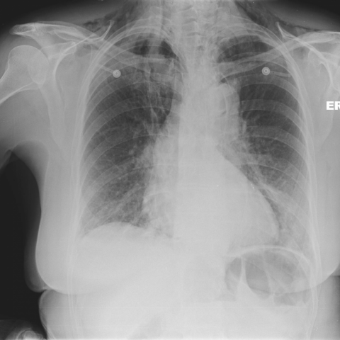

# Official gain: 8911_8353800871456

Post-run explicit answers: D **F**, M **F**, P **E**, reference **F**. Frozen runtime answers: D F, M F, P E; original records unchanged.

[Complete observable requests, tools and stages](../traces/8911_8353800871456.json) · [Original benchmark case](../../v12/results/cases/8911_8353800871456.md) · [D cached original observable request](../../direct_qwen60/requests/8911_8353800871456.json)

```text
Based on Figure 2, which statement most accurately describes the relationship between the pneumomediastinum and pneumopericardium, and what clinical insight does this provide regarding the patient's condition?

A) The pneumomediastinum is localized only to the lower mediastinum, while the pneumopericardium is extensive, indicating a high likelihood of cardiac tamponade.
B) The pneumomediastinum extends into the neck, while the pneumopericardium is confined to the cardiac silhouette, suggesting a severe rupture of the oesophagus with potential for mediastinitis.
C) Both pneumomediastinum and pneumopericardium are localized to the upper chest, indicating a minor rupture with limited risk of further complications.
D) The pneumomediastinum surrounds the heart and extends superiorly, while the pneumopericardium is minimal, suggesting the primary source of air is distal oesophageal perforation.
E) The pneumopericardium is extensive and overshadows the pneumomediastinum, indicating the air source is likely cardiac trauma rather than oesophageal perforation.
F) The pneumomediastinum is more pronounced than the pneumopericardium, extending into the neck, indicating significant oesophageal perforation consistent with Boerhaave's syndrome.
```



## D

```text
Answer: F  
Reason: Figure 2 shows extensive air in the mediastinum, including tracking into the neck (subcutaneous emphysema), with a visible pneumopericardium (air around the heart). This pattern—pneumomediastinum > pneumopericardium, with cervical extension—is classic for oesophageal rupture (e.g., Boerhaave’s syndrome), where air escapes from the oesophagus into the mediastinum and can dissect into the pericardial sac. Option F correctly identifies this relationship and clinical implication.
```

## M

```text
Looking at the tool outputs, I need to critically evaluate them since there's a discrepancy between what I visually observe and what the tools are reporting.

The chest_xray_classifier shows moderate probabilities for several conditions (around 0.4-0.5) but doesn't specifically identify pneumomediastinum or pneumopericardium as high-probability findings.

The chest_xray_report_generator states "the cardiomediastinal silhouette is normal" and "no evidence of pneumonia," which contradicts my visual assessment of air in the mediastinum and around the heart.

However, the xray_phrase_grounding tools did locate both pneumomediastinum and pneumopericardium with bounding boxes:
- Pneumomediastinum: [0.305, 0.135, 0.815, 0.685] - covering a large area from upper to lower mediastinum
- Pneumopericardium: [0.345, 0.295, 0.795, 0.705] - surrounding the cardiac silhouette

Visually examining Figure 2, I can see:
- Air lucency in the mediastinum, particularly along the left heart border and extending upward toward the neck
- Air surrounding the heart (pneumopericardium)
- The pattern suggests air tracking from a source, likely esophageal perforation

Looking at the answer choices:
A) Incorrect - no indication of cardiac tamponade
B) Partially correct about extension into neck, but the pneumopericardium isn't confined to cardiac silhouette - it's part of the same air collection
C) Incorrect - this is not minor; the air extends significantly
D) The pneumomediastinum does surround the heart and extend superiorly, but the pneumopericardium appears substantial, not minimal
E) Incorrect - the pneumomediastinum appears more extensive than pneumopericardium
F) This seems most accurate: pneumomediastinum is more pronounced, extends into the neck, and this pattern is classic for Boerhaave's syndrome (esophageal perforation)

Boerhaave's syndrome typically presents with pneumomediastinum that extends into the neck (subcutaneous emphysema) and often includes pneumopericardium. The air tracks from the esophageal rupture through the mediastinum.

Given the visual evidence of extensive pneumomediastinum extending superiorly into the neck region, and the clinical context of esophageal perforation being a common cause of this pattern, option F is the most accurate.

Return Answer: F followed by: The pneumomediastinum is more pronounced than the pneumopericardium and extends into the neck, which is characteristic of Boerhaave's syndrome (spontaneous esophageal rupture), indicating a serious condition requiring urgent intervention.
```

## P

```text
Answer: E) The pneumopericardium is extensive and overshadows the pneumomediastinum, indicating the air source is likely cardiac trauma rather than oesophageal perforation.

Evidence:  
1. No subcutaneous emphysema or air extension into the neck is visible, ruling out typical oesophageal rupture patterns (e.g., Boerhaave’s).  
2. Pericardial air appears as a well-defined, prominent lucency surrounding the heart, while mediastinal air is less conspicuous and diffuse.  
3. Although volume quantification is unreliable on 2D radiograph, the expert tool states pericardial air volume exceeds mediastinal air, supporting the visual impression of dominant pneumopericardium—more consistent with cardiac trauma than oesophageal perforation.
```

