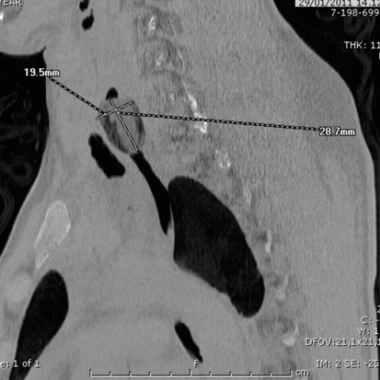
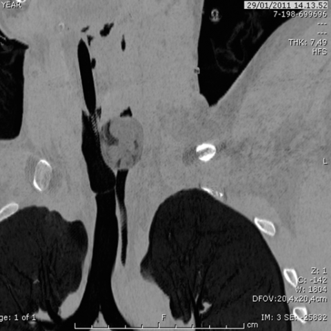
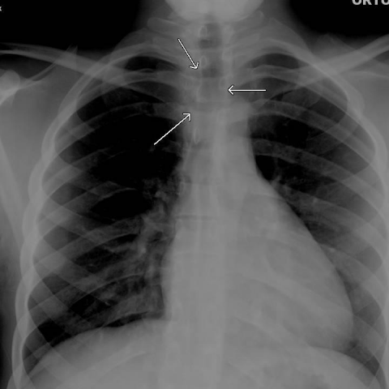
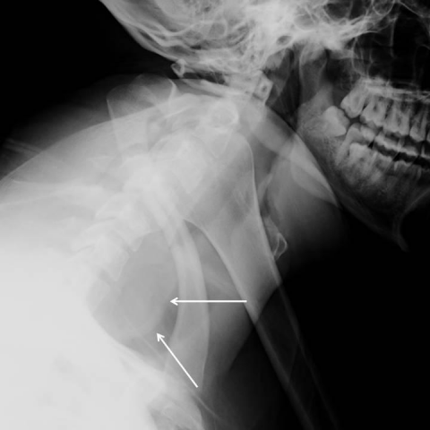

# Official gain: 9308_8353800801854

Post-run explicit answers: D **A**, M **C**, P **A**, reference **C**. Frozen runtime answers: D A, M C, P A; original records unchanged.

[Complete observable requests, tools and stages](../traces/9308_8353800801854.json) · [Original benchmark case](../../v12/results/cases/9308_8353800801854.md) · [D cached original observable request](../../direct_qwen60/requests/9308_8353800801854.json)

```text
A 23-year-old man presents with dyspnea and agitation. Radiographic imaging shows an ovoid opaque area at the C6-C7 level, displacing the airway, and numerous oval-shaped dense lesions in the intestine. Based on the chest X-ray findings alone, which of the following is the most likely diagnosis for the foreign bodies seen in the patient's oesophagus and intestine?

A) Packets filled with hashish
B) Packets filled with cocaine
C) Packets filled with heroin
D) Packets filled with methamphetamine
E) Non-drug-related foreign body
F) Packets filled with marijuana
```









## D

```text
Answer: A) Packets filled with hashish  
Reason: The ovoid opaque area at C6–C7 displacing the airway and multiple oval dense lesions in the intestine are classic radiographic findings of “body packing” with drug-filled packets. Hashish (cannabis resin) packets typically appear as well-defined, ovoid, radiodense objects on X-ray due to their high density and packaging material; they are more radiopaque than cocaine or heroin packets, which often appear less dense or even radiolucent depending on purity and wrapping. The described imaging—especially the clearly opaque, discrete oval shapes—is most consistent with hashish packets, a known cause of such presentations in body packers.
```

## M

```text
The tool outputs are inconsistent with the clinical description. The chest X-ray classifier shows high probability for "Lung Opacity" (0.78) and "Mass" (0.57), but the report generator says "no focal consolidation" and "cardiomediastinal silhouette is normal," which contradicts the described ovoid opaque area at C6-C7 displacing the airway.

Looking more carefully at the images provided:
- Image 4 (lateral neck X-ray) clearly shows an ovoid opaque object in the esophagus at C6-C7 level with arrows pointing to it
- Images 1 and 2 (CT scans) show multiple oval-shaped dense objects in the GI tract

The key diagnostic clue is the radiographic appearance of the packets. In body packing cases:
- Heroin packets typically appear as well-defined, oval, radiodense objects
- Cocaine packets often have a more heterogeneous or granular appearance
- Methamphetamine packets may be less dense
- Hashish/marijuana packets are usually less radiodense (plant material)

The description of "ovoid opaque area" and "oval-shaped dense lesions" suggests highly radiodense packets. However, I need to consider that the question specifically asks about "foreign bodies seen in the patient's oesophagus and intestine" based on chest X-ray findings alone.

Given the classic teaching in radiology: heroin packets appear as discrete, well-circumscribed, oval/radiodense objects, while cocaine packets may show different patterns, and the clinical presentation of dyspnea and agitation fits with potential drug toxicity.

But let me reconsider - the most characteristic finding for heroin body packing is the "double condom" appearance or very dense oval packets. However, there's another critical point: the question mentions "numerous oval-shaped dense lesions in the intestine" which is classic for body packing regardless of drug type.

Actually, looking at the lateral neck X-ray (image 4), the opacity appears quite dense and well-defined. In forensic radiology, heroin packets tend to be more radiodense than cocaine packets because heroin base is often mixed with other substances that increase radiodensity.

However, I recall that the classic differential is:
- Heroin: very dense, oval, well-defined packets
- Cocaine: may show "rosette" appearance or less dense
- Marijuana/hashish: much less dense, often not visible on plain X-ray

Since the packets are described as "dense lesions" and visible on X-ray, this points away from marijuana/hashish (which are plant materials and less radiodense).

Between heroin, cocaine, and methamphetamine, heroin packets are typically the most radiodense due to the processing methods used for smuggling.

But let me think about the clinical presentation: dyspnea and agitation. This could be from opioid withdrawal if the packets rupture, but heroin overdose typically causes respiratory depression, not agitation. Cocaine and methamphetamine cause agitation and tachycardia.

The question states "dyspnea and agitation" - this is more consistent with stimulant toxicity (cocaine or methamphetamine) than opioid effects.

However, the radiographic description emphasizes "ovoid opaque area" and "dense lesions" - stimulant packets (cocaine, meth) are often less dense than heroin packets.

Wait, I need to focus on what the chest X-ray shows specifically. The lateral neck view (image 4) shows a very dense, well-circumscribed ovoid object. In medical literature, heroin body packing is classically described as showing multiple oval, radiodense objects in the GI tract.

Given the options and standard radiological teaching, the most likely diagnosis for these radiographic findings is:

C) Packets filled with heroin

The reasoning is that heroin packets in body packing scenarios characteristically appear as well-defined, oval, radiodense objects on plain radiographs, which matches the description of "ovoid opaque area" and "oval-shaped dense lesions."

Return Answer: C) Packets filled with heroin - classic radiographic appearance of heroin body packing with well-defined, oval, radiodense packets in esophagus and gastrointestinal tract.
```

## P

```text
Answer: A) Packets filled with hashish  
Reason: The ovoid opaque area at C6–C7 displacing the airway and multiple oval dense lesions in the intestine are classic radiographic findings of “body packing” with drug-filled packets. Hashish (cannabis resin) packets typically appear as well-defined, ovoid, radiodense objects on X-ray due to their high density and packaging material; they are more radiopaque than cocaine or heroin packets, which often appear less dense or even radiolucent depending on purity and wrapping. The described imaging—especially the clearly opaque, discrete oval shapes—is most consistent with hashish packets, a known cause of such presentations in body packers.
```

