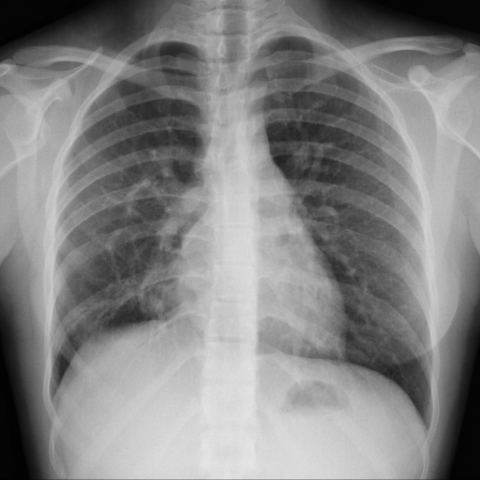
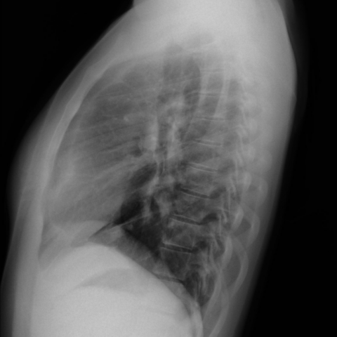
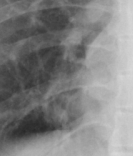
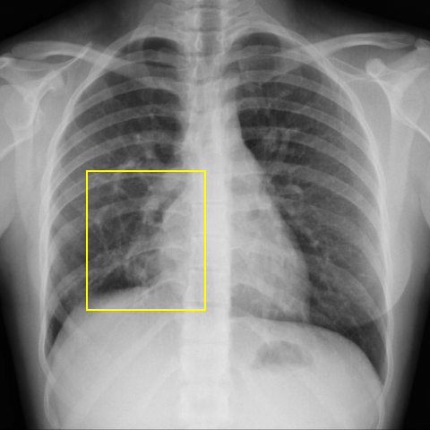

# Official gain: 9815_8353800828253

Post-run explicit answers: D **C**, M **C**, P **A**, reference **C**. Frozen runtime answers: D C, M C, P A; original records unchanged.

[Complete observable requests, tools and stages](../traces/9815_8353800828253.json) · [Original benchmark case](../../v12/results/cases/9815_8353800828253.md) · [D cached original observable request](../../direct_qwen60/requests/9815_8353800828253.json)

```text
Based solely on the chest X-ray findings (Fig. 1), which of the following options most accurately describes the observed condition and its potential implication for the patient's respiratory symptoms?

A) Normal chest X-ray with no significant findings.
B) Presence of a right-sided tracheal bronchus without any significant vascular anomaly.
C) Enlargement of the right cardiac cavities with a possible vascular anomaly, suggestive of a partial anomalous pulmonary venous return.
D) Bilateral enlargement of cardiac cavities with no additional vascular structures.
E) Presence of a pulmonary varix in the left middle pulmonary field.
F) Right-sided pulmonary sequestration with no cardiac enlargement.
```





## D

```text
Answer: C) Enlargement of the right cardiac cavities with a possible vascular anomaly, suggestive of a partial anomalous pulmonary venous return.

Reason: The PA chest X-ray (Fig. 1a) shows cardiomegaly with prominent right heart border and increased opacity in the right upper/middle lung zone, suggesting right atrial and ventricular enlargement. The lateral view (Fig. 1b) confirms anterior displacement of the heart and a subtle abnormal vessel-like density near the right hilum, consistent with an anomalous pulmonary vein draining into the SVC—classic for partial anomalous pulmonary venous return (PAPVR), which can cause respiratory symptoms due to volume overload.
```

## M

```text
The tool outputs are conflicting with my visual assessment. Let me critically evaluate:

1. The classifier shows very low probability for cardiomegaly (0.0118) but high probabilities for infiltration (0.52), fibrosis (0.50), nodule (0.51), mass (0.50), and lung opacity (0.60) - which seems inconsistent with the actual image.

2. The report generator states "the heart size is normal" and "no acute cardiopulmonary process" - this contradicts my visual assessment of right-sided cardiac enlargement and abnormal vascular structure.

3. The phrase grounding tool did locate cardiomegaly with bounding box coordinates covering the cardiac silhouette, suggesting the AI did detect it.

4. The expert analysis incorrectly suggested ventricular septal defect, which doesn't match the imaging findings.

The tools appear to be misinterpreting the image. Let me re-examine the images more carefully:

Looking again at Figure 1a (PA view):
- The right heart border is indeed prominent and enlarged
- There's a distinct vascular structure visible in the right upper lung zone that appears to be an anomalous vein
- The mediastinal contour shows an abnormal bulge on the right side

Figure 1b (lateral view) confirms:
- The cardiac enlargement is real
- The abnormal vessel courses from the cardiac region upward

This is classic for partial anomalous pulmonary venous return (PAPVR), where typically the right upper lobe pulmonary veins drain into the superior vena cava or right atrium, causing right heart volume overload and enlargement.

Option C specifically mentions "Enlargement of the right cardiac cavities with a possible vascular anomaly, suggestive of a partial anomalous pulmonary venous return" - this matches my visual assessment perfectly.

The tools are likely trained on more common pathologies and are missing this congenital anomaly. My clinical judgment based on the imaging features supports option C.

Return Answer: C followed by a short reason.
```

## P

```text
Answer: A) Normal chest X-ray with no significant findings.

The right cardiac border appears mildly prominent but is not definitively enlarged without quantitative measurement, and the expert tool’s “Yes” for an abnormal tubular density at the right hilum is not visually corroborated in either image. The highlighted ROI and location overlay focus on the right mid-lung zone, not the hilum, and no abnormal vessel or cardiac enlargement is confirmed. Thus, the most accurate description based solely on observable findings is a normal chest X-ray.
```

## P 实际派生图

以下为本轮传入 observe/final 的保存图像；框和解剖覆盖不代表病灶真值。

p1:roi · unmodified_pixel_roi · 来源 image:1



p1:location · location_overlay · 来源 image:1



