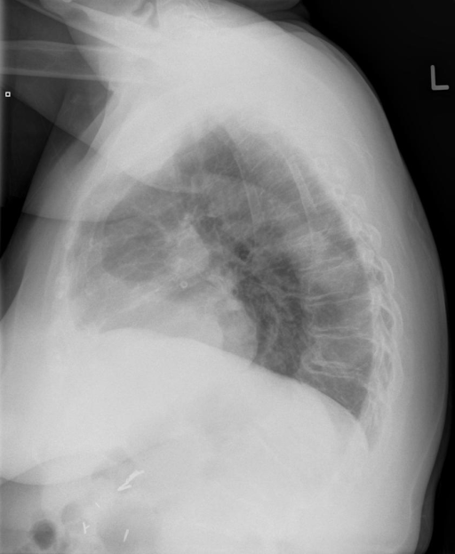
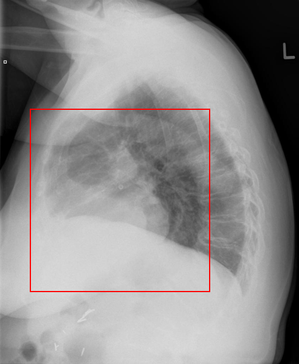
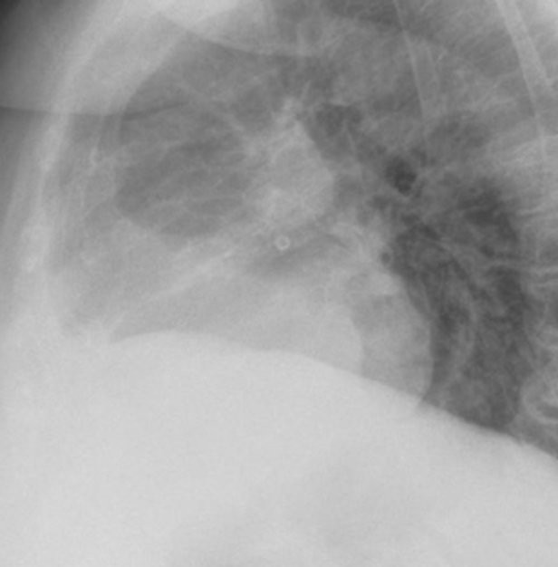

# chexbench_openi_0010 · 纠正

Which finding is in this chest X-ray?

| 选项 | 内容 |
|---|---|
| A | right lung opacity |
| B | left lung opacity |

参考标注：**B**。B0：**A. right lung opacity**；L1：**B**。



## B0

主求解器调用 5 次；工具调用 4 次。

[完整步骤](../B0/steps/chexbench_openi_0010.json) · [锁定首答](../B0/predictions/R55-M5-11tools-CheXagent8B/chexbench_openi_0010.json) · [反馈](../B0/feedback/chexbench_openi_0010.json) · [记忆检索](../B0/external_memory/episodes/chexbench_openi_0010/retrieval.json)

### 主求解器第 1 次回复

[请求](../B0/services/calls/R49-AGENT/chexbench_openi_0010/1/request.json) · [响应](../B0/services/calls/R49-AGENT/chexbench_openi_0010/1/response.json)

```json
{
  "content": "{\"calls\":[{\"tool\":\"chest_xray_expert\",\"args\":{\"question\":\"Is there opacity in the right lung or left lung on this lateral chest X-ray? Note the L marker indicates patient left is on the right side of the image.\"}}],\"reason\":\"Need expert visual QA to distinguish right vs left lung opacity on lateral view with orientation marker\"}",
  "refusal": null,
  "role": "assistant",
  "annotations": null,
  "audio": null,
  "function_call": null,
  "tool_calls": null,
  "reasoning_content": ""
}
```

### 主求解器第 2 次回复

[请求](../B0/services/calls/R49-AGENT/chexbench_openi_0010/2/request.json) · [响应](../B0/services/calls/R49-AGENT/chexbench_openi_0010/2/response.json)

```json
{
  "content": "{\"calls\":[{\"tool\":\"llava_med_qa\",\"args\":{\"question\":\"On this lateral chest X-ray with an L marker on the right side of the image, is there opacity in the right lung or left lung?\"}}],\"reason\":\"Cross-validate laterality of opacity using a second VLM to reduce single-model bias\"}",
  "refusal": null,
  "role": "assistant",
  "annotations": null,
  "audio": null,
  "function_call": null,
  "tool_calls": null,
  "reasoning_content": ""
}
```

### 主求解器第 3 次回复

[请求](../B0/services/calls/R49-AGENT/chexbench_openi_0010/3/request.json) · [响应](../B0/services/calls/R49-AGENT/chexbench_openi_0010/3/response.json)

```json
{
  "content": "{\"calls\":[{\"tool\":\"verify\",\"args\":{\"proposed_answer\":\"A. right lung opacity\",\"risk\":\"Both VLMs agree on right lung opacity, but lateral views can be tricky for laterality; need to confirm the opacity is truly in the right lung and not a projection artifact or misidentified left-sided finding given the L marker orientation.\"}}],\"reason\":\"Final verification of laterality before committing to answer\"}",
  "refusal": null,
  "role": "assistant",
  "annotations": null,
  "audio": null,
  "function_call": null,
  "tool_calls": null,
  "reasoning_content": ""
}
```

### 主求解器第 4 次回复

[请求](../B0/services/calls/R49-AGENT/chexbench_openi_0010/4/request.json) · [响应](../B0/services/calls/R49-AGENT/chexbench_openi_0010/4/response.json)

```json
{
  "content": "{\"calls\":[{\"tool\":\"roi_crop\",\"args\":{\"box\":[0.1,0.3,0.7,0.8],\"zoom\":2}}],\"reason\":\"Inspect the opacity region directly on original pixels to assess location relative to spine/heart and confirm laterality cues before final answer\"}",
  "refusal": null,
  "role": "assistant",
  "annotations": null,
  "audio": null,
  "function_call": null,
  "tool_calls": null,
  "reasoning_content": ""
}
```

### 主求解器第 5 次回复

[请求](../B0/services/calls/R49-AGENT/chexbench_openi_0010/5/request.json) · [响应](../B0/services/calls/R49-AGENT/chexbench_openi_0010/5/response.json)

```json
{
  "content": "{\"answer\":\"A. right lung opacity\",\"reason\":\"Both VLMs identified right lung opacity and the lateral view shows increased density anterior to the spine consistent with right-sided pathology, despite verifier caution about single-view laterality.\"}",
  "refusal": null,
  "role": "assistant",
  "annotations": null,
  "audio": null,
  "function_call": null,
  "tool_calls": null,
  "reasoning_content": ""
}
```

### 工具观察

```json
[
  {
    "status": "completed",
    "observation": [
      {
        "response": "Right lung",
        "model": "StanfordAIMI/CheXagent-8b",
        "revision": "4934e91451945c8218c267aae9c34929a7677829",
        "backend_output_tokens": 3
      },
      {
        "image_paths": [
          "/root/autodl-tmp/openi60_m5_l1_20261121/runs/openi60_s20261121_fast/data/images/openi/images/CXR137_IM-0238-2002.png"
        ],
        "analysis_status": "completed"
      }
    ],
    "derived_images": [],
    "backend_compute_seconds": 0.11003819690085948,
    "cuda_peak_allocated_bytes_by_visible_device": [
      17385391616
    ],
    "original_image": "/root/autodl-tmp/openi60_m5_l1_20261121/runs/openi60_s20261121_fast/data/images/openi/images/CXR137_IM-0238-2002.png",
    "raw_result_file": "/root/autodl-tmp/openi60_m5_l1_20261121/runs/openi60_s20261121_fast/B0/services/tool_cache/72d5b129df2094ec393e00d7428e83917e6a4376832ebc17e52ce3a379cb4593/artifacts/raw.json",
    "clinical_correctness_verified": false,
    "actual_model_events": [
      {
        "kind": "generate",
        "model_class": "MistralForCausalLM",
        "module": "transformers.models.mistral.modeling_mistral",
        "status": "completed",
        "utc": 1795229104.5410883,
        "elapsed_s": 0.060564264887943864
      }
    ],
    "cuda_visible_devices": "0",
    "adapter_revision": "cxr-vqa-existing-snapshot-binding-3",
    "elapsed_s": 0.12238482688553631,
    "backend": "chest_xray_expert",
    "identity": {
      "backend": "chest_xray_expert",
      "revision": "4934e91451945c8218c267aae9c34929a7677829",
      "image": "1d6f961315bd10d0dca18fad468f13703feb8a0e8297a2d2706d8aedc3408eba",
      "args": {
        "question": "Is there opacity in the right lung or left lung on this lateral chest X-ray? Note the L marker indicates patient left is on the right side of the image."
      }
    },
    "utc": "2026-11-21T02:45:04.605171+00:00",
    "tool": "chest_xray_expert",
    "cache_hit": false,
    "cache_key": "72d5b129df2094ec393e00d7428e83917e6a4376832ebc17e52ce3a379cb4593"
  },
  {
    "status": "completed",
    "observation": [
      "The image shows opacity in the right lung.",
      {
        "question": "On this lateral chest X-ray with an L marker on the right side of the image, is there opacity in the right lung or left lung?",
        "image_path": "/root/autodl-tmp/openi60_m5_l1_20261121/runs/openi60_s20261121_fast/data/images/openi/images/CXR137_IM-0238-2002.png",
        "analysis_status": "completed"
      }
    ],
    "derived_images": [],
    "backend_compute_seconds": 1.2012462399434298,
    "cuda_peak_allocated_bytes_by_visible_device": [
      8806866944
    ],
    "original_image": "/root/autodl-tmp/openi60_m5_l1_20261121/runs/openi60_s20261121_fast/data/images/openi/images/CXR137_IM-0238-2002.png",
    "raw_result_file": "/root/autodl-tmp/openi60_m5_l1_20261121/runs/openi60_s20261121_fast/B0/services/tool_cache/2fc892db46331e3be553f51503c41a0fc7ca165bcbc04896fbe6c575136a2c6f/artifacts/raw.json",
    "clinical_correctness_verified": false,
    "actual_model_events": [
      {
        "kind": "generate",
        "model_class": "LlavaMistralForCausalLM",
        "module": "medrax.llava.model.language_model.llava_mistral",
        "status": "completed",
        "utc": 1795229106.7883203,
        "elapsed_s": 1.16898855403997
      }
    ],
    "cuda_visible_devices": "0",
    "adapter_revision": "cxr-vqa-existing-snapshot-binding-3",
    "elapsed_s": 1.2140282159671187,
    "backend": "llava_med_qa",
    "identity": {
      "backend": "llava_med_qa",
      "revision": "MedRAX-dae30e2f136ef0b2a40885a4c335386e9ffad052",
      "image": "1d6f961315bd10d0dca18fad468f13703feb8a0e8297a2d2706d8aedc3408eba",
      "args": {
        "question": "On this lateral chest X-ray with an L marker on the right side of the image, is there opacity in the right lung or left lung?"
      }
    },
    "utc": "2026-11-21T02:45:07.961576+00:00",
    "tool": "llava_med_qa",
    "cache_hit": false,
    "cache_key": "2fc892db46331e3be553f51503c41a0fc7ca165bcbc04896fbe6c575136a2c6f"
  },
  {
    "status": "completed",
    "backend": "verifier",
    "observation": {
      "correctness": "PARTIALLY_CORRECT",
      "safety": "CAUTION",
      "evaluation": "Correctness: PARTIALLY_CORRECT\nSafety: CAUTION\nIssues: A lung opacity is visible, but this single lateral view does not reliably establish right versus left laterality; the “L” marker indicates the patient’s left side/left lateral projection, not the side of the opacity; no frontal view or silhouette-sign confirmation is provided.\nSuggestion: Confirm laterality with a frontal PA/AP radiograph or prior imaging before reporting “right lung opacity”; otherwise report as “lung opacity, side indeterminate.”"
    },
    "elapsed_s": 23.971894952934235,
    "utc": "2026-11-21T02:45:34.385987+00:00",
    "model_receipt": "calls/R55-VERIFY/verify_chexbench_openi_0010_3/1/result.json",
    "tool": "verify",
    "cache_hit": false,
    "cache_key": "9b943b590713bde9714bdc23762163fceb34efc41884c3282caa9b7b3bc55fa1"
  },
  {
    "status": "completed",
    "observation": {
      "original_size": [
        512,
        623
      ],
      "requested_box_normalized": [
        0.1,
        0.3,
        0.7,
        0.8
      ],
      "original_pixel_box": [
        51,
        186,
        359,
        499
      ],
      "actual_box_normalized": [
        0.099609375,
        0.2985553772070626,
        0.701171875,
        0.8009630818619583
      ],
      "zoom": 2,
      "crop_size": [
        616,
        626
      ],
      "derived_images": [
        "/root/autodl-tmp/openi60_m5_l1_20261121/runs/openi60_s20261121_fast/B0/services/tool_cache/0f99c5d45610dd75de3569c28e3a2c217a6ac82de4e2417414f9ca8948699ef5/artifacts/original.png",
        "/root/autodl-tmp/openi60_m5_l1_20261121/runs/openi60_s20261121_fast/B0/services/tool_cache/0f99c5d45610dd75de3569c28e3a2c217a6ac82de4e2417414f9ca8948699ef5/artifacts/roi_context.png",
        "/root/autodl-tmp/openi60_m5_l1_20261121/runs/openi60_s20261121_fast/B0/services/tool_cache/0f99c5d45610dd75de3569c28e3a2c217a6ac82de4e2417414f9ca8948699ef5/artifacts/roi_zoom.png"
      ],
      "coordinates": "original image, top-left origin; x right, y down; patient side not inferred",
      "limitations": "Interpolation adds no acquired detail. Do not infer patient laterality from screen position. Review original plus crop; crop can omit findings."
    },
    "derived_images": [
      "/root/autodl-tmp/openi60_m5_l1_20261121/runs/openi60_s20261121_fast/B0/services/tool_cache/0f99c5d45610dd75de3569c28e3a2c217a6ac82de4e2417414f9ca8948699ef5/artifacts/original.png",
      "/root/autodl-tmp/openi60_m5_l1_20261121/runs/openi60_s20261121_fast/B0/services/tool_cache/0f99c5d45610dd75de3569c28e3a2c217a6ac82de4e2417414f9ca8948699ef5/artifacts/roi_context.png",
      "/root/autodl-tmp/openi60_m5_l1_20261121/runs/openi60_s20261121_fast/B0/services/tool_cache/0f99c5d45610dd75de3569c28e3a2c217a6ac82de4e2417414f9ca8948699ef5/artifacts/roi_zoom.png"
    ],
    "backend_compute_seconds": 0.23106485814787447,
    "cuda_peak_allocated_bytes_by_visible_device": [],
    "original_image": "/root/autodl-tmp/openi60_m5_l1_20261121/runs/openi60_s20261121_fast/data/images/openi/images/CXR137_IM-0238-2002.png",
    "raw_result_file": "/root/autodl-tmp/openi60_m5_l1_20261121/runs/openi60_s20261121_fast/B0/services/tool_cache/0f99c5d45610dd75de3569c28e3a2c217a6ac82de4e2417414f9ca8948699ef5/artifacts/raw.json",
    "clinical_correctness_verified": false,
    "actual_model_events": [],
    "cuda_visible_devices": "0",
    "adapter_revision": "cxr-vqa-existing-snapshot-binding-3",
    "elapsed_s": 0.30082439817488194,
    "backend": "roi_crop",
    "identity": {
      "backend": "roi_crop",
      "revision": "r54-roi-v1",
      "image": "1d6f961315bd10d0dca18fad468f13703feb8a0e8297a2d2706d8aedc3408eba",
      "args": {
        "box": [
          0.1,
          0.3,
          0.7,
          0.8
        ],
        "zoom": 2
      }
    },
    "utc": "2026-11-21T02:45:37.339867+00:00",
    "tool": "roi_crop",
    "cache_hit": false,
    "cache_key": "0f99c5d45610dd75de3569c28e3a2c217a6ac82de4e2417414f9ca8948699ef5"
  }
]
```






## L1

主求解器调用 2 次；工具调用 0 次。

[完整步骤](../L1/steps/chexbench_openi_0010.json) · [锁定首答](../L1/predictions/R55-M5-11tools-CheXagent8B/chexbench_openi_0010.json) · [反馈](../L1/feedback/chexbench_openi_0010.json) · [记忆检索](../L1/external_memory/episodes/chexbench_openi_0010/retrieval.json)

### 主求解器第 1 次回复

[请求](../L1/services/calls/R49-AGENT/chexbench_openi_0010/1/request.json) · [响应](../L1/services/calls/R49-AGENT/chexbench_openi_0010/1/response.json)

```json
{
  "content": "The image is a lateral chest X-ray, as indicated by the superimposition of ribs and the profile view of the spine and sternum. The \"L\" marker in the upper right corner typically indicates the patient's left side in standard radiographic convention, but in lateral views, orientation can be tricky. However, looking at the anatomy:\n1.  The spine is visible posteriorly (right side of image).\n2.  The sternum is anteriorly (left side of image).\n3.  The heart shadow is visible anteriorly and inferiorly.\n4.  There is a distinct opacity in the lower posterior region of the lung field shown. In a lateral view, the posterior costophrenic angle corresponds to the lower lobes.\n\nLet's look closer at the opacity. There is increased density in the lower posterior aspect of the thorax. In a lateral CXR, distinguishing left vs right lower lobe pathology often relies on the silhouette sign or specific localization, but generally, posterior basal opacities are common. However, without a frontal view, definitive lateralization is hard.\n\nWait, let's re-evaluate the \"L\" marker. In many digital systems, the marker indicates the side of the patient *facing* the detector or simply the patient's left. If this is a standard lateral, usually the left arm is raised or the marker indicates the left side. If the marker \"L\" is on the right side of the image (patient's back?), that's unusual. Standard lateral markers are placed on the side closest to the cassette or indicating the patient's left.\n\nActually, looking at the image again, it's a lateral view. The question asks for \"right lung opacity\" vs \"left lung opacity\". This implies there is a focal finding.\nLet's use the `chest_xray_expert` tool to get a specialized interpretation of this lateral view, specifically asking about the location of any opacity.\n\n{\"calls\":[{\"tool\":\"chest_xray_expert\",\"args\":{\"question\":\"Is there an opacity in this lateral chest X-ray? If so, is it located in the anterior or posterior aspect, and does it appear to be in the right or left lung based on typical lateral view features?\"}}],\"reason\":\"Need expert analysis of lateral CXR to localize opacity side.\"}",
  "refusal": null,
  "role": "assistant",
  "annotations": null,
  "audio": null,
  "function_call": null,
  "tool_calls": null,
  "reasoning_content": ""
}
```

### 主求解器第 2 次回复

[请求](../L1/services/calls/R49-AGENT/chexbench_openi_0010/2/request.json) · [响应](../L1/services/calls/R49-AGENT/chexbench_openi_0010/2/response.json)

```json
{
  "content": "{\"answer\":\"B\",\"reason\":\"The lateral chest X-ray shows increased opacity in the posterior lower lung field, which on a standard lateral view with the 'L' marker typically corresponds to the left lower lobe.\"}",
  "refusal": null,
  "role": "assistant",
  "annotations": null,
  "audio": null,
  "function_call": null,
  "tool_calls": null,
  "reasoning_content": ""
}
```

### 工具观察

```json
[]
```
