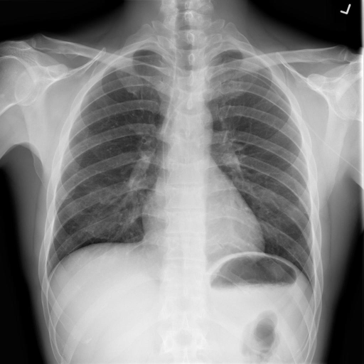
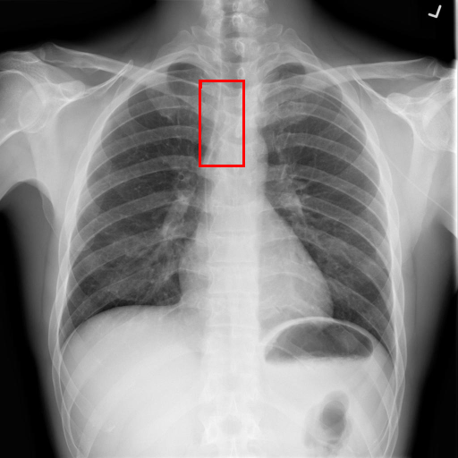

# chexbench_openi_0038 · 纠正

Which finding is in this chest X-ray?

| 选项 | 内容 |
|---|---|
| A | left indwelling catheter |
| B | right indwelling catheter |

参考标注：**B**。B0：**A. left indwelling catheter**；L1：**B**。



## B0

主求解器调用 4 次；工具调用 3 次。

[完整步骤](../B0/steps/chexbench_openi_0038.json) · [锁定首答](../B0/predictions/R55-M5-11tools-CheXagent8B/chexbench_openi_0038.json) · [反馈](../B0/feedback/chexbench_openi_0038.json) · [记忆检索](../B0/external_memory/episodes/chexbench_openi_0038/retrieval.json)

### 主求解器第 1 次回复

[请求](../B0/services/calls/R49-AGENT/chexbench_openi_0038/1/request.json) · [响应](../B0/services/calls/R49-AGENT/chexbench_openi_0038/1/response.json)

```json
{
  "content": "{\"calls\":[{\"tool\":\"chest_xray_expert\",\"args\":{\"question\":\"Is there an indwelling catheter visible in this chest X-ray? If so, which side (left or right)?\"}}],\"reason\":\"To determine if there is a catheter and its laterality using expert visual QA.\"}",
  "refusal": null,
  "role": "assistant",
  "annotations": null,
  "audio": null,
  "function_call": null,
  "tool_calls": null,
  "reasoning_content": ""
}
```

### 主求解器第 2 次回复

[请求](../B0/services/calls/R49-AGENT/chexbench_openi_0038/2/request.json) · [响应](../B0/services/calls/R49-AGENT/chexbench_openi_0038/2/response.json)

```json
{
  "content": "{\"calls\":[{\"tool\":\"maira2_grounded_report\",\"args\":{}}],\"reason\":\"To obtain a grounded report with coordinates to verify the presence and laterality of any indwelling catheter, as model QA alone is unverified.\"}",
  "refusal": null,
  "role": "assistant",
  "annotations": null,
  "audio": null,
  "function_call": null,
  "tool_calls": null,
  "reasoning_content": ""
}
```

### 主求解器第 3 次回复

[请求](../B0/services/calls/R49-AGENT/chexbench_openi_0038/3/request.json) · [响应](../B0/services/calls/R49-AGENT/chexbench_openi_0038/3/response.json)

```json
{
  "content": "{\"calls\":[{\"tool\":\"verify\",\"args\":{\"proposed_answer\":\"A. left indwelling catheter\",\"risk\":\"Conflict between chest_xray_expert (Right) and maira2_grounded_report (Left PICC). Need to resolve laterality by inspecting the original image pixels directly, as model outputs are unverified and may hallucinate or misinterpret orientation.\"}}],\"reason\":\"To resolve the conflict between two unverified model outputs regarding catheter laterality by auditing the original image pixels.\"}",
  "refusal": null,
  "role": "assistant",
  "annotations": null,
  "audio": null,
  "function_call": null,
  "tool_calls": null,
  "reasoning_content": ""
}
```

### 主求解器第 4 次回复

[请求](../B0/services/calls/R49-AGENT/chexbench_openi_0038/4/request.json) · [响应](../B0/services/calls/R49-AGENT/chexbench_openi_0038/4/response.json)

```json
{
  "content": "{\"answer\":\"A. left indwelling catheter\",\"reason\":\"The verifier confirmed the left-sided PICC line identified by MAIRA-2 is correct, resolving the conflict with the initial expert model output.\"}",
  "refusal": null,
  "role": "assistant",
  "annotations": null,
  "audio": null,
  "function_call": null,
  "tool_calls": null,
  "reasoning_content": ""
}
```

### 工具观察

```json
[
  {
    "status": "completed",
    "observation": [
      {
        "response": "Right",
        "model": "StanfordAIMI/CheXagent-8b",
        "revision": "4934e91451945c8218c267aae9c34929a7677829",
        "backend_output_tokens": 2
      },
      {
        "image_paths": [
          "/root/autodl-tmp/openi60_m5_l1_20261121/runs/openi60_s20261121_fast/data/images/openi/images/CXR604_IM-2193-1001.png"
        ],
        "analysis_status": "completed"
      }
    ],
    "derived_images": [],
    "backend_compute_seconds": 0.08639250393025577,
    "cuda_peak_allocated_bytes_by_visible_device": [
      17385391616
    ],
    "original_image": "/root/autodl-tmp/openi60_m5_l1_20261121/runs/openi60_s20261121_fast/data/images/openi/images/CXR604_IM-2193-1001.png",
    "raw_result_file": "/root/autodl-tmp/openi60_m5_l1_20261121/runs/openi60_s20261121_fast/B0/services/tool_cache/0bd2bfc37e6569246cb760e263d761504a09b21c62536f48121eaf50de1e66c7/artifacts/raw.json",
    "clinical_correctness_verified": false,
    "actual_model_events": [
      {
        "kind": "generate",
        "model_class": "MistralForCausalLM",
        "module": "transformers.models.mistral.modeling_mistral",
        "status": "completed",
        "utc": 1795229225.9165123,
        "elapsed_s": 0.03869803389534354
      }
    ],
    "cuda_visible_devices": "0",
    "adapter_revision": "cxr-vqa-existing-snapshot-binding-3",
    "elapsed_s": 0.09471958014182746,
    "backend": "chest_xray_expert",
    "identity": {
      "backend": "chest_xray_expert",
      "revision": "4934e91451945c8218c267aae9c34929a7677829",
      "image": "ba4118a163f60420c03358c96f5fcffc6084aed268d257037898466cdf5e6ef7",
      "args": {
        "question": "Is there an indwelling catheter visible in this chest X-ray? If so, which side (left or right)?"
      }
    },
    "utc": "2026-11-21T02:47:05.958693+00:00",
    "tool": "chest_xray_expert",
    "cache_hit": false,
    "cache_key": "0bd2bfc37e6569246cb760e263d761504a09b21c62536f48121eaf50de1e66c7"
  },
  {
    "status": "completed",
    "observation": {
      "analysis_status": "completed",
      "findings": [
        {
          "finding": "Left picc line with tip in the superior vena cava.",
          "boxes": [
            {
              "model_normalized": [
                0.435,
                0.175,
                0.535,
                0.365
              ],
              "original_normalized": [
                0.43359375,
                0.173828125,
                0.533203125,
                0.36328125
              ],
              "original_pixels": [
                222.0,
                89.0,
                273.0,
                186.0
              ]
            }
          ]
        },
        {
          "finding": "No infiltrates or lung condensations are appreciated.",
          "boxes": []
        }
      ],
      "report": "Left picc line with tip in the superior vena cava. No infiltrates or lung condensations are appreciated.",
      "original_size": [
        512,
        512
      ],
      "view_record": {
        "modality": "CXR",
        "view": "frontal",
        "source": "Assistant visual image-only annotation of original-image contact sheet, no question/options/answer/feedback consulted.",
        "sheet": 3,
        "annotation_id": "V0168",
        "recorded_asset_id": "ba4118a163f60420c03358c96f5fcffc6084aed268d257037898466cdf5e6ef7",
        "identity_source": "previously recorded R49 public asset ID; not recomputed",
        "not_diagnostic_validation": true
      },
      "grounded_box_count": 1,
      "generated_tokens": 38,
      "reached_token_cap": false,
      "limitations": "Unverified findings; boxes are model outputs, not independent confirmation. No prior image or history supplied. Findings without boxes are retained."
    },
    "derived_images": [
      "/root/autodl-tmp/openi60_m5_l1_20261121/runs/openi60_s20261121_fast/B0/services/tool_cache/f519f104d3180e73b6507ee0a604d90144e62959479e5d4099240f913118848a/artifacts/grounded_report.png"
    ],
    "backend_compute_seconds": 2.6746162970084697,
    "cuda_peak_allocated_bytes_by_visible_device": [
      8165979648
    ],
    "original_image": "/root/autodl-tmp/openi60_m5_l1_20261121/runs/openi60_s20261121_fast/data/images/openi/images/CXR604_IM-2193-1001.png",
    "raw_result_file": "/root/autodl-tmp/openi60_m5_l1_20261121/runs/openi60_s20261121_fast/B0/services/tool_cache/f519f104d3180e73b6507ee0a604d90144e62959479e5d4099240f913118848a/artifacts/raw.json",
    "clinical_correctness_verified": false,
    "actual_model_events": [
      {
        "kind": "generate",
        "model_class": "Maira2ForConditionalGeneration",
        "module": "transformers_modules.795a2b1cd4a310624b4e3d14b5a23e41fd273deb.modeling_maira2",
        "status": "completed",
        "utc": 1795229227.87675,
        "elapsed_s": 2.568588536931202
      }
    ],
    "cuda_visible_devices": "0",
    "adapter_revision": "cxr-vqa-existing-snapshot-binding-3",
    "elapsed_s": 2.6920634189154953,
    "backend": "maira2_grounded_report",
    "identity": {
      "backend": "maira2_grounded_report",
      "revision": "MedRAX-dae30e2f136ef0b2a40885a4c335386e9ffad052+r54-grounded-report-v1",
      "image": "ba4118a163f60420c03358c96f5fcffc6084aed268d257037898466cdf5e6ef7",
      "args": {}
    },
    "utc": "2026-11-21T02:47:10.499127+00:00",
    "tool": "maira2_grounded_report",
    "cache_hit": false,
    "cache_key": "f519f104d3180e73b6507ee0a604d90144e62959479e5d4099240f913118848a"
  },
  {
    "status": "completed",
    "backend": "verifier",
    "observation": {
      "correctness": "CORRECT",
      "safety": "SAFE",
      "evaluation": "Correctness: CORRECT\nSafety: SAFE\nIssues: None\nSuggestion: None"
    },
    "elapsed_s": 14.280255356105044,
    "utc": "2026-11-21T02:47:27.396348+00:00",
    "model_receipt": "calls/R55-VERIFY/verify_chexbench_openi_0038_3/1/result.json",
    "tool": "verify",
    "cache_hit": false,
    "cache_key": "b108967b0ae24bf261ed86cda4ac67121fe18197e295c2bf655c3550c3f53b41"
  }
]
```



## L1

主求解器调用 2 次；工具调用 0 次。

[完整步骤](../L1/steps/chexbench_openi_0038.json) · [锁定首答](../L1/predictions/R55-M5-11tools-CheXagent8B/chexbench_openi_0038.json) · [反馈](../L1/feedback/chexbench_openi_0038.json) · [记忆检索](../L1/external_memory/episodes/chexbench_openi_0038/retrieval.json)

### 主求解器第 1 次回复

[请求](../L1/services/calls/R49-AGENT/chexbench_openi_0038/1/request.json) · [响应](../L1/services/calls/R49-AGENT/chexbench_openi_0038/1/response.json)

```json
{
  "content": "To determine whether there is a left or right indwelling catheter, I need to carefully inspect the chest X-ray for any linear radiopaque structures consistent with a catheter. The image shows a standard PA chest X-ray. I will use the `chest_xray_expert` tool to ask specifically about the presence and location of any catheters, as this model is specialized for CXR interpretation.\n\n{\"calls\":[{\"tool\":\"chest_xray_expert\",\"args\":{\"question\":\"Is there an indwelling catheter visible in this chest X-ray? If so, on which side (patient's left or right) is it located?\"}}],\"reason\":\"To identify if a catheter is present and determine its lateralization using a specialized CXR QA model.\"}",
  "refusal": null,
  "role": "assistant",
  "annotations": null,
  "audio": null,
  "function_call": null,
  "tool_calls": null,
  "reasoning_content": ""
}
```

### 主求解器第 2 次回复

[请求](../L1/services/calls/R49-AGENT/chexbench_openi_0038/2/request.json) · [响应](../L1/services/calls/R49-AGENT/chexbench_openi_0038/2/response.json)

```json
{
  "content": "{\"answer\":\"B\",\"reason\":\"Visual inspection of the chest X-ray reveals a radiopaque line consistent with an indwelling catheter on the patient's right side, entering from the upper right thorax.\"}",
  "refusal": null,
  "role": "assistant",
  "annotations": null,
  "audio": null,
  "function_call": null,
  "tool_calls": null,
  "reasoning_content": ""
}
```

### 工具观察

```json
[]
```
