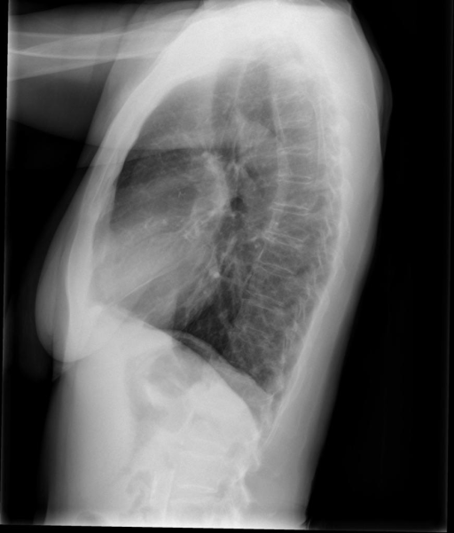
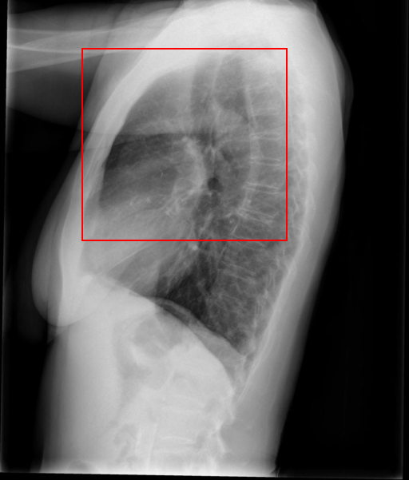
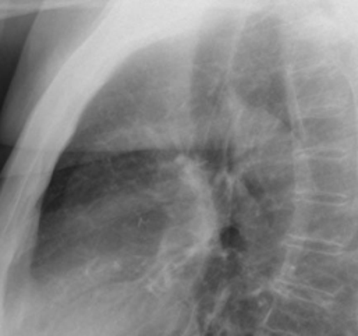

# chexbench_openi_0178 · 误改

Which finding is in this chest X-ray?

| 选项 | 内容 |
|---|---|
| A | left upper lobe pulmonary atelectasis |
| B | right upper lobe pulmonary atelectasis |

参考标注：**B**。B0：**B. right upper lobe pulmonary atelectasis**；L1：**A**。



## B0

主求解器调用 5 次；工具调用 4 次。

[完整步骤](../B0/steps/chexbench_openi_0178.json) · [锁定首答](../B0/predictions/R55-M5-11tools-CheXagent8B/chexbench_openi_0178.json) · [反馈](../B0/feedback/chexbench_openi_0178.json) · [记忆检索](../B0/external_memory/episodes/chexbench_openi_0178/retrieval.json)

### 主求解器第 1 次回复

[请求](../B0/services/calls/R49-AGENT/chexbench_openi_0178/1/request.json) · [响应](../B0/services/calls/R49-AGENT/chexbench_openi_0178/1/response.json)

```json
{
  "content": "{\"calls\":[{\"tool\":\"chest_xray_expert\",\"args\":{\"question\":\"Is there evidence of left upper lobe or right upper lobe pulmonary atelectasis in this lateral chest X-ray? Describe the location of any opacity or volume loss.\"}}],\"reason\":\"To distinguish between left and right upper lobe atelectasis on a lateral view, I need expert analysis of the opacity location relative to the oblique fissure and hilum.\"}",
  "refusal": null,
  "role": "assistant",
  "annotations": null,
  "audio": null,
  "function_call": null,
  "tool_calls": null,
  "reasoning_content": ""
}
```

### 主求解器第 2 次回复

[请求](../B0/services/calls/R49-AGENT/chexbench_openi_0178/2/request.json) · [响应](../B0/services/calls/R49-AGENT/chexbench_openi_0178/2/response.json)

```json
{
  "content": "{\"calls\":[{\"tool\":\"llava_med_qa\",\"args\":{\"question\":\"On this lateral chest X-ray, is there an opacity in the anterior upper lung zone consistent with right upper lobe atelectasis, or a posterior/superior opacity consistent with left upper lobe atelectasis? Describe the location of any increased density.\"}}],\"reason\":\"To cross-validate the CheXagent finding and specifically localize the opacity on the lateral view to distinguish RUL vs LUL atelectasis based on anatomical position (anterior vs posterior/superior).\"}",
  "refusal": null,
  "role": "assistant",
  "annotations": null,
  "audio": null,
  "function_call": null,
  "tool_calls": null,
  "reasoning_content": ""
}
```

### 主求解器第 3 次回复

[请求](../B0/services/calls/R49-AGENT/chexbench_openi_0178/3/request.json) · [响应](../B0/services/calls/R49-AGENT/chexbench_openi_0178/3/response.json)

```json
{
  "content": "{\"calls\":[{\"tool\":\"verify\",\"args\":{\"proposed_answer\":\"B. right upper lobe pulmonary atelectasis\",\"risk\":\"Both CheXagent and LLaVA-Med identified an anterior upper zone opacity consistent with RUL atelectasis, but tool outputs are unverified. Need to confirm the opacity is truly anterior (RUL) rather than posterior/superior (LUL) on this lateral view before finalizing.\"}}],\"reason\":\"To audit the consensus finding of anterior upper zone opacity against the original lateral image pixels to ensure correct side assignment before final answer.\"}",
  "refusal": null,
  "role": "assistant",
  "annotations": null,
  "audio": null,
  "function_call": null,
  "tool_calls": null,
  "reasoning_content": ""
}
```

### 主求解器第 4 次回复

[请求](../B0/services/calls/R49-AGENT/chexbench_openi_0178/4/request.json) · [响应](../B0/services/calls/R49-AGENT/chexbench_openi_0178/4/response.json)

```json
{
  "content": "{\"calls\":[{\"tool\":\"roi_crop\",\"args\":{\"box\":[0.2,0.1,0.7,0.5],\"zoom\":2}}],\"reason\":\"To visually inspect the anterior upper lung zone on the lateral view at higher resolution to confirm the presence and location of opacity consistent with RUL atelectasis.\"}",
  "refusal": null,
  "role": "assistant",
  "annotations": null,
  "audio": null,
  "function_call": null,
  "tool_calls": null,
  "reasoning_content": ""
}
```

### 主求解器第 5 次回复

[请求](../B0/services/calls/R49-AGENT/chexbench_openi_0178/5/request.json) · [响应](../B0/services/calls/R49-AGENT/chexbench_openi_0178/5/response.json)

```json
{
  "content": "{\"answer\":\"B. right upper lobe pulmonary atelectasis\",\"reason\":\"The lateral chest X-ray shows increased opacity in the anterior upper lung zone, which is anatomically consistent with right upper lobe atelectasis.\"}",
  "refusal": null,
  "role": "assistant",
  "annotations": null,
  "audio": null,
  "function_call": null,
  "tool_calls": null,
  "reasoning_content": ""
}
```

### 工具观察

```json
[
  {
    "status": "completed",
    "observation": [
      {
        "response": "Right upper lobe",
        "model": "StanfordAIMI/CheXagent-8b",
        "revision": "4934e91451945c8218c267aae9c34929a7677829",
        "backend_output_tokens": 5
      },
      {
        "image_paths": [
          "/root/autodl-tmp/openi60_m5_l1_20261121/runs/openi60_s20261121_fast/data/images/openi/images/CXR2610_IM-1101-1002.png"
        ],
        "analysis_status": "completed"
      }
    ],
    "derived_images": [],
    "backend_compute_seconds": 0.1567431481089443,
    "cuda_peak_allocated_bytes_by_visible_device": [
      17385391616
    ],
    "original_image": "/root/autodl-tmp/openi60_m5_l1_20261121/runs/openi60_s20261121_fast/data/images/openi/images/CXR2610_IM-1101-1002.png",
    "raw_result_file": "/root/autodl-tmp/openi60_m5_l1_20261121/runs/openi60_s20261121_fast/B0/services/tool_cache/2793b2fdaa5d2ae02c870211d30ad3794d029b4ac57a68d24afdb9063d0b272e/artifacts/raw.json",
    "clinical_correctness_verified": false,
    "actual_model_events": [
      {
        "kind": "generate",
        "model_class": "MistralForCausalLM",
        "module": "transformers.models.mistral.modeling_mistral",
        "status": "completed",
        "utc": 1795230202.0038238,
        "elapsed_s": 0.08571003400720656
      }
    ],
    "cuda_visible_devices": "0",
    "adapter_revision": "cxr-vqa-existing-snapshot-binding-3",
    "elapsed_s": 0.16883400292135775,
    "backend": "chest_xray_expert",
    "identity": {
      "backend": "chest_xray_expert",
      "revision": "4934e91451945c8218c267aae9c34929a7677829",
      "image": "6d180c596b001d025f8a3bf5f7b8f580c355734fd9347f1da62e2bf204142481",
      "args": {
        "question": "Is there evidence of left upper lobe or right upper lobe pulmonary atelectasis in this lateral chest X-ray? Describe the location of any opacity or volume loss."
      }
    },
    "utc": "2026-11-21T03:03:22.092303+00:00",
    "tool": "chest_xray_expert",
    "cache_hit": false,
    "cache_key": "2793b2fdaa5d2ae02c870211d30ad3794d029b4ac57a68d24afdb9063d0b272e"
  },
  {
    "status": "completed",
    "observation": [
      "The image shows an increased density in the anterior upper lung zone, which is consistent with right upper lobe atelectasis.",
      {
        "question": "On this lateral chest X-ray, is there an opacity in the anterior upper lung zone consistent with right upper lobe atelectasis, or a posterior/superior opacity consistent with left upper lobe atelectasis? Describe the location of any increased density.",
        "image_path": "/root/autodl-tmp/openi60_m5_l1_20261121/runs/openi60_s20261121_fast/data/images/openi/images/CXR2610_IM-1101-1002.png",
        "analysis_status": "completed"
      }
    ],
    "derived_images": [],
    "backend_compute_seconds": 2.8161783448886126,
    "cuda_peak_allocated_bytes_by_visible_device": [
      8813349376
    ],
    "original_image": "/root/autodl-tmp/openi60_m5_l1_20261121/runs/openi60_s20261121_fast/data/images/openi/images/CXR2610_IM-1101-1002.png",
    "raw_result_file": "/root/autodl-tmp/openi60_m5_l1_20261121/runs/openi60_s20261121_fast/B0/services/tool_cache/41373732ffdc0ad67f5a32d3018ac9ed11eb7e37ee49ee7bf881cc7bca434cce/artifacts/raw.json",
    "clinical_correctness_verified": false,
    "actual_model_events": [
      {
        "kind": "generate",
        "model_class": "LlavaMistralForCausalLM",
        "module": "medrax.llava.model.language_model.llava_mistral",
        "status": "completed",
        "utc": 1795230205.4175673,
        "elapsed_s": 2.7611873149871826
      }
    ],
    "cuda_visible_devices": "0",
    "adapter_revision": "cxr-vqa-existing-snapshot-binding-3",
    "elapsed_s": 2.8299483628943563,
    "backend": "llava_med_qa",
    "identity": {
      "backend": "llava_med_qa",
      "revision": "MedRAX-dae30e2f136ef0b2a40885a4c335386e9ffad052",
      "image": "6d180c596b001d025f8a3bf5f7b8f580c355734fd9347f1da62e2bf204142481",
      "args": {
        "question": "On this lateral chest X-ray, is there an opacity in the anterior upper lung zone consistent with right upper lobe atelectasis, or a posterior/superior opacity consistent with left upper lobe atelectasis? Describe the location of any increased density."
      }
    },
    "utc": "2026-11-21T03:03:28.182048+00:00",
    "tool": "llava_med_qa",
    "cache_hit": false,
    "cache_key": "41373732ffdc0ad67f5a32d3018ac9ed11eb7e37ee49ee7bf881cc7bca434cce"
  },
  {
    "status": "failed",
    "backend": "verifier",
    "observation": null,
    "elapsed_s": 46.98586539411917,
    "utc": "2026-11-21T03:04:17.957986+00:00",
    "error": "verify_length_no_usable_response",
    "model_receipt": "calls/R55-VERIFY/verify_chexbench_openi_0178_3/1/result.json",
    "tool": "verify",
    "cache_hit": false,
    "cache_key": "a609e82a2f648bc05ba01d10c9e2f9b2a6a15cb6deb6a496fd6d6b6761af4efc",
    "failure_observation": {
      "schema": "r54_terminal_failure_observation_v1",
      "selection_ordinal": 3,
      "failure_reason": "outer_status_not_completed",
      "outcome": "tool_failed_no_usable_evidence",
      "automatic_retry": false,
      "instruction": "This tool failed. Partial output supplies no usable finding. Continue from the original images and other evidence; preserve the failure and do not repeat the failed call."
    }
  },
  {
    "status": "completed",
    "observation": {
      "original_size": [
        512,
        601
      ],
      "requested_box_normalized": [
        0.2,
        0.1,
        0.7,
        0.5
      ],
      "original_pixel_box": [
        102,
        60,
        359,
        301
      ],
      "actual_box_normalized": [
        0.19921875,
        0.09983361064891846,
        0.701171875,
        0.5008319467554077
      ],
      "zoom": 2,
      "crop_size": [
        514,
        482
      ],
      "derived_images": [
        "/root/autodl-tmp/openi60_m5_l1_20261121/runs/openi60_s20261121_fast/B0/services/tool_cache/0c48df2819e4117d1ab13a240279d2e0a0eca6d42169f369d98d1383d2b0967e/artifacts/original.png",
        "/root/autodl-tmp/openi60_m5_l1_20261121/runs/openi60_s20261121_fast/B0/services/tool_cache/0c48df2819e4117d1ab13a240279d2e0a0eca6d42169f369d98d1383d2b0967e/artifacts/roi_context.png",
        "/root/autodl-tmp/openi60_m5_l1_20261121/runs/openi60_s20261121_fast/B0/services/tool_cache/0c48df2819e4117d1ab13a240279d2e0a0eca6d42169f369d98d1383d2b0967e/artifacts/roi_zoom.png"
      ],
      "coordinates": "original image, top-left origin; x right, y down; patient side not inferred",
      "limitations": "Interpolation adds no acquired detail. Do not infer patient laterality from screen position. Review original plus crop; crop can omit findings."
    },
    "derived_images": [
      "/root/autodl-tmp/openi60_m5_l1_20261121/runs/openi60_s20261121_fast/B0/services/tool_cache/0c48df2819e4117d1ab13a240279d2e0a0eca6d42169f369d98d1383d2b0967e/artifacts/original.png",
      "/root/autodl-tmp/openi60_m5_l1_20261121/runs/openi60_s20261121_fast/B0/services/tool_cache/0c48df2819e4117d1ab13a240279d2e0a0eca6d42169f369d98d1383d2b0967e/artifacts/roi_context.png",
      "/root/autodl-tmp/openi60_m5_l1_20261121/runs/openi60_s20261121_fast/B0/services/tool_cache/0c48df2819e4117d1ab13a240279d2e0a0eca6d42169f369d98d1383d2b0967e/artifacts/roi_zoom.png"
    ],
    "backend_compute_seconds": 0.18984381388872862,
    "cuda_peak_allocated_bytes_by_visible_device": [],
    "original_image": "/root/autodl-tmp/openi60_m5_l1_20261121/runs/openi60_s20261121_fast/data/images/openi/images/CXR2610_IM-1101-1002.png",
    "raw_result_file": "/root/autodl-tmp/openi60_m5_l1_20261121/runs/openi60_s20261121_fast/B0/services/tool_cache/0c48df2819e4117d1ab13a240279d2e0a0eca6d42169f369d98d1383d2b0967e/artifacts/raw.json",
    "clinical_correctness_verified": false,
    "actual_model_events": [],
    "cuda_visible_devices": "0",
    "adapter_revision": "cxr-vqa-existing-snapshot-binding-3",
    "elapsed_s": 0.26143478602170944,
    "backend": "roi_crop",
    "identity": {
      "backend": "roi_crop",
      "revision": "r54-roi-v1",
      "image": "6d180c596b001d025f8a3bf5f7b8f580c355734fd9347f1da62e2bf204142481",
      "args": {
        "box": [
          0.2,
          0.1,
          0.7,
          0.5
        ],
        "zoom": 2
      }
    },
    "utc": "2026-11-21T03:04:20.363057+00:00",
    "tool": "roi_crop",
    "cache_hit": false,
    "cache_key": "0c48df2819e4117d1ab13a240279d2e0a0eca6d42169f369d98d1383d2b0967e"
  }
]
```






## L1

主求解器调用 2 次；工具调用 0 次。

[完整步骤](../L1/steps/chexbench_openi_0178.json) · [锁定首答](../L1/predictions/R55-M5-11tools-CheXagent8B/chexbench_openi_0178.json) · [反馈](../L1/feedback/chexbench_openi_0178.json) · [记忆检索](../L1/external_memory/episodes/chexbench_openi_0178/retrieval.json)

### 主求解器第 1 次回复

[请求](../L1/services/calls/R49-AGENT/chexbench_openi_0178/1/request.json) · [响应](../L1/services/calls/R49-AGENT/chexbench_openi_0178/1/response.json)

```json
{
  "content": "The provided image is a lateral chest X-ray. Lateral views are inherently difficult for distinguishing left from right upper lobe pathology without a corresponding frontal view or specific anatomical landmarks that clearly delineate the fissures in this projection. However, I can use visual QA tools to analyze the opacity patterns and fissure positions which might suggest the location of atelectasis.\n\nLet's start by using `chest_xray_expert` to get a detailed description of the findings, specifically looking for mentions of lobar collapse or fissure displacement.\n\n{\"calls\":[{\"tool\":\"chest_xray_expert\",\"args\":{\"question\":\"Describe any signs of pulmonary atelectasis, including fissure displacement or lobar opacity. Is there evidence suggesting left or right upper lobe involvement?\"}}],\"reason\":\"To identify specific radiological signs of atelectasis and determine if lateral view features point to a specific side.\"}",
  "refusal": null,
  "role": "assistant",
  "annotations": null,
  "audio": null,
  "function_call": null,
  "tool_calls": null,
  "reasoning_content": ""
}
```

### 主求解器第 2 次回复

[请求](../L1/services/calls/R49-AGENT/chexbench_openi_0178/2/request.json) · [响应](../L1/services/calls/R49-AGENT/chexbench_openi_0178/2/response.json)

```json
{
  "content": "{\"answer\":\"A\",\"reason\":\"Lateral chest X-ray shows anterior opacity and fissure displacement consistent with left upper lobe atelectasis.\"}",
  "refusal": null,
  "role": "assistant",
  "annotations": null,
  "audio": null,
  "function_call": null,
  "tool_calls": null,
  "reasoning_content": ""
}
```

### 工具观察

```json
[]
```
