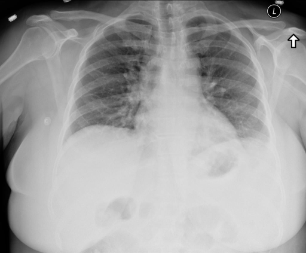
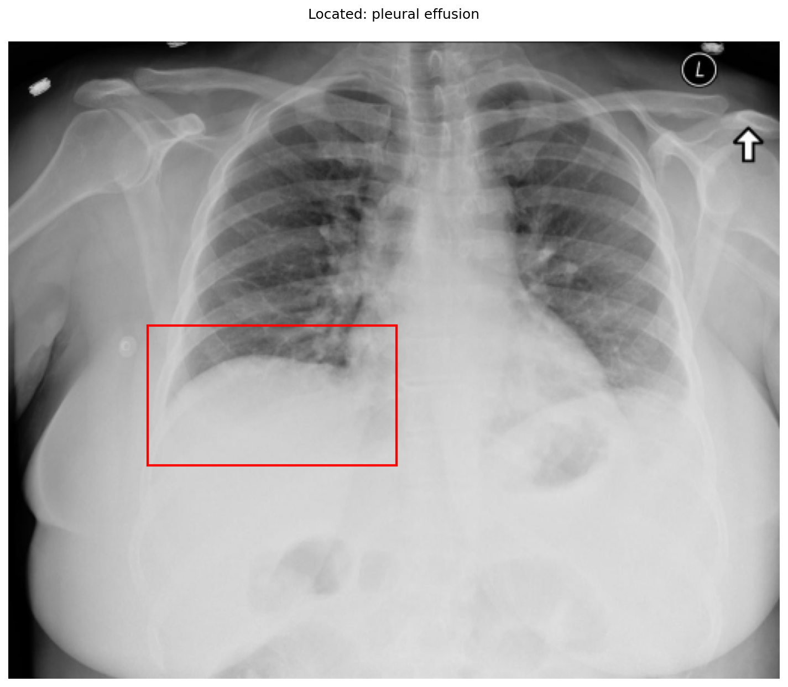

# chexbench_openi_0201 · 纠正

Which finding is in this chest X-ray?

| 选项 | 内容 |
|---|---|
| A | small right pleural effusion |
| B | small left pleural effusion |

参考标注：**A**。B0：**None**；L1：**A. small right pleural effusion**。



## B0

主求解器调用 4 次；工具调用 1 次。

[完整步骤](../B0/steps/chexbench_openi_0201.json) · [锁定首答](../B0/predictions/R55-M5-11tools-CheXagent8B/chexbench_openi_0201.json) · [反馈](../B0/feedback/chexbench_openi_0201.json) · [记忆检索](../B0/external_memory/episodes/chexbench_openi_0201/retrieval.json)

### 主求解器第 1 次回复

[请求](../B0/services/calls/R49-AGENT/chexbench_openi_0201/1/request.json) · [响应](../B0/services/calls/R49-AGENT/chexbench_openi_0201/1/response.json)

```json
{
  "content": "{\"calls\":[{\"tool\":\"roi_crop\",\"args\":{\"box\":[0.5,0.6,1.0,1.0],\"zoom\":2},\"reason\":\"Inspect left lower zone and costophrenic angle for blunting/effusion with L marker context\"},{\"tool\":\"roi_crop\",\"args\":{\"box\":[0.0,0.6,0.5,1.0],\"zoom\":2},\"reason\":\"Inspect right lower zone and costophrenic angle for comparison\"}],\"reason\":\"Compare both costophrenic angles to identify which side shows blunting consistent with a small pleural effusion.\"}",
  "refusal": null,
  "role": "assistant",
  "annotations": null,
  "audio": null,
  "function_call": null,
  "tool_calls": null,
  "reasoning_content": ""
}
```

### 主求解器第 2 次回复

[请求](../B0/services/calls/R49-AGENT/chexbench_openi_0201/2/request.json) · [响应](../B0/services/calls/R49-AGENT/chexbench_openi_0201/2/response.json)

```json
{
  "content": "{\"calls\":[{\"tool\":\"roi_crop\",\"args\":{\"box\":[0.5,0.6,1.0,1.0],\"zoom\":2},\"reason\":\"Inspect left lower zone and costophrenic angle for blunting/effusion with L marker context\"},{\"tool\":\"roi_crop\",\"args\":{\"box\":[0.0,0.6,0.5,1.0],\"zoom\":2},\"reason\":\"Inspect right lower zone and costophrenic angle for comparison\"}],\"reason\":\"Compare both costophrenic angles to identify which side shows blunting consistent with a small pleural effusion.\"}",
  "refusal": null,
  "role": "assistant",
  "annotations": null,
  "audio": null,
  "function_call": null,
  "tool_calls": null,
  "reasoning_content": ""
}
```

### 主求解器第 3 次回复

[请求](../B0/services/calls/R49-AGENT/chexbench_openi_0201/3/request.json) · [响应](../B0/services/calls/R49-AGENT/chexbench_openi_0201/3/response.json)

```json
{
  "content": "{\"calls\":[{\"tool\":\"chest_xray_expert\",\"args\":{\"question\":\"Is there blunting of the left costophrenic angle suggesting a small left pleural effusion? Compare with the right side.\"}}],\"reason\":\"Get expert assessment on laterality of costophrenic angle blunting to distinguish between left and right small pleural effusion.\"}",
  "refusal": null,
  "role": "assistant",
  "annotations": null,
  "audio": null,
  "function_call": null,
  "tool_calls": null,
  "reasoning_content": ""
}
```

### 主求解器第 4 次回复

[请求](../B0/services/calls/R49-AGENT/chexbench_openi_0201/4/request.json) · [响应](../B0/services/calls/R49-AGENT/chexbench_openi_0201/4/response.json)

```json
{
  "content": "{\"calls\":[{\"tool\":\"maira2_grounded_report\",\"args\":{},\"reason\":\"Obtain grounded findings with coordinates to verify laterality of any pleural effusion or costophrenic blunting.\"}],\"reason\":\"Get MAIRA-2 grounded report to cross-validate the side of potential small pleural effusion since expert QA returned 'No' for left-sided blunting, creating ambiguity between options A and B.\"}",
  "refusal": null,
  "role": "assistant",
  "annotations": null,
  "audio": null,
  "function_call": null,
  "tool_calls": null,
  "reasoning_content": ""
}
```

### 工具观察

```json
[
  {
    "status": "completed",
    "observation": [
      {
        "response": "No",
        "model": "StanfordAIMI/CheXagent-8b",
        "revision": "4934e91451945c8218c267aae9c34929a7677829",
        "backend_output_tokens": 2
      },
      {
        "image_paths": [
          "/root/autodl-tmp/openi60_m5_l1_20261121/runs/openi60_s20261121_fast/data/images/openi/images/CXR2886_IM-1288-0001-0002.png"
        ],
        "analysis_status": "completed"
      }
    ],
    "derived_images": [],
    "backend_compute_seconds": 0.1133942159358412,
    "cuda_peak_allocated_bytes_by_visible_device": [
      17385391616
    ],
    "original_image": "/root/autodl-tmp/openi60_m5_l1_20261121/runs/openi60_s20261121_fast/data/images/openi/images/CXR2886_IM-1288-0001-0002.png",
    "raw_result_file": "/root/autodl-tmp/openi60_m5_l1_20261121/runs/openi60_s20261121_fast/B0/services/tool_cache/b7bad4e11e067d573c8af395cdb48e0fa73d6b22ce40c61a5b7f644a1e1feedf/artifacts/raw.json",
    "clinical_correctness_verified": false,
    "actual_model_events": [
      {
        "kind": "generate",
        "model_class": "MistralForCausalLM",
        "module": "transformers.models.mistral.modeling_mistral",
        "status": "completed",
        "utc": 1795230520.716141,
        "elapsed_s": 0.03861829009838402
      }
    ],
    "cuda_visible_devices": "0",
    "adapter_revision": "cxr-vqa-existing-snapshot-binding-3",
    "elapsed_s": 0.126901064068079,
    "backend": "chest_xray_expert",
    "identity": {
      "backend": "chest_xray_expert",
      "revision": "4934e91451945c8218c267aae9c34929a7677829",
      "image": "0d7b1185b70fad1f50df47cd98901c5d897dd4577981ebc9cb80de41ce14d47d",
      "args": {
        "question": "Is there blunting of the left costophrenic angle suggesting a small left pleural effusion? Compare with the right side."
      }
    },
    "utc": "2026-11-21T03:08:40.757923+00:00",
    "tool": "chest_xray_expert",
    "cache_hit": false,
    "cache_key": "b7bad4e11e067d573c8af395cdb48e0fa73d6b22ce40c61a5b7f644a1e1feedf"
  }
]
```

## L1

主求解器调用 5 次；工具调用 4 次。

[完整步骤](../L1/steps/chexbench_openi_0201.json) · [锁定首答](../L1/predictions/R55-M5-11tools-CheXagent8B/chexbench_openi_0201.json) · [反馈](../L1/feedback/chexbench_openi_0201.json) · [记忆检索](../L1/external_memory/episodes/chexbench_openi_0201/retrieval.json)

### 主求解器第 1 次回复

[请求](../L1/services/calls/R49-AGENT/chexbench_openi_0201/1/request.json) · [响应](../L1/services/calls/R49-AGENT/chexbench_openi_0201/1/response.json)

```json
{
  "content": "{\"calls\":[{\"tool\":\"chest_xray_expert\",\"args\":{\"question\":\"Is there a pleural effusion? If so, is it on the patient's left or right side?\"}}],\"reason\":\"Determine presence and laterality of pleural effusion to distinguish between options A and B.\"}",
  "refusal": null,
  "role": "assistant",
  "annotations": null,
  "audio": null,
  "function_call": null,
  "tool_calls": null,
  "reasoning_content": ""
}
```

### 主求解器第 2 次回复

[请求](../L1/services/calls/R49-AGENT/chexbench_openi_0201/2/request.json) · [响应](../L1/services/calls/R49-AGENT/chexbench_openi_0201/2/response.json)

```json
{
  "content": "{\"calls\":[{\"tool\":\"maira2_grounded_report\",\"args\":{}}],\"reason\":\"Obtain grounded findings with coordinates to verify presence and laterality of pleural effusion, as the first tool returned 'No' which may be a false negative given the options.\"}",
  "refusal": null,
  "role": "assistant",
  "annotations": null,
  "audio": null,
  "function_call": null,
  "tool_calls": null,
  "reasoning_content": ""
}
```

### 主求解器第 3 次回复

[请求](../L1/services/calls/R49-AGENT/chexbench_openi_0201/3/request.json) · [响应](../L1/services/calls/R49-AGENT/chexbench_openi_0201/3/response.json)

```json
{
  "content": "{\"calls\":[{\"tool\":\"xray_phrase_grounding\",\"args\":{\"phrase\":\"pleural effusion\"}}],\"reason\":\"Check if phrase grounding can localize a pleural effusion to either costophrenic angle, providing coordinate-based evidence for laterality when two VQA models reported no effusion.\"}",
  "refusal": null,
  "role": "assistant",
  "annotations": null,
  "audio": null,
  "function_call": null,
  "tool_calls": null,
  "reasoning_content": ""
}
```

### 主求解器第 4 次回复

[请求](../L1/services/calls/R49-AGENT/chexbench_openi_0201/4/request.json) · [响应](../L1/services/calls/R49-AGENT/chexbench_openi_0201/4/response.json)

```json
{
  "content": "{\"calls\":[{\"tool\":\"verify\",\"args\":{\"proposed_answer\":\"A. small right pleural effusion\",\"risk\":\"The phrase grounding box is on the image-left (patient-right) costophrenic angle, but two VQA models reported no effusion; need to confirm if the blunting/opacity at this location represents a true small effusion rather than normal anatomy or artifact before finalizing.\"}}],\"reason\":\"Validate that the localized finding on the patient's right side corresponds to a small pleural effusion as per option A, resolving conflict between grounding evidence and negative VQA reports.\"}",
  "refusal": null,
  "role": "assistant",
  "annotations": null,
  "audio": null,
  "function_call": null,
  "tool_calls": null,
  "reasoning_content": ""
}
```

### 主求解器第 5 次回复

[请求](../L1/services/calls/R49-AGENT/chexbench_openi_0201/5/request.json) · [响应](../L1/services/calls/R49-AGENT/chexbench_openi_0201/5/response.json)

```json
{
  "content": "{\"answer\":\"A. small right pleural effusion\",\"reason\":\"Phrase grounding localized the finding to the patient's right costophrenic angle (image-left), and verification confirmed subtle blunting/opacity consistent with a small right pleural effusion.\"}",
  "refusal": null,
  "role": "assistant",
  "annotations": null,
  "audio": null,
  "function_call": null,
  "tool_calls": null,
  "reasoning_content": ""
}
```

### 工具观察

```json
[
  {
    "status": "completed",
    "observation": [
      {
        "response": "No",
        "model": "StanfordAIMI/CheXagent-8b",
        "revision": "4934e91451945c8218c267aae9c34929a7677829",
        "backend_output_tokens": 2
      },
      {
        "image_paths": [
          "/root/autodl-tmp/openi60_m5_l1_20261121/runs/openi60_s20261121_fast/data/images/openi/images/CXR2886_IM-1288-0001-0002.png"
        ],
        "analysis_status": "completed"
      }
    ],
    "derived_images": [],
    "backend_compute_seconds": 0.10226712096482515,
    "cuda_peak_allocated_bytes_by_visible_device": [
      17385391616
    ],
    "original_image": "/root/autodl-tmp/openi60_m5_l1_20261121/runs/openi60_s20261121_fast/data/images/openi/images/CXR2886_IM-1288-0001-0002.png",
    "raw_result_file": "/root/autodl-tmp/openi60_m5_l1_20261121/runs/openi60_s20261121_fast/L1/services/tool_cache/efd2a4ce917d5b4257b6ff6fed8127c89c7c6e9999b8914e6da89966351edd27/artifacts/raw.json",
    "clinical_correctness_verified": false,
    "actual_model_events": [
      {
        "kind": "generate",
        "model_class": "MistralForCausalLM",
        "module": "transformers.models.mistral.modeling_mistral",
        "status": "completed",
        "utc": 1795229735.9471774,
        "elapsed_s": 0.039106085896492004
      }
    ],
    "cuda_visible_devices": "0",
    "adapter_revision": "cxr-vqa-existing-snapshot-binding-3",
    "elapsed_s": 0.1134395319968462,
    "backend": "chest_xray_expert",
    "identity": {
      "backend": "chest_xray_expert",
      "revision": "4934e91451945c8218c267aae9c34929a7677829",
      "image": "0d7b1185b70fad1f50df47cd98901c5d897dd4577981ebc9cb80de41ce14d47d",
      "args": {
        "question": "Is there a pleural effusion? If so, is it on the patient's left or right side?"
      }
    },
    "utc": "2026-11-21T02:55:35.988901+00:00",
    "tool": "chest_xray_expert",
    "cache_hit": false,
    "cache_key": "efd2a4ce917d5b4257b6ff6fed8127c89c7c6e9999b8914e6da89966351edd27"
  },
  {
    "status": "completed",
    "observation": {
      "analysis_status": "completed",
      "findings": [
        {
          "finding": "The lungs are clear.",
          "boxes": []
        },
        {
          "finding": "The heart is normal in size.",
          "boxes": []
        },
        {
          "finding": "The mediastinum is normal in size.",
          "boxes": []
        },
        {
          "finding": "No pleural abnormalities are seen.",
          "boxes": []
        },
        {
          "finding": "No significant skeletal abnormalities are identified.",
          "boxes": []
        }
      ],
      "report": "The lungs are clear. The heart is normal in size. The mediastinum is normal in size. No pleural abnormalities are seen. No significant skeletal abnormalities are identified.",
      "original_size": [
        512,
        423
      ],
      "view_record": {
        "modality": "CXR",
        "view": "frontal",
        "source": "Assistant visual image-only annotation of original-image contact sheet; no question/options/answer/feedback consulted.",
        "sheet": 6,
        "annotation_id": "V0328",
        "recorded_asset_id": "0d7b1185b70fad1f50df47cd98901c5d897dd4577981ebc9cb80de41ce14d47d",
        "identity_source": "previously recorded R49 public asset ID; not recomputed",
        "not_diagnostic_validation": true
      },
      "grounded_box_count": 0,
      "generated_tokens": 54,
      "reached_token_cap": false,
      "limitations": "Unverified findings; boxes are model outputs, not independent confirmation. No prior image or history supplied. Findings without boxes are retained."
    },
    "derived_images": [],
    "backend_compute_seconds": 3.679338459856808,
    "cuda_peak_allocated_bytes_by_visible_device": [
      8165980160
    ],
    "original_image": "/root/autodl-tmp/openi60_m5_l1_20261121/runs/openi60_s20261121_fast/data/images/openi/images/CXR2886_IM-1288-0001-0002.png",
    "raw_result_file": "/root/autodl-tmp/openi60_m5_l1_20261121/runs/openi60_s20261121_fast/L1/services/tool_cache/a77e7461fc3da1e9d174772298dc4f214e06801c2db253ad488fc428d8f68a40/artifacts/raw.json",
    "clinical_correctness_verified": false,
    "actual_model_events": [
      {
        "kind": "generate",
        "model_class": "Maira2ForConditionalGeneration",
        "module": "transformers_modules.795a2b1cd4a310624b4e3d14b5a23e41fd273deb.modeling_maira2",
        "status": "completed",
        "utc": 1795229737.9120708,
        "elapsed_s": 3.629280165070668
      }
    ],
    "cuda_visible_devices": "0",
    "adapter_revision": "cxr-vqa-existing-snapshot-binding-3",
    "elapsed_s": 3.690545186167583,
    "backend": "maira2_grounded_report",
    "identity": {
      "backend": "maira2_grounded_report",
      "revision": "MedRAX-dae30e2f136ef0b2a40885a4c335386e9ffad052+r54-grounded-report-v1",
      "image": "0d7b1185b70fad1f50df47cd98901c5d897dd4577981ebc9cb80de41ce14d47d",
      "args": {}
    },
    "utc": "2026-11-21T02:55:41.548599+00:00",
    "tool": "maira2_grounded_report",
    "cache_hit": false,
    "cache_key": "a77e7461fc3da1e9d174772298dc4f214e06801c2db253ad488fc428d8f68a40"
  },
  {
    "status": "completed",
    "observation": [
      {
        "predictions": [
          {
            "phrase": "pleural effusion.",
            "bounding_boxes": {
              "model_coordinates": [
                [
                  0.115,
                  0.445,
                  0.505,
                  0.665
                ]
              ],
              "image_coordinates": [
                [
                  0.1796875,
                  0.4444444444444444,
                  0.501953125,
                  0.6643026004728132
                ]
              ]
            }
          }
        ],
        "visualization_path": "/root/autodl-tmp/openi60_m5_l1_20261121/runs/openi60_s20261121_fast/L1/services/tool_cache/f9acba42a5bb0fc131ce4e7b5538cbadfdc4cf08b22b4e681bc256eb487fc573/artifacts/maira_runtime/overlays/grounding_3c54d7d3.png"
      },
      {
        "image_path": "/root/autodl-tmp/openi60_m5_l1_20261121/runs/openi60_s20261121_fast/data/images/openi/images/CXR2886_IM-1288-0001-0002.png",
        "original_size": [
          512,
          423
        ],
        "model_input_size": [
          518,
          518
        ],
        "device": "cuda:0",
        "analysis_status": "completed"
      }
    ],
    "derived_images": [
      "/root/autodl-tmp/openi60_m5_l1_20261121/runs/openi60_s20261121_fast/L1/services/tool_cache/f9acba42a5bb0fc131ce4e7b5538cbadfdc4cf08b22b4e681bc256eb487fc573/artifacts/maira_runtime/overlays/grounding_3c54d7d3.png"
    ],
    "backend_compute_seconds": 1.7936941219959408,
    "cuda_peak_allocated_bytes_by_visible_device": [
      8117476864
    ],
    "original_image": "/root/autodl-tmp/openi60_m5_l1_20261121/runs/openi60_s20261121_fast/data/images/openi/images/CXR2886_IM-1288-0001-0002.png",
    "raw_result_file": "/root/autodl-tmp/openi60_m5_l1_20261121/runs/openi60_s20261121_fast/L1/services/tool_cache/f9acba42a5bb0fc131ce4e7b5538cbadfdc4cf08b22b4e681bc256eb487fc573/artifacts/raw.json",
    "clinical_correctness_verified": false,
    "actual_model_events": [
      {
        "kind": "generate",
        "model_class": "Maira2ForConditionalGeneration",
        "module": "transformers_modules.795a2b1cd4a310624b4e3d14b5a23e41fd273deb.modeling_maira2",
        "status": "completed",
        "utc": 1795229743.488875,
        "elapsed_s": 1.343771754996851
      }
    ],
    "cuda_visible_devices": "0",
    "adapter_revision": "cxr-vqa-existing-snapshot-binding-3",
    "elapsed_s": 1.8026703998912126,
    "backend": "xray_phrase_grounding",
    "identity": {
      "backend": "xray_phrase_grounding",
      "revision": "MedRAX-dae30e2f136ef0b2a40885a4c335386e9ffad052+r54-frontal-gate+inherited-eos-guard-v1",
      "image": "0d7b1185b70fad1f50df47cd98901c5d897dd4577981ebc9cb80de41ce14d47d",
      "args": {
        "phrase": "pleural effusion"
      }
    },
    "utc": "2026-11-21T02:55:45.252335+00:00",
    "tool": "xray_phrase_grounding",
    "cache_hit": false,
    "cache_key": "f9acba42a5bb0fc131ce4e7b5538cbadfdc4cf08b22b4e681bc256eb487fc573"
  },
  {
    "status": "completed",
    "backend": "verifier",
    "observation": {
      "correctness": "CORRECT",
      "safety": "SAFE",
      "evaluation": "Correctness: CORRECT  \nSafety: SAFE  \nIssues: Subtle blunting/opacity at the patient-right costophrenic angle (image-left) supports a small right effusion; however, AP portable technique, body habitus, and breast shadows can mimic a small effusion, and no lateral/decubitus view is available for confirmation.  \nSuggestion: Confirm with a lateral/decubitus radiograph or ultrasound if clinically indicated."
    },
    "elapsed_s": 23.719624024117365,
    "utc": "2026-11-21T02:56:12.657562+00:00",
    "model_receipt": "calls/R55-VERIFY/verify_chexbench_openi_0201_4/1/result.json",
    "tool": "verify",
    "cache_hit": false,
    "cache_key": "2e9e12b4fb4acfc84fbc45eaa0a1f58e3e3b8ddf931059921f6325102ad1fbc0"
  }
]
```


