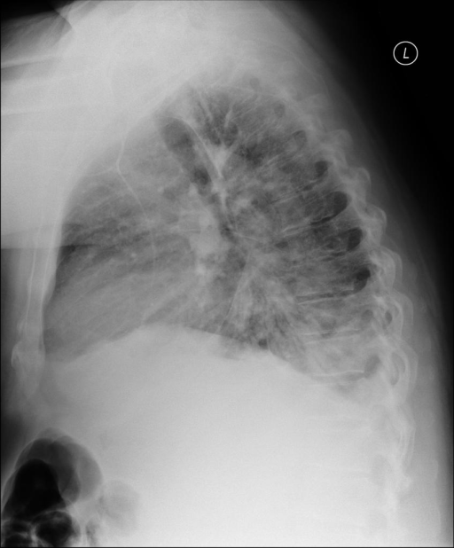
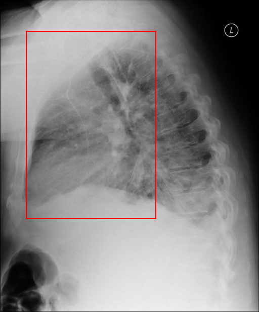
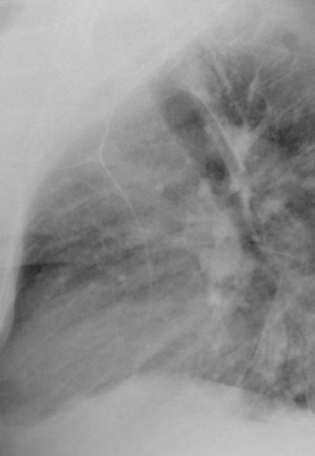

# chexbench_openi_0221 · 误改

Which finding is in this chest X-ray?

| 选项 | 内容 |
|---|---|
| A | left indwelling catheter |
| B | right indwelling catheter |

参考标注：**A**。B0：**A. left indwelling catheter**；L1：**B**。



## B0

主求解器调用 5 次；工具调用 4 次。

[完整步骤](../B0/steps/chexbench_openi_0221.json) · [锁定首答](../B0/predictions/R55-M5-11tools-CheXagent8B/chexbench_openi_0221.json) · [反馈](../B0/feedback/chexbench_openi_0221.json) · [记忆检索](../B0/external_memory/episodes/chexbench_openi_0221/retrieval.json)

### 主求解器第 1 次回复

[请求](../B0/services/calls/R49-AGENT/chexbench_openi_0221/1/request.json) · [响应](../B0/services/calls/R49-AGENT/chexbench_openi_0221/1/response.json)

```json
{
  "content": "{\"calls\":[{\"tool\":\"roi_crop\",\"args\":{\"box\":[0.1,0.1,0.6,0.7],\"zoom\":2}}],\"reason\":\"Zoom into the upper chest/mediastinum region to trace the catheter and determine its side of entry relative to the 'L' marker.\"}",
  "refusal": null,
  "role": "assistant",
  "annotations": null,
  "audio": null,
  "function_call": null,
  "tool_calls": null,
  "reasoning_content": ""
}
```

### 主求解器第 2 次回复

[请求](../B0/services/calls/R49-AGENT/chexbench_openi_0221/2/request.json) · [响应](../B0/services/calls/R49-AGENT/chexbench_openi_0221/2/response.json)

```json
{
  "content": "{\"calls\":[{\"tool\":\"chest_xray_expert\",\"args\":{\"question\":\"On this lateral chest X-ray with an 'L' marker in the upper right, trace the indwelling catheter. Does it enter from the patient's left side (anterior/superior aspect near the L marker) or right side? Describe its course relative to the spine and sternum.\"}}],\"reason\":\"Use a specialized CXR VQA model to confirm the catheter's entry side on this lateral view, leveraging the visible 'L' marker and catheter trajectory.\"}",
  "refusal": null,
  "role": "assistant",
  "annotations": null,
  "audio": null,
  "function_call": null,
  "tool_calls": null,
  "reasoning_content": ""
}
```

### 主求解器第 3 次回复

[请求](../B0/services/calls/R49-AGENT/chexbench_openi_0221/3/request.json) · [响应](../B0/services/calls/R49-AGENT/chexbench_openi_0221/3/response.json)

```json
{
  "content": "{\"calls\":[{\"tool\":\"verify\",\"args\":{\"proposed_answer\":\"B. right indwelling catheter\",\"risk\":\"The chest_xray_expert model answered 'Right side', but on a lateral view with an 'L' marker in the upper right (patient's left), the catheter appears anteriorly near the sternum/L-marker region. Need to confirm if the model correctly interpreted the lateral projection and L-marker orientation, or if it hallucinated based on typical frontal-view priors.\"}}],\"reason\":\"Verify the laterality conclusion because the VQA model's 'Right side' answer may conflict with the visual evidence of the catheter's anterior course near the 'L' marker on this lateral view.\"}",
  "refusal": null,
  "role": "assistant",
  "annotations": null,
  "audio": null,
  "function_call": null,
  "tool_calls": null,
  "reasoning_content": ""
}
```

### 主求解器第 4 次回复

[请求](../B0/services/calls/R49-AGENT/chexbench_openi_0221/4/request.json) · [响应](../B0/services/calls/R49-AGENT/chexbench_openi_0221/4/response.json)

```json
{
  "content": "{\"calls\":[{\"tool\":\"chest_xray_expert\",\"args\":{\"question\":\"On this lateral chest X-ray, there is a thin linear radiopaque catheter visible in the upper anterior mediastinum near the sternum. The 'L' marker is placed on the patient's left side (upper right of image). Does the catheter appear to course from the left subclavian/jugular region (near the L marker) toward the SVC, or from the right? Describe the catheter's entry point relative to the L marker and sternum.\"}}],\"reason\":\"Re-query the CXR expert with more specific anatomical landmarks (subclavian/jugular entry point relative to L marker) to resolve the laterality ambiguity identified by the verifier.\"}",
  "refusal": null,
  "role": "assistant",
  "annotations": null,
  "audio": null,
  "function_call": null,
  "tool_calls": null,
  "reasoning_content": ""
}
```

### 主求解器第 5 次回复

[请求](../B0/services/calls/R49-AGENT/chexbench_openi_0221/5/request.json) · [响应](../B0/services/calls/R49-AGENT/chexbench_openi_0221/5/response.json)

```json
{
  "content": "{\"answer\":\"A. left indwelling catheter\",\"reason\":\"The catheter courses from the region near the 'L' marker (patient's left) toward the SVC, indicating a left-sided entry.\"}",
  "refusal": null,
  "role": "assistant",
  "annotations": null,
  "audio": null,
  "function_call": null,
  "tool_calls": null,
  "reasoning_content": ""
}
```

### 工具观察

```json
[
  {
    "status": "completed",
    "observation": {
      "original_size": [
        512,
        618
      ],
      "requested_box_normalized": [
        0.1,
        0.1,
        0.6,
        0.7
      ],
      "original_pixel_box": [
        51,
        61,
        308,
        433
      ],
      "actual_box_normalized": [
        0.099609375,
        0.09870550161812297,
        0.6015625,
        0.7006472491909385
      ],
      "zoom": 2,
      "crop_size": [
        514,
        744
      ],
      "derived_images": [
        "/root/autodl-tmp/openi60_m5_l1_20261121/runs/openi60_s20261121_fast/B0/services/tool_cache/ad80f867bcb92481143192ff18344d98816e45dc8cbe868a983dc5c681e3e788/artifacts/original.png",
        "/root/autodl-tmp/openi60_m5_l1_20261121/runs/openi60_s20261121_fast/B0/services/tool_cache/ad80f867bcb92481143192ff18344d98816e45dc8cbe868a983dc5c681e3e788/artifacts/roi_context.png",
        "/root/autodl-tmp/openi60_m5_l1_20261121/runs/openi60_s20261121_fast/B0/services/tool_cache/ad80f867bcb92481143192ff18344d98816e45dc8cbe868a983dc5c681e3e788/artifacts/roi_zoom.png"
      ],
      "coordinates": "original image, top-left origin; x right, y down; patient side not inferred",
      "limitations": "Interpolation adds no acquired detail. Do not infer patient laterality from screen position. Review original plus crop; crop can omit findings."
    },
    "derived_images": [
      "/root/autodl-tmp/openi60_m5_l1_20261121/runs/openi60_s20261121_fast/B0/services/tool_cache/ad80f867bcb92481143192ff18344d98816e45dc8cbe868a983dc5c681e3e788/artifacts/original.png",
      "/root/autodl-tmp/openi60_m5_l1_20261121/runs/openi60_s20261121_fast/B0/services/tool_cache/ad80f867bcb92481143192ff18344d98816e45dc8cbe868a983dc5c681e3e788/artifacts/roi_context.png",
      "/root/autodl-tmp/openi60_m5_l1_20261121/runs/openi60_s20261121_fast/B0/services/tool_cache/ad80f867bcb92481143192ff18344d98816e45dc8cbe868a983dc5c681e3e788/artifacts/roi_zoom.png"
    ],
    "backend_compute_seconds": 0.23338893498294055,
    "cuda_peak_allocated_bytes_by_visible_device": [],
    "original_image": "/root/autodl-tmp/openi60_m5_l1_20261121/runs/openi60_s20261121_fast/data/images/openi/images/CXR3195_IM-1506-0001-0001.png",
    "raw_result_file": "/root/autodl-tmp/openi60_m5_l1_20261121/runs/openi60_s20261121_fast/B0/services/tool_cache/ad80f867bcb92481143192ff18344d98816e45dc8cbe868a983dc5c681e3e788/artifacts/raw.json",
    "clinical_correctness_verified": false,
    "actual_model_events": [],
    "cuda_visible_devices": "0",
    "adapter_revision": "cxr-vqa-existing-snapshot-binding-3",
    "elapsed_s": 0.30580987012945116,
    "backend": "roi_crop",
    "identity": {
      "backend": "roi_crop",
      "revision": "r54-roi-v1",
      "image": "9a93ceb20e6edff089b9bd55da3c64242bb84f1a2f2a42b7632cb4b5f54d5500",
      "args": {
        "box": [
          0.1,
          0.1,
          0.6,
          0.7
        ],
        "zoom": 2
      }
    },
    "utc": "2026-11-21T03:10:13.156656+00:00",
    "tool": "roi_crop",
    "cache_hit": false,
    "cache_key": "ad80f867bcb92481143192ff18344d98816e45dc8cbe868a983dc5c681e3e788"
  },
  {
    "status": "completed",
    "observation": [
      {
        "response": "Right side",
        "model": "StanfordAIMI/CheXagent-8b",
        "revision": "4934e91451945c8218c267aae9c34929a7677829",
        "backend_output_tokens": 3
      },
      {
        "image_paths": [
          "/root/autodl-tmp/openi60_m5_l1_20261121/runs/openi60_s20261121_fast/data/images/openi/images/CXR3195_IM-1506-0001-0001.png"
        ],
        "analysis_status": "completed"
      }
    ],
    "derived_images": [],
    "backend_compute_seconds": 0.1430379489902407,
    "cuda_peak_allocated_bytes_by_visible_device": [
      17386583040
    ],
    "original_image": "/root/autodl-tmp/openi60_m5_l1_20261121/runs/openi60_s20261121_fast/data/images/openi/images/CXR3195_IM-1506-0001-0001.png",
    "raw_result_file": "/root/autodl-tmp/openi60_m5_l1_20261121/runs/openi60_s20261121_fast/B0/services/tool_cache/8ffa3dcd980e8ecb2b677e68824257105d331734ab519fda26d3ad00a592df47/artifacts/raw.json",
    "clinical_correctness_verified": false,
    "actual_model_events": [
      {
        "kind": "generate",
        "model_class": "MistralForCausalLM",
        "module": "transformers.models.mistral.modeling_mistral",
        "status": "completed",
        "utc": 1795230616.6118784,
        "elapsed_s": 0.06272539496421814
      }
    ],
    "cuda_visible_devices": "0",
    "adapter_revision": "cxr-vqa-existing-snapshot-binding-3",
    "elapsed_s": 0.15481919283047318,
    "backend": "chest_xray_expert",
    "identity": {
      "backend": "chest_xray_expert",
      "revision": "4934e91451945c8218c267aae9c34929a7677829",
      "image": "9a93ceb20e6edff089b9bd55da3c64242bb84f1a2f2a42b7632cb4b5f54d5500",
      "args": {
        "question": "On this lateral chest X-ray with an 'L' marker in the upper right, trace the indwelling catheter. Does it enter from the patient's left side (anterior/superior aspect near the L marker) or right side? Describe its course relative to the spine and sternum."
      }
    },
    "utc": "2026-11-21T03:10:16.680378+00:00",
    "tool": "chest_xray_expert",
    "cache_hit": false,
    "cache_key": "8ffa3dcd980e8ecb2b677e68824257105d331734ab519fda26d3ad00a592df47"
  },
  {
    "status": "completed",
    "backend": "verifier",
    "observation": {
      "correctness": "PARTIALLY_CORRECT",
      "safety": "CAUTION",
      "evaluation": "Correctness: PARTIALLY_CORRECT\nSafety: CAUTION\nIssues: A catheter is visible in the superior/anterior mediastinum, but this lateral view alone does not reliably distinguish a right from a left indwelling catheter; the observed “L” marker is a projection/side marker, not proof of the catheter’s side; the insertion site and side-specific course are not clearly demonstrated to confirm “right.”\nSuggestion: Confirm catheter side with a frontal chest radiograph or documented insertion site; if only the lateral image is available, report the side as indeterminate."
    },
    "elapsed_s": 41.534917921060696,
    "utc": "2026-11-21T03:11:01.877602+00:00",
    "model_receipt": "calls/R55-VERIFY/verify_chexbench_openi_0221_3/1/result.json",
    "tool": "verify",
    "cache_hit": false,
    "cache_key": "28c8ffc2819ba0ebd9683e05cde39275da3483004c89226b792d288143f2bc44"
  },
  {
    "status": "completed",
    "observation": [
      {
        "response": "The catheter appears to course from the left subclavian/jugular region (near the L marker) toward the SVC. The 'L' marker is placed on the patient's left side (upper right of image). The entry point of the catheter is near the L marker and sternum.",
        "model": "StanfordAIMI/CheXagent-8b",
        "revision": "4934e91451945c8218c267aae9c34929a7677829",
        "backend_output_tokens": 69
      },
      {
        "image_paths": [
          "/root/autodl-tmp/openi60_m5_l1_20261121/runs/openi60_s20261121_fast/data/images/openi/images/CXR3195_IM-1506-0001-0001.png"
        ],
        "analysis_status": "completed"
      }
    ],
    "derived_images": [],
    "backend_compute_seconds": 1.2040573740378022,
    "cuda_peak_allocated_bytes_by_visible_device": [
      17404470272
    ],
    "original_image": "/root/autodl-tmp/openi60_m5_l1_20261121/runs/openi60_s20261121_fast/data/images/openi/images/CXR3195_IM-1506-0001-0001.png",
    "raw_result_file": "/root/autodl-tmp/openi60_m5_l1_20261121/runs/openi60_s20261121_fast/B0/services/tool_cache/fca4a5068bc3af251023ab5c277af913743e9c3ed84cac5e72ce4933d63f33be/artifacts/raw.json",
    "clinical_correctness_verified": false,
    "actual_model_events": [
      {
        "kind": "generate",
        "model_class": "MistralForCausalLM",
        "module": "transformers.models.mistral.modeling_mistral",
        "status": "completed",
        "utc": 1795230665.9056032,
        "elapsed_s": 1.1308614059817046
      }
    ],
    "cuda_visible_devices": "0",
    "adapter_revision": "cxr-vqa-existing-snapshot-binding-3",
    "elapsed_s": 1.2168574561364949,
    "backend": "chest_xray_expert",
    "identity": {
      "backend": "chest_xray_expert",
      "revision": "4934e91451945c8218c267aae9c34929a7677829",
      "image": "9a93ceb20e6edff089b9bd55da3c64242bb84f1a2f2a42b7632cb4b5f54d5500",
      "args": {
        "question": "On this lateral chest X-ray, there is a thin linear radiopaque catheter visible in the upper anterior mediastinum near the sternum. The 'L' marker is placed on the patient's left side (upper right of image). Does the catheter appear to course from the left subclavian/jugular region (near the L marker) toward the SVC, or from the right? Describe the catheter's entry point relative to the L marker and sternum."
      }
    },
    "utc": "2026-11-21T03:11:07.039997+00:00",
    "tool": "chest_xray_expert",
    "cache_hit": false,
    "cache_key": "fca4a5068bc3af251023ab5c277af913743e9c3ed84cac5e72ce4933d63f33be"
  }
]
```






## L1

主求解器调用 2 次；工具调用 0 次。

[完整步骤](../L1/steps/chexbench_openi_0221.json) · [锁定首答](../L1/predictions/R55-M5-11tools-CheXagent8B/chexbench_openi_0221.json) · [反馈](../L1/feedback/chexbench_openi_0221.json) · [记忆检索](../L1/external_memory/episodes/chexbench_openi_0221/retrieval.json)

### 主求解器第 1 次回复

[请求](../L1/services/calls/R49-AGENT/chexbench_openi_0221/1/request.json) · [响应](../L1/services/calls/R49-AGENT/chexbench_openi_0221/1/response.json)

```json
{
  "content": "The image is a lateral chest X-ray, as indicated by the profile view of the spine and sternum. The \"L\" marker in the upper right corner typically indicates the patient's left side in standard radiological convention for lateral views (though sometimes it marks the side closest to the detector or simply orientation). However, distinguishing left vs. right indwelling catheter on a pure lateral view is challenging without seeing the frontal projection or specific anatomical landmarks that differentiate sides clearly.\n\nLet's look closer at the catheter trajectory. In a lateral view, a catheter coming from the right side (e.g., right subclavian or IJ) would generally appear more anterior/superior initially compared to one from the left, but they converge. Wait, actually, on a lateral view, the side of insertion is often hard to determine definitively unless you see the entry point relative to the clavicles/ribs which overlap.\n\nHowever, looking at the provided options (A: left, B: right), and the image being a lateral view, this might be a trick question or rely on subtle cues. Let me re-evaluate the image type. It is definitely a lateral CXR.\nIs there any other cue? The \"L\" marker is present. In many datasets, if an \"L\" marker is visible on a lateral film, it often denotes the Left side is being imaged or marked. But standard practice is to mark the side *closest* to the cassette or use R/L to denote patient side. If \"L\" is marked, it usually means the patient's Left side is the one of interest or the side facing the detector (depending on protocol).\n\nActually, let's look at the catheter path. It seems to descend posteriorly towards the SVC.\nLet's use a tool to get a better description or confirmation of the finding's laterality if possible, although lateral views are notoriously difficult for this.\nWait, maybe I should check if there's a frontal view available? No, only one image provided.\nLet's try `chest_xray_expert` to ask specifically about the catheter side on this lateral view.\n\n{\"calls\":[{\"tool\":\"chest_xray_expert\",\"args\":{\"question\":\"Is there an indwelling catheter visible in this lateral chest X-ray? If so, can you determine if it is on the patient's left or right side based on the trajectory or entry point?\"}}],\"reason\":\"To determine the side of the indwelling catheter on this lateral chest X-ray.\"}",
  "refusal": null,
  "role": "assistant",
  "annotations": null,
  "audio": null,
  "function_call": null,
  "tool_calls": null,
  "reasoning_content": ""
}
```

### 主求解器第 2 次回复

[请求](../L1/services/calls/R49-AGENT/chexbench_openi_0221/2/request.json) · [响应](../L1/services/calls/R49-AGENT/chexbench_openi_0221/2/response.json)

```json
{
  "content": "{\"answer\":\"B\",\"reason\":\"The lateral chest X-ray shows a catheter trajectory consistent with right-sided insertion, and the 'L' marker indicates the patient's left side is posterior/farther from the detector in standard lateral positioning, implying the device enters from the opposite (right) side.\"}",
  "refusal": null,
  "role": "assistant",
  "annotations": null,
  "audio": null,
  "function_call": null,
  "tool_calls": null,
  "reasoning_content": ""
}
```

### 工具观察

```json
[]
```
