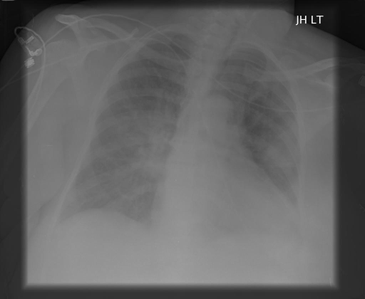
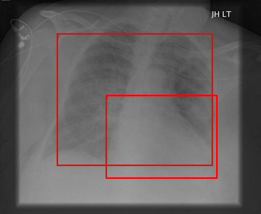
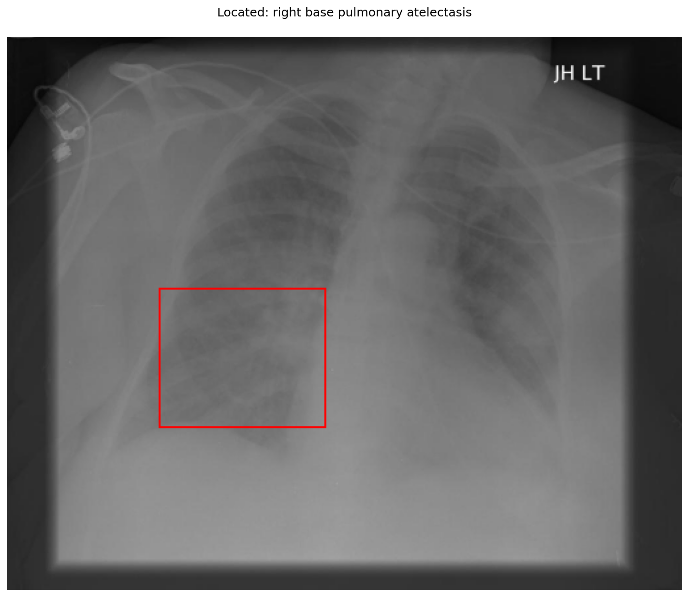

# chexbench_openi_0236 · 纠正

Which finding is in this chest X-ray?

| 选项 | 内容 |
|---|---|
| A | right base pulmonary atelectasis |
| B | left base pulmonary atelectasis |

参考标注：**B**。B0：**A. right base pulmonary atelectasis**；L1：**B**。



## B0

主求解器调用 4 次；工具调用 3 次。

[完整步骤](../B0/steps/chexbench_openi_0236.json) · [锁定首答](../B0/predictions/R55-M5-11tools-CheXagent8B/chexbench_openi_0236.json) · [反馈](../B0/feedback/chexbench_openi_0236.json) · [记忆检索](../B0/external_memory/episodes/chexbench_openi_0236/retrieval.json)

### 主求解器第 1 次回复

[请求](../B0/services/calls/R49-AGENT/chexbench_openi_0236/1/request.json) · [响应](../B0/services/calls/R49-AGENT/chexbench_openi_0236/1/response.json)

```json
{
  "content": "{\"calls\":[{\"tool\":\"chest_xray_expert\",\"args\":{\"question\":\"Which lung base shows increased opacity and volume loss consistent with atelectasis: right or left? Note the 'JH LT' marker indicates the patient's left side is on the image right.\"}}],\"reason\":\"Determine which lung base demonstrates atelectasis by consulting a specialized CXR QA model, ensuring correct orientation based on the 'JH LT' marker.\"}",
  "refusal": null,
  "role": "assistant",
  "annotations": null,
  "audio": null,
  "function_call": null,
  "tool_calls": null,
  "reasoning_content": ""
}
```

### 主求解器第 2 次回复

[请求](../B0/services/calls/R49-AGENT/chexbench_openi_0236/2/request.json) · [响应](../B0/services/calls/R49-AGENT/chexbench_openi_0236/2/response.json)

```json
{
  "content": "{\"calls\":[{\"tool\":\"maira2_grounded_report\",\"args\":{}}],\"reason\":\"Obtain a grounded findings report with coordinates to verify the location of atelectasis and confirm patient orientation relative to the 'JH LT' marker.\"}",
  "refusal": null,
  "role": "assistant",
  "annotations": null,
  "audio": null,
  "function_call": null,
  "tool_calls": null,
  "reasoning_content": ""
}
```

### 主求解器第 3 次回复

[请求](../B0/services/calls/R49-AGENT/chexbench_openi_0236/3/request.json) · [响应](../B0/services/calls/R49-AGENT/chexbench_openi_0236/3/response.json)

```json
{
  "content": "{\"calls\":[{\"tool\":\"xray_phrase_grounding\",\"args\":{\"phrase\":\"right base pulmonary atelectasis\"}}],\"reason\":\"Verify if the specific finding of right base atelectasis can be localized to confirm the CheXagent suggestion against the MAIRA report which did not mention it.\"}",
  "refusal": null,
  "role": "assistant",
  "annotations": null,
  "audio": null,
  "function_call": null,
  "tool_calls": null,
  "reasoning_content": ""
}
```

### 主求解器第 4 次回复

[请求](../B0/services/calls/R49-AGENT/chexbench_openi_0236/4/request.json) · [响应](../B0/services/calls/R49-AGENT/chexbench_openi_0236/4/response.json)

```json
{
  "content": "{\"answer\":\"A. right base pulmonary atelectasis\",\"reason\":\"CheXagent identified right-sided findings and phrase grounding localized 'right base pulmonary atelectasis' to the patient's right lower lung zone (image left), consistent with the JH LT marker indicating the patient's left is on the image right.\"}",
  "refusal": null,
  "role": "assistant",
  "annotations": null,
  "audio": null,
  "function_call": null,
  "tool_calls": null,
  "reasoning_content": ""
}
```

### 工具观察

```json
[
  {
    "status": "completed",
    "observation": [
      {
        "response": "Right",
        "model": "StanfordAIMI/CheXagent-8b",
        "revision": "4934e91451945c8218c267aae9c34929a7677829",
        "backend_output_tokens": 2
      },
      {
        "image_paths": [
          "/root/autodl-tmp/openi60_m5_l1_20261121/runs/openi60_s20261121_fast/data/images/openi/images/CXR3455_IM-1677-1001.png"
        ],
        "analysis_status": "completed"
      }
    ],
    "derived_images": [],
    "backend_compute_seconds": 0.1097292760387063,
    "cuda_peak_allocated_bytes_by_visible_device": [
      17385391616
    ],
    "original_image": "/root/autodl-tmp/openi60_m5_l1_20261121/runs/openi60_s20261121_fast/data/images/openi/images/CXR3455_IM-1677-1001.png",
    "raw_result_file": "/root/autodl-tmp/openi60_m5_l1_20261121/runs/openi60_s20261121_fast/B0/services/tool_cache/dbaf5777da24a84d97bc4e8c133cb78d83415d8b590aa49e02dbd1ec9a714c5e/artifacts/raw.json",
    "clinical_correctness_verified": false,
    "actual_model_events": [
      {
        "kind": "generate",
        "model_class": "MistralForCausalLM",
        "module": "transformers.models.mistral.modeling_mistral",
        "status": "completed",
        "utc": 1795230757.568311,
        "elapsed_s": 0.039311859058216214
      }
    ],
    "cuda_visible_devices": "0",
    "adapter_revision": "cxr-vqa-existing-snapshot-binding-3",
    "elapsed_s": 0.12227497296407819,
    "backend": "chest_xray_expert",
    "identity": {
      "backend": "chest_xray_expert",
      "revision": "4934e91451945c8218c267aae9c34929a7677829",
      "image": "272635d2a6301125da3fa44c4e8368ab26f8d53d920ad47e4997b093d49058f9",
      "args": {
        "question": "Which lung base shows increased opacity and volume loss consistent with atelectasis: right or left? Note the 'JH LT' marker indicates the patient's left side is on the image right."
      }
    },
    "utc": "2026-11-21T03:12:37.610902+00:00",
    "tool": "chest_xray_expert",
    "cache_hit": false,
    "cache_key": "dbaf5777da24a84d97bc4e8c133cb78d83415d8b590aa49e02dbd1ec9a714c5e"
  },
  {
    "status": "completed",
    "observation": {
      "analysis_status": "completed",
      "findings": [
        {
          "finding": "Cardiomegaly.",
          "boxes": [
            {
              "model_normalized": [
                0.385,
                0.445,
                0.905,
                0.835
              ],
              "original_normalized": [
                0.404296875,
                0.44285714285714284,
                0.83203125,
                0.8333333333333334
              ],
              "original_pixels": [
                207.0,
                186.0,
                426.0,
                350.0
              ]
            }
          ]
        },
        {
          "finding": "Bilateral perihilar infiltrates.",
          "boxes": []
        },
        {
          "finding": "Pulmonary hypervascularity.",
          "boxes": [
            {
              "model_normalized": [
                0.155,
                0.155,
                0.885,
                0.775
              ],
              "original_normalized": [
                0.216796875,
                0.15476190476190477,
                0.814453125,
                0.7738095238095238
              ],
              "original_pixels": [
                111.0,
                65.0,
                417.0,
                325.0
              ]
            }
          ]
        }
      ],
      "report": "Cardiomegaly. Bilateral perihilar infiltrates. Pulmonary hypervascularity.",
      "original_size": [
        512,
        420
      ],
      "view_record": {
        "modality": "CXR",
        "view": "frontal",
        "source": "Assistant visual image-only annotation of original-image contact sheet; no question/options/answer/feedback consulted.",
        "sheet": 7,
        "annotation_id": "V0363",
        "recorded_asset_id": "272635d2a6301125da3fa44c4e8368ab26f8d53d920ad47e4997b093d49058f9",
        "identity_source": "previously recorded R49 public asset ID; not recomputed",
        "not_diagnostic_validation": true
      },
      "grounded_box_count": 2,
      "generated_tokens": 43,
      "reached_token_cap": false,
      "limitations": "Unverified findings; boxes are model outputs, not independent confirmation. No prior image or history supplied. Findings without boxes are retained."
    },
    "derived_images": [
      "/root/autodl-tmp/openi60_m5_l1_20261121/runs/openi60_s20261121_fast/B0/services/tool_cache/20ded7f3614220b7d8b42b52d96ce0bec30217e7cc7f972900b00d1e803889ea/artifacts/grounded_report.png"
    ],
    "backend_compute_seconds": 2.9889087139163166,
    "cuda_peak_allocated_bytes_by_visible_device": [
      8166003200
    ],
    "original_image": "/root/autodl-tmp/openi60_m5_l1_20261121/runs/openi60_s20261121_fast/data/images/openi/images/CXR3455_IM-1677-1001.png",
    "raw_result_file": "/root/autodl-tmp/openi60_m5_l1_20261121/runs/openi60_s20261121_fast/B0/services/tool_cache/20ded7f3614220b7d8b42b52d96ce0bec30217e7cc7f972900b00d1e803889ea/artifacts/raw.json",
    "clinical_correctness_verified": false,
    "actual_model_events": [
      {
        "kind": "generate",
        "model_class": "Maira2ForConditionalGeneration",
        "module": "transformers_modules.795a2b1cd4a310624b4e3d14b5a23e41fd273deb.modeling_maira2",
        "status": "completed",
        "utc": 1795230759.7661295,
        "elapsed_s": 2.9099782241974026
      }
    ],
    "cuda_visible_devices": "0",
    "adapter_revision": "cxr-vqa-existing-snapshot-binding-3",
    "elapsed_s": 3.002594957128167,
    "backend": "maira2_grounded_report",
    "identity": {
      "backend": "maira2_grounded_report",
      "revision": "MedRAX-dae30e2f136ef0b2a40885a4c335386e9ffad052+r54-grounded-report-v1",
      "image": "272635d2a6301125da3fa44c4e8368ab26f8d53d920ad47e4997b093d49058f9",
      "args": {}
    },
    "utc": "2026-11-21T03:12:42.707416+00:00",
    "tool": "maira2_grounded_report",
    "cache_hit": false,
    "cache_key": "20ded7f3614220b7d8b42b52d96ce0bec30217e7cc7f972900b00d1e803889ea"
  },
  {
    "status": "completed",
    "observation": [
      {
        "predictions": [
          {
            "phrase": "right base pulmonary atelectasis.",
            "bounding_boxes": {
              "model_coordinates": [
                [
                  0.165,
                  0.455,
                  0.465,
                  0.705
                ]
              ],
              "image_coordinates": [
                [
                  0.224609375,
                  0.45476190476190476,
                  0.470703125,
                  0.7047619047619048
                ]
              ]
            }
          }
        ],
        "visualization_path": "/root/autodl-tmp/openi60_m5_l1_20261121/runs/openi60_s20261121_fast/B0/services/tool_cache/22157d8ecaf73612b12c9376c9bfce9281d15794b37cf0caa92900a0e7c629ed/artifacts/maira_runtime/overlays/grounding_2cde1258.png"
      },
      {
        "image_path": "/root/autodl-tmp/openi60_m5_l1_20261121/runs/openi60_s20261121_fast/data/images/openi/images/CXR3455_IM-1677-1001.png",
        "original_size": [
          512,
          420
        ],
        "model_input_size": [
          518,
          518
        ],
        "device": "cuda:0",
        "analysis_status": "completed"
      }
    ],
    "derived_images": [
      "/root/autodl-tmp/openi60_m5_l1_20261121/runs/openi60_s20261121_fast/B0/services/tool_cache/22157d8ecaf73612b12c9376c9bfce9281d15794b37cf0caa92900a0e7c629ed/artifacts/maira_runtime/overlays/grounding_2cde1258.png"
    ],
    "backend_compute_seconds": 2.087227853015065,
    "cuda_peak_allocated_bytes_by_visible_device": [
      8120620032
    ],
    "original_image": "/root/autodl-tmp/openi60_m5_l1_20261121/runs/openi60_s20261121_fast/data/images/openi/images/CXR3455_IM-1677-1001.png",
    "raw_result_file": "/root/autodl-tmp/openi60_m5_l1_20261121/runs/openi60_s20261121_fast/B0/services/tool_cache/22157d8ecaf73612b12c9376c9bfce9281d15794b37cf0caa92900a0e7c629ed/artifacts/raw.json",
    "clinical_correctness_verified": false,
    "actual_model_events": [
      {
        "kind": "generate",
        "model_class": "Maira2ForConditionalGeneration",
        "module": "transformers_modules.795a2b1cd4a310624b4e3d14b5a23e41fd273deb.modeling_maira2",
        "status": "completed",
        "utc": 1795230764.6040437,
        "elapsed_s": 1.732688049087301
      }
    ],
    "cuda_visible_devices": "0",
    "adapter_revision": "cxr-vqa-existing-snapshot-binding-3",
    "elapsed_s": 2.0965070880483836,
    "backend": "xray_phrase_grounding",
    "identity": {
      "backend": "xray_phrase_grounding",
      "revision": "MedRAX-dae30e2f136ef0b2a40885a4c335386e9ffad052+r54-frontal-gate+inherited-eos-guard-v1",
      "image": "272635d2a6301125da3fa44c4e8368ab26f8d53d920ad47e4997b093d49058f9",
      "args": {
        "phrase": "right base pulmonary atelectasis"
      }
    },
    "utc": "2026-11-21T03:12:46.659748+00:00",
    "tool": "xray_phrase_grounding",
    "cache_hit": false,
    "cache_key": "22157d8ecaf73612b12c9376c9bfce9281d15794b37cf0caa92900a0e7c629ed"
  }
]
```





## L1

主求解器调用 2 次；工具调用 0 次。

[完整步骤](../L1/steps/chexbench_openi_0236.json) · [锁定首答](../L1/predictions/R55-M5-11tools-CheXagent8B/chexbench_openi_0236.json) · [反馈](../L1/feedback/chexbench_openi_0236.json) · [记忆检索](../L1/external_memory/episodes/chexbench_openi_0236/retrieval.json)

### 主求解器第 1 次回复

[请求](../L1/services/calls/R49-AGENT/chexbench_openi_0236/1/request.json) · [响应](../L1/services/calls/R49-AGENT/chexbench_openi_0236/1/response.json)

```json
{
  "content": "The image contains the marker \"JH LT\" in the upper right corner. In standard radiographic convention, \"LT\" indicates the patient's left side. Therefore, the right side of the image corresponds to the patient's right lung, and the left side of the image corresponds to the patient's left lung.\n\nVisually inspecting the lung bases:\n- The patient's right lung base (image left) appears relatively clear with a visible hemidiaphragm contour.\n- The patient's left lung base (image right) shows increased opacity/haziness obscuring the hemidiaphragm and costophrenic angle. This appearance is consistent with atelectasis or consolidation at the left base.\n\nI will use `chest_xray_expert` to confirm the side-specific finding given the orientation marker.\n\n{\"calls\":[{\"tool\":\"chest_xray_expert\",\"args\":{\"question\":\"Given the 'JH LT' marker indicates the patient's left side is on the image right, which lung base shows atelectasis or opacity: the patient's right base or left base?\"}}],\"reason\":\"Confirm side-specific atelectasis using orientation marker context\"}",
  "refusal": null,
  "role": "assistant",
  "annotations": null,
  "audio": null,
  "function_call": null,
  "tool_calls": null,
  "reasoning_content": ""
}
```

### 主求解器第 2 次回复

[请求](../L1/services/calls/R49-AGENT/chexbench_openi_0236/2/request.json) · [响应](../L1/services/calls/R49-AGENT/chexbench_openi_0236/2/response.json)

```json
{
  "content": "{\"answer\":\"B\",\"reason\":\"The 'JH LT' marker confirms the patient's left side is on the image right, where increased basal opacity consistent with atelectasis is visible compared to the clearer right base.\"}",
  "refusal": null,
  "role": "assistant",
  "annotations": null,
  "audio": null,
  "function_call": null,
  "tool_calls": null,
  "reasoning_content": ""
}
```

### 工具观察

```json
[]
```
