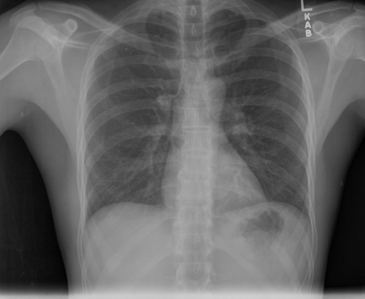
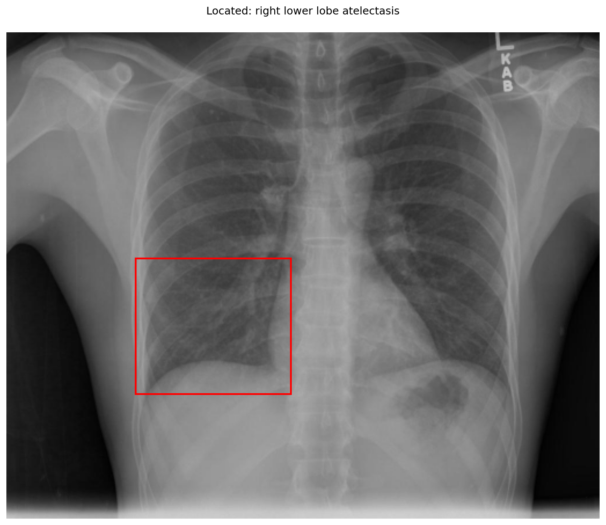
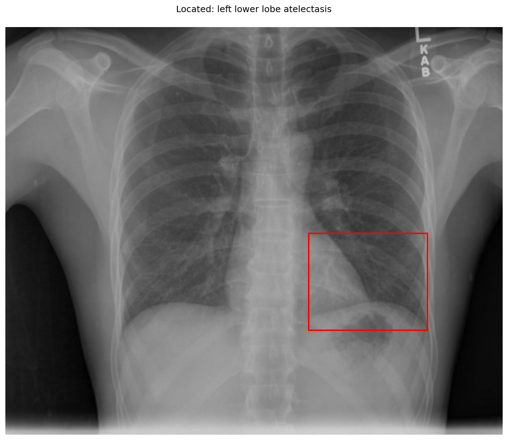

# chexbench_openi_0100 · 误改

Which finding is in this chest X-ray?

| 选项 | 内容 |
|---|---|
| A | left lower lobe pulmonary atelectasis |
| B | right lower lobe pulmonary atelectasis |

参考标注 **B**。B0-F **B. right lower lobe pulmonary atelectasis**，L1-F **A. left lower lobe pulmonary atelectasis**。

## B0-F

主模型 4 次，工具 3 次，格式修复 0 次。运行器状态 `completed`。

[完整步骤](../B0/steps/chexbench_openi_0100.json) · [锁定首答](../B0/predictions/R55-M5-11tools-CheXagent8B/chexbench_openi_0100.json) · [工具回执](../B0/services/tool_selections/R49-AGENT/chexbench_openi_0100)

| 调用 | 请求 | 响应 | 协议事件 |
|---:|---|---|---|
| 1 | [请求](../B0/services/calls/R49-AGENT/chexbench_openi_0100/1/request.json) | [响应](../B0/services/calls/R49-AGENT/chexbench_openi_0100/1/response.json) | [协议事件](../B0/services/protocol_events/chexbench_openi_0100/1.json) |
| 2 | [请求](../B0/services/calls/R49-AGENT/chexbench_openi_0100/2/request.json) | [响应](../B0/services/calls/R49-AGENT/chexbench_openi_0100/2/response.json) | [协议事件](../B0/services/protocol_events/chexbench_openi_0100/2.json) |
| 3 | [请求](../B0/services/calls/R49-AGENT/chexbench_openi_0100/3/request.json) | [响应](../B0/services/calls/R49-AGENT/chexbench_openi_0100/3/response.json) | [协议事件](../B0/services/protocol_events/chexbench_openi_0100/3.json) |
| 4 | [请求](../B0/services/calls/R49-AGENT/chexbench_openi_0100/4/request.json) | [响应](../B0/services/calls/R49-AGENT/chexbench_openi_0100/4/response.json) | [协议事件](../B0/services/protocol_events/chexbench_openi_0100/4.json) |

## L1-F

主模型 5 次，工具 4 次，格式修复 0 次。运行器状态 `completed`。

[完整步骤](../L1/steps/chexbench_openi_0100.json) · [锁定首答](../L1/predictions/R55-M5-11tools-CheXagent8B/chexbench_openi_0100.json) · [工具回执](../L1/services/tool_selections/R49-AGENT/chexbench_openi_0100)

| 调用 | 请求 | 响应 | 协议事件 |
|---:|---|---|---|
| 1 | [请求](../L1/services/calls/R49-AGENT/chexbench_openi_0100/1/request.json) | [响应](../L1/services/calls/R49-AGENT/chexbench_openi_0100/1/response.json) | [协议事件](../L1/services/protocol_events/chexbench_openi_0100/1.json) |
| 2 | [请求](../L1/services/calls/R49-AGENT/chexbench_openi_0100/2/request.json) | [响应](../L1/services/calls/R49-AGENT/chexbench_openi_0100/2/response.json) | [协议事件](../L1/services/protocol_events/chexbench_openi_0100/2.json) |
| 3 | [请求](../L1/services/calls/R49-AGENT/chexbench_openi_0100/3/request.json) | [响应](../L1/services/calls/R49-AGENT/chexbench_openi_0100/3/response.json) | [协议事件](../L1/services/protocol_events/chexbench_openi_0100/3.json) |
| 4 | [请求](../L1/services/calls/R49-AGENT/chexbench_openi_0100/4/request.json) | [响应](../L1/services/calls/R49-AGENT/chexbench_openi_0100/4/response.json) | [协议事件](../L1/services/protocol_events/chexbench_openi_0100/4.json) |
| 5 | [请求](../L1/services/calls/R49-AGENT/chexbench_openi_0100/5/request.json) | [响应](../L1/services/calls/R49-AGENT/chexbench_openi_0100/5/response.json) | [协议事件](../L1/services/protocol_events/chexbench_openi_0100/5.json) |

