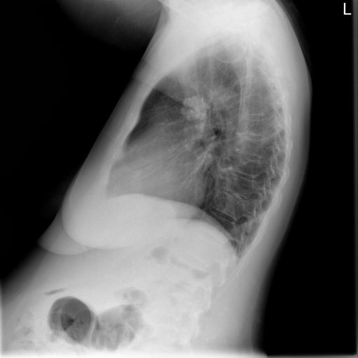
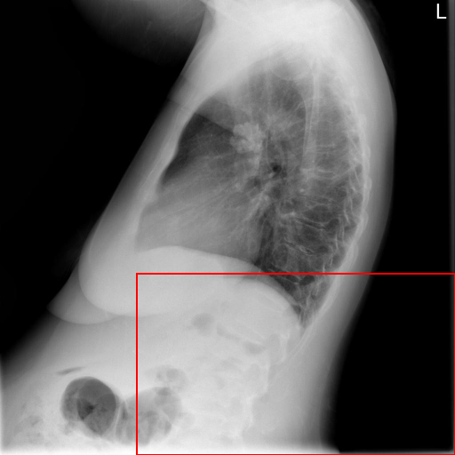
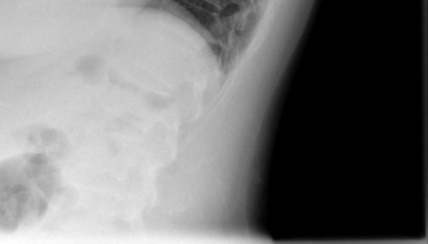

# chexbench_openi_0235 · 误改

Which finding is in this chest X-ray?

| 选项 | 内容 |
|---|---|
| A | small right pleural effusion |
| B | small left pleural effusion |

参考标注 **A**。B0-F **A. small right pleural effusion**，L1-F **B. small left pleural effusion**。

## B0-F

主模型 7 次，工具 6 次，格式修复 0 次。运行器状态 `completed`。

[完整步骤](../B0/steps/chexbench_openi_0235.json) · [锁定首答](../B0/predictions/R55-M5-11tools-CheXagent8B/chexbench_openi_0235.json) · [工具回执](../B0/services/tool_selections/R49-AGENT/chexbench_openi_0235)

| 调用 | 请求 | 响应 | 协议事件 |
|---:|---|---|---|
| 1 | [请求](../B0/services/calls/R49-AGENT/chexbench_openi_0235/1/request.json) | [响应](../B0/services/calls/R49-AGENT/chexbench_openi_0235/1/response.json) | [协议事件](../B0/services/protocol_events/chexbench_openi_0235/1.json) |
| 2 | [请求](../B0/services/calls/R49-AGENT/chexbench_openi_0235/2/request.json) | [响应](../B0/services/calls/R49-AGENT/chexbench_openi_0235/2/response.json) | [协议事件](../B0/services/protocol_events/chexbench_openi_0235/2.json) |
| 3 | [请求](../B0/services/calls/R49-AGENT/chexbench_openi_0235/3/request.json) | [响应](../B0/services/calls/R49-AGENT/chexbench_openi_0235/3/response.json) | [协议事件](../B0/services/protocol_events/chexbench_openi_0235/3.json) |
| 4 | [请求](../B0/services/calls/R49-AGENT/chexbench_openi_0235/4/request.json) | [响应](../B0/services/calls/R49-AGENT/chexbench_openi_0235/4/response.json) | [协议事件](../B0/services/protocol_events/chexbench_openi_0235/4.json) |
| 5 | [请求](../B0/services/calls/R49-AGENT/chexbench_openi_0235/5/request.json) | [响应](../B0/services/calls/R49-AGENT/chexbench_openi_0235/5/response.json) | [协议事件](../B0/services/protocol_events/chexbench_openi_0235/5.json) |
| 6 | [请求](../B0/services/calls/R49-AGENT/chexbench_openi_0235/6/request.json) | [响应](../B0/services/calls/R49-AGENT/chexbench_openi_0235/6/response.json) | [协议事件](../B0/services/protocol_events/chexbench_openi_0235/6.json) |
| 7 | [请求](../B0/services/calls/R49-AGENT/chexbench_openi_0235/7/request.json) | [响应](../B0/services/calls/R49-AGENT/chexbench_openi_0235/7/response.json) | [协议事件](../B0/services/protocol_events/chexbench_openi_0235/7.json) |

## L1-F

主模型 9 次，工具 8 次，格式修复 0 次。运行器状态 `completed`。

[完整步骤](../L1/steps/chexbench_openi_0235.json) · [锁定首答](../L1/predictions/R55-M5-11tools-CheXagent8B/chexbench_openi_0235.json) · [工具回执](../L1/services/tool_selections/R49-AGENT/chexbench_openi_0235)

| 调用 | 请求 | 响应 | 协议事件 |
|---:|---|---|---|
| 1 | [请求](../L1/services/calls/R49-AGENT/chexbench_openi_0235/1/request.json) | [响应](../L1/services/calls/R49-AGENT/chexbench_openi_0235/1/response.json) | [协议事件](../L1/services/protocol_events/chexbench_openi_0235/1.json) |
| 2 | [请求](../L1/services/calls/R49-AGENT/chexbench_openi_0235/2/request.json) | [响应](../L1/services/calls/R49-AGENT/chexbench_openi_0235/2/response.json) | [协议事件](../L1/services/protocol_events/chexbench_openi_0235/2.json) |
| 3 | [请求](../L1/services/calls/R49-AGENT/chexbench_openi_0235/3/request.json) | [响应](../L1/services/calls/R49-AGENT/chexbench_openi_0235/3/response.json) | [协议事件](../L1/services/protocol_events/chexbench_openi_0235/3.json) |
| 4 | [请求](../L1/services/calls/R49-AGENT/chexbench_openi_0235/4/request.json) | [响应](../L1/services/calls/R49-AGENT/chexbench_openi_0235/4/response.json) | [协议事件](../L1/services/protocol_events/chexbench_openi_0235/4.json) |
| 5 | [请求](../L1/services/calls/R49-AGENT/chexbench_openi_0235/5/request.json) | [响应](../L1/services/calls/R49-AGENT/chexbench_openi_0235/5/response.json) | [协议事件](../L1/services/protocol_events/chexbench_openi_0235/5.json) |
| 6 | [请求](../L1/services/calls/R49-AGENT/chexbench_openi_0235/6/request.json) | [响应](../L1/services/calls/R49-AGENT/chexbench_openi_0235/6/response.json) | [协议事件](../L1/services/protocol_events/chexbench_openi_0235/6.json) |
| 7 | [请求](../L1/services/calls/R49-AGENT/chexbench_openi_0235/7/request.json) | [响应](../L1/services/calls/R49-AGENT/chexbench_openi_0235/7/response.json) | [协议事件](../L1/services/protocol_events/chexbench_openi_0235/7.json) |
| 8 | [请求](../L1/services/calls/R49-AGENT/chexbench_openi_0235/8/request.json) | [响应](../L1/services/calls/R49-AGENT/chexbench_openi_0235/8/response.json) | [协议事件](../L1/services/protocol_events/chexbench_openi_0235/8.json) |
| 9 | [请求](../L1/services/calls/R49-AGENT/chexbench_openi_0235/9/request.json) | [响应](../L1/services/calls/R49-AGENT/chexbench_openi_0235/9/response.json) | [协议事件](../L1/services/protocol_events/chexbench_openi_0235/9.json) |

