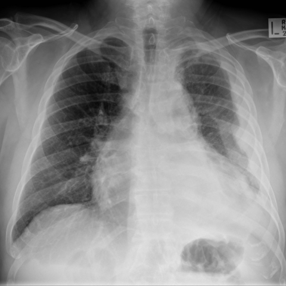

# R1：10569_8353800725393

[全部题目](README.md) · [完整可观察记录](../traces/10569_8353800725393.json) · [D0原回复](../../direct_qwen60/responses/10569_8353800725393_1.json)

D0明确Answer缓存 **B**；R1观察求解 **B**；控制器采用 **B**；参考 **B**；回退 **False**。

## 完整题干与选项

```text
Based on the chest X-ray images provided, which of the following best describes the changes observed in the patient's condition over the 6-month period, specifically focusing on the contralateral lung?  
A) There is a decrease in the number of miliary nodules in the right lung, suggesting a response to chemotherapy.  
B) There is an increase in the number and distribution of miliary nodules in the right lung, consistent with metastatic spread.  
C) The miliary nodules in the right lung remain unchanged, indicating a stable disease state.  
D) The right lung shows new large masses instead of miliary nodules, indicating a potential new primary malignancy.  
E) The right lung exhibits alveolar opacities rather than miliary nodules, suggesting an infectious process.  
F) There is no significant change in the pleural thickening of the left hemithorax.
```

## 原图与本轮局部

**image:1 — Figure 1a**



**image:2 — Figure 1b**


[基准来源及V12历史过程](../../v12/results/cases/10569_8353800725393.md)。模型/工具输出不是人工确认的患者事实。

## 单次观察与方向绑定

```json
{
  "attribute": "change",
  "target_region": "right lung parenchyma",
  "neutral_question": "Describe the change in the number, size, and distribution of small nodular opacities in the right lung between the two images.",
  "kind": "visual",
  "image_ids": [
    "image:1",
    "image:2"
  ],
  "target_patient_side": "right",
  "box": null,
  "tool": "",
  "tool_args": {},
  "image_metadata": [
    {
      "image_id": "image:1",
      "modality": "CXR",
      "view": "frontal",
      "marker": {
        "text": "R",
        "box": [
          0.94,
          0.06,
          0.98,
          0.1
        ]
      }
    },
    {
      "image_id": "image:2",
      "modality": "CXR",
      "view": "frontal",
      "marker": {
        "text": "L",
        "box": [
          0.94,
          0.06,
          0.98,
          0.1
        ]
      }
    }
  ],
  "warnings": []
}
```

```json
{
  "requested_kind": "visual",
  "executed_kind": "visual",
  "selected_image_ids": [
    "image:1",
    "image:2"
  ],
  "started_utc": "2026-10-31T08:45:54.136164+00:00",
  "status": "returned",
  "crop_audit": null,
  "medical_tool_calls": 0,
  "crop_calls": 0,
  "ended_utc": "2026-10-31T08:45:54.136178+00:00"
}
```

## 独立观察后的原始短答

```text
Answer: B) There is an increase in the number and distribution of miliary nodules in the right lung, consistent with metastatic spread.  
Reason: In Figure 1a, the right lung shows relatively sparse, faint nodular opacities; in Figure 1b, the right lung demonstrates markedly more numerous, denser, and more diffusely distributed small nodular opacities—consistent with progression of miliary disease—while the left lung remains largely unchanged (with pleural thickening/hemithoracic opacity), confirming the change is contralateral and progressive.
```
