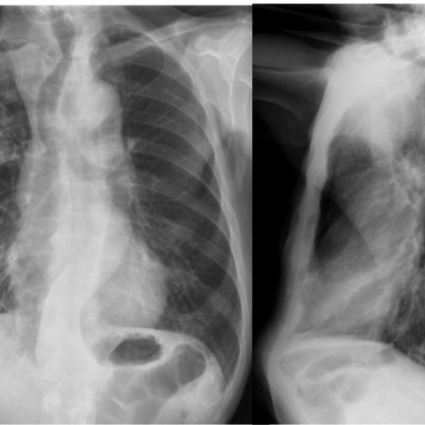

# R1：11801_8353800651620

[全部题目](README.md) · [完整可观察记录](../traces/11801_8353800651620.json) · [D0原回复](../../direct_qwen60/responses/11801_8353800651620_1.json)

D0明确Answer缓存 **A**；R1观察求解 **A**；控制器采用 **A**；参考 **B**；回退 **False**。

## 完整题干与选项

```text
Based on the chest radiograph findings, what is the most likely diagnosis for the patient's condition given the clinical history and imaging characteristics? Consider the patterns and changes in airspace consolidations observed in the X-ray images.

A) Chronic eosinophilic pneumonia
B) Lipoid pneumonia
C) Primary pulmonary lymphoma
D) Sarcoidosis
E) Lepidic predominant adenocarcinoma
F) Bronchiectasis
```

## 原图与本轮局部

**image:1 — Figure 1**


**image:2 — Figure 2**



[基准来源及V12历史过程](../../v12/results/cases/11801_8353800651620.md)。模型/工具输出不是人工确认的患者事实。

## 单次观察与方向绑定

```json
{
  "attribute": "change",
  "target_region": "airspace consolidations across the two images",
  "neutral_question": "Describe the spatial evolution and morphological change of the airspace opacities between the two radiographs, including whether they migrate, consolidate, resolve, or shift in distribution.",
  "kind": "visual",
  "image_ids": [
    "image:1",
    "image:2"
  ],
  "target_patient_side": "bilateral",
  "box": null,
  "tool": "",
  "tool_args": {},
  "image_metadata": [
    {
      "image_id": "image:1",
      "modality": "CXR",
      "view": "frontal",
      "marker": {
        "text": "unknown",
        "box": null
      }
    },
    {
      "image_id": "image:2",
      "modality": "CXR",
      "view": "montage",
      "marker": {
        "text": "unknown",
        "box": null
      }
    }
  ],
  "warnings": []
}
```

```json
{
  "requested_kind": "visual",
  "executed_kind": "visual",
  "selected_image_ids": [
    "image:1",
    "image:2"
  ],
  "started_utc": "2026-10-31T08:46:18.646988+00:00",
  "status": "returned",
  "crop_audit": null,
  "medical_tool_calls": 0,
  "crop_calls": 0,
  "ended_utc": "2026-10-31T08:46:18.647014+00:00"
}
```

## 独立观察后的原始短答

```text
Answer: A) Chronic eosinophilic pneumonia  
Reason: The airspace consolidations in Figure 1 are patchy and peripheral, predominantly in the upper and mid lung zones; in Figure 2, the opacities have shifted—new consolidation appears in the lower zones while prior areas show partial resolution—consistent with the migratory, transient nature of chronic eosinophilic pneumonia, unlike the fixed or progressive patterns of the other options.
```
