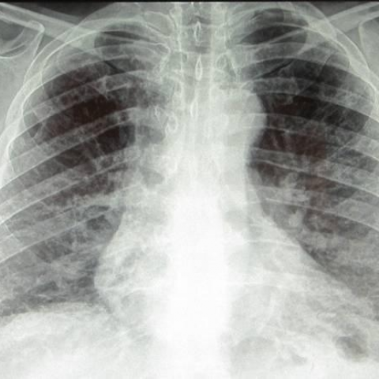
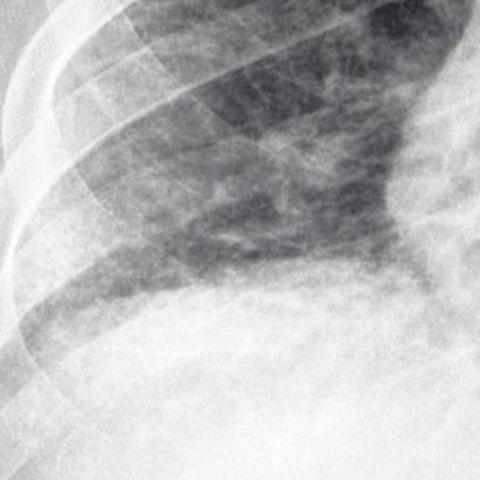

# R1：11804_8353800651404

[全部题目](README.md) · [完整可观察记录](../traces/11804_8353800651404.json) · [D0原回复](../../direct_qwen60/responses/11804_8353800651404_1.json)

D0明确Answer缓存 **A**；R1观察求解 **A**；控制器采用 **A**；参考 **D**；回退 **False**。

## 完整题干与选项

```text
Based on the chest X-rays provided, which of the following statements best describes the relationship and localization of the reticular markings and hyperlucency observed in the patient's lungs?

A) The lower lobe reticular markings are more prominent on the right side, and the upper lobe hyperlucency is more pronounced on the left side.
B) The lower lobe reticular markings are equally prominent on both sides, and the upper lobe hyperlucency is more pronounced on the right side.
C) The lower lobe reticular markings are more prominent on the left side, and the upper lobe hyperlucency is equally pronounced on both sides.
D) The lower lobe reticular markings are more prominent on the right side, and the upper lobe hyperlucency is equally pronounced on both sides.
E) The lower lobe reticular markings are equally prominent on both sides, and the upper lobe hyperlucency is more pronounced on the left side.
F) The lower lobe reticular markings are more prominent on the left side, and the upper lobe hyperlucency is more pronounced on the right side.
```

## 原图与本轮局部

**image:1 — Figure 1a**



**image:2 — Figure 1b**


**image:3 — Figure 1c**



**image:4 — Figure 1d**


[基准来源及V12历史过程](../../v12/results/cases/11804_8353800651404.md)。模型/工具输出不是人工确认的患者事实。

## 单次观察与方向绑定

```json
{
  "attribute": "side",
  "target_region": "lower lobe reticular markings and upper lobe hyperlucency",
  "neutral_question": "On which side(s) are the lower lobe reticular markings more prominent, and on which side(s) is the upper lobe hyperlucency more pronounced?",
  "kind": "visual",
  "image_ids": [
    "image:1"
  ],
  "target_patient_side": "bilateral",
  "box": null,
  "tool": "",
  "tool_args": {},
  "image_metadata": [
    {
      "image_id": "image:1",
      "modality": "CXR",
      "view": "frontal",
      "marker": {
        "text": "unknown",
        "box": null
      }
    }
  ],
  "warnings": []
}
```

```json
{
  "requested_kind": "visual",
  "executed_kind": "visual",
  "selected_image_ids": [
    "image:1"
  ],
  "started_utc": "2026-10-31T08:46:28.256488+00:00",
  "status": "returned",
  "crop_audit": null,
  "medical_tool_calls": 0,
  "crop_calls": 0,
  "ended_utc": "2026-10-31T08:46:28.256514+00:00"
}
```

## 独立观察后的原始短答

```text
Answer: A) The lower lobe reticular markings are more prominent on the right side, and the upper lobe hyperlucency is more pronounced on the left side.  
Reason: In Figure 1a (PA CXR), the right lower lung zone shows denser, more confluent reticular opacities compared to the left lower zone; conversely, the left upper lung zone appears more radiolucent (hyperlucent) with reduced vascular markings relative to the right upper zone—consistent with asymmetric emphysema or fibrosis distribution, and no R/L marker is visible to flip orientation, so standard PA CXR convention (patient’s right = image left) applies; thus, image-left = patient-right, image-right = patient-left, confirming right-sided lower lobe reticulation and left-sided upper lobe hyperlucency.
```
