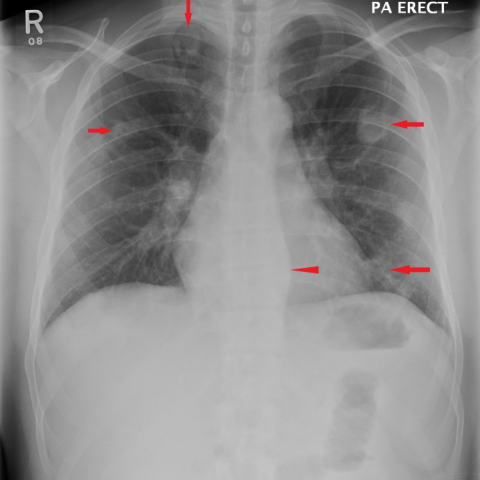

# R1：12721_8353800681884

[全部题目](README.md) · [完整可观察记录](../traces/12721_8353800681884.json) · [D0原回复](../../direct_qwen60/responses/12721_8353800681884_1.json)

D0明确Answer缓存 **B**；R1观察求解 **B**；控制器采用 **B**；参考 **B**；回退 **False**。

## 完整题干与选项

```text
Considering the chest X-ray findings and the patient's clinical presentation, which of the following best describes the progression and most likely diagnosis of the pulmonary condition seen in the X-rays?

A) The pulmonary nodules have increased in number and size, with new cavitations, suggesting a worsening case of tuberculosis.
B) The pulmonary nodules have decreased in size and number post-antibiotic therapy, with resolution of cavitations, consistent with septic emboli.
C) The thickened para-vertebral stripe has enlarged, indicating the progression of a metastatic disease.
D) The pulmonary nodules remain unchanged in number and size, indicating chronic inflammatory disease such as Wegner's granulomatosis.
E) There is complete resolution of all pulmonary nodules, suggesting an initial misdiagnosis.
F) The para-vertebral stripe thickening has resolved, indicating the treatment was effective against a primary spinal infection.
```

## 原图与本轮局部

**image:1 — Figure 1**



**image:2 — Figure 7**


[基准来源及V12历史过程](../../v12/results/cases/12721_8353800681884.md)。模型/工具输出不是人工确认的患者事实。

## 单次观察与方向绑定

```json
{
  "attribute": "change",
  "target_region": "pulmonary nodules and cavitations across both lungs",
  "neutral_question": "Describe the interval change in number, size, and presence of cavitations of pulmonary opacities between the two images.",
  "kind": "visual",
  "image_ids": [
    "image:1",
    "image:2"
  ],
  "target_patient_side": "bilateral",
  "box": null,
  "tool": "",
  "tool_args": {},
  "image_metadata": [
    {
      "image_id": "image:1",
      "modality": "CXR",
      "view": "frontal",
      "marker": {
        "text": "R",
        "box": [
          0.04,
          0.03,
          0.08,
          0.07
        ]
      }
    },
    {
      "image_id": "image:2",
      "modality": "CXR",
      "view": "frontal",
      "marker": {
        "text": "L",
        "box": [
          0.88,
          0.03,
          0.92,
          0.07
        ]
      }
    }
  ],
  "warnings": []
}
```

```json
{
  "requested_kind": "visual",
  "executed_kind": "visual",
  "selected_image_ids": [
    "image:1",
    "image:2"
  ],
  "started_utc": "2026-10-31T08:47:03.795995+00:00",
  "status": "returned",
  "crop_audit": null,
  "medical_tool_calls": 0,
  "crop_calls": 0,
  "ended_utc": "2026-10-31T08:47:03.796022+00:00"
}
```

## 独立观察后的原始短答

```text
Answer: B) The pulmonary nodules have decreased in size and number post-antibiotic therapy, with resolution of cavitations, consistent with septic emboli.  
Reason: In Figure 1, multiple ill-defined pulmonary opacities (nodules) with possible cavitations are visible (e.g., right mid-lung and left lower lung, marked by red arrows); in Figure 7, these opacities are absent or markedly reduced, indicating interval improvement—consistent with resolution after treatment, as described in option B.
```
