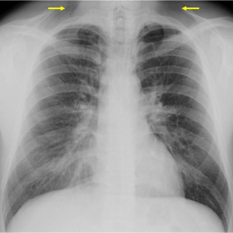

# R1：13935_8353800618951

[全部题目](README.md) · [完整可观察记录](../traces/13935_8353800618951.json) · [D0原回复](../../direct_qwen60/responses/13935_8353800618951_1.json)

D0明确Answer缓存 **B**；R1观察求解 **C**；控制器采用 **C**；参考 **C**；回退 **False**。

## 完整题干与选项

```text
A 26-year-old male patient presents with sudden thoracic and supraclavicular pain and dyspnoea. The chest X-ray was initially misinterpreted as normal. Upon reevaluation, multiple subtle signs were observed. Which of the following findings is most indicative of a spontaneous pneumomediastinum on the chest X-ray, and what does this imply about the underlying pathophysiological mechanism?

A) Presence of a continuous diaphragmatic sign; suggests pneumopericardium due to air posterior to the pericardium.
B) Observation of subcutaneous emphysema in the supraclavicular region; indicates air leakage from the mediastinum into subcutaneous tissue.
C) Detection of a double bronchial wall sign; implies air dissecting along the bronchial walls due to alveolar rupture.
D) Identification of Naclerio's V sign; indicates an esophageal rupture with mediastinal air lateral to the aorta.
E) Visualization of the thymic sail sign; suggests pneumomediastinum in a pediatric patient due to elevated thymus.
F) Recognition of the ring around the artery sign; signifies air enclosing the pulmonary artery due to tracheobronchial injury.
```

## 原图与本轮局部

**image:1 — Figure 3a**



**image:2 — Figure 3b**


[基准来源及V12历史过程](../../v12/results/cases/13935_8353800618951.md)。模型/工具输出不是人工确认的患者事实。

## 单次观察与方向绑定

```json
{
  "attribute": "sign",
  "target_region": "mediastinal and supraclavicular regions on frontal chest X-ray",
  "neutral_question": "Which named radiographic sign is visible in the mediastinum or supraclavicular area, and where exactly is it located relative to the trachea, aorta, and clavicles?",
  "kind": "visual",
  "image_ids": [
    "image:1",
    "image:2"
  ],
  "target_patient_side": "bilateral",
  "box": null,
  "tool": "",
  "tool_args": {},
  "image_metadata": [
    {
      "image_id": "image:1",
      "modality": "CXR",
      "view": "frontal",
      "marker": {
        "text": "unknown",
        "box": null
      }
    },
    {
      "image_id": "image:2",
      "modality": "CXR",
      "view": "frontal",
      "marker": {
        "text": "unknown",
        "box": null
      }
    }
  ],
  "warnings": []
}
```

```json
{
  "requested_kind": "visual",
  "executed_kind": "visual",
  "selected_image_ids": [
    "image:1",
    "image:2"
  ],
  "started_utc": "2026-10-31T08:48:09.044942+00:00",
  "status": "returned",
  "crop_audit": null,
  "medical_tool_calls": 0,
  "crop_calls": 0,
  "ended_utc": "2026-10-31T08:48:09.044970+00:00"
}
```

## 独立观察后的原始短答

```text
Answer: C) Detection of a double bronchial wall sign; implies air dissecting along the bronchial walls due to alveolar rupture.  
Reason: Figure 3b shows linear lucencies parallel to the trachea and main bronchi (yellow arrows), representing air in the peribronchial connective tissue—the classic “double bronchial wall” sign of pneumomediastinum, consistent with air tracking from ruptured alveoli along bronchovascular sheaths.
```
