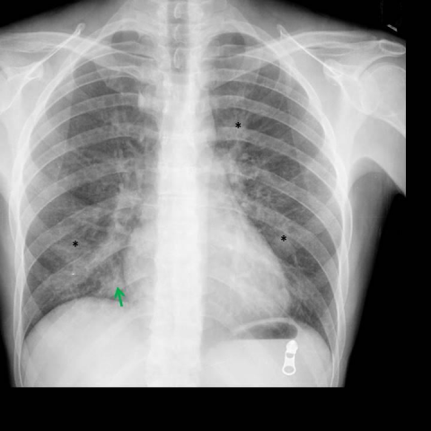

# R1：15314_8353800558683

[全部题目](README.md) · [完整可观察记录](../traces/15314_8353800558683.json) · [D0原回复](../../direct_qwen60/responses/15314_8353800558683_1.json)

D0明确Answer缓存 **C**；R1观察求解 **C**；控制器采用 **C**；参考 **C**；回退 **False**。

## 完整题干与选项

```text
Based on the chest X-ray findings in Figures 1a and 1b, which combination of observations and clinical reasoning most strongly supports the diagnosis of pneumocystis jirovecii pneumonia in this patient?

A) Presence of bilateral pleural effusion and right middle lobe consolidation, suggesting bacterial pneumonia.
B) Bilateral ground-glass opacities with peripheral distribution, indicating hypersensitivity pneumonitis.
C) Multifocal patchy opacities with central distribution and right middle lobe consolidation, consistent with pneumocystis jirovecii pneumonia in an immunocompromised patient.
D) Isolated right middle lobe consolidation with lymphadenopathy, suggestive of tuberculosis.
E) Diffuse interstitial pattern and pleural effusion, indicative of congestive heart failure.
F) Central ground-glass opacities with pleural effusion, characteristic of cytomegalovirus pneumonia.
```

## 原图与本轮局部

**image:1 — Figure 1a**



**image:2 — Figure 1b**


[基准来源及V12历史过程](../../v12/results/cases/15314_8353800558683.md)。模型/工具输出不是人工确认的患者事实。

## 单次观察与方向绑定

```json
{
  "attribute": "other",
  "target_region": "lung opacities across both lungs",
  "neutral_question": "Describe the spatial distribution of the lung opacities (e.g., central, peripheral, perihilar, diffuse) in Figures 1a and 1b.",
  "kind": "visual",
  "image_ids": [
    "image:1",
    "image:2"
  ],
  "target_patient_side": "bilateral",
  "box": null,
  "tool": "",
  "tool_args": {},
  "image_metadata": [
    {
      "image_id": "image:1",
      "modality": "CXR",
      "view": "frontal",
      "marker": {
        "text": "R",
        "box": [
          0.78,
          0.82,
          0.82,
          0.86
        ]
      }
    },
    {
      "image_id": "image:2",
      "modality": "CXR",
      "view": "lateral",
      "marker": {
        "text": "unknown",
        "box": null
      }
    }
  ],
  "warnings": []
}
```

```json
{
  "requested_kind": "visual",
  "executed_kind": "visual",
  "selected_image_ids": [
    "image:1",
    "image:2"
  ],
  "started_utc": "2026-10-31T08:48:55.861641+00:00",
  "status": "returned",
  "crop_audit": null,
  "medical_tool_calls": 0,
  "crop_calls": 0,
  "ended_utc": "2026-10-31T08:48:55.861665+00:00"
}
```

## 独立观察后的原始短答

```text
Answer: C) Multifocal patchy opacities with central distribution and right middle lobe consolidation, consistent with pneumocystis jirovecii pneumonia in an immunocompromised patient.  
Reason: Both frontal (Fig 1a) and lateral (Fig 1b) views show bilateral, multifocal patchy opacities that are predominantly perihilar/central (not peripheral), with increased density in the right middle lobe—classic for PJP in immunocompromised hosts; peripheral ground-glass (option B) is not seen, and pleural effusions or lymphadenopathy are absent.
```
