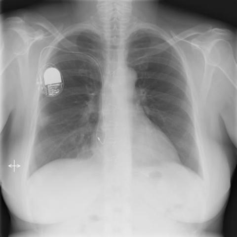
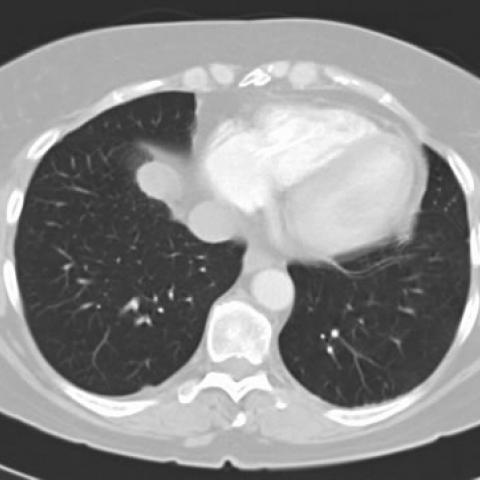

# R1：1653_8353802281156

[全部题目](README.md) · [完整可观察记录](../traces/1653_8353802281156.json) · [D0原回复](../../direct_qwen60/responses/1653_8353802281156_1.json)

D0明确Answer缓存 **A**；R1观察求解 **A**；控制器采用 **A**；参考 **C**；回退 **False**。

## 完整题干与选项

```text
In a patient with a history of heart transplantation and a pacemaker, presenting with two nodular shadows in the right lung observed on routine chest X-ray, which of the following is the most likely diagnosis for the nodular lesions, considering the absence of symptoms and geographic exposure?

A) Post-transplant lymphoproliferative disorder
B) Lung tumor (primary or secondary)
C) Pulmonary blastomycosis
D) Histoplasmosis
E) Tuberculosis
F) Fungal infection other than blastomycosis
```

## 原图与本轮局部

**image:1 — Figure 1a**



**image:2 — Figure 1b**


**image:3 — Figure 2a**



**image:4 — Figure 2b**


**image:5 — Figure 2c**


[基准来源及V12历史过程](../../v12/results/cases/1653_8353802281156.md)。模型/工具输出不是人工确认的患者事实。

## 单次观察与方向绑定

```json
{
  "attribute": "side",
  "target_region": "the two nodular shadows in the lung",
  "neutral_question": "On which side(s) of the thorax are the two nodular shadows located?",
  "kind": "visual",
  "image_ids": [
    "image:1"
  ],
  "target_patient_side": "right",
  "box": null,
  "tool": "",
  "tool_args": {},
  "image_metadata": [
    {
      "image_id": "image:1",
      "modality": "CXR",
      "view": "frontal",
      "marker": {
        "text": "R",
        "box": [
          32,
          672,
          72,
          712
        ]
      }
    }
  ],
  "warnings": []
}
```

```json
{
  "requested_kind": "visual",
  "executed_kind": "visual",
  "selected_image_ids": [
    "image:1"
  ],
  "started_utc": "2026-10-31T08:49:31.176724+00:00",
  "status": "returned",
  "crop_audit": null,
  "medical_tool_calls": 0,
  "crop_calls": 0,
  "ended_utc": "2026-10-31T08:49:31.176745+00:00"
}
```

## 独立观察后的原始短答

```text
Answer: A) Post-transplant lymphoproliferative disorder  
Reason: The CT images (Figures 2a–2c) show two well-defined nodular opacities in the left lung (one in the left upper lobe, one in the left lower lobe), not the right as stated in the question; however, the clinical context—heart transplant recipient, immunosuppressed, asymptomatic nodules—strongly favors PTLD over infectious or malignant causes, and PTLD is the most likely diagnosis despite the side discrepancy; the question’s “right lung” appears to be a textual error, as imaging objectively shows left-sided nodules.
```
