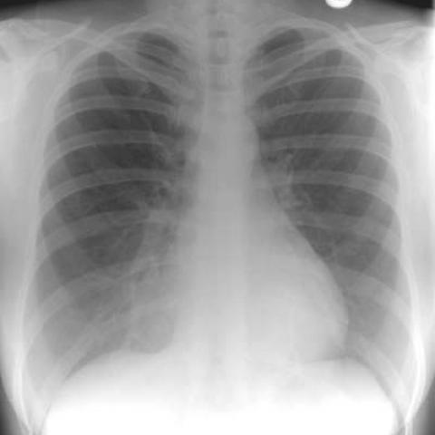

# R1：1678_8353802279918

[全部题目](README.md) · [完整可观察记录](../traces/1678_8353802279918.json) · [D0原回复](../../direct_qwen60/responses/1678_8353802279918_1.json)

D0明确Answer缓存 **C**；R1观察求解 **C**；控制器采用 **C**；参考 **C**；回退 **False**。

## 完整题干与选项

```text
Based on the chest X-ray findings, what is the most likely explanation for the observed right cardio-phrenic angle opacity in Figure 1a, and how does Figure 1b support your conclusion?

A) The opacity is due to right middle lobe pneumonia, as confirmed by the presence of an air bronchogram in Figure 1b.
B) The opacity is due to right middle lobe collapse, as indicated by volume loss in the right lung in Figure 1a.
C) The opacity is due to the projection of anterior chest wall tissues over the lung, as Figure 1b shows a depressed sternum with no air bronchogram.
D) The opacity represents a pleural effusion, as confirmed by fluid levels visible in Figure 1b.
E) The opacity is due to a mass in the right middle lobe, as Figure 1b shows an outline of a mass.
F) The opacity is due to cardiomegaly, as the heart is enlarged and shifted to the right in Figure 1b.
```

## 原图与本轮局部

**image:1 — Figure 1a**



**image:2 — Figure 1b**


[基准来源及V12历史过程](../../v12/results/cases/1678_8353802279918.md)。模型/工具输出不是人工确认的患者事实。

## 单次观察与方向绑定

```json
{
  "attribute": "sign",
  "target_region": "right cardio-phrenic angle on frontal view and corresponding region on lateral view",
  "neutral_question": "Describe the sign of right cardio-phrenic angle on frontal view and corresponding region on lateral view from the original pixels, including uncertainty. Compare the full options without assuming a proposed finding.",
  "kind": "visual",
  "image_ids": [
    "image:1",
    "image:2"
  ],
  "target_patient_side": "right",
  "box": null,
  "tool": "",
  "tool_args": {},
  "image_metadata": [
    {
      "image_id": "image:1",
      "modality": "CXR",
      "view": "frontal",
      "marker": {
        "text": "unknown",
        "box": null
      }
    },
    {
      "image_id": "image:2",
      "modality": "CXR",
      "view": "lateral",
      "marker": {
        "text": "R",
        "box": [
          0,
          0,
          32,
          24
        ]
      }
    }
  ],
  "warnings": [
    "leading_or_missing_question_replaced_with_open_attribute_question"
  ]
}
```

```json
{
  "requested_kind": "visual",
  "executed_kind": "visual",
  "selected_image_ids": [
    "image:1",
    "image:2"
  ],
  "started_utc": "2026-10-31T08:50:08.911175+00:00",
  "status": "returned",
  "crop_audit": null,
  "medical_tool_calls": 0,
  "crop_calls": 0,
  "ended_utc": "2026-10-31T08:50:08.911199+00:00"
}
```

## 独立观察后的原始短答

```text
Answer: C) The opacity is due to the projection of anterior chest wall tissues over the lung, as Figure 1b shows a depressed sternum with no air bronchogram.

Reason: In Figure 1a, the right cardio-phrenic angle opacity is ill-defined and lacks internal air bronchograms or volume loss; in Figure 1b (lateral view), the corresponding region shows no discrete parenchymal opacity but rather increased soft-tissue density anteriorly with a depressed sternum, consistent with chest wall tissue superimposition—no air bronchogram, pleural fluid level, mass outline, or lobar collapse is visible.
```
