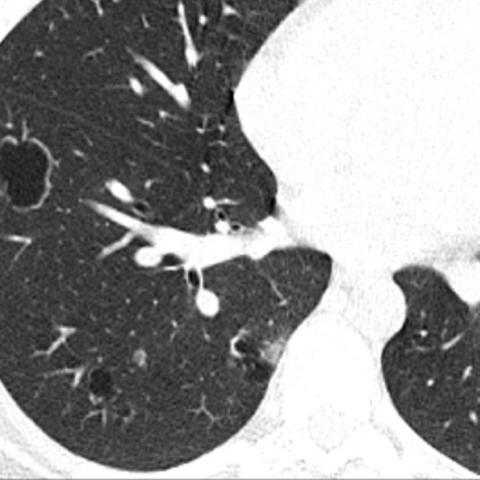

# R1：17182_8143559676067

[全部题目](README.md) · [完整可观察记录](../traces/17182_8143559676067.json) · [D0原回复](../../direct_qwen60/responses/17182_8143559676067_1.json)

D0明确Answer缓存 **C**；R1观察求解 **C**；控制器采用 **C**；参考 **C**；回退 **False**。

## 完整题干与选项

```text
Based on the chest X-ray observations from Figures 1a-c, which of the following best describes the likely diagnosis and the reasoning behind it, considering the clinical history of recurrent pneumonia and a supraglottic polypoid lesion?

A) Granulomatosis with polyangiitis, due to bilateral lung nodules with cavitation.
B) Lymphangioleiomyomatosis, indicated by the presence of cystic lesions in the lung parenchyma.
C) Recurrent respiratory papillomatosis, supported by cavitated nodules and the presence of a supraglottic lesion.
D) Pulmonary Langerhans cell histiocytosis, characterized by cystic and nodular lung lesions.
E) Cystic pulmonary metastases, due to the presence of multiple nodular lesions with variable sizes.
```

## 原图与本轮局部

**image:1 — Figure 1a**



**image:2 — Figure 1b**


**image:3 — Figure 1c**


[基准来源及V12历史过程](../../v12/results/cases/17182_8143559676067.md)。模型/工具输出不是人工确认的患者事实。

## 单次观察与方向绑定

```json
{
  "attribute": "side",
  "target_region": "lung lesions relative to mediastinum",
  "neutral_question": "Describe the side of lung lesions relative to mediastinum from the original pixels, including uncertainty. Compare the full options without assuming a proposed finding.",
  "kind": "visual",
  "image_ids": [
    "image:3"
  ],
  "target_patient_side": "bilateral",
  "box": null,
  "tool": "",
  "tool_args": {},
  "image_metadata": [
    {
      "image_id": "image:3",
      "modality": "CT",
      "view": "axial",
      "marker": {
        "text": "unknown",
        "box": null
      }
    }
  ],
  "warnings": [
    "leading_or_missing_question_replaced_with_open_attribute_question"
  ]
}
```

```json
{
  "requested_kind": "visual",
  "executed_kind": "visual",
  "selected_image_ids": [
    "image:3"
  ],
  "started_utc": "2026-10-31T08:50:29.520742+00:00",
  "status": "returned",
  "crop_audit": null,
  "medical_tool_calls": 0,
  "crop_calls": 0,
  "ended_utc": "2026-10-31T08:50:29.520767+00:00"
}
```

## 独立观察后的原始短答

```text
Answer: C) Recurrent respiratory papillomatosis, supported by cavitated nodules and the presence of a supraglottic lesion.  
Reason: Figure 1c (CT) shows multiple bilateral lung nodules, many with central lucency/cavitation, and the clinical history specifies a supraglottic polypoid lesion—key features of recurrent respiratory papillomatosis with pulmonary spread; other options lack the combination of cavitated nodules + upper airway papilloma.
```
