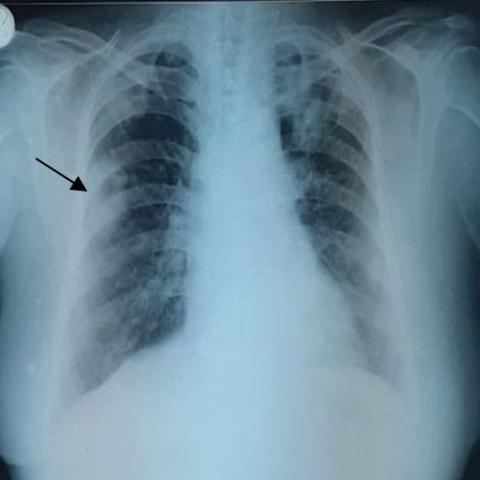

# R1：17621_8143559684844

[全部题目](README.md) · [完整可观察记录](../traces/17621_8143559684844.json) · [D0原回复](../../direct_qwen60/responses/17621_8143559684844_1.json)

D0明确Answer缓存 **D**；R1观察求解 **D**；控制器采用 **D**；参考 **D**；回退 **False**。

## 完整题干与选项

```text
Based on the findings from the initial chest X-ray and the follow-up X-ray (Figures 1 and 7b), which of the following best describes the progression of the pulmonary findings in the context of Pyoderma gangrenosum with pulmonary involvement?
A) The right middle zone opacity has resolved, and new lesions have appeared in the bilateral lower zones.
B) The right middle zone opacity has increased in size, and new cavitating nodules have appeared in the bilateral upper zones.
C) The right middle zone opacity remains unchanged, and the nodular shadows have decreased in size in the bilateral upper zones.
D) The right middle zone opacity has decreased in size, and the nodular shadows in the bilateral upper zones have increased in size.
E) The right middle zone opacity has increased in size, and the nodular shadows have decreased in size in the bilateral lower zones.
F) The right middle zone opacity has decreased in size, and the nodular shadows have increased in size in the bilateral lower zones.
```

## 原图与本轮局部

**image:1 — Figure 1**



**image:2 — Figure 7b**


[基准来源及V12历史过程](../../v12/results/cases/17621_8143559684844.md)。模型/工具输出不是人工确认的患者事实。

## 单次观察与方向绑定

```json
{
  "attribute": "change",
  "target_region": "right middle zone opacity and nodular shadows in bilateral upper and lower zones",
  "neutral_question": "Describe the interval change between Figure 1 and Figure 7b in the size and presence of the opacity in the right middle zone and the nodular shadows in the bilateral upper and lower zones.",
  "kind": "visual",
  "image_ids": [
    "image:1",
    "image:2"
  ],
  "target_patient_side": "bilateral",
  "box": null,
  "tool": "",
  "tool_args": {},
  "image_metadata": [
    {
      "image_id": "image:1",
      "modality": "CXR",
      "view": "frontal",
      "marker": {
        "text": "unknown",
        "box": null
      }
    },
    {
      "image_id": "image:2",
      "modality": "CXR",
      "view": "frontal",
      "marker": {
        "text": "R",
        "box": [
          0.02,
          0.02,
          0.06,
          0.06
        ]
      }
    }
  ],
  "warnings": []
}
```

```json
{
  "requested_kind": "visual",
  "executed_kind": "visual",
  "selected_image_ids": [
    "image:1",
    "image:2"
  ],
  "started_utc": "2026-10-31T08:50:53.610686+00:00",
  "status": "returned",
  "crop_audit": null,
  "medical_tool_calls": 0,
  "crop_calls": 0,
  "ended_utc": "2026-10-31T08:50:53.610712+00:00"
}
```

## 独立观察后的原始短答

```text
Answer: D) The right middle zone opacity has decreased in size, and the nodular shadows in the bilateral upper zones have increased in size.  
Reason: In Figure 1, a distinct opacity is visible in the right middle zone (arrow), which is markedly reduced or absent in Figure 7b; concurrently, faint nodular opacities in the bilateral upper zones in Figure 1 appear more prominent and numerous in Figure 7b, indicating interval increase in the upper zones while the right middle zone opacity decreased.
```
