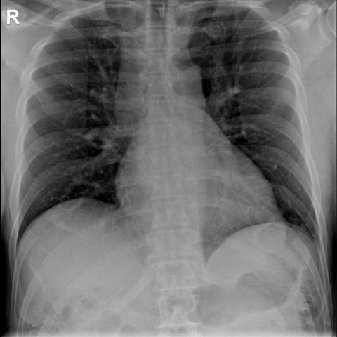

# R1：18202_8143559000122

[全部题目](README.md) · [完整可观察记录](../traces/18202_8143559000122.json) · [D0原回复](../../direct_qwen60/responses/18202_8143559000122_1.json)

D0明确Answer缓存 **C**；R1观察求解 **A**；控制器采用 **A**；参考 **A**；回退 **False**。

## 完整题干与选项

```text
Based on the chest X-ray findings, which combination of radiographic signs is most suggestive of a pulmonary embolism in this patient?

A) Wedge-shaped pleural-based opacity in the right lower lung field and engorgement of the right descending pulmonary artery
B) Wedge-shaped pleural-based opacity in the left lower lung field and engorgement of the left descending pulmonary artery
C) Engorgement of the right descending pulmonary artery and a focal peripheral hyperlucency in the right lung field
D) Wedge-shaped pleural-based opacity in the right lower lung field and a focal peripheral hyperlucency in the left lung field
E) Engorgement of the left descending pulmonary artery and a focal peripheral hyperlucency in the left lung field
F) Engorgement of the right descending pulmonary artery and a wedge-shaped pleural-based opacity in the left lower lung field
```

## 原图与本轮局部

**image:1 — Figure 1a**


**image:2 — Figure 1b**


**image:3 — Figure 2**



[基准来源及V12历史过程](../../v12/results/cases/18202_8143559000122.md)。模型/工具输出不是人工确认的患者事实。

## 单次观察与方向绑定

```json
{
  "attribute": "side",
  "target_region": "the lung field containing the wedge-shaped pleural-based opacity and the engorged descending pulmonary artery",
  "neutral_question": "On which patient side is the wedge-shaped pleural-based opacity located, and on which side is the engorged descending pulmonary artery located?",
  "kind": "visual",
  "image_ids": [
    "image:1",
    "image:2"
  ],
  "target_patient_side": "bilateral",
  "box": null,
  "tool": "",
  "tool_args": {},
  "image_metadata": [
    {
      "image_id": "image:1",
      "modality": "CXR",
      "view": "frontal",
      "marker": {
        "text": "R",
        "box": [
          0.0,
          0.15,
          0.03,
          0.2
        ]
      }
    },
    {
      "image_id": "image:2",
      "modality": "CXR",
      "view": "frontal",
      "marker": {
        "text": "R",
        "box": [
          0.0,
          0.15,
          0.03,
          0.2
        ]
      }
    }
  ],
  "warnings": []
}
```

```json
{
  "requested_kind": "visual",
  "executed_kind": "visual",
  "selected_image_ids": [
    "image:1",
    "image:2"
  ],
  "started_utc": "2026-10-31T08:51:31.813581+00:00",
  "status": "returned",
  "crop_audit": null,
  "medical_tool_calls": 0,
  "crop_calls": 0,
  "ended_utc": "2026-10-31T08:51:31.813607+00:00"
}
```

## 独立观察后的原始短答

```text
Answer: A) Wedge-shaped pleural-based opacity in the right lower lung field and engorgement of the right descending pulmonary artery  
Reason: In Figure 1b, the white arrow points to a wedge-shaped pleural-based opacity in the right lower lung field, and the blue arrow indicates engorgement of the right descending pulmonary artery (visible as a dilated vessel near the right hilum); both findings are on the same (right) side, matching option A.
```
