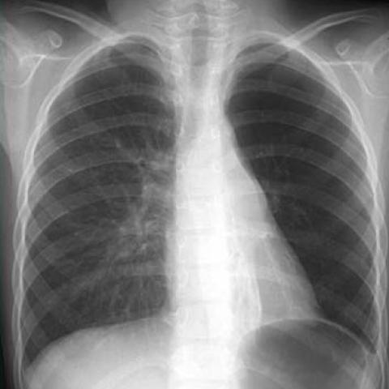
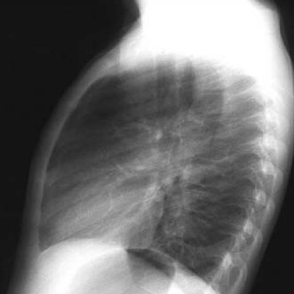

# R1：3359_8353801515597

[全部题目](README.md) · [完整可观察记录](../traces/3359_8353801515597.json) · [D0原回复](../../direct_qwen60/responses/3359_8353801515597_1.json)

D0明确Answer缓存 **D**；R1观察求解 **A**；控制器采用 **A**；参考 **B**；回退 **False**。

## 完整题干与选项

```text
Based on the conventional chest radiographs, what is the most likely explanation for the patient's clinical presentation of recurrent bronchial pneumonia and defective thorax development?
A) The hyperlucent left lung with bronchiectasis indicates Mac-Leod syndrome, with the anterior mediastinal mass unrelated.
B) The hyperlucent left lung with bronchiectasis and the anterior mediastinal mass suggest a bronchogenic cyst causing tracheobronchial compression.
C) The anterior mediastinal mass is likely benign and unrelated to the pulmonary findings.
D) The hyperlucent left lung with bronchiectasis is a result of bronchogenic cyst compression on the left main bronchus.
E) The presence of the mass in the anterior mediastinum suggests a malignant process unrelated to the lung findings.
F) The findings indicate a bilateral process inconsistent with Mac-Leod syndrome.
```

## 原图与本轮局部

**image:1 — Figure 1a**



**image:2 — Figure 1b**



[基准来源及V12历史过程](../../v12/results/cases/3359_8353801515597.md)。模型/工具输出不是人工确认的患者事实。

## 单次观察与方向绑定

```json
{
  "attribute": "side",
  "target_region": "hyperlucent lung and associated bronchiectasis",
  "neutral_question": "On which patient side is the hyperlucent lung with bronchiectasis located?",
  "kind": "visual",
  "image_ids": [
    "image:1"
  ],
  "target_patient_side": "left",
  "box": null,
  "tool": "",
  "tool_args": {},
  "image_metadata": [
    {
      "image_id": "image:1",
      "modality": "CXR",
      "view": "frontal",
      "marker": {
        "text": "L",
        "box": [
          0.92,
          0.03,
          0.96,
          0.06
        ]
      }
    },
    {
      "image_id": "image:2",
      "modality": "CXR",
      "view": "lateral",
      "marker": {
        "text": "unknown",
        "box": null
      }
    }
  ],
  "warnings": []
}
```

```json
{
  "requested_kind": "visual",
  "executed_kind": "visual",
  "selected_image_ids": [
    "image:1"
  ],
  "started_utc": "2026-10-31T08:52:24.158650+00:00",
  "status": "returned",
  "crop_audit": null,
  "medical_tool_calls": 0,
  "crop_calls": 0,
  "ended_utc": "2026-10-31T08:52:24.158687+00:00"
}
```

## 独立观察后的原始短答

```text
Answer: A) The hyperlucent left lung with bronchiectasis indicates Mac-Leod syndrome, with the anterior mediastinal mass unrelated.  
Reason: In Figure 1a (PA CXR), the left lung is markedly hyperlucent with reduced vascular markings and volume loss (mediastinal shift toward left, elevated left hemidiaphragm), and bronchiectatic changes are visible in the left lower zone; this matches classic left-sided MacLeod syndrome (swyer-James), and no anterior mediastinal mass is visible on the provided images—so option A’s description of the side and findings is best supported by the visual evidence, while other options incorrectly invoke a mass not seen.
```
