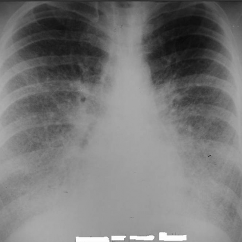

# R1：3831_8353801520459

[全部题目](README.md) · [完整可观察记录](../traces/3831_8353801520459.json) · [D0原回复](../../direct_qwen60/responses/3831_8353801520459_1.json)

D0明确Answer缓存 **E**；R1观察求解 **E**；控制器采用 **E**；参考 **B**；回退 **False**。

## 完整题干与选项

```text
Based on the chest X-ray findings in Figure 1, which of the following best describes the observed pattern and its implications?

A) The chest X-ray shows a diffuse reticular pattern predominantly in the upper lobes, suggesting interstitial lung disease with a primary involvement of the apices.
B) The chest X-ray reveals a diffuse micronodular pattern with calcified nodules obscuring the diaphragmatic and cardiac contours, indicative of pulmonary alveolar microlithiasis.
C) The chest X-ray demonstrates large, cavitary lesions in the upper lobes, consistent with a diagnosis of pulmonary tuberculosis.
D) The chest X-ray exhibits a unilateral pleural effusion with mediastinal shift, suggesting malignant pleural mesothelioma.
E) The chest X-ray illustrates bilateral perihilar opacities with Kerley B lines, indicative of pulmonary edema secondary to congestive heart failure.
F) The chest X-ray shows a pattern of air bronchograms with ground-glass opacities, suggestive of acute respiratory distress syndrome.
```

## 原图与本轮局部

**image:1 — Figure 1**



[基准来源及V12历史过程](../../v12/results/cases/3831_8353801520459.md)。模型/工具输出不是人工确认的患者事实。

## 单次观察与方向绑定

```json
{
  "attribute": "pattern",
  "target_region": "bilateral lung fields, especially perihilar and lower zones",
  "neutral_question": "Describe the radiographic pattern observed in the lungs, including its distribution (e.g., upper vs. lower lobes, perihilar vs. peripheral) and key morphological features (e.g., linear, nodular, reticular, ground-glass, air bronchograms, Kerley lines).",
  "kind": "visual",
  "image_ids": [
    "image:1"
  ],
  "target_patient_side": "bilateral",
  "box": null,
  "tool": "",
  "tool_args": {},
  "image_metadata": [
    {
      "image_id": "image:1",
      "modality": "CXR",
      "view": "frontal",
      "marker": {
        "text": "unknown",
        "box": null
      }
    }
  ],
  "warnings": []
}
```

```json
{
  "requested_kind": "visual",
  "executed_kind": "visual",
  "selected_image_ids": [
    "image:1"
  ],
  "started_utc": "2026-10-31T08:53:27.446701+00:00",
  "status": "returned",
  "crop_audit": null,
  "medical_tool_calls": 0,
  "crop_calls": 0,
  "ended_utc": "2026-10-31T08:53:27.446722+00:00"
}
```

## 独立观察后的原始短答

```text
Answer: E) The chest X-ray illustrates bilateral perihilar opacities with Kerley B lines, indicative of pulmonary edema secondary to congestive heart failure.  
Reason: The image shows symmetric, hazy perihilar opacities with fine horizontal linear opacities at the lung bases (consistent with Kerley B lines), and no cavitary lesions, micronodules, or pleural effusion—supporting cardiogenic pulmonary edema; the pattern is bilateral and lower-perihilar, not upper-lobe predominant.
```
