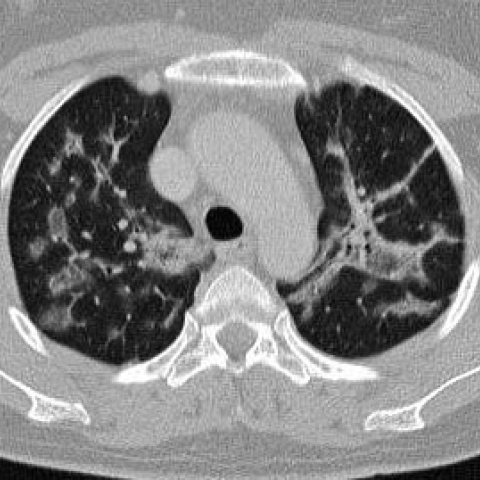
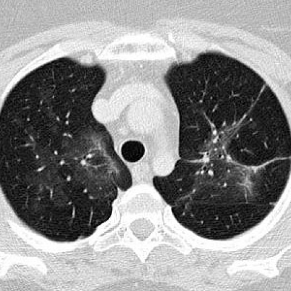

# R1：7738_8353800850751

[全部题目](README.md) · [完整可观察记录](../traces/7738_8353800850751.json) · [D0原回复](../../direct_qwen60/responses/7738_8353800850751_1.json)

D0明确Answer缓存 **B**；R1观察求解 **B**；控制器采用 **B**；参考 **C**；回退 **False**。

## 完整题干与选项

```text
Based on the chest X-ray images provided for a 44-year-old woman with a history of dry cough and mild shortness of breath, determine the most likely progression of her pulmonary condition following corticosteroid treatment. Which observation best supports the diagnosis of cryptogenic organizing pneumonia (COP) in this case?

A) Persistent bilateral peribronchial consolidations with air bronchogram and nodular opacities.
B) Complete resolution of all lesions with no residual opacities.
C) Reduction in bilateral peribronchial consolidations with residual ground glass opacities.
D) Increase in the size of pre-tracheal lymph nodes.
E) Development of new cavitary nodules.
F) No change in the chest X-ray findings after treatment.
```

## 原图与本轮局部

**image:1 — Figure 1a**



**image:2 — Figure 2a**



[基准来源及V12历史过程](../../v12/results/cases/7738_8353800850751.md)。模型/工具输出不是人工确认的患者事实。

## 单次观察与方向绑定

```json
{
  "attribute": "change",
  "target_region": "bilateral lung parenchyma",
  "neutral_question": "Describe the interval change in lung opacities between the two axial images.",
  "kind": "visual",
  "image_ids": [
    "image:1",
    "image:2"
  ],
  "target_patient_side": "bilateral",
  "box": null,
  "tool": "",
  "tool_args": {},
  "image_metadata": [
    {
      "image_id": "image:1",
      "modality": "CT",
      "view": "axial",
      "marker": {
        "text": "unknown",
        "box": null
      }
    },
    {
      "image_id": "image:2",
      "modality": "CT",
      "view": "axial",
      "marker": {
        "text": "unknown",
        "box": null
      }
    }
  ],
  "warnings": []
}
```

```json
{
  "requested_kind": "visual",
  "executed_kind": "visual",
  "selected_image_ids": [
    "image:1",
    "image:2"
  ],
  "started_utc": "2026-10-31T08:56:00.503559+00:00",
  "status": "returned",
  "crop_audit": null,
  "medical_tool_calls": 0,
  "crop_calls": 0,
  "ended_utc": "2026-10-31T08:56:00.503580+00:00"
}
```

## 独立观察后的原始短答

```text
Answer: B) Complete resolution of all lesions with no residual opacities.  
Reason: Comparing Figure 1a and Figure 2a, the bilateral patchy consolidations and reticulonodular opacities present in Figure 1a are absent in Figure 2a, which shows clear lung parenchyma with normal vascular markings—indicating complete radiographic resolution, a hallmark response to corticosteroids in cryptogenic organizing pneumonia (COP).
```
