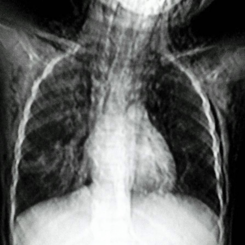

# R1：8129_8353800862240

[全部题目](README.md) · [完整可观察记录](../traces/8129_8353800862240.json) · [D0原回复](../../direct_qwen60/responses/8129_8353800862240_1.json)

D0明确Answer缓存 **B**；R1观察求解 **B**；控制器采用 **B**；参考 **B**；回退 **False**。

## 完整题干与选项

```text
Based on the chest X-ray findings, which of the following conditions is most accurately suggested by the images, given the clinical presentation of sudden respiratory distress and soft tissue oedema with crepitus over the chest and neck in a 5-year-old child?

A. Pneumonia with pleural effusion
B. Subcutaneous emphysema and pneumomediastinum
C. Rib fracture with pneumothorax
D. Asthmatic exacerbation with no additional findings
E. Foreign body aspiration with localized emphysema
F. Traumatic pneumothorax with rib fracture
```

## 原图与本轮局部

**image:1 — Figure 1**



[基准来源及V12历史过程](../../v12/results/cases/8129_8353800862240.md)。模型/工具输出不是人工确认的患者事实。

## 单次观察与方向绑定

```json
{
  "attribute": "sign",
  "target_region": "soft tissue and mediastinal regions of the chest X-ray",
  "neutral_question": "Describe any radiographic signs of gas in the soft tissues or mediastinum, including their distribution and relationship to anatomical structures.",
  "kind": "visual",
  "image_ids": [
    "image:1"
  ],
  "target_patient_side": "bilateral",
  "box": null,
  "tool": "",
  "tool_args": {},
  "image_metadata": [
    {
      "image_id": "image:1",
      "modality": "CXR",
      "view": "frontal",
      "marker": {
        "text": "unknown",
        "box": null
      }
    }
  ],
  "warnings": []
}
```

```json
{
  "requested_kind": "visual",
  "executed_kind": "visual",
  "selected_image_ids": [
    "image:1"
  ],
  "started_utc": "2026-10-31T08:56:10.135810+00:00",
  "status": "returned",
  "crop_audit": null,
  "medical_tool_calls": 0,
  "crop_calls": 0,
  "ended_utc": "2026-10-31T08:56:10.135832+00:00"
}
```

## 独立观察后的原始短答

```text
Answer: B. Subcutaneous emphysema and pneumomediastinum  
Reason: The CXR shows linear radiolucent streaks tracking along the neck and upper chest soft tissues, and a lucent band outlining the mediastinal structures (especially the aortic arch and heart borders), consistent with gas in subcutaneous tissues and mediastinum—key signs of subcutaneous emphysema and pneumomediastinum; no rib fracture or pleural effusion is evident.
```
