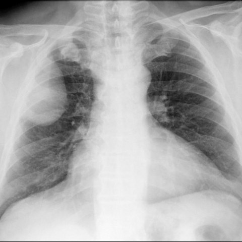
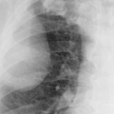

# Benchmark case 11858_8353800664572

[Case index](README.md) · [Machine-readable case](11858_8353800664572.json) · [Scored outcomes](../per-question-outcomes.json)

Source: [Eurorad case 11858](https://www.eurorad.org/case/11858); [ChestAgentBench pinned revision](https://huggingface.co/datasets/wanglab/chest-agent-bench/tree/921e60440927f9893228d843c0206b755744252a).

These are the benchmark inputs used in the frozen experiment. Model and tool observations below are recorded outputs, not independently validated clinical findings.

## Full question and options

```text
Based on the chest X-ray findings and the clinical history, which of the following is the most likely diagnosis for the mass observed in the right hemithorax of this 57-year-old male patient?

A. Lipoma
B. Well-differentiated liposarcoma
C. Metastatic tumor
D. Pleural effusion
E. Primary lung cancer
F. Pneumonia
```

## Original benchmark images

### image:1 — figures/11858/figure_1a.jpg



### image:2 — figures/11858/figure_1b.jpg


## Recorded answers

| Stage | Answer | Execution route/status |
|---|---|---|
| P0 | E | completed |
| V10 VKE candidate | C | candidate before gate |
| V10 VKE final | E | retain |
| S1 | C | selector |
| S2 | C | targeted_followup |
| S3 | E | selector |

Reference answer (post-generation scoring only): **B**.

## V10 VKE candidate and gate record

```json
{
  "candidate": "C",
  "final": "E",
  "changed_attributes": [
    "fat lucency",
    "intrapulmonary vs extrapulmonary",
    "margin morphology"
  ],
  "candidate_payload": {
    "answer": "C",
    "uncertain": true,
    "changed_attributes": [
      "fat lucency",
      "intrapulmonary vs extrapulmonary",
      "margin morphology"
    ],
    "evidence_refs": [
      "p0:tool:1",
      "p0:tool:2",
      "p0:tool:3",
      "VKE:tool:1"
    ],
    "observations": [
      {
        "attribute": "fat lucency",
        "image_ids": [
          "image:1"
        ],
        "value": "absent; homogeneous soft-tissue density without radiolucency in cropped region",
        "status": "observed_absent",
        "evidence_refs": [
          "VKE:tool:1"
        ]
      },
      {
        "attribute": "spatial relationship to lung",
        "image_ids": [
          "image:1",
          "image:2"
        ],
        "value": "extrapulmonary (expert tool); no air bronchograms or spiculation",
        "status": "observed_present",
        "evidence_refs": [
          "p0:tool:3"
        ]
      },
      {
        "attribute": "pleural effusion",
        "image_ids": [
          "image:1"
        ],
        "value": "not present per report and visual absence of meniscus",
        "status": "observed_absent",
        "evidence_refs": [
          "p0:tool:2"
        ]
      }
    ],
    "missing_evidence": [
      "CT for fat confirmation",
      "clinical history (smoking, weight loss, prior malignancy)",
      "size change over time",
      "calcification"
    ],
    "parse_warnings": [],
    "discarded_evidence_refs": []
  },
  "gate": {
    "decision": "retain",
    "changed_attributes": [
      "fat lucency",
      "intrapulmonary vs extrapulmonary",
      "margin morphology"
    ],
    "evidence_refs": [
      "p0:tool:3",
      "VKE:tool:1"
    ],
    "unmet_requirements": [
      "CT for fat confirmation",
      "clinical history (smoking, weight loss, prior malignancy)",
      "size change over time",
      "calcification"
    ],
    "reason": "Extrapulmonary location confirmed by expert tool (p0:tool:3); fat lucency absent in cropped image (VKE:tool:1), ruling out lipoma/liposarcoma; however, no evidence supports metastatic tumor over primary lung cancer—both remain plausible without CT or clinical history."
  },
  "fallback": null,
  "k_ids": [
    "BTS_PLEURAL_2023_K01",
    "RAD_CXR_CHALLENGES_2025_10"
  ],
  "e_ids": [
    "B10_6abffeb9b46662abc08f55b4c57664044fa16238cb78f05f2f6029fb0ff0e26b",
    "B10_fb47f1d505253c3f0101444e516b9ed18fbf0b955a27233799d83353ce296a1c"
  ],
  "candidate_error_type": null,
  "gate_error_type": null
}
```

## Cached anonymous comparison

The X/Y mapping and observation provenance are exposed here for retrospective review. They were kept separate from the selector-facing anonymous input.

```json
{
  "answer_mapping": {
    "X": "E",
    "Y": "C"
  },
  "choices": {
    "X": "Primary lung cancer",
    "Y": "Metastatic tumor"
  },
  "evidence_mapping": {
    "observation_1": "p0:tool:5",
    "observation_2": "p0:tool:3",
    "observation_3": "VKE:tool:1",
    "observation_4": "p0:tool:4",
    "observation_5": "p0:tool:2",
    "observation_6": "p0:tool:1"
  },
  "cached_image_adjustments": []
}
```

### Additional cached pixels

**image_3**



```json
{
  "image_id": "image_3",
  "role": "existing_local_or_tool_image",
  "size": [
    192,
    192
  ],
  "parent_image_id": "image_1",
  "pixel_box": [
    48,
    96,
    240,
    288
  ],
  "source_size": [
    480,
    480
  ],
  "orientation": "unresolved",
  "timepoint": "unresolved"
}
```

### Cached tool observations

Tool request and return text is preserved; private filesystem paths are replaced by image links or an omission marker. Tool conclusions remain fallible.

#### observation_1 — image_visualizer

```json
{
  "observation_id": "observation_1",
  "tool": "image_visualizer",
  "request": {
    "image_path": "image_2",
    "title": "Lateral chest X-ray showing right hemithorax mass"
  },
  "raw_result": [
    {
      "image_path": "image_2"
    },
    {
      "image_path": "image_2",
      "title": true,
      "description": false,
      "figsize": [
        10,
        10
      ],
      "cmap": "rgb",
      "analysis_status": "completed"
    }
  ],
  "image_ids": []
}
```

#### observation_2 — chest_xray_expert

```json
{
  "observation_id": "observation_2",
  "tool": "chest_xray_expert",
  "request": {
    "image_paths": [
      "image_1",
      "image_2"
    ],
    "prompt": "Analyze the mass in the right hemithorax and determine if it appears intrapulmonary or extrapulmonary, and provide differential diagnosis"
  },
  "raw_result": [
    {
      "response": "Extrapulmonary"
    },
    {
      "image_paths": [
        "image_1",
        "image_2"
      ],
      "prompt": "Analyze the mass in the right hemithorax and determine if it appears intrapulmonary or extrapulmonary, and provide differential diagnosis",
      "max_new_tokens": 512,
      "analysis_status": "completed"
    }
  ],
  "image_ids": []
}
```

#### observation_3 — crop_current_image

```json
{
  "observation_id": "observation_3",
  "tool": "crop_current_image",
  "request": {
    "image_path": "image_1",
    "box": [
      0.1,
      0.2,
      0.5,
      0.6
    ]
  },
  "raw_result": {
    "image_id": "image_3",
    "path": "image_3",
    "role": "current_image_pixel_crop",
    "parent_image_id": "image_1",
    "parent_path": "image_1",
    "source_size": [
      480,
      480
    ],
    "crop_size": [
      192,
      192
    ],
    "normalized_box": [
      0.1,
      0.2,
      0.5,
      0.6
    ],
    "pixel_box": [
      48,
      96,
      240,
      288
    ],
    "coordinate_system": "stored_pixel_coordinates_no_anatomical_orientation_inferred",
    "orientation": "unresolved",
    "timepoint": "unresolved"
  },
  "image_ids": [
    "image_3"
  ]
}
```

#### observation_4 — image_visualizer

```json
{
  "observation_id": "observation_4",
  "tool": "image_visualizer",
  "request": {
    "image_path": "image_1",
    "title": "Frontal chest X-ray showing right hemithorax mass"
  },
  "raw_result": [
    {
      "image_path": "image_1"
    },
    {
      "image_path": "image_1",
      "title": true,
      "description": false,
      "figsize": [
        10,
        10
      ],
      "cmap": "rgb",
      "analysis_status": "completed"
    }
  ],
  "image_ids": []
}
```

#### observation_5 — chest_xray_report_generator

```json
{
  "observation_id": "observation_5",
  "tool": "chest_xray_report_generator",
  "request": {
    "image_path": "image_1"
  },
  "raw_result": [
    "CHEST X-RAY REPORT\n\nFINDINGS:\nthe heart is mildly enlarged. the pulmonary vasculature is within normal limits. there is no focal consolidation. there is no pleural effusion or pneumothorax.\n\nIMPRESSION:\n1. single portable upright ap chest radiograph dated 2 / 5 / 2000 at 1509 hours demonstrates mild interstitial pulmonary edema. 2. no focal consolidation. 3. no evidence of acute cardiopulmonary disease.",
    {
      "image_path": "image_1",
      "analysis_status": "completed",
      "sections_generated": [
        "findings",
        "impression"
      ]
    }
  ],
  "image_ids": []
}
```

#### observation_6 — chest_xray_classifier

```json
{
  "observation_id": "observation_6",
  "tool": "chest_xray_classifier",
  "request": {
    "image_path": "image_1"
  },
  "raw_result": [
    {
      "Atelectasis": 0.5034358501434326,
      "Consolidation": 0.472412109375,
      "Infiltration": 0.3353716731071472,
      "Pneumothorax": 0.3890107572078705,
      "Edema": 0.04551161453127861,
      "Emphysema": 0.513150691986084,
      "Fibrosis": 0.510621964931488,
      "Effusion": 0.34115344285964966,
      "Pneumonia": 0.006919270846992731,
      "Pleural_Thickening": 0.4667108952999115,
      "Cardiomegaly": 0.5609867572784424,
      "Nodule": 0.5441993474960327,
      "Mass": 0.672955334186554,
      "Hernia": 0.004134453367441893,
      "Lung Lesion": 0.14480078220367432,
      "Fracture": 0.5040183067321777,
      "Lung Opacity": 0.5112483501434326,
      "Enlarged Cardiomediastinum": 0.510299563407898
    },
    {
      "image_path": "image_1",
      "analysis_status": "completed",
      "note": "Probabilities range from 0 to 1, with higher values indicating higher likelihood of the condition."
    }
  ],
  "image_ids": []
}
```

## S2 targeted follow-up action and reader observation

```json
{
  "action_plan": {
    "action": "reinspect_original",
    "image_ids": [
      "image_1",
      "image_2"
    ],
    "box": null,
    "reason": "The question asks whether the right hemithorax mass abuts/displaces the pleura and if there is pleural thickening or rib erosion—features requiring full-image context for spatial relationships and bony detail; lateral view (image_2) is essential to assess pleural contact and rib integrity, while frontal view (image_1) localizes the mass. Cached crop (image_3) lacks sufficient resolution and field-of-view for rib erosion or pleural interface assessment.",
    "parse_warnings": []
  },
  "action": {
    "action": "reinspect_original",
    "tool_attempts": 0,
    "repairs": [],
    "warnings": [],
    "images": [
      {
        "image_id": "image_1",
        "role": "original",
        "size": [
          480,
          480
        ],
        "orientation": "unresolved",
        "timepoint": "unresolved",
        "path": "images/originals/figures/11858/figure_1a.jpg"
      },
      {
        "image_id": "image_2",
        "role": "original",
        "size": [
          480,
          480
        ],
        "orientation": "unresolved",
        "timepoint": "unresolved",
        "path": "images/originals/figures/11858/figure_1b.jpg"
      }
    ]
  },
  "observation": {
    "observation_id": "followup_observation_1",
    "observation": "The right hemithoracic mass abuts the pleura, with a relatively sharp interface and no clear evidence of pleural thickening or rib erosion on either the PA (image_1) or lateral (image_2) views. The mass appears to be extrapleural or parenchymal with pleural contact, but definitive assessment of subtle pleural reaction or cortical rib changes is limited by image resolution and lack of lateral rib detail in image_2.",
    "evidence_refs": [
      "image_1",
      "image_2"
    ],
    "unresolved": [
      "exact laterality (right vs left) cannot be confirmed without orientation markers",
      "presence of minimal pleural thickening or early rib erosion may be below detection threshold due to image resolution and projection"
    ],
    "parse_warnings": [],
    "status": "independent_visual_report_requires_image_verification"
  }
}
```

## V11 selector and reader records

A recorded choice can coexist with an empty observation list. That record alone does not establish a supported visual comparison. See the [decision audit](../decision-audit.json) and [decision-pattern analysis](../decision-pattern-analysis.md) for this limitation.

```json
{
  "S1": {
    "stage": "S1",
    "initial": "E",
    "candidate": "C",
    "final": "C",
    "route": "selector",
    "selector": {
      "choice": "Y",
      "observations": [
        {
          "attribute": "mass location (intrapulmonary vs extrapulmonary)",
          "direction": "supports_Y",
          "evidence_refs": [
            "observation_2"
          ],
          "value": "The chest X-ray expert explicitly classifies the mass as extrapulmonary, which is more typical of metastatic disease (e.g., pleural, chest wall, or mediastinal origin) than primary lung cancer, which is usually intrapulmonary."
        },
        {
          "attribute": "presence of other lesions or signs of malignancy",
          "direction": "unresolved",
          "evidence_refs": [
            "observation_5",
            "observation_6"
          ],
          "value": "The report notes no focal consolidation, effusion, or pneumothorax; classifier shows elevated Mass (0.673) and Nodule (0.544), but no clear evidence of multiple nodules or lymphadenopathy to strongly favor metastasis over primary. However, absence of classic primary lung cancer features (e.g., spiculated margin, hilar involvement) leans toward extrapulmonary origin."
        },
        {
          "attribute": "clinical context (age, gender)",
          "direction": "supports_both",
          "evidence_refs": [],
          "value": "57-year-old male is in a demographic risk group for both primary lung cancer and metastatic disease; no distinguishing clinical history provided."
        }
      ],
      "needs_followup": true,
      "followup_question": "Does the mass abut or displace the pleura, and is there associated pleural thickening or rib erosion?",
      "parse_warnings": []
    },
    "fallback": null,
    "timing": {
      "started_utc": "2026-10-30T15:37:25.029760+00:00",
      "ended_utc": "2026-10-30T15:37:34.216005+00:00",
      "elapsed_s": 9.186
    },
    "selector_error_type": null
  },
  "S2": {
    "stage": "S2",
    "initial": "E",
    "candidate": "C",
    "final": "C",
    "s1_final": "C",
    "route": "targeted_followup",
    "selector": {
      "choice": "Y",
      "observations": [
        {
          "attribute": "location (intrapulmonary vs extrapulmonary)",
          "direction": "supports_Y",
          "evidence_refs": [
            "observation_2"
          ],
          "value": "Expert analysis explicitly states the mass is extrapulmonary; metastatic tumors (e.g., from sarcoma, breast, GI) are more commonly extrapleural/extralobar than primary lung cancers, which are typically intrapulmonary."
        },
        {
          "attribute": "pleural interface and rib erosion",
          "direction": "supports_Y",
          "evidence_refs": [
            "followup_observation_1"
          ],
          "value": "Mass abuts pleura with sharp interface and no rib erosion—more typical of a metastatic deposit (e.g., from renal cell carcinoma or sarcoma) than primary lung cancer, which often shows spiculation, pleural tailing, or rib destruction when invasive."
        },
        {
          "attribute": "clinical context absence",
          "direction": "supports_both",
          "evidence_refs": [],
          "value": "No smoking history, prior malignancy, or symptoms provided; neither diagnosis is ruled out by history, but extrapulmonary location favors metastasis."
        }
      ],
      "needs_followup": true,
      "followup_question": "Is there a discrete, well-circumscribed margin with a convex bulge against the pleura, or an irregular, spiculated margin invading lung parenchyma?",
      "parse_warnings": []
    },
    "fallback": null,
    "followup_question": "Does the mass abut or displace the pleura, and is there associated pleural thickening or rib erosion?",
    "action": "reinspect_original",
    "new_observation": {
      "observation_id": "followup_observation_1",
      "observation": "The right hemithoracic mass abuts the pleura, with a relatively sharp interface and no clear evidence of pleural thickening or rib erosion on either the PA (image_1) or lateral (image_2) views. The mass appears to be extrapleural or parenchymal with pleural contact, but definitive assessment of subtle pleural reaction or cortical rib changes is limited by image resolution and lack of lateral rib detail in image_2.",
      "evidence_refs": [
        "image_1",
        "image_2"
      ],
      "unresolved": [
        "exact laterality (right vs left) cannot be confirmed without orientation markers",
        "presence of minimal pleural thickening or early rib erosion may be below detection threshold due to image resolution and projection"
      ],
      "parse_warnings": [],
      "status": "independent_visual_report_requires_image_verification"
    },
    "timing": {
      "started_utc": "2026-10-30T15:43:00.311201+00:00",
      "ended_utc": "2026-10-30T15:43:16.670314+00:00",
      "elapsed_s": 16.359
    },
    "selector_error_type": null
  },
  "S3": {
    "stage": "S3",
    "initial": "E",
    "candidate": "C",
    "final": "E",
    "route": "selector",
    "selector": {
      "choice": "X",
      "observations": [
        {
          "attribute": "mass location and relationship to lung parenchyma",
          "direction": "supports_X",
          "evidence_refs": [
            "image_1",
            "image_2"
          ],
          "value": "Mass is in right hemithorax, with reduced lung volume and crowding of bronchovascular markings adjacent to it—suggestive of an intrapulmonary mass causing atelectasis; however, tool observation 2 explicitly states 'Extrapulmonary'. This conflict remains unresolved, but the visual evidence (volume loss, bronchovascular crowding) more strongly supports intrapulmonary origin, which favors primary lung cancer over metastasis (which is often extrapulmonary or multifocal)."
        },
        {
          "attribute": "number of lesions",
          "direction": "supports_X",
          "evidence_refs": [
            "image_1",
            "image_2"
          ],
          "value": "Only a single mass is visible; no other nodules or masses are identified on frontal or lateral views. Solitary mass favors primary lung cancer over metastatic disease, which commonly presents with multiple lesions."
        },
        {
          "attribute": "pleural/bony involvement",
          "direction": "supports_both",
          "evidence_refs": [
            "image_1",
            "image_2"
          ],
          "value": "No pleural effusion, thickening, or rib/vertebral destruction observed—consistent with both primary lung cancer (especially early-stage) and some metastases (e.g., from renal cell carcinoma), so not discriminatory."
        },
        {
          "attribute": "mediastinal shift and tracheal position",
          "direction": "supports_X",
          "evidence_refs": [
            "image_1"
          ],
          "value": "Midline trachea and no mediastinal shift suggest the mass is not large enough to cause significant displacement—more typical of a primary tumor than a bulky metastatic deposit, though not definitive."
        },
        {
          "attribute": "tool classifier output for 'Mass'",
          "direction": "supports_both",
          "evidence_refs": [
            "observation_6"
          ],
          "value": "High probability (0.673) for 'Mass' confirms presence but does not distinguish primary vs metastatic."
        },
        {
          "attribute": "extrapulmonary vs intrapulmonary designation",
          "direction": "conflict",
          "evidence_refs": [
            "observation_2",
            "blind_observation_1"
          ],
          "value": "Tool says 'Extrapulmonary'; blind observer notes volume loss and bronchovascular crowding—features more consistent with intrapulmonary mass. Given visual evidence, intrapulmonary interpretation is better supported, favoring X."
        }
      ],
      "needs_followup": true,
      "followup_question": "Is there an air bronchogram within the mass on high-resolution imaging?",
      "parse_warnings": []
    },
    "fallback": null,
    "blind_observation": {
      "observation_id": "blind_observation_1",
      "observations": [
        {
          "attribute": "mass location",
          "value": "right hemithorax, predominantly in the right upper and mid lung zones, with extension toward the hilum",
          "status": "observed_present",
          "evidence_refs": [
            "image_1"
          ]
        },
        {
          "attribute": "mass density and margins",
          "value": "well-defined, homogeneous soft-tissue density mass; borders appear relatively smooth but not sharply demarcated from adjacent lung parenchyma in some regions",
          "status": "observed_present",
          "evidence_refs": [
            "image_1"
          ]
        },
        {
          "attribute": "mediastinal shift",
          "value": "no obvious mediastinal shift on frontal view; trachea appears midline",
          "status": "observed_absent",
          "evidence_refs": [
            "image_1"
          ]
        },
        {
          "attribute": "lung volume/atelectasis",
          "value": "reduced volume of right lung with crowding of bronchovascular markings in right upper/mid zones, suggesting volume loss or collapse adjacent to mass",
          "status": "observed_present",
          "evidence_refs": [
            "image_1"
          ]
        },
        {
          "attribute": "pleural involvement",
          "value": "no visible pleural effusion; no obvious pleural thickening or nodularity on frontal or lateral views",
          "status": "observed_absent",
          "evidence_refs": [
            "image_1",
            "image_2"
          ]
        },
        {
          "attribute": "calcification within mass",
          "value": "no definite internal calcification visible within the mass on either view",
          "status": "observed_absent",
          "evidence_refs": [
            "image_1",
            "image_2"
          ]
        },
        {
          "attribute": "rib or bony destruction",
          "value": "no overt rib erosion or vertebral destruction visible on available images",
          "status": "observed_absent",
          "evidence_refs": [
            "image_1",
            "image_2"
          ]
        },
        {
          "attribute": "lateral view correlation",
          "value": "lateral image (image_2) confirms a posteriorly located mass in the right hemithorax, overlapping the right upper lobe and possibly extending into the fissure; anterior structures (e.g., heart, sternum) are not displaced anteriorly",
          "status": "observed_present",
          "evidence_refs": [
            "image_2"
          ]
        }
      ],
      "uncertainties": [
        "Anatomical laterality (left/right) cannot be definitively confirmed without orientation markers or clinical metadata; assignment assumes standard radiographic convention (patient facing detector, left side of image = patient's right).",
        "Exact size of mass cannot be quantified due to lack of scale or calibration.",
        "Internal architecture (e.g., cavitation, spiculation, air bronchograms) is limited by image resolution and projection overlap.",
        "No prior imaging available for comparison; growth rate or stability unknown.",
        "Clinical history (e.g., smoking, symptoms, duration) not provided and thus not incorporated."
      ],
      "parse_warnings": [],
      "status": "independent_blind_visual_report_requires_image_verification"
    },
    "timing": {
      "started_utc": "2026-10-30T16:07:54.326853+00:00",
      "ended_utc": "2026-10-30T16:08:26.784187+00:00",
      "elapsed_s": 32.457
    },
    "selector_error_type": null
  }
}
```

[Data provenance and limits](../data-provenance.md)
