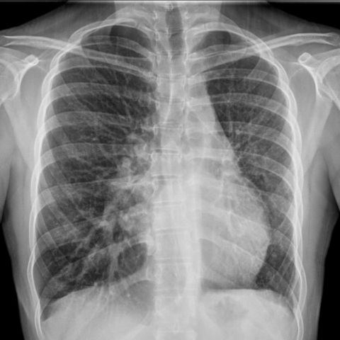
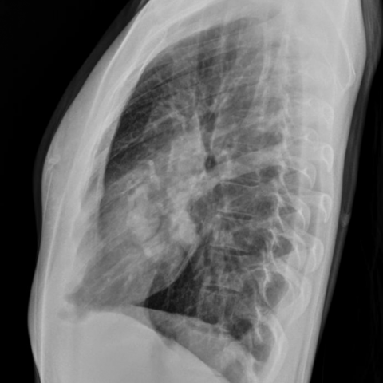

# Benchmark case 12255_8353800651353

[Case index](README.md) · [Machine-readable case](12255_8353800651353.json) · [Scored outcomes](../per-question-outcomes.json)

Source: [Eurorad case 12255](https://www.eurorad.org/case/12255); [ChestAgentBench pinned revision](https://huggingface.co/datasets/wanglab/chest-agent-bench/tree/921e60440927f9893228d843c0206b755744252a).

These are the benchmark inputs used in the frozen experiment. Model and tool observations below are recorded outputs, not independently validated clinical findings.

## Full question and options

```text
Based on the chest X-ray findings, what is the most likely explanation for the serpentine tubular structure observed in the right medial lobe, taking into account the volume loss in the left hemithorax?
A) The presence of a right-sided aortic arch causing deviation.
B) An anomalous right bronchial artery.
C) A right-sided pulmonary artery aneurysm.
D) An abnormal course of a single right meandering pulmonary vein.
E) A right-sided pneumothorax causing mediastinal shift.
F) A dilated right main bronchus due to chronic infection.
```

## Original benchmark images

### image:1 — figures/12255/figure_1a.jpg



### image:2 — figures/12255/figure_1b.jpg



## Recorded answers

| Stage | Answer | Execution route/status |
|---|---|---|
| P0 | missing | tool_error |
| V10 VKE candidate | D | candidate before gate |
| V10 VKE final | D | p0_missing_use_independent_candidate |
| S1 | D | p0_missing |
| S2 | D | inherited_s1 |
| S3 | D | p0_missing |

Reference answer (post-generation scoring only): **D**.

## V10 VKE candidate and gate record

```json
{
  "candidate": "D",
  "final": "D",
  "changed_attributes": [
    "vascular vs bronchial density",
    "ipsilateral vascular markings",
    "left volume loss correlation"
  ],
  "candidate_payload": {
    "answer": "D",
    "uncertain": true,
    "changed_attributes": [
      "vascular vs bronchial density",
      "ipsilateral vascular markings",
      "left volume loss correlation"
    ],
    "evidence_refs": [
      "image:1",
      "image:2"
    ],
    "observations": [
      {
        "attribute": "serpentine structure density",
        "image_ids": [
          "image:1"
        ],
        "value": "soft-tissue opacity, no lucent center",
        "status": "observed_present",
        "evidence_refs": [
          "image:1"
        ]
      },
      {
        "attribute": "left hemithorax volume loss",
        "image_ids": [
          "image:1",
          "image:2"
        ],
        "value": "mediastinal shift left, crowded ribs, elevated hemidiaphragm",
        "status": "observed_present",
        "evidence_refs": [
          "image:1",
          "image:2"
        ]
      },
      {
        "attribute": "right lung hyperlucency (pneumothorax sign)",
        "image_ids": [
          "image:1",
          "image:2"
        ],
        "value": "absent; right lung aerated normally",
        "status": "observed_absent",
        "evidence_refs": [
          "image:1",
          "image:2"
        ]
      },
      {
        "attribute": "air-filled bronchus (lucent lumen)",
        "image_ids": [
          "image:1"
        ],
        "value": "not observed; structure is uniformly opaque",
        "status": "observed_absent",
        "evidence_refs": [
          "image:1"
        ]
      }
    ],
    "missing_evidence": [
      "contrast enhancement to confirm venous vs arterial",
      "CT correlation for definitive anatomy"
    ],
    "parse_warnings": [],
    "discarded_evidence_refs": []
  },
  "gate": {
    "decision": "p0_missing_use_independent_candidate"
  },
  "fallback": null,
  "k_ids": [
    "RAD_FLEISCHNER_2024_01",
    "RAD_CXR_CHALLENGES_2025_07"
  ],
  "e_ids": [
    "B10_7529153b8934dc1ab21fce97e76fd0f8377387dc4240e21f5a05ad12cf6cfbdc",
    "B10_ea548f88a90ea1f91a3cf00f79aaee751326826a539c8a47915004e54f35fad9"
  ],
  "candidate_error_type": null,
  "gate_error_type": null
}
```

## Detailed comparison evidence

This case did not route to the 21-case anonymous disagreement selector. Its original input and recorded answers are included; no selector packet was generated.

## V11 selector and reader records

A recorded choice can coexist with an empty observation list. That record alone does not establish a supported visual comparison. See the [decision audit](../decision-audit.json) and [decision-pattern analysis](../decision-pattern-analysis.md) for this limitation.

```json
{
  "S1": {
    "stage": "S1",
    "initial": null,
    "candidate": "D",
    "final": "D",
    "route": "p0_missing",
    "selector": null,
    "fallback": null,
    "timing": {
      "started_utc": "2026-10-30T15:37:34.219550+00:00",
      "ended_utc": "2026-10-30T15:37:34.219773+00:00",
      "elapsed_s": 0.0
    },
    "selector_error_type": null
  },
  "S2": {
    "stage": "S2",
    "initial": null,
    "candidate": "D",
    "final": "D",
    "s1_final": "D",
    "route": "inherited_s1",
    "selector": null,
    "fallback": null,
    "timing": {
      "started_utc": "2026-10-30T15:43:16.674114+00:00",
      "ended_utc": "2026-10-30T15:43:16.674310+00:00",
      "elapsed_s": 0.0
    },
    "selector_error_type": null
  },
  "S3": {
    "stage": "S3",
    "initial": null,
    "candidate": "D",
    "final": "D",
    "route": "p0_missing",
    "selector": null,
    "fallback": null,
    "timing": {
      "started_utc": "2026-10-30T16:08:26.787946+00:00",
      "ended_utc": "2026-10-30T16:08:26.788151+00:00",
      "elapsed_s": 0.0
    },
    "selector_error_type": null
  }
}
```

[Data provenance and limits](../data-provenance.md)
