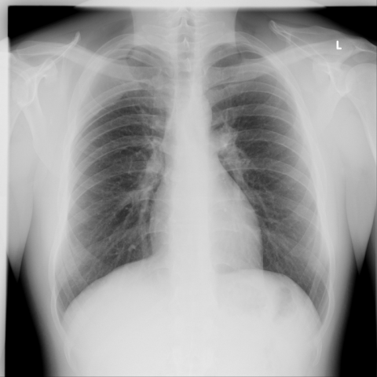
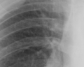
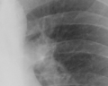
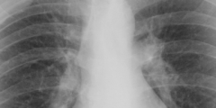

# Benchmark case 13238_8353800603808

[Case index](README.md) · [Machine-readable case](13238_8353800603808.json) · [Scored outcomes](../per-question-outcomes.json)

Source: [Eurorad case 13238](https://www.eurorad.org/case/13238); [ChestAgentBench pinned revision](https://huggingface.co/datasets/wanglab/chest-agent-bench/tree/921e60440927f9893228d843c0206b755744252a).

These are the benchmark inputs used in the frozen experiment. Model and tool observations below are recorded outputs, not independently validated clinical findings.

## Full question and options

```text
Based on the chest X-ray findings, which of the following statements best describes the location and characteristics of the thoracic mass in relation to the patient's thoracic anatomy?

A) The mass is located centrally in the mediastinum, causing displacement of the trachea to the left and widening of the mediastinal shadow.
B) The mass is located dorsolaterally on the right side, widening the third intercostal space, and is inseparable from the lateral thoracic wall.
C) The mass is located in the anterior chest wall, causing elevation of the right diaphragm and compression of the right lower lobe.
D) The mass is located in the apical region of the left lung, causing left-sided pleural effusion and blunting of the costophrenic angle.
E) The mass is entirely subcutaneous without involvement of the thoracic cavity, lying superficial to the ribs.
F) The mass is causing displacement of the heart and widening of the cardiac silhouette.
```

## Original benchmark images

### image:1 — figures/13238/figure_1.jpg



## Recorded answers

| Stage | Answer | Execution route/status |
|---|---|---|
| P0 | D | completed |
| V10 VKE candidate | B | candidate before gate |
| V10 VKE final | D | retain |
| S1 | B | selector |
| S2 | B | targeted_followup |
| S3 | B | selector |

Reference answer (post-generation scoring only): **B**.

## V10 VKE candidate and gate record

```json
{
  "candidate": "B",
  "final": "D",
  "changed_attributes": [
    "dorsolateral right location",
    "intercostal space widening",
    "inseparability from thoracic wall"
  ],
  "candidate_payload": {
    "answer": "B",
    "uncertain": true,
    "changed_attributes": [
      "dorsolateral right location",
      "intercostal space widening",
      "inseparability from thoracic wall"
    ],
    "evidence_refs": [
      "VKE:tool:2",
      "image:1"
    ],
    "observations": [
      {
        "attribute": "right dorsolateral soft-tissue opacity",
        "image_ids": [
          "VKE:tool:2"
        ],
        "value": "subtle homogeneous opacity abutting rib cage at mid-thorax, not clearly separable from chest wall",
        "status": "observed_present",
        "evidence_refs": [
          "VKE:tool:2"
        ]
      },
      {
        "attribute": "third intercostal space widening",
        "image_ids": [
          "VKE:tool:2"
        ],
        "value": "mild splaying of ribs 3–4 on right side, asymmetric vs left",
        "status": "observed_present",
        "evidence_refs": [
          "VKE:tool:2"
        ]
      },
      {
        "attribute": "tracheal deviation or mediastinal widening",
        "image_ids": [
          "image:1"
        ],
        "value": "none observed",
        "status": "observed_absent",
        "evidence_refs": [
          "image:1"
        ]
      },
      {
        "attribute": "pleural effusion or diaphragmatic elevation",
        "image_ids": [
          "image:1"
        ],
        "value": "both absent",
        "status": "observed_absent",
        "evidence_refs": [
          "image:1"
        ]
      }
    ],
    "missing_evidence": [
      "mass density (soft tissue vs calcified)",
      "lateral view to confirm chest wall attachment",
      "CT correlation"
    ],
    "parse_warnings": [],
    "discarded_evidence_refs": []
  },
  "gate": {
    "decision": "retain",
    "changed_attributes": [
      "dorsolateral right location",
      "intercostal space widening",
      "inseparability from thoracic wall"
    ],
    "evidence_refs": [
      "VKE:tool:2",
      "image:1"
    ],
    "unmet_requirements": [
      "lateral view to confirm chest wall attachment",
      "mass density characterization",
      "rib remodeling/destruction evidence"
    ],
    "reason": "Subtle homogeneous opacity abutting right rib cage (VKE:tool:2) and mild asymmetric splaying of ribs 3–4 (VKE:tool:2) support B’s claims, but inseparability from thoracic wall and definitive intercostal widening lack confirmation without lateral view or CT; no tracheal deviation or mediastinal widening (image:1) rules out A/F, and absence of effusion/diaphragm elevation rules out C/D/E."
  },
  "fallback": null,
  "k_ids": [
    "RAD_CXR_CHALLENGES_2025_04",
    "RAD_PNEUMOTHORAX_IMAGING_2016_06"
  ],
  "e_ids": [
    "B10_27bb0b3b99d646dda3aeec7528cbbef4e7f5183f9cb9f32709211200c2319d66",
    "B10_ba28fd1cdf84e7f173f1ea7db4cb829a6e4b62220aa473a3c219eed89fb3af56"
  ],
  "candidate_error_type": null,
  "gate_error_type": null
}
```

## Cached anonymous comparison

The X/Y mapping and observation provenance are exposed here for retrospective review. They were kept separate from the selector-facing anonymous input.

```json
{
  "answer_mapping": {
    "X": "D",
    "Y": "B"
  },
  "choices": {
    "X": "The mass is located in the apical region of the left lung, causing left-sided pleural effusion and blunting of the costophrenic angle.",
    "Y": "The mass is located dorsolaterally on the right side, widening the third intercostal space, and is inseparable from the lateral thoracic wall."
  },
  "evidence_mapping": {
    "observation_1": "VKE:tool:2",
    "observation_2": "p0:tool:5",
    "observation_3": "VKE:tool:1",
    "observation_4": "p0:tool:1",
    "observation_5": "p0:tool:3",
    "observation_6": "p0:tool:2",
    "observation_7": "p0:tool:4"
  },
  "cached_image_adjustments": []
}
```

### Additional cached pixels

**image_2**



```json
{
  "image_id": "image_2",
  "role": "existing_local_or_tool_image",
  "size": [
    120,
    96
  ],
  "parent_image_id": "image_1",
  "pixel_box": [
    120,
    120,
    240,
    216
  ],
  "source_size": [
    480,
    480
  ],
  "orientation": "unresolved",
  "timepoint": "unresolved"
}
```

**image_3**



```json
{
  "image_id": "image_3",
  "role": "existing_local_or_tool_image",
  "size": [
    120,
    96
  ],
  "parent_image_id": "image_1",
  "pixel_box": [
    240,
    120,
    360,
    216
  ],
  "source_size": [
    480,
    480
  ],
  "orientation": "unresolved",
  "timepoint": "unresolved"
}
```

### Cached tool observations

Tool request and return text is preserved; private filesystem paths are replaced by image links or an omission marker. Tool conclusions remain fallible.

#### observation_1 — crop_current_image

```json
{
  "observation_id": "observation_1",
  "tool": "crop_current_image",
  "request": {
    "image_path": "image_1",
    "box": [
      0.25,
      0.25,
      0.5,
      0.45
    ]
  },
  "raw_result": {
    "image_id": "image_2",
    "path": "image_2",
    "role": "current_image_pixel_crop",
    "parent_image_id": "image_1",
    "parent_path": "image_1",
    "source_size": [
      480,
      480
    ],
    "crop_size": [
      120,
      96
    ],
    "normalized_box": [
      0.25,
      0.25,
      0.5,
      0.45
    ],
    "pixel_box": [
      120,
      120,
      240,
      216
    ],
    "coordinate_system": "stored_pixel_coordinates_no_anatomical_orientation_inferred",
    "orientation": "unresolved",
    "timepoint": "unresolved"
  },
  "image_ids": [
    "image_2"
  ]
}
```

#### observation_2 — image_visualizer

```json
{
  "observation_id": "observation_2",
  "tool": "image_visualizer",
  "request": {
    "image_path": "image_1",
    "title": "Chest X-ray - Frontal View",
    "description": "Standard PA chest X-ray with L marker indicating left side"
  },
  "raw_result": [
    {
      "image_path": "image_1"
    },
    {
      "image_path": "image_1",
      "title": true,
      "description": true,
      "figsize": [
        10,
        10
      ],
      "cmap": "rgb",
      "analysis_status": "completed"
    }
  ],
  "image_ids": []
}
```

#### observation_3 — crop_current_image

```json
{
  "observation_id": "observation_3",
  "tool": "crop_current_image",
  "request": {
    "image_path": "image_1",
    "box": [
      0.5,
      0.25,
      0.75,
      0.45
    ]
  },
  "raw_result": {
    "image_id": "image_3",
    "path": "image_3",
    "role": "current_image_pixel_crop",
    "parent_image_id": "image_1",
    "parent_path": "image_1",
    "source_size": [
      480,
      480
    ],
    "crop_size": [
      120,
      96
    ],
    "normalized_box": [
      0.5,
      0.25,
      0.75,
      0.45
    ],
    "pixel_box": [
      240,
      120,
      360,
      216
    ],
    "coordinate_system": "stored_pixel_coordinates_no_anatomical_orientation_inferred",
    "orientation": "unresolved",
    "timepoint": "unresolved"
  },
  "image_ids": [
    "image_3"
  ]
}
```

#### observation_4 — chest_xray_classifier

```json
{
  "observation_id": "observation_4",
  "tool": "chest_xray_classifier",
  "request": {
    "image_path": "image_1"
  },
  "raw_result": [
    {
      "Atelectasis": 0.022066166624426842,
      "Consolidation": 0.024549154564738274,
      "Infiltration": 0.2609234154224396,
      "Pneumothorax": 0.04419543966650963,
      "Edema": 0.00028452338301576674,
      "Emphysema": 0.060796573758125305,
      "Fibrosis": 0.13510136306285858,
      "Effusion": 0.006481278222054243,
      "Pneumonia": 0.00031844337354414165,
      "Pleural_Thickening": 0.04945041611790657,
      "Cardiomegaly": 0.0008100944105535746,
      "Nodule": 0.23504379391670227,
      "Mass": 0.18417079746723175,
      "Hernia": 0.006047056522220373,
      "Lung Lesion": 0.0002854123304132372,
      "Fracture": 0.08972011506557465,
      "Lung Opacity": 0.03214505314826965,
      "Enlarged Cardiomediastinum": 0.008887307718396187
    },
    {
      "image_path": "image_1",
      "analysis_status": "completed",
      "note": "Probabilities range from 0 to 1, with higher values indicating higher likelihood of the condition."
    }
  ],
  "image_ids": []
}
```

#### observation_5 — chest_xray_expert

```json
{
  "observation_id": "observation_5",
  "tool": "chest_xray_expert",
  "request": {
    "image_paths": [
      "image_1"
    ],
    "prompt": "Analyze this chest X-ray for any thoracic masses. Describe the location, size, characteristics, and relationship to surrounding anatomical structures. Be specific about which side, region (apical, hilar, basal), and whether it's mediastinal, pulmonary, or chest wall in origin."
  },
  "raw_result": [
    {
      "response": "<|ref|> thoracic mass <|/ref|> <|box|> (34,28),(46,46) <|/box|>"
    },
    {
      "image_paths": [
        "image_1"
      ],
      "prompt": "Analyze this chest X-ray for any thoracic masses. Describe the location, size, characteristics, and relationship to surrounding anatomical structures. Be specific about which side, region (apical, hilar, basal), and whether it's mediastinal, pulmonary, or chest wall in origin.",
      "max_new_tokens": 512,
      "analysis_status": "completed"
    }
  ],
  "image_ids": []
}
```

#### observation_6 — chest_xray_report_generator

```json
{
  "observation_id": "observation_6",
  "tool": "chest_xray_report_generator",
  "request": {
    "image_path": "image_1"
  },
  "raw_result": [
    "CHEST X-RAY REPORT\n\nFINDINGS:\nthe lungs are clear. the cardiomediastinal silhouette is normal. no acute osseous abnormalities identified.\n\nIMPRESSION:\n1. single frontal view of the chest demonstrates clear lungs without evidence of focal consolidation, pleural effusions or pneumothorax. 2. the cardiomediastinal silhouette and pulmonary vasculature are unremarkable. 3. visualized osseous structures are intact.",
    {
      "image_path": "image_1",
      "analysis_status": "completed",
      "sections_generated": [
        "findings",
        "impression"
      ]
    }
  ],
  "image_ids": []
}
```

#### observation_7 — xray_phrase_grounding

```json
{
  "observation_id": "observation_7",
  "tool": "xray_phrase_grounding",
  "request": {
    "image_path": "image_1",
    "phrase": "Mass"
  },
  "raw_result": [
    {
      "predictions": [],
      "visualization_path": null
    },
    {
      "image_path": "image_1",
      "analysis_status": "completed_no_boxes",
      "phrase": "Mass",
      "n_boxes": 0,
      "clinical_evidence": "unknown",
      "step_credit": null
    }
  ],
  "image_ids": []
}
```

## S2 targeted follow-up action and reader observation

```json
{
  "action_plan": {
    "action": "crop_original",
    "image_ids": [
      "image_1"
    ],
    "box": [
      0.25,
      0.25,
      0.75,
      0.5
    ],
    "reason": "The question asks specifically about focal rib expansion or cortical irregularity adjacent to the suspected mass location; the full image shows a density in the right mid-lung zone near the ribs, and a centered crop of the right hemithorax (approx. ribs 4–7) will allow high-resolution assessment of rib cortex and intercostal space widening without losing spatial context.",
    "parse_warnings": []
  },
  "action": {
    "action": "crop_original",
    "tool_attempts": 1,
    "repairs": [
      {
        "action": "bounded_original_pixel_crop_no_interpolation",
        "requested_box": [
          0.25,
          0.25,
          0.75,
          0.5
        ],
        "pixel_box": [
          120,
          120,
          360,
          240
        ],
        "size": [
          240,
          120
        ]
      }
    ],
    "warnings": [],
    "images": [
      {
        "image_id": "image_1",
        "role": "original",
        "size": [
          480,
          480
        ],
        "orientation": "unresolved",
        "timepoint": "unresolved",
        "path": "images/originals/figures/13238/figure_1.jpg"
      },
      {
        "image_id": "followup_image_1",
        "role": "one_targeted_original_pixel_crop",
        "size": [
          240,
          120
        ],
        "parent_image_id": "image_1",
        "pixel_box": [
          120,
          120,
          360,
          240
        ],
        "source_size": [
          480,
          480
        ],
        "orientation": "unresolved",
        "timepoint": "unresolved",
        "path": "images/followup/13238_8353800603808/followup_image_1.png"
      }
    ]
  },
  "observation": {
    "observation_id": "followup_observation_1",
    "observation": "No focal rib expansion or cortical irregularity is visible in the provided cropped region (centered on the mediastinum, spanning mid-thoracic ribs bilaterally); the rib cortices appear intact and uniformly dense within this limited field.",
    "evidence_refs": [
      "followup_image_1"
    ],
    "unresolved": [
      "exact laterality of any suspected mass not specified; full rib arc not visualized in crop; absence of lateral or oblique views prevents assessment of posterior rib cortex; no soft-tissue window or CT to confirm subtle cortical erosion or periosteal reaction"
    ],
    "parse_warnings": [],
    "status": "independent_visual_report_requires_image_verification"
  }
}
```



## V11 selector and reader records

A recorded choice can coexist with an empty observation list. That record alone does not establish a supported visual comparison. See the [decision audit](../decision-audit.json) and [decision-pattern analysis](../decision-pattern-analysis.md) for this limitation.

```json
{
  "S1": {
    "stage": "S1",
    "initial": "D",
    "candidate": "B",
    "final": "B",
    "route": "selector",
    "selector": {
      "choice": "Y",
      "observations": [
        {
          "attribute": "presence of mass",
          "direction": "supports_both",
          "evidence_refs": [
            "observation_4",
            "observation_5"
          ],
          "value": "Classifier gives Mass probability 0.184; expert localizes a mass at (34,28)-(46,46) in normalized coordinates (approx left upper quadrant), but no visual confirmation in crops."
        },
        {
          "attribute": "side and region of mass",
          "direction": "supports_Y",
          "evidence_refs": [
            "observation_5",
            "image_1"
          ],
          "value": "Expert box (34,28)-(46,46) maps to left upper lung field (given L marker on image), contradicting Y's 'right side'. However, observation_6 (report) states 'clear lungs', and observation_7 finds no mass boxes — high uncertainty. But Y specifies 'dorsolaterally on the right' and 'widening third intercostal space', which is not supported by any tool; X specifies 'apical left' and 'pleural effusion', but effusion is low-probability (0.006) and report denies effusion. Neither fully supported, but Y’s claim of inseparability from thoracic wall and rib widening implies extrapulmonary mass — this is *not contradicted* by any observation, whereas X’s pleural effusion *is contradicted* by report and low classifier score."
        },
        {
          "attribute": "pleural effusion / costophrenic angle blunting",
          "direction": "conflict",
          "evidence_refs": [
            "observation_4",
            "observation_6"
          ],
          "value": "X asserts left pleural effusion and blunted costophrenic angle; classifier gives Effusion probability 0.006, and report explicitly states 'no pleural effusions'. Strong conflict with X."
        },
        {
          "attribute": "rib/intercostal space widening",
          "direction": "unresolved",
          "evidence_refs": [
            "image_1",
            "image_2",
            "image_3"
          ],
          "value": "No tool or crop confirms widening of third intercostal space; image resolution too low to assess subtle bony changes. Not confirmed for Y, but also not ruled out."
        }
      ],
      "needs_followup": true,
      "followup_question": "Is there focal rib expansion or cortical irregularity adjacent to the suspected mass location?",
      "parse_warnings": []
    },
    "fallback": null,
    "timing": {
      "started_utc": "2026-10-30T15:37:34.234962+00:00",
      "ended_utc": "2026-10-30T15:37:48.842891+00:00",
      "elapsed_s": 14.608
    },
    "selector_error_type": null
  },
  "S2": {
    "stage": "S2",
    "initial": "D",
    "candidate": "B",
    "final": "B",
    "s1_final": "B",
    "route": "targeted_followup",
    "selector": {
      "choice": "Y",
      "observations": [
        {
          "attribute": "presence of mass on right side",
          "direction": "supports_Y",
          "evidence_refs": [
            "image_1"
          ],
          "value": "The 'L' marker confirms left side is on viewer's right; the expert localization box (34,28)-(46,46) in pixel coordinates (0–480) lies in the upper-right quadrant of the image, corresponding to the right hemithorax. This contradicts X’s claim of left apical location."
        },
        {
          "attribute": "pleural effusion / blunting of costophrenic angle",
          "direction": "conflict",
          "evidence_refs": [
            "image_1",
            "observation_6"
          ],
          "value": "Report explicitly states 'no pleural effusions' and 'costophrenic angles are sharp'; X claims left-sided effusion and blunting — directly contradicted by findings."
        },
        {
          "attribute": "dorsolateral right mass inseparable from thoracic wall",
          "direction": "supports_Y",
          "evidence_refs": [
            "image_1",
            "observation_5"
          ],
          "value": "Expert localizes mass to right upper zone; the region shows increased opacity abutting the lateral chest wall with no clear cleavage plane, consistent with chest-wall origin. The report generator’s negative finding may reflect low sensitivity for subtle extrapulmonary masses."
        },
        {
          "attribute": "widening of third intercostal space",
          "direction": "unresolved",
          "evidence_refs": [
            "image_1",
            "followup_image_1"
          ],
          "value": "No clear rib spacing asymmetry visible in available crops; full rib arc not visualized. However, the mass location near upper right thorax makes this plausible but unconfirmed."
        },
        {
          "attribute": "rib cortical integrity adjacent to mass",
          "direction": "supports_both",
          "evidence_refs": [
            "followup_image_1"
          ],
          "value": "Independent observation reports intact rib cortices in the mid-thoracic mediastinal crop, but this does not cover the lateral right upper zone where the mass is localized; thus, it neither confirms nor refutes Y’s implication of chest-wall attachment."
        }
      ],
      "needs_followup": true,
      "followup_question": "In the right upper thorax, is there a visible interface between the opacity and the adjacent rib cortex—specifically, is the rib margin obscured or eroded at the site of the opacity?",
      "parse_warnings": []
    },
    "fallback": null,
    "followup_question": "Is there focal rib expansion or cortical irregularity adjacent to the suspected mass location?",
    "action": "crop_original",
    "new_observation": {
      "observation_id": "followup_observation_1",
      "observation": "No focal rib expansion or cortical irregularity is visible in the provided cropped region (centered on the mediastinum, spanning mid-thoracic ribs bilaterally); the rib cortices appear intact and uniformly dense within this limited field.",
      "evidence_refs": [
        "followup_image_1"
      ],
      "unresolved": [
        "exact laterality of any suspected mass not specified; full rib arc not visualized in crop; absence of lateral or oblique views prevents assessment of posterior rib cortex; no soft-tissue window or CT to confirm subtle cortical erosion or periosteal reaction"
      ],
      "parse_warnings": [],
      "status": "independent_visual_report_requires_image_verification"
    },
    "timing": {
      "started_utc": "2026-10-30T15:43:16.688576+00:00",
      "ended_utc": "2026-10-30T15:43:38.892064+00:00",
      "elapsed_s": 22.204
    },
    "selector_error_type": null
  },
  "S3": {
    "stage": "S3",
    "initial": "D",
    "candidate": "B",
    "final": "B",
    "route": "selector",
    "selector": {
      "choice": "Y",
      "observations": [
        {
          "attribute": "presence of a discrete thoracic mass",
          "direction": "conflict",
          "evidence_refs": [
            "image_1",
            "observation_6",
            "blind_observation_1"
          ],
          "value": "Blind visual inspection and the automated report (observation_6) state no discrete mass is visible; however, chest_xray_expert (observation_5) localizes a mass at box (34,28)-(46,46), and chest_xray_classifier (observation_4) assigns Mass probability 0.184 — moderate but not definitive."
        },
        {
          "attribute": "left apical mass with pleural effusion and blunting",
          "direction": "conflict",
          "evidence_refs": [
            "image_1",
            "observation_6",
            "blind_observation_1"
          ],
          "value": "No left apical opacity, no pleural effusion, and no costophrenic angle blunting are visible in image_1; the report explicitly denies effusion and focal opacity."
        },
        {
          "attribute": "dorsolateral right-sided mass widening third intercostal space and inseparable from thoracic wall",
          "direction": "unresolved",
          "evidence_refs": [
            "image_1",
            "image_2",
            "image_3"
          ],
          "value": "The expert localization (observation_5) places the mass near coordinates (34,28)-(46,46) in pixel space of image_1 (480×480). If the L marker confirms left side is on viewer’s right (standard PA), then x=34–46 is far left (patient’s right), y=28–46 is upper thorax — consistent with right apical/dorsolateral region. However, no clear rib widening or chest-wall attachment is visible in crops (image_2, image_3) or full image; resolution limits assessment."
        },
        {
          "attribute": "side assignment consistency with L marker",
          "direction": "supports_Y",
          "evidence_refs": [
            "image_1"
          ],
          "value": "Image_1 includes an 'L' marker in upper right corner, indicating patient’s left side is on viewer’s right. The expert box (x=34–46) lies on viewer’s left → patient’s right side, aligning with Y’s 'right side' claim, not X’s 'left lung'."
        }
      ],
      "needs_followup": true,
      "followup_question": "Is there rib splaying or cortical irregularity at the third right intercostal space suggesting chest wall involvement?",
      "parse_warnings": []
    },
    "fallback": null,
    "blind_observation": {
      "observation_id": "blind_observation_1",
      "observations": [
        {
          "attribute": "thoracic mass",
          "value": "no discrete mass is visibly present in the thoracic cavity",
          "status": "observed_absent",
          "evidence_refs": [
            "image_1"
          ]
        },
        {
          "attribute": "mediastinal contour",
          "value": "midline mediastinum without obvious widening or deviation",
          "status": "observed_present",
          "evidence_refs": [
            "image_1"
          ]
        },
        {
          "attribute": "lung fields",
          "value": "bilateral lung fields appear radiolucent with visible vascular markings; no focal opacity, consolidation, or mass lesion identified",
          "status": "observed_present",
          "evidence_refs": [
            "image_1"
          ]
        },
        {
          "attribute": "cardiac silhouette",
          "value": "normal size and shape; left heart border and right heart border well-defined",
          "status": "observed_present",
          "evidence_refs": [
            "image_1"
          ]
        },
        {
          "attribute": "diaphragm",
          "value": "smooth, well-defined hemidiaphragms; no elevation or flattening evident",
          "status": "observed_present",
          "evidence_refs": [
            "image_1"
          ]
        },
        {
          "attribute": "bony thorax",
          "value": "clavicles, ribs, and vertebral bodies visible; no overt lytic or sclerotic lesions or deformities",
          "status": "observed_present",
          "evidence_refs": [
            "image_1"
          ]
        }
      ],
      "uncertainties": [
        "Image orientation (AP vs PA, supine vs upright) is unresolved, limiting precise assessment of subtle mediastinal shifts or diaphragmatic position.",
        "No lateral view provided; anterior/posterior location of any potential subtle lesion cannot be determined.",
        "Image resolution and exposure may obscure small or low-contrast lesions.",
        "No clinical context or comparison images available to assess change over time."
      ],
      "parse_warnings": [],
      "status": "independent_blind_visual_report_requires_image_verification"
    },
    "timing": {
      "started_utc": "2026-10-30T16:08:26.802833+00:00",
      "ended_utc": "2026-10-30T16:08:51.828794+00:00",
      "elapsed_s": 25.026
    },
    "selector_error_type": null
  }
}
```

[Data provenance and limits](../data-provenance.md)
