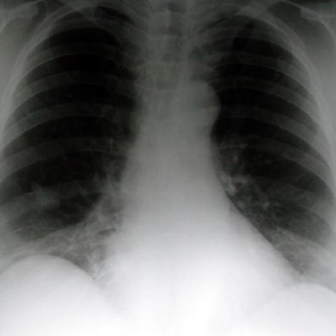

# Benchmark case 1461_8353802159822

[Case index](README.md) · [Machine-readable case](1461_8353802159822.json) · [Scored outcomes](../per-question-outcomes.json)

Source: [Eurorad case 1461](https://www.eurorad.org/case/1461); [ChestAgentBench pinned revision](https://huggingface.co/datasets/wanglab/chest-agent-bench/tree/921e60440927f9893228d843c0206b755744252a).

These are the benchmark inputs used in the frozen experiment. Model and tool observations below are recorded outputs, not independently validated clinical findings.

## Full question and options

```text
Based on the PA chest radiograph (Figure 1a) and the magnified view of the lesion (Figure 1b), which of the following best describes the findings and diagnosis for the patient?

A) A well-defined round mass in the right lower zone with calcified margins, suggestive of a granuloma.
B) A trefoil-shaped mass lesion in the right lower zone with indistinct margins, consistent with bronchial atresia.
C) A poorly-defined mass in the left lower zone with surrounding consolidation, indicative of pneumonia.
D) A trefoil-shaped mass lesion in the right upper zone with clear margins, suggestive of a benign tumor.
E) A round mass lesion in the right lower zone with irregular margins, consistent with malignancy.
F) A linear opacity in the right lower zone suggestive of atelectasis.
```

## Original benchmark images

### image:1 — figures/1461/figure_1a.jpg



### image:2 — figures/1461/figure_1b.jpg


## Recorded answers

| Stage | Answer | Execution route/status |
|---|---|---|
| P0 | B | completed |
| V10 VKE candidate | B | candidate before gate |
| V10 VKE final | B | no_change |
| S1 | B | inherited_agreement |
| S2 | B | inherited_s1 |
| S3 | B | inherited_agreement |

Reference answer (post-generation scoring only): **B**.

## V10 VKE candidate and gate record

```json
{
  "candidate": "B",
  "final": "B",
  "changed_attributes": [
    "location (right lower zone)",
    "shape (trefoil-shaped)",
    "margins (indistinct)"
  ],
  "candidate_payload": {
    "answer": "B",
    "uncertain": true,
    "changed_attributes": [
      "location (right lower zone)",
      "shape (trefoil-shaped)",
      "margins (indistinct)"
    ],
    "evidence_refs": [
      "image:1",
      "image:2",
      "VKE:tool:1"
    ],
    "observations": [
      {
        "attribute": "side and zone",
        "image_ids": [
          "image:1"
        ],
        "value": "right lower zone (PA view: right lung on image left; opacity in lower-left hemithorax)",
        "status": "observed_present",
        "evidence_refs": [
          "image:1",
          "p0:tool:2"
        ]
      },
      {
        "attribute": "shape",
        "image_ids": [
          "VKE:tool:1"
        ],
        "value": "lobulated/trefoil-like, not round or linear",
        "status": "observed_present",
        "evidence_refs": [
          "VKE:tool:1"
        ]
      },
      {
        "attribute": "margins",
        "image_ids": [
          "VKE:tool:1"
        ],
        "value": "indistinct, blending with parenchyma",
        "status": "observed_present",
        "evidence_refs": [
          "VKE:tool:1"
        ]
      },
      {
        "attribute": "calcification",
        "image_ids": [
          "VKE:tool:1"
        ],
        "value": "not visible",
        "status": "observed_absent",
        "evidence_refs": [
          "VKE:tool:1"
        ]
      },
      {
        "attribute": "surrounding consolidation",
        "image_ids": [
          "image:1"
        ],
        "value": "absent per report generator",
        "status": "observed_absent",
        "evidence_refs": [
          "p0:tool:2"
        ]
      }
    ],
    "missing_evidence": [
      "definitive confirmation of trefoil morphology (requires higher-resolution CT)",
      "clinical history (e.g., asymptomatic young adult favors bronchial atresia)"
    ],
    "parse_warnings": [],
    "discarded_evidence_refs": []
  },
  "gate": {
    "decision": "no_change"
  },
  "fallback": null,
  "k_ids": [
    "ACR_NODULE_2023_K05",
    "RAD_FLEISCHNER_2024_12"
  ],
  "e_ids": [
    "B10_dc1447d417eabe202938e6f119699ad045568b09a8702a4ee25ffb7cd753d7e1",
    "B10_4e469c862beb6710df1647edb4d1e94cbd1258709b07955620a43c454da0a808"
  ],
  "candidate_error_type": null,
  "gate_error_type": null
}
```

## Detailed comparison evidence

This case did not route to the 21-case anonymous disagreement selector. Its original input and recorded answers are included; no selector packet was generated.

## V11 selector and reader records

A recorded choice can coexist with an empty observation list. That record alone does not establish a supported visual comparison. See the [decision audit](../decision-audit.json) and [decision-pattern analysis](../decision-pattern-analysis.md) for this limitation.

```json
{
  "S1": {
    "stage": "S1",
    "initial": "B",
    "candidate": "B",
    "final": "B",
    "route": "inherited_agreement",
    "selector": null,
    "fallback": null,
    "timing": {
      "started_utc": "2026-10-30T15:38:01.289640+00:00",
      "ended_utc": "2026-10-30T15:38:01.290244+00:00",
      "elapsed_s": 0.001
    },
    "selector_error_type": null
  },
  "S2": {
    "stage": "S2",
    "initial": "B",
    "candidate": "B",
    "final": "B",
    "s1_final": "B",
    "route": "inherited_s1",
    "selector": null,
    "fallback": null,
    "timing": {
      "started_utc": "2026-10-30T15:44:01.285470+00:00",
      "ended_utc": "2026-10-30T15:44:01.285672+00:00",
      "elapsed_s": 0.0
    },
    "selector_error_type": null
  },
  "S3": {
    "stage": "S3",
    "initial": "B",
    "candidate": "B",
    "final": "B",
    "route": "inherited_agreement",
    "selector": null,
    "fallback": null,
    "timing": {
      "started_utc": "2026-10-30T16:09:15.748907+00:00",
      "ended_utc": "2026-10-30T16:09:15.749123+00:00",
      "elapsed_s": 0.0
    },
    "selector_error_type": null
  }
}
```

[Data provenance and limits](../data-provenance.md)
