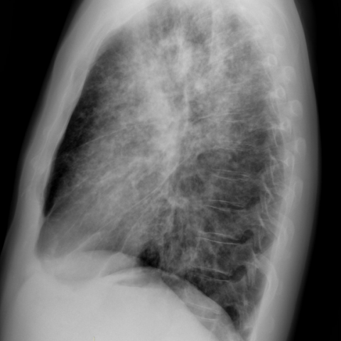

# Benchmark case 14838_8353800529839

[Case index](README.md) · [Machine-readable case](14838_8353800529839.json) · [Scored outcomes](../per-question-outcomes.json)

Source: [Eurorad case 14838](https://www.eurorad.org/case/14838); [ChestAgentBench pinned revision](https://huggingface.co/datasets/wanglab/chest-agent-bench/tree/921e60440927f9893228d843c0206b755744252a).

These are the benchmark inputs used in the frozen experiment. Model and tool observations below are recorded outputs, not independently validated clinical findings.

## Full question and options

```text
Based on the chest X-ray findings in Figure 1a and 1b, which of the following statements best aligns with the diagnosis of stage 2 sarcoidosis, and what is the rationale behind this conclusion?

A) Diffuse nodular opacities are predominantly located in the lower lung lobes, which is consistent with stage 2 sarcoidosis due to the presence of bilateral hilar lymphadenopathy.
B) Diffuse nodular opacities are predominantly located in the upper lung lobes with moderate bilateral hilar lymphadenopathy, which is consistent with stage 2 sarcoidosis.
C) Diffuse nodular opacities are predominantly located in the lower lung lobes with moderate unilateral hilar lymphadenopathy, suggesting an alternative diagnosis rather than stage 2 sarcoidosis.
D) There are no nodular opacities present, but moderate bilateral hilar lymphadenopathy suggests stage 1 sarcoidosis.
E) Diffuse nodular opacities are predominantly located in the middle lung lobes with no hilar lymphadenopathy, suggesting stage 0 sarcoidosis.
F) Diffuse nodular opacities are present throughout all lung zones with massive pleural effusion, indicating advanced sarcoidosis.
```

## Original benchmark images

### image:1 — figures/14838/figure_1a.jpg


### image:2 — figures/14838/figure_1b.jpg



## Recorded answers

| Stage | Answer | Execution route/status |
|---|---|---|
| P0 | B | completed |
| V10 VKE candidate | B | candidate before gate |
| V10 VKE final | B | no_change |
| S1 | B | inherited_agreement |
| S2 | B | inherited_s1 |
| S3 | B | inherited_agreement |

Reference answer (post-generation scoring only): **B**.

## V10 VKE candidate and gate record

```json
{
  "candidate": "B",
  "final": "B",
  "changed_attributes": [
    "lobar distribution",
    "laterality of lymphadenopathy"
  ],
  "candidate_payload": {
    "answer": "B",
    "uncertain": false,
    "changed_attributes": [
      "lobar distribution",
      "laterality of lymphadenopathy"
    ],
    "evidence_refs": [
      "image:1",
      "VKE:tool:1"
    ],
    "observations": [
      {
        "attribute": "lobar distribution of nodular opacities",
        "image_ids": [
          "image:1"
        ],
        "value": "predominantly upper lung zones bilaterally",
        "status": "observed_present",
        "evidence_refs": [
          "image:1",
          "VKE:tool:1"
        ]
      },
      {
        "attribute": "laterality of hilar lymphadenopathy",
        "image_ids": [
          "image:1"
        ],
        "value": "bilateral",
        "status": "observed_present",
        "evidence_refs": [
          "image:1",
          "VKE:tool:1",
          "p0:tool:4"
        ]
      }
    ],
    "missing_evidence": [
      "quantitative size of lymphadenopathy",
      "pleural effusion assessment (not visible in current views)"
    ],
    "parse_warnings": [],
    "discarded_evidence_refs": []
  },
  "gate": {
    "decision": "no_change"
  },
  "fallback": null,
  "k_ids": [
    "RAD_CXR_CHALLENGES_2025_01",
    "ACR_DLD_2026_K01"
  ],
  "e_ids": [
    "B10_9626056ed88c9deaabfc05456a0ad2ecadcb4f685e732c860df4456b5ba8e2ef",
    "B10_eace1f010ac9fca48fd65d398c9d098f3f270fdfd3020acff72d245ed9c5fe6c"
  ],
  "candidate_error_type": null,
  "gate_error_type": null
}
```

## Detailed comparison evidence

This case did not route to the 21-case anonymous disagreement selector. Its original input and recorded answers are included; no selector packet was generated.

## V11 selector and reader records

A recorded choice can coexist with an empty observation list. That record alone does not establish a supported visual comparison. See the [decision audit](../decision-audit.json) and [decision-pattern analysis](../decision-pattern-analysis.md) for this limitation.

```json
{
  "S1": {
    "stage": "S1",
    "initial": "B",
    "candidate": "B",
    "final": "B",
    "route": "inherited_agreement",
    "selector": null,
    "fallback": null,
    "timing": {
      "started_utc": "2026-10-30T15:38:01.293998+00:00",
      "ended_utc": "2026-10-30T15:38:01.294380+00:00",
      "elapsed_s": 0.0
    },
    "selector_error_type": null
  },
  "S2": {
    "stage": "S2",
    "initial": "B",
    "candidate": "B",
    "final": "B",
    "s1_final": "B",
    "route": "inherited_s1",
    "selector": null,
    "fallback": null,
    "timing": {
      "started_utc": "2026-10-30T15:44:01.289106+00:00",
      "ended_utc": "2026-10-30T15:44:01.289282+00:00",
      "elapsed_s": 0.0
    },
    "selector_error_type": null
  },
  "S3": {
    "stage": "S3",
    "initial": "B",
    "candidate": "B",
    "final": "B",
    "route": "inherited_agreement",
    "selector": null,
    "fallback": null,
    "timing": {
      "started_utc": "2026-10-30T16:09:15.752598+00:00",
      "ended_utc": "2026-10-30T16:09:15.752779+00:00",
      "elapsed_s": 0.0
    },
    "selector_error_type": null
  }
}
```

[Data provenance and limits](../data-provenance.md)
