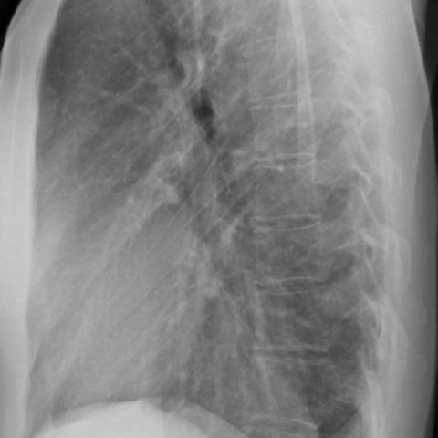

# Benchmark case 15189_8353800545058

[Case index](README.md) · [Machine-readable case](15189_8353800545058.json) · [Scored outcomes](../per-question-outcomes.json)

Source: [Eurorad case 15189](https://www.eurorad.org/case/15189); [ChestAgentBench pinned revision](https://huggingface.co/datasets/wanglab/chest-agent-bench/tree/921e60440927f9893228d843c0206b755744252a).

These are the benchmark inputs used in the frozen experiment. Model and tool observations below are recorded outputs, not independently validated clinical findings.

## Full question and options

```text
Based solely on the PA and LL projection chest X-rays (Fig. 5a and Fig. 5b), what is the most likely diagnosis for the mediastinal changes observed in the patient, and what characteristics support this diagnosis?
A. Intrathoracic lipoma, characterized by a soft tissue density opacity with well-defined margins and no evidence of compression phenomena.
B. Liposarcoma, suggested by the presence of an irregular mass with mixed density and signs of local invasion.
C. Mediastinal lymphadenopathy, indicated by multiple discrete nodular opacities with varying densities.
D. Pneumomediastinum, evidenced by linear radiolucencies outlining mediastinal structures.
E. Hiatal hernia, suggested by the presence of a soft tissue mass in the retrocardiac space with air-fluid levels.
F. Left lower lobe pneumonia, indicated by a homogenous opacity with air bronchograms in the retrocardiac region.
```

## Original benchmark images

### image:1 — figures/15189/figure_5a.jpg


### image:2 — figures/15189/figure_5b.jpg



## Recorded answers

| Stage | Answer | Execution route/status |
|---|---|---|
| P0 | A | completed |
| V10 VKE candidate | A | candidate before gate |
| V10 VKE final | A | no_change |
| S1 | A | inherited_agreement |
| S2 | A | inherited_s1 |
| S3 | A | inherited_agreement |

Reference answer (post-generation scoring only): **A**.

## V10 VKE candidate and gate record

```json
{
  "candidate": "A",
  "final": "A",
  "changed_attributes": [
    "homogeneous density",
    "well-defined margins",
    "posterior mediastinal location",
    "no air-fluid levels",
    "no gastric displacement"
  ],
  "candidate_payload": {
    "answer": "A",
    "uncertain": true,
    "changed_attributes": [
      "homogeneous density",
      "well-defined margins",
      "posterior mediastinal location",
      "no air-fluid levels",
      "no gastric displacement"
    ],
    "evidence_refs": [
      "image:1",
      "image:2",
      "VKE:tool:2:image:1"
    ],
    "observations": [
      {
        "attribute": "mediastinal opacity density and margins",
        "image_ids": [
          "image:1",
          "VKE:tool:2:image:1"
        ],
        "value": "homogeneous, well-defined, low-attenuation (darker than muscle, near lung background)",
        "status": "observed_present",
        "evidence_refs": [
          "image:1",
          "VKE:tool:2:image:1"
        ]
      },
      {
        "attribute": "air or air-fluid levels in retrocardiac region",
        "image_ids": [
          "image:1",
          "image:2"
        ],
        "value": "absent; no meniscus, no lucency within mass",
        "status": "observed_absent",
        "evidence_refs": [
          "image:1",
          "image:2"
        ]
      },
      {
        "attribute": "gastric bubble displacement or peristalsis",
        "image_ids": [
          "image:2"
        ],
        "value": "gastric air bubble normal anterior position; no evidence of herniation",
        "status": "observed_absent",
        "evidence_refs": [
          "image:2"
        ]
      },
      {
        "attribute": "irregular margins or local invasion",
        "image_ids": [
          "image:1",
          "image:2"
        ],
        "value": "mass sharply demarcated, no spiculation or chest wall/vascular encasement",
        "status": "observed_absent",
        "evidence_refs": [
          "image:1",
          "image:2"
        ]
      }
    ],
    "missing_evidence": [
      "CT Hounsfield units to confirm fat density",
      "dynamic imaging for peristalsis"
    ],
    "parse_warnings": [],
    "discarded_evidence_refs": []
  },
  "gate": {
    "decision": "no_change"
  },
  "fallback": null,
  "k_ids": [
    "ACR_NODULE_2023_K05",
    "RAD_CXR_CHALLENGES_2025_06"
  ],
  "e_ids": [
    "B10_00dd8ce96a864667c9dce9413c7e358d0fd2f4430a81f2833b6000cd0841d8bd",
    "B10_cac4b22b42c959ca9c96de1349615807b661715a2f60e2257470444486881033"
  ],
  "candidate_error_type": null,
  "gate_error_type": null
}
```

## Detailed comparison evidence

This case did not route to the 21-case anonymous disagreement selector. Its original input and recorded answers are included; no selector packet was generated.

## V11 selector and reader records

A recorded choice can coexist with an empty observation list. That record alone does not establish a supported visual comparison. See the [decision audit](../decision-audit.json) and [decision-pattern analysis](../decision-pattern-analysis.md) for this limitation.

```json
{
  "S1": {
    "stage": "S1",
    "initial": "A",
    "candidate": "A",
    "final": "A",
    "route": "inherited_agreement",
    "selector": null,
    "fallback": null,
    "timing": {
      "started_utc": "2026-10-30T15:38:01.297944+00:00",
      "ended_utc": "2026-10-30T15:38:01.298316+00:00",
      "elapsed_s": 0.0
    },
    "selector_error_type": null
  },
  "S2": {
    "stage": "S2",
    "initial": "A",
    "candidate": "A",
    "final": "A",
    "s1_final": "A",
    "route": "inherited_s1",
    "selector": null,
    "fallback": null,
    "timing": {
      "started_utc": "2026-10-30T15:44:01.292587+00:00",
      "ended_utc": "2026-10-30T15:44:01.292758+00:00",
      "elapsed_s": 0.0
    },
    "selector_error_type": null
  },
  "S3": {
    "stage": "S3",
    "initial": "A",
    "candidate": "A",
    "final": "A",
    "route": "inherited_agreement",
    "selector": null,
    "fallback": null,
    "timing": {
      "started_utc": "2026-10-30T16:09:15.756291+00:00",
      "ended_utc": "2026-10-30T16:09:15.756691+00:00",
      "elapsed_s": 0.0
    },
    "selector_error_type": null
  }
}
```

[Data provenance and limits](../data-provenance.md)
