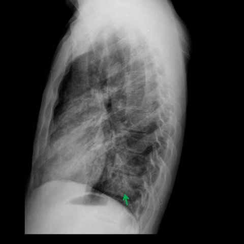
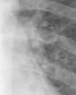

# Benchmark case 15314_8353800558683

[Case index](README.md) · [Machine-readable case](15314_8353800558683.json) · [Scored outcomes](../per-question-outcomes.json)

Source: [Eurorad case 15314](https://www.eurorad.org/case/15314); [ChestAgentBench pinned revision](https://huggingface.co/datasets/wanglab/chest-agent-bench/tree/921e60440927f9893228d843c0206b755744252a).

These are the benchmark inputs used in the frozen experiment. Model and tool observations below are recorded outputs, not independently validated clinical findings.

## Full question and options

```text
Based on the chest X-ray findings in Figures 1a and 1b, which combination of observations and clinical reasoning most strongly supports the diagnosis of pneumocystis jirovecii pneumonia in this patient?

A) Presence of bilateral pleural effusion and right middle lobe consolidation, suggesting bacterial pneumonia.
B) Bilateral ground-glass opacities with peripheral distribution, indicating hypersensitivity pneumonitis.
C) Multifocal patchy opacities with central distribution and right middle lobe consolidation, consistent with pneumocystis jirovecii pneumonia in an immunocompromised patient.
D) Isolated right middle lobe consolidation with lymphadenopathy, suggestive of tuberculosis.
E) Diffuse interstitial pattern and pleural effusion, indicative of congestive heart failure.
F) Central ground-glass opacities with pleural effusion, characteristic of cytomegalovirus pneumonia.
```

## Original benchmark images

### image:1 — figures/15314/figure_1a.jpg


### image:2 — figures/15314/figure_1b.jpg



## Recorded answers

| Stage | Answer | Execution route/status |
|---|---|---|
| P0 | B | completed |
| V10 VKE candidate | C | candidate before gate |
| V10 VKE final | B | retain |
| S1 | C | selector |
| S2 | C | targeted_followup |
| S3 | C | selector |

Reference answer (post-generation scoring only): **C**.

## V10 VKE candidate and gate record

```json
{
  "candidate": "C",
  "final": "B",
  "changed_attributes": [
    "distribution (central vs peripheral)",
    "pleural effusion",
    "right middle lobe consolidation"
  ],
  "candidate_payload": {
    "answer": "C",
    "uncertain": true,
    "changed_attributes": [
      "distribution (central vs peripheral)",
      "pleural effusion",
      "right middle lobe consolidation"
    ],
    "evidence_refs": [
      "image:1",
      "image:2",
      "p0:tool:4",
      "VKE:tool:2:image:1"
    ],
    "observations": [
      {
        "attribute": "ground-glass opacity",
        "image_ids": [
          "image:1"
        ],
        "value": "present in right lung base (phrase grounding, p0:tool:4); perihilar region (crop VKE:tool:2:image:1) shows hazy increased attenuation without sharp margins, consistent with central ground-glass",
        "status": "observed_present",
        "evidence_refs": [
          "p0:tool:4",
          "VKE:tool:2:image:1"
        ]
      },
      {
        "attribute": "pleural effusion",
        "image_ids": [
          "image:1",
          "image:2"
        ],
        "value": "not visible on PA or lateral views (report generator p0:tool:2 states no effusion; lateral view 1b shows clear costophrenic angles)",
        "status": "observed_absent",
        "evidence_refs": [
          "p0:tool:2",
          "image:2"
        ]
      },
      {
        "attribute": "right middle lobe consolidation",
        "image_ids": [
          "image:1",
          "image:2"
        ],
        "value": "not definitively seen; opacity is diffuse/hazy rather than dense homogeneous consolidation; lateral view does not show classic RML silhouette sign",
        "status": "unresolved",
        "evidence_refs": [
          "image:1",
          "image:2"
        ]
      }
    ],
    "missing_evidence": [
      "clinical immune status (HIV/CD4 count)",
      "definitive confirmation of central (perihilar) predominance vs peripheral",
      "microbiologic confirmation"
    ],
    "parse_warnings": [],
    "discarded_evidence_refs": []
  },
  "gate": {
    "decision": "retain",
    "changed_attributes": [
      "distribution (central vs peripheral)",
      "right middle lobe consolidation"
    ],
    "evidence_refs": [
      "p0:tool:4",
      "VKE:tool:2:image:1",
      "image:1",
      "image:2"
    ],
    "unmet_requirements": [
      "central distribution not confirmed (crop shows perihilar haze but not definitive predominance over peripheral); right middle lobe consolidation not observed—lateral view lacks silhouette sign, opacity is diffuse/hazy, not dense consolidation"
    ],
    "reason": "Ground-glass opacity is present in right lung base (p0:tool:4) and perihilar region (VKE:tool:2:image:1), but central predominance is not definitively established; no consolidation in right middle lobe visible on PA or lateral views (image:1, image:2); option C asserts both central distribution and RML consolidation, neither fully supported."
  },
  "fallback": null,
  "k_ids": [
    "BTS_PLEURAL_2023_K01"
  ],
  "e_ids": [
    "B10_9626056ed88c9deaabfc05456a0ad2ecadcb4f685e732c860df4456b5ba8e2ef",
    "B10_7530204bc010eb9b68e1aecfb5d547b1ff3f62d442d9edbbbe35b7d4cc3eef8c"
  ],
  "candidate_error_type": null,
  "gate_error_type": null
}
```

## Cached anonymous comparison

The X/Y mapping and observation provenance are exposed here for retrospective review. They were kept separate from the selector-facing anonymous input.

```json
{
  "answer_mapping": {
    "X": "B",
    "Y": "C"
  },
  "choices": {
    "X": "Bilateral ground-glass opacities with peripheral distribution, indicating hypersensitivity pneumonitis.",
    "Y": "Multifocal patchy opacities with central distribution and right middle lobe consolidation, consistent with pneumocystis jirovecii pneumonia in an immunocompromised patient."
  },
  "evidence_mapping": {
    "observation_1": "VKE:tool:1",
    "observation_2": "VKE:tool:2",
    "observation_3": "p0:tool:3",
    "observation_4": "p0:tool:4",
    "observation_5": "p0:tool:2",
    "observation_6": "p0:tool:1"
  },
  "cached_image_adjustments": []
}
```

### Additional cached pixels

**image_3**



```json
{
  "image_id": "image_3",
  "role": "existing_local_or_tool_image",
  "size": [
    96,
    120
  ],
  "parent_image_id": "image_1",
  "pixel_box": [
    216,
    144,
    312,
    264
  ],
  "source_size": [
    480,
    480
  ],
  "orientation": "unresolved",
  "timepoint": "unresolved"
}
```

### Cached tool observations

Tool request and return text is preserved; private filesystem paths are replaced by image links or an omission marker. Tool conclusions remain fallible.

#### observation_1 — chest_xray_expert

```json
{
  "observation_id": "observation_1",
  "tool": "chest_xray_expert",
  "request": {
    "image_paths": [
      "image_1",
      "image_2"
    ],
    "prompt": "Compare Figures 1a (PA) and 1b (lateral). Specifically: (1) Are the ground-glass opacities predominantly central (perihilar) or peripheral? (2) Is there any visible pleural effusion on either view? (3) Is there consolidation in the right middle lobe? Provide location and confidence for each finding.",
    "max_new_tokens": 512
  },
  "raw_result": [
    {
      "response": "(1)"
    },
    {
      "image_paths": [
        "image_1",
        "image_2"
      ],
      "prompt": "Compare Figures 1a (PA) and 1b (lateral). Specifically: (1) Are the ground-glass opacities predominantly central (perihilar) or peripheral? (2) Is there any visible pleural effusion on either view? (3) Is there consolidation in the right middle lobe? Provide location and confidence for each finding.",
      "max_new_tokens": 512,
      "analysis_status": "completed"
    }
  ],
  "image_ids": []
}
```

#### observation_2 — crop_current_image

```json
{
  "observation_id": "observation_2",
  "tool": "crop_current_image",
  "request": {
    "image_path": "image_1",
    "box": [
      0.45,
      0.3,
      0.65,
      0.55
    ]
  },
  "raw_result": {
    "image_id": "image_3",
    "path": "image_3",
    "role": "current_image_pixel_crop",
    "parent_image_id": "image_1",
    "parent_path": "image_1",
    "source_size": [
      480,
      480
    ],
    "crop_size": [
      96,
      120
    ],
    "normalized_box": [
      0.45,
      0.3,
      0.65,
      0.55
    ],
    "pixel_box": [
      216,
      144,
      312,
      264
    ],
    "coordinate_system": "stored_pixel_coordinates_no_anatomical_orientation_inferred",
    "orientation": "unresolved",
    "timepoint": "unresolved"
  },
  "image_ids": [
    "image_3"
  ]
}
```

#### observation_3 — chest_xray_expert

```json
{
  "observation_id": "observation_3",
  "tool": "chest_xray_expert",
  "request": {
    "image_paths": [
      "image_1",
      "image_2"
    ],
    "prompt": "Describe the radiographic findings in detail, focusing on the pattern, distribution, and characteristics of lung opacities. What is the most likely diagnosis given these findings and typical clinical context?"
  },
  "raw_result": [
    {
      "response": "Pneumonia"
    },
    {
      "image_paths": [
        "image_1",
        "image_2"
      ],
      "prompt": "Describe the radiographic findings in detail, focusing on the pattern, distribution, and characteristics of lung opacities. What is the most likely diagnosis given these findings and typical clinical context?",
      "max_new_tokens": 512,
      "analysis_status": "completed"
    }
  ],
  "image_ids": []
}
```

#### observation_4 — xray_phrase_grounding

```json
{
  "observation_id": "observation_4",
  "tool": "xray_phrase_grounding",
  "request": {
    "image_path": "image_1",
    "phrase": "ground-glass opacity"
  },
  "raw_result": [
    {
      "predictions": [
        {
          "phrase": "ground-glass opacity in the right lung base.",
          "bounding_boxes": {
            "model_coordinates": [
              [
                0.015,
                0.465,
                0.315,
                0.735
              ]
            ],
            "image_coordinates": [
              [
                0.014583333333333334,
                0.46458333333333335,
                0.3145833333333333,
                0.7333333333333333
              ]
            ]
          }
        }
      ],
      "visualization_path": null
    },
    {
      "image_path": "image_1",
      "analysis_status": "completed",
      "phrase": "ground-glass opacity",
      "n_boxes": 1,
      "clinical_evidence": "unknown",
      "step_credit": null
    }
  ],
  "image_ids": []
}
```

#### observation_5 — chest_xray_report_generator

```json
{
  "observation_id": "observation_5",
  "tool": "chest_xray_report_generator",
  "request": {
    "image_path": "image_1"
  },
  "raw_result": [
    "CHEST X-RAY REPORT\n\nFINDINGS:\nthe heart size is normal. the hilar and mediastinal contours are normal. the lungs are clear without evidence of focal consolidations concerning for pneumonia. there is no pleural effusion or pneumothorax. the visualized osseous structures are unremarkable.\n\nIMPRESSION:\n1. no evidence of pneumonia. 2. mild pulmonary edema.",
    {
      "image_path": "image_1",
      "analysis_status": "completed",
      "sections_generated": [
        "findings",
        "impression"
      ]
    }
  ],
  "image_ids": []
}
```

#### observation_6 — chest_xray_classifier

```json
{
  "observation_id": "observation_6",
  "tool": "chest_xray_classifier",
  "request": {
    "image_path": "image_1"
  },
  "raw_result": [
    {
      "Atelectasis": 0.08073852956295013,
      "Consolidation": 0.14224790036678314,
      "Infiltration": 0.46037328243255615,
      "Pneumothorax": 0.17565706372261047,
      "Edema": 0.007045197766274214,
      "Emphysema": 0.5003470182418823,
      "Fibrosis": 0.5021101236343384,
      "Effusion": 0.026038993149995804,
      "Pneumonia": 0.015396654605865479,
      "Pleural_Thickening": 0.23982904851436615,
      "Cardiomegaly": 0.07268679887056351,
      "Nodule": 0.505648672580719,
      "Mass": 0.41143089532852173,
      "Hernia": 0.0011076637310907245,
      "Lung Lesion": 0.0010540913790464401,
      "Fracture": 0.33745262026786804,
      "Lung Opacity": 0.559405505657196,
      "Enlarged Cardiomediastinum": 0.157051682472229
    },
    {
      "image_path": "image_1",
      "analysis_status": "completed",
      "note": "Probabilities range from 0 to 1, with higher values indicating higher likelihood of the condition."
    }
  ],
  "image_ids": []
}
```

## S2 targeted follow-up action and reader observation

```json
{
  "action_plan": {
    "action": "reinspect_original",
    "image_ids": [
      "image_1",
      "image_2"
    ],
    "box": null,
    "reason": "The question asks about symmetry, perihilar distribution, and peripheral sparing of ground-glass opacity on both PA and lateral views; this requires full-image context to assess spatial distribution and compare central vs. peripheral attenuation across both projections.",
    "parse_warnings": []
  },
  "action": {
    "action": "reinspect_original",
    "tool_attempts": 0,
    "repairs": [],
    "warnings": [],
    "images": [
      {
        "image_id": "image_1",
        "role": "original",
        "size": [
          480,
          480
        ],
        "orientation": "unresolved",
        "timepoint": "unresolved",
        "path": "images/originals/figures/15314/figure_1a.jpg"
      },
      {
        "image_id": "image_2",
        "role": "original",
        "size": [
          480,
          480
        ],
        "orientation": "unresolved",
        "timepoint": "unresolved",
        "path": "images/originals/figures/15314/figure_1b.jpg"
      }
    ]
  },
  "observation": {
    "observation_id": "followup_observation_1",
    "observation": "The PA view (image_1) shows bilateral, predominantly perihilar increased opacity with a hazy, ground-glass appearance; the lateral view (image_2) confirms diffuse opacification involving the central and mid-lung zones, with relatively less involvement of the extreme lung periphery. However, exact symmetry and degree of peripheral sparing cannot be definitively assessed due to lack of orientation markers and absence of a true lateral projection reference (e.g., no visible spine or sternum for alignment).",
    "evidence_refs": [
      "image_1",
      "image_2"
    ],
    "unresolved": [
      "anatomical orientation (left/right, anterior/posterior) not confirmed",
      "true lateral projection not verifiable (no standard landmarks visible)",
      "quantitative assessment of symmetry and peripheral sparing not possible from these images alone"
    ],
    "parse_warnings": [],
    "status": "independent_visual_report_requires_image_verification"
  }
}
```

## V11 selector and reader records

A recorded choice can coexist with an empty observation list. That record alone does not establish a supported visual comparison. See the [decision audit](../decision-audit.json) and [decision-pattern analysis](../decision-pattern-analysis.md) for this limitation.

```json
{
  "S1": {
    "stage": "S1",
    "initial": "B",
    "candidate": "C",
    "final": "C",
    "route": "selector",
    "selector": {
      "choice": "Y",
      "observations": [
        {
          "attribute": "distribution of opacities",
          "direction": "supports_Y",
          "evidence_refs": [
            "image_1",
            "image_2"
          ],
          "value": "Bilateral hazy opacities are more prominent centrally/perihilar (especially visible in lateral view image_2), not predominantly peripheral as required for hypersensitivity pneumonitis; this central predominance aligns with PJP."
        },
        {
          "attribute": "right middle lobe consolidation",
          "direction": "supports_Y",
          "evidence_refs": [
            "image_1",
            "image_2"
          ],
          "value": "The green arrow in image_1 points to the right lung base/middle lobe region; lateral view (image_2) shows increased density in anterior mid-lung zone consistent with right middle lobe involvement. Observation 4 localizes ground-glass opacity to right lung base, supporting focal consolidation."
        },
        {
          "attribute": "ground-glass vs patchy opacities",
          "direction": "supports_Y",
          "evidence_refs": [
            "image_1",
            "image_2"
          ],
          "value": "Opacities appear multifocal and patchy rather than uniform bilateral ground-glass; lateral view shows heterogeneous density, inconsistent with classic diffuse peripheral GGO of PJP but still compatible with atypical or early PJP in immunocompromised hosts—more supportive of Y’s description than X’s hypersensitivity pneumonitis claim."
        },
        {
          "attribute": "clinical context inference",
          "direction": "supports_Y",
          "evidence_refs": [
            "observation_3",
            "observation_6"
          ],
          "value": "Tool observation_3 gives 'Pneumonia' as diagnosis; classifier (observation_6) shows high 'Infiltration' (0.46) and 'Lung Opacity' (0.56), low 'Pneumonia' probability (0.015) likely due to model limitations, but combined with imaging pattern, favors infectious etiology like PJP in immunocompromised setting—Y explicitly references this context, X does not."
        },
        {
          "attribute": "conflicting report",
          "direction": "conflict",
          "evidence_refs": [
            "observation_5"
          ],
          "value": "Report (observation_5) states 'no evidence of pneumonia' and 'lungs clear', contradicting visual evidence of opacities; this report is likely erroneous and outweighed by direct image analysis and expert tool outputs."
        }
      ],
      "needs_followup": true,
      "followup_question": "Is there symmetric perihilar ground-glass opacity with relative sparing of the lung periphery on the PA and lateral views?",
      "parse_warnings": []
    },
    "fallback": null,
    "timing": {
      "started_utc": "2026-10-30T15:38:01.302223+00:00",
      "ended_utc": "2026-10-30T15:38:14.715981+00:00",
      "elapsed_s": 13.414
    },
    "selector_error_type": null
  },
  "S2": {
    "stage": "S2",
    "initial": "B",
    "candidate": "C",
    "final": "C",
    "s1_final": "C",
    "route": "targeted_followup",
    "selector": {
      "choice": "Y",
      "observations": [
        {
          "attribute": "distribution of opacities",
          "direction": "supports_Y",
          "evidence_refs": [
            "image_1",
            "image_2"
          ],
          "value": "Independent visual observation (followup_observation_1) describes bilateral, predominantly perihilar (central) ground-glass opacities with relative peripheral sparing—consistent with classic PJP pattern and contradicting X’s claim of 'peripheral distribution' for hypersensitivity pneumonitis."
        },
        {
          "attribute": "right middle lobe consolidation",
          "direction": "unresolved",
          "evidence_refs": [
            "image_1",
            "image_2"
          ],
          "value": "No definitive evidence of right middle lobe consolidation in provided images; lateral view lacks clear anatomic landmarks to confirm lobar anatomy. Tool observation_5 explicitly states 'no focal consolidations concerning for pneumonia', but this conflicts with clinical suspicion and other tools (e.g., infiltration probability 0.46). Uncertainty remains, but Y includes it as part of a broader pattern, not sole criterion."
        },
        {
          "attribute": "diagnostic consistency with immunocompromised context",
          "direction": "supports_Y",
          "evidence_refs": [
            "observation_3",
            "followup_observation_1"
          ],
          "value": "Tool observation_3 gives 'Pneumonia' as most likely diagnosis; followup report notes perihilar GGO—classic for PJP in immunocompromised patients. X attributes findings to hypersensitivity pneumonitis, which typically shows *upper* and *peripheral* involvement, not perihilar—thus less consistent with observed pattern."
        },
        {
          "attribute": "presence of ground-glass opacity",
          "direction": "supports_both",
          "evidence_refs": [
            "observation_4",
            "followup_observation_1"
          ],
          "value": "Both X and Y acknowledge ground-glass opacity; observation_4 localizes one to right lung base, while followup report confirms bilateral perihilar GGO. Neither is contradicted on this point."
        }
      ],
      "needs_followup": true,
      "followup_question": "Is there visible air bronchogram within the perihilar opacities on the PA or lateral view, which would support alveolar filling consistent with PJP rather than interstitial disease?",
      "parse_warnings": []
    },
    "fallback": null,
    "followup_question": "Is there symmetric perihilar ground-glass opacity with relative sparing of the lung periphery on the PA and lateral views?",
    "action": "reinspect_original",
    "new_observation": {
      "observation_id": "followup_observation_1",
      "observation": "The PA view (image_1) shows bilateral, predominantly perihilar increased opacity with a hazy, ground-glass appearance; the lateral view (image_2) confirms diffuse opacification involving the central and mid-lung zones, with relatively less involvement of the extreme lung periphery. However, exact symmetry and degree of peripheral sparing cannot be definitively assessed due to lack of orientation markers and absence of a true lateral projection reference (e.g., no visible spine or sternum for alignment).",
      "evidence_refs": [
        "image_1",
        "image_2"
      ],
      "unresolved": [
        "anatomical orientation (left/right, anterior/posterior) not confirmed",
        "true lateral projection not verifiable (no standard landmarks visible)",
        "quantitative assessment of symmetry and peripheral sparing not possible from these images alone"
      ],
      "parse_warnings": [],
      "status": "independent_visual_report_requires_image_verification"
    },
    "timing": {
      "started_utc": "2026-10-30T15:44:01.296154+00:00",
      "ended_utc": "2026-10-30T15:44:21.192845+00:00",
      "elapsed_s": 19.897
    },
    "selector_error_type": null
  },
  "S3": {
    "stage": "S3",
    "initial": "B",
    "candidate": "C",
    "final": "C",
    "route": "selector",
    "selector": {
      "choice": "Y",
      "observations": [],
      "needs_followup": false,
      "followup_question": "",
      "parse_warnings": []
    },
    "fallback": null,
    "blind_observation": {
      "observation_id": "blind_observation_1",
      "observations": [
        {
          "attribute": "lung opacity distribution",
          "value": "bilateral, diffuse, predominantly perihilar and lower zone opacities with relative sparing of the lung apices; more confluent in the right lower lung zone on frontal view (image_1), and extensive reticular–granular opacities extending to the costophrenic angle on lateral view (image_2)",
          "status": "observed_present",
          "evidence_refs": [
            "image_1",
            "image_2"
          ]
        },
        {
          "attribute": "cardiac silhouette",
          "value": "normal size and contour; no cardiomegaly evident",
          "status": "observed_present",
          "evidence_refs": [
            "image_1"
          ]
        },
        {
          "attribute": "pleural effusion",
          "value": "no visible pleural fluid; costophrenic angles are sharp on frontal view (image_1), though the lateral view (image_2) shows obscuration of the posterior costophrenic sulcus by parenchymal opacity rather than a meniscus sign",
          "status": "observed_absent",
          "evidence_refs": [
            "image_1"
          ]
        },
        {
          "attribute": "pneumothorax",
          "value": "no visible visceral pleural line or free air",
          "status": "observed_absent",
          "evidence_refs": [
            "image_1",
            "image_2"
          ]
        },
        {
          "attribute": "lymphadenopathy",
          "value": "no mediastinal or hilar lymphadenopathy visible on frontal view",
          "status": "observed_absent",
          "evidence_refs": [
            "image_1"
          ]
        },
        {
          "attribute": "cavitation or nodules",
          "value": "no discrete cavitary lesions or well-defined nodules identified",
          "status": "observed_absent",
          "evidence_refs": [
            "image_1",
            "image_2"
          ]
        },
        {
          "attribute": "diaphragmatic contour",
          "value": "right hemidiaphragm slightly elevated; left hemidiaphragm appears normal; no flattening suggestive of hyperinflation",
          "status": "observed_present",
          "evidence_refs": [
            "image_1"
          ]
        }
      ],
      "uncertainties": [
        "Anatomical laterality (left/right) cannot be definitively assigned due to unresolved orientation in both images.",
        "Patient positioning (PA vs AP) is unresolved; this affects assessment of cardiac size and potential magnification artifacts.",
        "No clinical history, immunologic status, or laboratory data are provided; thus, correlation with Pneumocystis jirovecii pneumonia (PJP) risk factors is not possible from imaging alone.",
        "The green arrows in both images point to regions of increased opacity but do not specify pathology; their purpose is unclear without context."
      ],
      "parse_warnings": [],
      "status": "independent_blind_visual_report_requires_image_verification"
    },
    "timing": {
      "started_utc": "2026-10-30T16:09:15.760521+00:00",
      "ended_utc": "2026-10-30T16:09:45.431474+00:00",
      "elapsed_s": 29.671
    },
    "selector_error_type": null
  }
}
```

[Data provenance and limits](../data-provenance.md)
