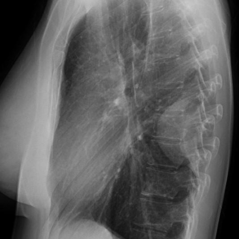
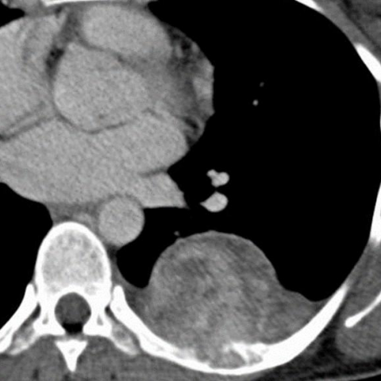

# Benchmark case 16037_8353800455673

[Case index](README.md) · [Machine-readable case](16037_8353800455673.json) · [Scored outcomes](../per-question-outcomes.json)

Source: [Eurorad case 16037](https://www.eurorad.org/case/16037); [ChestAgentBench pinned revision](https://huggingface.co/datasets/wanglab/chest-agent-bench/tree/921e60440927f9893228d843c0206b755744252a).

These are the benchmark inputs used in the frozen experiment. Model and tool observations below are recorded outputs, not independently validated clinical findings.

## Full question and options

```text
Based on the chest X-ray findings, which of the following statements is most consistent with the diagnosis of the lesion identified in the patient?
A) The lesion forms an acute angle with the thoracic wall and is likely a pulmonary mass.
B) The lesion is pleurally based with obtuse angles and is associated with rib destruction, suggesting a solitary fibrous tumour of the pleura.
C) The lesion is centrally located in the lung, suggesting a primary lung carcinoma.
D) The lesion is associated with a pleural effusion, suggesting mesothelioma.
E) The lesion is calcified and is likely a pleural metastasis.
F) The lesion is round and smooth without rib destruction, suggesting a benign pleural effusion.
```

## Original benchmark images

### image:1 — figures/16037/figure_1.jpg


### image:2 — figures/16037/figure_2.jpg



### image:3 — figures/16037/figure_3.jpg



## Recorded answers

| Stage | Answer | Execution route/status |
|---|---|---|
| P0 | B | completed |
| V10 VKE candidate | B | candidate before gate |
| V10 VKE final | B | no_change |
| S1 | B | inherited_agreement |
| S2 | B | inherited_s1 |
| S3 | B | inherited_agreement |

Reference answer (post-generation scoring only): **B**.

## V10 VKE candidate and gate record

```json
{
  "candidate": "B",
  "final": "B",
  "changed_attributes": [
    "pleural vs pulmonary location",
    "angle with thoracic wall",
    "rib destruction"
  ],
  "candidate_payload": {
    "answer": "B",
    "uncertain": true,
    "changed_attributes": [
      "pleural vs pulmonary location",
      "angle with thoracic wall",
      "rib destruction"
    ],
    "evidence_refs": [
      "image:1",
      "image:2",
      "image:3",
      "p0:tool:3",
      "p0:tool:4"
    ],
    "observations": [
      {
        "attribute": "pleural vs pulmonary location",
        "image_ids": [
          "image:1",
          "image:3"
        ],
        "value": "pleural-based lesion identified by expert tool and CT appearance",
        "status": "observed_present",
        "evidence_refs": [
          "p0:tool:3",
          "image:3"
        ]
      },
      {
        "attribute": "angle with thoracic wall",
        "image_ids": [
          "image:1"
        ],
        "value": "inconclusive from frontal view; obtuse angle suspected but not definitively shown",
        "status": "unresolved",
        "evidence_refs": [
          "image:1"
        ]
      },
      {
        "attribute": "rib destruction",
        "image_ids": [
          "image:1",
          "image:3"
        ],
        "value": "no clear evidence of rib erosion visible on available images",
        "status": "observed_absent",
        "evidence_refs": [
          "image:1",
          "image:3"
        ]
      }
    ],
    "missing_evidence": [
      "definitive assessment of lesion-chest wall angle",
      "confirmation of rib destruction status"
    ],
    "parse_warnings": [],
    "discarded_evidence_refs": []
  },
  "gate": {
    "decision": "no_change"
  },
  "fallback": null,
  "k_ids": [
    "RAD_PNEUMOTHORAX_IMAGING_2016_07",
    "RAD_CXR_CHALLENGES_2025_03"
  ],
  "e_ids": [
    "B10_457c771e2403d6712b6257571b315c318c99cfaea76819b04e6ecda4de743db2",
    "B10_33e13798084934ec58ee4630a7d7cdb49300c0b80d2b2053dac4e8b5a8d9ade8"
  ],
  "candidate_error_type": null,
  "gate_error_type": null
}
```

## Detailed comparison evidence

This case did not route to the 21-case anonymous disagreement selector. Its original input and recorded answers are included; no selector packet was generated.

## V11 selector and reader records

A recorded choice can coexist with an empty observation list. That record alone does not establish a supported visual comparison. See the [decision audit](../decision-audit.json) and [decision-pattern analysis](../decision-pattern-analysis.md) for this limitation.

```json
{
  "S1": {
    "stage": "S1",
    "initial": "B",
    "candidate": "B",
    "final": "B",
    "route": "inherited_agreement",
    "selector": null,
    "fallback": null,
    "timing": {
      "started_utc": "2026-10-30T15:38:14.719668+00:00",
      "ended_utc": "2026-10-30T15:38:14.719889+00:00",
      "elapsed_s": 0.0
    },
    "selector_error_type": null
  },
  "S2": {
    "stage": "S2",
    "initial": "B",
    "candidate": "B",
    "final": "B",
    "s1_final": "B",
    "route": "inherited_s1",
    "selector": null,
    "fallback": null,
    "timing": {
      "started_utc": "2026-10-30T15:44:21.196585+00:00",
      "ended_utc": "2026-10-30T15:44:21.196790+00:00",
      "elapsed_s": 0.0
    },
    "selector_error_type": null
  },
  "S3": {
    "stage": "S3",
    "initial": "B",
    "candidate": "B",
    "final": "B",
    "route": "inherited_agreement",
    "selector": null,
    "fallback": null,
    "timing": {
      "started_utc": "2026-10-30T16:09:45.435029+00:00",
      "ended_utc": "2026-10-30T16:09:45.435271+00:00",
      "elapsed_s": 0.0
    },
    "selector_error_type": null
  }
}
```

[Data provenance and limits](../data-provenance.md)
