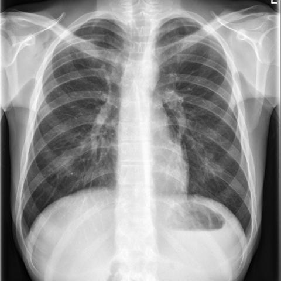

# Benchmark case 16486_8353800471802

[Case index](README.md) · [Machine-readable case](16486_8353800471802.json) · [Scored outcomes](../per-question-outcomes.json)

Source: [Eurorad case 16486](https://www.eurorad.org/case/16486); [ChestAgentBench pinned revision](https://huggingface.co/datasets/wanglab/chest-agent-bench/tree/921e60440927f9893228d843c0206b755744252a).

These are the benchmark inputs used in the frozen experiment. Model and tool observations below are recorded outputs, not independently validated clinical findings.

## Full question and options

```text
Based on the chest X-ray findings in Figure 1 and Figure 8, what is the most likely diagnosis, and what does the progression of findings suggest about the clinical course of the condition in this patient?
A) Secondary pneumomediastinum due to oesophageal rupture, with worsening condition
B) Spontaneous pneumothorax with stable condition
C) Primary spontaneous pneumomediastinum with improvement
D) Pneumopericardium with no change in condition
E) Pneumoperitoneum with deterioration
F) Primary spontaneous pneumomediastinum with worsening condition
```

## Original benchmark images

### image:1 — figures/16486/figure_1.jpg


### image:2 — figures/16486/figure_8.jpg



## Recorded answers

| Stage | Answer | Execution route/status |
|---|---|---|
| P0 | C | completed |
| V10 VKE candidate | C | candidate before gate |
| V10 VKE final | C | no_change |
| S1 | C | inherited_agreement |
| S2 | C | inherited_s1 |
| S3 | C | inherited_agreement |

Reference answer (post-generation scoring only): **C**.

## V10 VKE candidate and gate record

```json
{
  "candidate": "C",
  "final": "C",
  "changed_attributes": [
    "linear lucency along left cardiac border present in Figure 1, absent in Figure 8",
    "clinical course: improvement"
  ],
  "candidate_payload": {
    "answer": "C",
    "uncertain": false,
    "changed_attributes": [
      "linear lucency along left cardiac border present in Figure 1, absent in Figure 8",
      "clinical course: improvement"
    ],
    "evidence_refs": [
      "VKE:tool:1",
      "VKE:tool:2",
      "p0:tool:5"
    ],
    "observations": [
      {
        "attribute": "linear radiolucency tracking left heart border (pneumomediastinum sign)",
        "image_ids": [
          "image:1"
        ],
        "value": "clearly visible as thin lucent line parallel to left cardiac margin",
        "status": "observed_present",
        "evidence_refs": [
          "VKE:tool:1"
        ]
      },
      {
        "attribute": "linear radiolucency tracking left heart border",
        "image_ids": [
          "image:2"
        ],
        "value": "not visible; left cardiac border smooth and continuous",
        "status": "observed_absent",
        "evidence_refs": [
          "VKE:tool:2"
        ]
      },
      {
        "attribute": "diagnosis consensus",
        "image_ids": [
          "image:1",
          "image:2"
        ],
        "value": "expert VQA identifies pneumomediastinum improving from Fig 1 to Fig 8",
        "status": "hypothesis",
        "evidence_refs": [
          "p0:tool:5"
        ]
      }
    ],
    "missing_evidence": [
      "lateral view confirmation",
      "clinical history (e.g., vomiting, trauma)",
      "time interval between images"
    ],
    "parse_warnings": [],
    "discarded_evidence_refs": []
  },
  "gate": {
    "decision": "no_change"
  },
  "fallback": null,
  "k_ids": [
    "BTS_PLEURAL_2023_K01"
  ],
  "e_ids": [
    "B10_6abffeb9b46662abc08f55b4c57664044fa16238cb78f05f2f6029fb0ff0e26b",
    "B10_fb47f1d505253c3f0101444e516b9ed18fbf0b955a27233799d83353ce296a1c"
  ],
  "candidate_error_type": null,
  "gate_error_type": null
}
```

## Detailed comparison evidence

This case did not route to the 21-case anonymous disagreement selector. Its original input and recorded answers are included; no selector packet was generated.

## V11 selector and reader records

A recorded choice can coexist with an empty observation list. That record alone does not establish a supported visual comparison. See the [decision audit](../decision-audit.json) and [decision-pattern analysis](../decision-pattern-analysis.md) for this limitation.

```json
{
  "S1": {
    "stage": "S1",
    "initial": "C",
    "candidate": "C",
    "final": "C",
    "route": "inherited_agreement",
    "selector": null,
    "fallback": null,
    "timing": {
      "started_utc": "2026-10-30T15:38:14.723345+00:00",
      "ended_utc": "2026-10-30T15:38:14.723542+00:00",
      "elapsed_s": 0.0
    },
    "selector_error_type": null
  },
  "S2": {
    "stage": "S2",
    "initial": "C",
    "candidate": "C",
    "final": "C",
    "s1_final": "C",
    "route": "inherited_s1",
    "selector": null,
    "fallback": null,
    "timing": {
      "started_utc": "2026-10-30T15:44:21.200280+00:00",
      "ended_utc": "2026-10-30T15:44:21.200477+00:00",
      "elapsed_s": 0.0
    },
    "selector_error_type": null
  },
  "S3": {
    "stage": "S3",
    "initial": "C",
    "candidate": "C",
    "final": "C",
    "route": "inherited_agreement",
    "selector": null,
    "fallback": null,
    "timing": {
      "started_utc": "2026-10-30T16:09:45.438633+00:00",
      "ended_utc": "2026-10-30T16:09:45.439208+00:00",
      "elapsed_s": 0.001
    },
    "selector_error_type": null
  }
}
```

[Data provenance and limits](../data-provenance.md)
