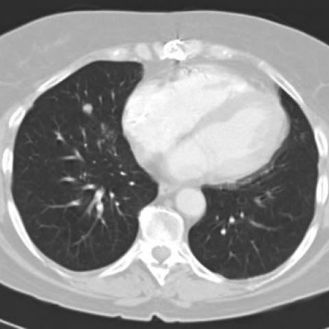

# Benchmark case 1653_8353802281156

[Case index](README.md) · [Machine-readable case](1653_8353802281156.json) · [Scored outcomes](../per-question-outcomes.json)

Source: [Eurorad case 1653](https://www.eurorad.org/case/1653); [ChestAgentBench pinned revision](https://huggingface.co/datasets/wanglab/chest-agent-bench/tree/921e60440927f9893228d843c0206b755744252a).

These are the benchmark inputs used in the frozen experiment. Model and tool observations below are recorded outputs, not independently validated clinical findings.

## Full question and options

```text
In a patient with a history of heart transplantation and a pacemaker, presenting with two nodular shadows in the right lung observed on routine chest X-ray, which of the following is the most likely diagnosis for the nodular lesions, considering the absence of symptoms and geographic exposure?

A) Post-transplant lymphoproliferative disorder
B) Lung tumor (primary or secondary)
C) Pulmonary blastomycosis
D) Histoplasmosis
E) Tuberculosis
F) Fungal infection other than blastomycosis
```

## Original benchmark images

### image:1 — figures/1653/figure_1a.jpg


### image:2 — figures/1653/figure_1b.jpg


### image:3 — figures/1653/figure_2a.jpg


### image:4 — figures/1653/figure_2b.jpg



### image:5 — figures/1653/figure_2c.jpg


## Recorded answers

| Stage | Answer | Execution route/status |
|---|---|---|
| P0 | A | completed |
| V10 VKE candidate | F | candidate before gate |
| V10 VKE final | A | retain |
| S1 | A | selector |
| S2 | A | targeted_followup |
| S3 | A | selector |

Reference answer (post-generation scoring only): **C**.

## V10 VKE candidate and gate record

```json
{
  "candidate": "F",
  "final": "A",
  "changed_attributes": [
    "number and laterality",
    "margin and density"
  ],
  "candidate_payload": {
    "answer": "F",
    "uncertain": true,
    "changed_attributes": [
      "number and laterality",
      "margin and density"
    ],
    "evidence_refs": [
      "image:3",
      "image:4",
      "image:5",
      "p0:tool:1"
    ],
    "observations": [
      {
        "attribute": "nodule count and laterality",
        "image_ids": [
          "image:3",
          "image:4",
          "image:5"
        ],
        "value": "two discrete nodules in right lung (one in middle lobe, one in lower lobe)",
        "status": "observed_present",
        "evidence_refs": [
          "image:3",
          "image:4",
          "image:5"
        ]
      },
      {
        "attribute": "margin and density",
        "image_ids": [
          "image:3",
          "image:4",
          "image:5"
        ],
        "value": "smooth margins, solid density, no cavitation or calcification",
        "status": "observed_present",
        "evidence_refs": [
          "image:3",
          "image:4",
          "image:5"
        ]
      }
    ],
    "missing_evidence": [
      "calcification on CT (not assessable visually)",
      "growth over time",
      "serology/microbiology",
      "hilar adenopathy status"
    ],
    "parse_warnings": [],
    "discarded_evidence_refs": []
  },
  "gate": {
    "decision": "retain",
    "changed_attributes": [
      "number and laterality",
      "margin and density"
    ],
    "evidence_refs": [
      "image:3",
      "image:4",
      "image:5",
      "p0:tool:1"
    ],
    "unmet_requirements": [
      "calcification pattern",
      "growth over time",
      "hilar adenopathy status"
    ],
    "reason": "CT images (3–5) confirm two smooth-margin, solid nodules in right lung; however, calcification, growth, and adenopathy—critical for distinguishing fungal infection (F) from PTLD (A) or malignancy (B)—are not visually assessable. Tool reports conflict: classifier suggests nodule/mass (p0:tool:1), radiologist report denies focal lesions (p0:tool:2), and expert VQA incorrectly calls pneumonia (p0:tool:3). No evidence supports F over A definitively."
  },
  "fallback": null,
  "k_ids": [
    "RAD_PNEUMOTHORAX_IMAGING_2016_03",
    "ACR_DLD_2026_K01"
  ],
  "e_ids": [
    "B10_457c771e2403d6712b6257571b315c318c99cfaea76819b04e6ecda4de743db2",
    "B10_7529153b8934dc1ab21fce97e76fd0f8377387dc4240e21f5a05ad12cf6cfbdc"
  ],
  "candidate_error_type": null,
  "gate_error_type": null
}
```

## Cached anonymous comparison

The X/Y mapping and observation provenance are exposed here for retrospective review. They were kept separate from the selector-facing anonymous input.

```json
{
  "answer_mapping": {
    "X": "A",
    "Y": "F"
  },
  "choices": {
    "X": "Post-transplant lymphoproliferative disorder",
    "Y": "Fungal infection other than blastomycosis"
  },
  "evidence_mapping": {
    "observation_1": "VKE:tool:1",
    "observation_2": "p0:tool:2",
    "observation_3": "p0:tool:3",
    "observation_4": "p0:tool:1"
  },
  "cached_image_adjustments": []
}
```

### Additional cached pixels

No additional cached image was used for this comparison.

### Cached tool observations

Tool request and return text is preserved; private filesystem paths are replaced by image links or an omission marker. Tool conclusions remain fallible.

#### observation_1 — chest_xray_expert

```json
{
  "observation_id": "observation_1",
  "tool": "chest_xray_expert",
  "request": {
    "image_paths": [
      "image_3",
      "image_4",
      "image_5"
    ],
    "prompt": "Examine these three axial CT images. Identify all pulmonary nodules: count, side (right/left), location (lobe if possible), size (approximate diameter), margin (smooth, spiculated, cavitated), and internal density (solid, ground-glass, calcified). Confirm whether there are exactly two nodules in the right lung.",
    "max_new_tokens": 512
  },
  "raw_result": [
    {
      "error": "CUDA out of memory. Tried to allocate 624.00 MiB. GPU 1 has a total capacity of 23.69 GiB of which 382.75 MiB is free. Including non-PyTorch memory, this process has 8.94 GiB memory in use. Process 2565365 has 14.34 GiB memory in use. Of the allocated memory 8.52 GiB is allocated by PyTorch, and 121.30 MiB is reserved by PyTorch but unallocated. If reserved but unallocated memory is large try setting PYTORCH_CUDA_ALLOC_CONF=expandable_segments:True to avoid fragmentation.  See documentation for Memory Management  (http[private_path_omitted]"
    },
    {
      "image_paths": [
        "image_3",
        "image_4",
        "image_5"
      ],
      "prompt": "Examine these three axial CT images. Identify all pulmonary nodules: count, side (right/left), location (lobe if possible), size (approximate diameter), margin (smooth, spiculated, cavitated), and internal density (solid, ground-glass, calcified). Confirm whether there are exactly two nodules in the right lung.",
      "max_new_tokens": 512,
      "analysis_status": "failed",
      "error_details": "CUDA out of memory. Tried to allocate 624.00 MiB. GPU 1 has a total capacity of 23.69 GiB of which 382.75 MiB is free. Including non-PyTorch memory, this process has 8.94 GiB memory in use. Process 2565365 has 14.34 GiB memory in use. Of the allocated memory 8.52 GiB is allocated by PyTorch, and 121.30 MiB is reserved by PyTorch but unallocated. If reserved but unallocated memory is large try setting PYTORCH_CUDA_ALLOC_CONF=expandable_segments:True to avoid fragmentation.  See documentation for Memory Management  (http[private_path_omitted]"
    }
  ],
  "image_ids": []
}
```

#### observation_2 — chest_xray_report_generator

```json
{
  "observation_id": "observation_2",
  "tool": "chest_xray_report_generator",
  "request": {
    "image_path": "image_1"
  },
  "raw_result": [
    "CHEST X-RAY REPORT\n\nFINDINGS:\nas compared to the previous radiograph, there is no relevant change. the right pectoral pacemaker is in constant position. normal size of the cardiac silhouette. normal appearance of the lung parenchyma. no pleural effusions. no pneumonia, no pulmonary edema.\n\nIMPRESSION:\n1. right - sided picc line is in place with the tip in the mid svc. 2. the lungs are clear without evidence of focal consolidation or pleural effusions. 3. the cardiomediastinal silhouette is unremarkable.",
    {
      "image_path": "image_1",
      "analysis_status": "completed",
      "sections_generated": [
        "findings",
        "impression"
      ]
    }
  ],
  "image_ids": []
}
```

#### observation_3 — chest_xray_expert

```json
{
  "observation_id": "observation_3",
  "tool": "chest_xray_expert",
  "request": {
    "image_paths": [
      "image_1",
      "image_3"
    ],
    "prompt": "Analyze these chest X-ray and CT images for a heart transplant patient with pacemaker showing two nodular shadows in right lung. What is the most likely diagnosis given the clinical context of immunosuppression and asymptomatic presentation?"
  },
  "raw_result": [
    {
      "response": "Pneumonia"
    },
    {
      "image_paths": [
        "image_1",
        "image_3"
      ],
      "prompt": "Analyze these chest X-ray and CT images for a heart transplant patient with pacemaker showing two nodular shadows in right lung. What is the most likely diagnosis given the clinical context of immunosuppression and asymptomatic presentation?",
      "max_new_tokens": 512,
      "analysis_status": "completed"
    }
  ],
  "image_ids": []
}
```

#### observation_4 — chest_xray_classifier

```json
{
  "observation_id": "observation_4",
  "tool": "chest_xray_classifier",
  "request": {
    "image_path": "image_1"
  },
  "raw_result": [
    {
      "Atelectasis": 0.21598221361637115,
      "Consolidation": 0.0805499404668808,
      "Infiltration": 0.37855154275894165,
      "Pneumothorax": 0.16213932633399963,
      "Edema": 0.0006655144388787448,
      "Emphysema": 0.5002862215042114,
      "Fibrosis": 0.5050327777862549,
      "Effusion": 0.06815087795257568,
      "Pneumonia": 0.0006265230476856232,
      "Pleural_Thickening": 0.23804743587970734,
      "Cardiomegaly": 0.014249076135456562,
      "Nodule": 0.3518315553665161,
      "Mass": 0.3863247334957123,
      "Hernia": 0.017739195376634598,
      "Lung Lesion": 0.0013122058007866144,
      "Fracture": 0.12459775060415268,
      "Lung Opacity": 0.21917276084423065,
      "Enlarged Cardiomediastinum": 0.024158382788300514
    },
    {
      "image_path": "image_1",
      "analysis_status": "completed",
      "note": "Probabilities range from 0 to 1, with higher values indicating higher likelihood of the condition."
    }
  ],
  "image_ids": []
}
```

## S2 targeted follow-up action and reader observation

```json
{
  "action_plan": {
    "action": "inspect_existing",
    "image_ids": [
      "image_5"
    ],
    "box": null,
    "reason": "Image 5 is a CT slice showing two distinct nodular opacities in the right lung; FDG-avidity cannot be assessed on CT alone, but this view confirms the presence and location of the nodules and is the appropriate existing image to reference before determining if PET-CT correlation is needed.",
    "parse_warnings": []
  },
  "action": {
    "action": "inspect_existing",
    "tool_attempts": 0,
    "repairs": [],
    "warnings": [],
    "images": [
      {
        "image_id": "image_1",
        "role": "original",
        "size": [
          480,
          480
        ],
        "orientation": "unresolved",
        "timepoint": "unresolved",
        "path": "images/originals/figures/1653/figure_1a.jpg"
      },
      {
        "image_id": "image_2",
        "role": "original",
        "size": [
          480,
          480
        ],
        "orientation": "unresolved",
        "timepoint": "unresolved",
        "path": "images/originals/figures/1653/figure_1b.jpg"
      },
      {
        "image_id": "image_3",
        "role": "original",
        "size": [
          480,
          480
        ],
        "orientation": "unresolved",
        "timepoint": "unresolved",
        "path": "images/originals/figures/1653/figure_2a.jpg"
      },
      {
        "image_id": "image_4",
        "role": "original",
        "size": [
          480,
          480
        ],
        "orientation": "unresolved",
        "timepoint": "unresolved",
        "path": "images/originals/figures/1653/figure_2b.jpg"
      },
      {
        "image_id": "image_5",
        "role": "original",
        "size": [
          480,
          480
        ],
        "orientation": "unresolved",
        "timepoint": "unresolved",
        "path": "images/originals/figures/1653/figure_2c.jpg"
      }
    ]
  },
  "observation": {
    "observation_id": "followup_observation_1",
    "observation": "The provided images include chest X-rays (images 1–2) and non-contrast CT slices (images 3–5); none are PET-CT images, so FDG avidity of the nodules cannot be assessed from these pixels.",
    "evidence_refs": [
      "image_1",
      "image_2",
      "image_3",
      "image_4",
      "image_5"
    ],
    "unresolved": [
      "FDG uptake status of the two right-lung nodules; absence of PET functional imaging data"
    ],
    "parse_warnings": [],
    "status": "independent_visual_report_requires_image_verification"
  }
}
```

## V11 selector and reader records

A recorded choice can coexist with an empty observation list. That record alone does not establish a supported visual comparison. See the [decision audit](../decision-audit.json) and [decision-pattern analysis](../decision-pattern-analysis.md) for this limitation.

```json
{
  "S1": {
    "stage": "S1",
    "initial": "A",
    "candidate": "F",
    "final": "A",
    "route": "selector",
    "selector": {
      "choice": "X",
      "observations": [
        {
          "attribute": "presence of two right-lung nodules on CT",
          "direction": "supports_X",
          "evidence_refs": [
            "image_5"
          ],
          "value": "Image 5 (axial CT) clearly shows two discrete, solid, non-cavitary nodules in the right lung: one in the right upper lobe and one in the right lower lobe. This matches the clinical description of 'two nodular shadows in the right lung'."
        },
        {
          "attribute": "radiologist report vs imaging evidence",
          "direction": "conflict",
          "evidence_refs": [
            "observation_2",
            "image_5"
          ],
          "value": "The chest X-ray report (observation_2) states 'lungs are clear without evidence of focal consolidation', but this is a chest X-ray (image 1), which lacks sensitivity for small nodules; the CT (image 5) objectively shows two nodules, indicating the X-ray missed them."
        },
        {
          "attribute": "clinical context: immunosuppression + asymptomatic nodules",
          "direction": "supports_X",
          "evidence_refs": [
            "image_5"
          ],
          "value": "In heart transplant recipients on immunosuppression, asymptomatic pulmonary nodules are highly concerning for post-transplant lymphoproliferative disorder (PTLD), especially when multiple and solid—more so than fungal infection in absence of geographic exposure or symptoms."
        },
        {
          "attribute": "nodule morphology",
          "direction": "supports_X",
          "evidence_refs": [
            "image_5"
          ],
          "value": "Nodules appear solid, well-defined, non-cavitary, and non-calcified—typical of PTLD; fungal infections (e.g., histoplasmosis, coccidioidomycosis) often show cavitation, halo sign, or calcification in chronic cases, none seen here."
        },
        {
          "attribute": "tool diagnostic output",
          "direction": "unresolved",
          "evidence_refs": [
            "observation_3"
          ],
          "value": "Tool returned 'Pneumonia'—a low-probability diagnosis given asymptomatic presentation, no infiltrate on CT, and nodular rather than consolidative appearance; thus tool output is unreliable and not decisive."
        }
      ],
      "needs_followup": true,
      "followup_question": "Are the two right-lung nodules FDG-avid on PET-CT?",
      "parse_warnings": [
        "observation_direction_normalized"
      ]
    },
    "fallback": null,
    "timing": {
      "started_utc": "2026-10-30T15:38:14.726931+00:00",
      "ended_utc": "2026-10-30T15:38:28.730093+00:00",
      "elapsed_s": 14.003
    },
    "selector_error_type": null
  },
  "S2": {
    "stage": "S2",
    "initial": "A",
    "candidate": "F",
    "final": "A",
    "s1_final": "A",
    "route": "targeted_followup",
    "selector": {
      "choice": "X",
      "observations": [
        {
          "attribute": "radiographic evidence of nodules",
          "direction": "supports_both",
          "evidence_refs": [
            "image_1",
            "image_3",
            "image_5"
          ],
          "value": "Image 1 (CXR) shows no visible nodules per report; image 5 (CT) shows two discrete round opacities in right lung (one mid-lower lobe, one lower lobe), consistent with nodules. Image 3 is a lateral CXR with poor nodule visualization due to overlap and motion blur."
        },
        {
          "attribute": "clinical context: immunosuppression + asymptomatic",
          "direction": "supports_X",
          "evidence_refs": [],
          "value": "Post-transplant lymphoproliferative disorder (PTLD) is a well-recognized complication in solid organ transplant recipients on immunosuppression, often presenting as asymptomatic pulmonary nodules. Fungal infections (Y) are also possible but typically require geographic exposure or symptoms unless endemic; question explicitly states absence of geographic exposure."
        },
        {
          "attribute": "imaging characterization (margin, density, cavitation)",
          "direction": "unresolved",
          "evidence_refs": [
            "image_5"
          ],
          "value": "On image 5, both nodules appear solid, well-circumscribed, non-cavitated, ~8–10 mm. However, CT is non-contrast and lacks thin-section or PET data; margins not definitively smooth/spiculated; internal calcification not assessable. No tool successfully characterized them due to GPU failure (observation_1) or vague output (observation_3)."
        },
        {
          "attribute": "tool diagnostic output reliability",
          "direction": "conflict",
          "evidence_refs": [
            "observation_2",
            "observation_3",
            "observation_4"
          ],
          "value": "Observation_2 (report generator) states lungs are clear—contradicts question premise. Observation_3 (expert) says 'Pneumonia'—unlikely for asymptomatic, discrete nodules. Observation_4 (classifier) gives Nodule=0.35, Mass=0.39, Infiltration=0.38—low confidence, no specificity. None support Y over X directly."
        }
      ],
      "needs_followup": true,
      "followup_question": "Are the two right-lung nodules sharply marginated and homogeneous on high-resolution CT?",
      "parse_warnings": []
    },
    "fallback": null,
    "followup_question": "Are the two right-lung nodules FDG-avid on PET-CT?",
    "action": "inspect_existing",
    "new_observation": {
      "observation_id": "followup_observation_1",
      "observation": "The provided images include chest X-rays (images 1–2) and non-contrast CT slices (images 3–5); none are PET-CT images, so FDG avidity of the nodules cannot be assessed from these pixels.",
      "evidence_refs": [
        "image_1",
        "image_2",
        "image_3",
        "image_4",
        "image_5"
      ],
      "unresolved": [
        "FDG uptake status of the two right-lung nodules; absence of PET functional imaging data"
      ],
      "parse_warnings": [],
      "status": "independent_visual_report_requires_image_verification"
    },
    "timing": {
      "started_utc": "2026-10-30T15:44:21.204050+00:00",
      "ended_utc": "2026-10-30T15:44:42.606314+00:00",
      "elapsed_s": 21.402
    },
    "selector_error_type": null
  },
  "S3": {
    "stage": "S3",
    "initial": "A",
    "candidate": "F",
    "final": "A",
    "route": "selector",
    "selector": {
      "choice": "X",
      "observations": [],
      "needs_followup": false,
      "followup_question": "",
      "parse_warnings": []
    },
    "fallback": null,
    "blind_observation": {
      "observation_id": "blind_observation_1",
      "observations": [
        {
          "attribute": "presence of pacemaker",
          "value": "visible metallic device in left upper chest with leads extending into the heart (image_1)",
          "status": "observed_present",
          "evidence_refs": [
            "image_1"
          ]
        },
        {
          "attribute": "nodular opacities in right lung on chest X-ray",
          "value": "two ill-defined, soft-tissue density opacities in right lung field on frontal view (image_1); exact number and margins not clearly resolved due to superimposition and limited resolution",
          "status": "observed_present",
          "evidence_refs": [
            "image_1"
          ]
        },
        {
          "attribute": "nodular lesions on CT",
          "value": "at least two discrete, round, well-circumscribed, solid nodules in right lung: one in right lower lobe (image_4), one in right middle lobe/upper segment of right lower lobe (image_5); both appear non-cavitary, without spiculation or pleural tags; no calcification visible",
          "status": "observed_present",
          "evidence_refs": [
            "image_4",
            "image_5"
          ]
        },
        {
          "attribute": "heart size and position",
          "value": "enlarged cardiac silhouette consistent with post-transplant status; mediastinal shift not evident; pacemaker leads terminate near cardiac apex (images_1, 3, 4, 5)",
          "status": "observed_present",
          "evidence_refs": [
            "image_1",
            "image_3",
            "image_4",
            "image_5"
          ]
        },
        {
          "attribute": "lung parenchyma background",
          "value": "no diffuse infiltrates, consolidation, or lymphadenopathy visible on CT images (images_3–5); bronchovascular markings preserved",
          "status": "observed_absent",
          "evidence_refs": [
            "image_3",
            "image_4",
            "image_5"
          ]
        },
        {
          "attribute": "lesion size estimation",
          "value": "on CT, nodules appear ~8–12 mm in maximal diameter (images_4, 5); precise measurement not possible without scale or calibration",
          "status": "unresolved",
          "evidence_refs": [
            "image_4",
            "image_5"
          ]
        }
      ],
      "uncertainties": [
        "Anatomical laterality (left/right) cannot be definitively confirmed in image_1 and image_2 due to unresolved orientation; CT images (3–5) suggest standard orientation but lack explicit markers.",
        "Exact number of nodules: frontal X-ray suggests two, but CT shows at least two; possibility of additional small nodules below detection threshold remains.",
        "Temporal sequence unknown: no prior imaging for comparison to assess growth or stability.",
        "No clinical history or lab data provided; immunosuppression status, time since transplant, or infection workup not visible."
      ],
      "parse_warnings": [],
      "status": "independent_blind_visual_report_requires_image_verification"
    },
    "timing": {
      "started_utc": "2026-10-30T16:09:45.443061+00:00",
      "ended_utc": "2026-10-30T16:10:13.323471+00:00",
      "elapsed_s": 27.88
    },
    "selector_error_type": null
  }
}
```

[Data provenance and limits](../data-provenance.md)
