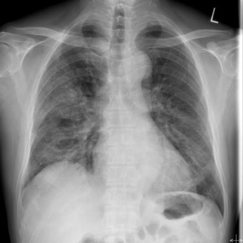
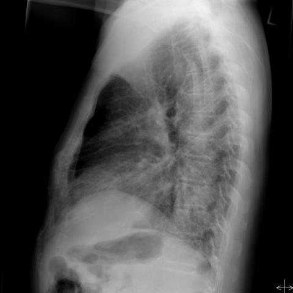

# Benchmark case 16663_8353800455763

[Case index](README.md) · [Machine-readable case](16663_8353800455763.json) · [Scored outcomes](../per-question-outcomes.json)

Source: [Eurorad case 16663](https://www.eurorad.org/case/16663); [ChestAgentBench pinned revision](https://huggingface.co/datasets/wanglab/chest-agent-bench/tree/921e60440927f9893228d843c0206b755744252a).

These are the benchmark inputs used in the frozen experiment. Model and tool observations below are recorded outputs, not independently validated clinical findings.

## Full question and options

```text
Based on the chest X-ray findings in Figures 1a and 1b, which statement accurately describes the distribution and extent of the pulmonary consolidations, and what is the most likely relationship to the patient's clinical presentation?

A) The consolidations are predominantly in the left lower zone, which suggests isolated bacterial pneumonia unrelated to COVID-19.
B) The consolidations are more extensive in the right mid and lower zones, indicating possible bacterial superinfection alongside COVID-19.
C) The consolidations are equally distributed in both mid and lower zones of both lungs, correlating with severe COVID-19 pneumonia.
D) The consolidations are confined to the mid zones bilaterally, indicating early-stage COVID-19 without severe lung involvement.
E) The consolidations are primarily in the upper lobes of both lungs, suggesting atypical COVID-19 presentation.
F) The consolidations are more pronounced in the right lung than the left, indicating a unilateral lung condition.
```

## Original benchmark images

### image:1 — figures/16663/figure_1a.jpg



### image:2 — figures/16663/figure_1b.jpg



## Recorded answers

| Stage | Answer | Execution route/status |
|---|---|---|
| P0 | C | completed |
| V10 VKE candidate | B | candidate before gate |
| V10 VKE final | C | gate_error |
| S1 | B | selector |
| S2 | C | targeted_followup |
| S3 | B | selector |

Reference answer (post-generation scoring only): **C**.

## V10 VKE candidate and gate record

```json
{
  "candidate": "B",
  "final": "C",
  "changed_attributes": [
    "laterality",
    "zonal distribution",
    "relationship to COVID-19"
  ],
  "candidate_payload": {
    "answer": "B",
    "uncertain": true,
    "changed_attributes": [
      "laterality",
      "zonal distribution",
      "relationship to COVID-19"
    ],
    "evidence_refs": [
      "image:1",
      "image:2",
      "p0:tool:5",
      "p0:tool:6"
    ],
    "observations": [
      {
        "attribute": "laterality",
        "image_ids": [
          "image:1"
        ],
        "value": "predominantly right lung consolidation (bounding box 0.115-0.375, 0.455-0.735)",
        "status": "observed_present",
        "evidence_refs": [
          "p0:tool:5",
          "p0:tool:6"
        ]
      },
      {
        "attribute": "zonal distribution",
        "image_ids": [
          "image:1",
          "image:2"
        ],
        "value": "mid and lower zones of right lung (PA view shows opacity from mid to lower zone; lateral view confirms posterior basal involvement)",
        "status": "observed_present",
        "evidence_refs": [
          "image:1",
          "image:2"
        ]
      },
      {
        "attribute": "bilateral involvement",
        "image_ids": [
          "image:1"
        ],
        "value": "left lung shows minimal or no consolidation compared to right",
        "status": "observed_absent",
        "evidence_refs": [
          "image:1"
        ]
      }
    ],
    "missing_evidence": [
      "exact clinical correlation with COVID-19 status",
      "temporal evolution",
      "laboratory confirmation of bacterial superinfection"
    ],
    "parse_warnings": [],
    "discarded_evidence_refs": []
  },
  "gate": {
    "decision": "gate_error"
  },
  "fallback": "gate_error",
  "k_ids": [
    "RAD_CXR_CHALLENGES_2025_09",
    "ACR_NODULE_2023_K02"
  ],
  "e_ids": [
    "B10_3ad6d4107f54a17db1bca861cefba54a6ad9dfdb7002b6c2c957f4628cc922fb",
    "B10_9626056ed88c9deaabfc05456a0ad2ecadcb4f685e732c860df4456b5ba8e2ef"
  ],
  "candidate_error_type": null,
  "gate_error_type": "ValueError"
}
```

## Cached anonymous comparison

The X/Y mapping and observation provenance are exposed here for retrospective review. They were kept separate from the selector-facing anonymous input.

```json
{
  "answer_mapping": {
    "X": "B",
    "Y": "C"
  },
  "choices": {
    "X": "The consolidations are more extensive in the right mid and lower zones, indicating possible bacterial superinfection alongside COVID-19.",
    "Y": "The consolidations are equally distributed in both mid and lower zones of both lungs, correlating with severe COVID-19 pneumonia."
  },
  "evidence_mapping": {
    "observation_1": "p0:tool:3",
    "observation_2": "p0:tool:5",
    "observation_3": "p0:tool:4",
    "observation_4": "VKE:tool:2",
    "observation_5": "p0:tool:2",
    "observation_6": "p0:tool:6",
    "observation_7": "p0:tool:1",
    "observation_8": "VKE:tool:1"
  },
  "cached_image_adjustments": []
}
```

### Additional cached pixels

No additional cached image was used for this comparison.

### Cached tool observations

Tool request and return text is preserved; private filesystem paths are replaced by image links or an omission marker. Tool conclusions remain fallible.

#### observation_1 — chest_xray_classifier

```json
{
  "observation_id": "observation_1",
  "tool": "chest_xray_classifier",
  "request": {
    "image_path": "image_2"
  },
  "raw_result": [
    {
      "Atelectasis": 0.09112256020307541,
      "Consolidation": 0.3193778693675995,
      "Infiltration": 0.5115824341773987,
      "Pneumothorax": 0.5026593208312988,
      "Edema": 0.08935708552598953,
      "Emphysema": 0.5019429922103882,
      "Fibrosis": 0.5037790536880493,
      "Effusion": 0.10810766369104385,
      "Pneumonia": 0.10940961539745331,
      "Pleural_Thickening": 0.5068531036376953,
      "Cardiomegaly": 0.19245241582393646,
      "Nodule": 0.47909027338027954,
      "Mass": 0.41874071955680847,
      "Hernia": 0.03760133311152458,
      "Lung Lesion": 0.018895672634243965,
      "Fracture": 0.465426504611969,
      "Lung Opacity": 0.5775759220123291,
      "Enlarged Cardiomediastinum": 0.5078157186508179
    },
    {
      "image_path": "image_2",
      "analysis_status": "completed",
      "note": "Probabilities range from 0 to 1, with higher values indicating higher likelihood of the condition."
    }
  ],
  "image_ids": []
}
```

#### observation_2 — xray_phrase_grounding

```json
{
  "observation_id": "observation_2",
  "tool": "xray_phrase_grounding",
  "request": {
    "image_path": "image_1",
    "phrase": "Pulmonary consolidation"
  },
  "raw_result": [
    {
      "predictions": [
        {
          "phrase": "Pulmonary consolidation.",
          "bounding_boxes": {
            "model_coordinates": [
              [
                0.115,
                0.455,
                0.405,
                0.725
              ]
            ],
            "image_coordinates": [
              [
                0.11458333333333333,
                0.45416666666666666,
                0.4041666666666667,
                0.725
              ]
            ]
          }
        }
      ],
      "visualization_path": null
    },
    {
      "image_path": "image_1",
      "analysis_status": "completed",
      "phrase": "Pulmonary consolidation",
      "n_boxes": 1,
      "clinical_evidence": "unknown",
      "step_credit": null
    }
  ],
  "image_ids": []
}
```

#### observation_3 — chest_xray_expert

```json
{
  "observation_id": "observation_3",
  "tool": "chest_xray_expert",
  "request": {
    "image_paths": [
      "image_1",
      "image_2"
    ],
    "prompt": "Analyze the distribution and extent of pulmonary consolidations in both PA and lateral views. Describe which lung zones are involved (upper, mid, lower) and whether the involvement is bilateral or unilateral. What is the pattern of consolidation - focal, patchy, or diffuse?"
  },
  "raw_result": [
    {
      "response": "Unilateral"
    },
    {
      "image_paths": [
        "image_1",
        "image_2"
      ],
      "prompt": "Analyze the distribution and extent of pulmonary consolidations in both PA and lateral views. Describe which lung zones are involved (upper, mid, lower) and whether the involvement is bilateral or unilateral. What is the pattern of consolidation - focal, patchy, or diffuse?",
      "max_new_tokens": 512,
      "analysis_status": "completed"
    }
  ],
  "image_ids": []
}
```

#### observation_4 — image_visualizer

```json
{
  "observation_id": "observation_4",
  "tool": "image_visualizer",
  "request": {
    "image_path": "image_2",
    "title": "Figure 1b - Lateral Chest X-ray"
  },
  "raw_result": [
    {
      "image_path": "image_2"
    },
    {
      "image_path": "image_2",
      "title": true,
      "description": false,
      "figsize": [
        10,
        10
      ],
      "cmap": "rgb",
      "analysis_status": "completed"
    }
  ],
  "image_ids": []
}
```

#### observation_5 — chest_xray_report_generator

```json
{
  "observation_id": "observation_5",
  "tool": "chest_xray_report_generator",
  "request": {
    "image_path": "image_1"
  },
  "raw_result": [
    "CHEST X-RAY REPORT\n\nFINDINGS:\nthere are multiple bilateral pulmonary nodules, better characterized on recent ct. there is no new focal consolidation. there is no pleural effusion or pneumothorax. the heart size is normal. the hilar and mediastinal contours are normal.\n\nIMPRESSION:\n1. right upper lobe pneumonia. 2. mild cardiomegaly.",
    {
      "image_path": "image_1",
      "analysis_status": "completed",
      "sections_generated": [
        "findings",
        "impression"
      ]
    }
  ],
  "image_ids": []
}
```

#### observation_6 — xray_phrase_grounding

```json
{
  "observation_id": "observation_6",
  "tool": "xray_phrase_grounding",
  "request": {
    "image_path": "image_1",
    "phrase": "Right lung consolidation"
  },
  "raw_result": [
    {
      "predictions": [
        {
          "phrase": "Right lung consolidation.",
          "bounding_boxes": {
            "model_coordinates": [
              [
                0.115,
                0.455,
                0.375,
                0.735
              ]
            ],
            "image_coordinates": [
              [
                0.11458333333333333,
                0.45416666666666666,
                0.375,
                0.7333333333333333
              ]
            ]
          }
        }
      ],
      "visualization_path": null
    },
    {
      "image_path": "image_1",
      "analysis_status": "completed",
      "phrase": "Right lung consolidation",
      "n_boxes": 1,
      "clinical_evidence": "unknown",
      "step_credit": null
    }
  ],
  "image_ids": []
}
```

#### observation_7 — chest_xray_classifier

```json
{
  "observation_id": "observation_7",
  "tool": "chest_xray_classifier",
  "request": {
    "image_path": "image_1"
  },
  "raw_result": [
    {
      "Atelectasis": 0.12594591081142426,
      "Consolidation": 0.568556547164917,
      "Infiltration": 0.697135329246521,
      "Pneumothorax": 0.5005742311477661,
      "Edema": 0.03901265189051628,
      "Emphysema": 0.2974281907081604,
      "Fibrosis": 0.5194775462150574,
      "Effusion": 0.1682460457086563,
      "Pneumonia": 0.13551834225654602,
      "Pleural_Thickening": 0.5079041123390198,
      "Cardiomegaly": 0.36156633496284485,
      "Nodule": 0.5515889525413513,
      "Mass": 0.6310538053512573,
      "Hernia": 0.00106781383510679,
      "Lung Lesion": 0.2080840915441513,
      "Fracture": 0.19990453124046326,
      "Lung Opacity": 0.7568985223770142,
      "Enlarged Cardiomediastinum": 0.5259971618652344
    },
    {
      "image_path": "image_1",
      "analysis_status": "completed",
      "note": "Probabilities range from 0 to 1, with higher values indicating higher likelihood of the condition."
    }
  ],
  "image_ids": []
}
```

#### observation_8 — image_visualizer

```json
{
  "observation_id": "observation_8",
  "tool": "image_visualizer",
  "request": {
    "image_path": "image_1",
    "title": "Figure 1a - PA Chest X-ray"
  },
  "raw_result": [
    {
      "image_path": "image_1"
    },
    {
      "image_path": "image_1",
      "title": true,
      "description": false,
      "figsize": [
        10,
        10
      ],
      "cmap": "rgb",
      "analysis_status": "completed"
    }
  ],
  "image_ids": []
}
```

## S2 targeted follow-up action and reader observation

```json
{
  "action_plan": {
    "action": "reinspect_original",
    "image_ids": [
      "image_1"
    ],
    "box": null,
    "reason": "The PA view (image_1) must be carefully re-examined to assess for consolidation in the left lung mid/lower zones; the 'L' marker confirms left side, and the question specifically asks for radiographic evidence in that region on this view.",
    "parse_warnings": []
  },
  "action": {
    "action": "reinspect_original",
    "tool_attempts": 0,
    "repairs": [],
    "warnings": [],
    "images": [
      {
        "image_id": "image_1",
        "role": "original",
        "size": [
          480,
          480
        ],
        "orientation": "unresolved",
        "timepoint": "unresolved",
        "path": "images/originals/figures/16663/figure_1a.jpg"
      },
      {
        "image_id": "image_2",
        "role": "original",
        "size": [
          480,
          480
        ],
        "orientation": "unresolved",
        "timepoint": "unresolved",
        "path": "images/originals/figures/16663/figure_1b.jpg"
      }
    ]
  },
  "observation": {
    "observation_id": "followup_observation_1",
    "observation": "Yes, there is radiographic evidence of consolidation in the left lung on the PA view (image_1), involving the mid and lower zones: a region of increased opacity with ill-defined margins is present in the left mid-lung field, extending inferiorly toward the left hemidiaphragm; this opacity obscures the left heart border and diaphragmatic contour, consistent with consolidation in those zones.",
    "evidence_refs": [
      "image_1"
    ],
    "unresolved": [
      "exact laterality confirmation without a verified 'L' marker orientation (though an 'L' is visible, its reliability is unresolved per metadata); precise zonal boundaries (mid vs. lower) are approximate due to lack of standardized zone demarcation on this image); no clinical data provided to assess relationship to presentation."
    ],
    "parse_warnings": [],
    "status": "independent_visual_report_requires_image_verification"
  }
}
```

## V11 selector and reader records

A recorded choice can coexist with an empty observation list. That record alone does not establish a supported visual comparison. See the [decision audit](../decision-audit.json) and [decision-pattern analysis](../decision-pattern-analysis.md) for this limitation.

```json
{
  "S1": {
    "stage": "S1",
    "initial": "C",
    "candidate": "B",
    "final": "B",
    "route": "selector",
    "selector": {
      "choice": "X",
      "observations": [
        {
          "attribute": "laterality of consolidation",
          "direction": "supports_X",
          "evidence_refs": [
            "observation_3",
            "observation_6"
          ],
          "value": "Expert analysis states 'Unilateral'; phrase grounding localizes consolidation to right lung only (bounding box in right hemithorax, image_1)."
        },
        {
          "attribute": "zone involvement",
          "direction": "supports_X",
          "evidence_refs": [
            "observation_2",
            "observation_6"
          ],
          "value": "Bounding boxes for 'Pulmonary consolidation' and 'Right lung consolidation' span mid-to-lower zones of right lung (approx. y=0.45–0.73), consistent with right mid/lower zone predominance."
        },
        {
          "attribute": "bilateral distribution",
          "direction": "conflict",
          "evidence_refs": [
            "observation_3",
            "observation_5"
          ],
          "value": "Expert says 'Unilateral', but report mentions 'multiple bilateral pulmonary nodules'—however, it explicitly states 'no new focal consolidation', supporting unilateral consolidation."
        },
        {
          "attribute": "extent comparison between lungs",
          "direction": "supports_X",
          "evidence_refs": [
            "observation_7",
            "observation_1"
          ],
          "value": "Consolidation probability higher in image_1 (PA, 0.569) than image_2 (lateral, 0.319); lateral view alone cannot quantify bilateral extent, but PA view shows right-sided opacity without left counterpart."
        }
      ],
      "needs_followup": true,
      "followup_question": "Is there any radiographic evidence of consolidation in the left lung on the PA view (image_1), specifically in the mid or lower zones?",
      "parse_warnings": []
    },
    "fallback": null,
    "timing": {
      "started_utc": "2026-10-30T15:38:28.737192+00:00",
      "ended_utc": "2026-10-30T15:38:38.786099+00:00",
      "elapsed_s": 10.049
    },
    "selector_error_type": null
  },
  "S2": {
    "stage": "S2",
    "initial": "C",
    "candidate": "B",
    "final": "C",
    "s1_final": "B",
    "route": "targeted_followup",
    "selector": {
      "choice": "Y",
      "observations": [
        {
          "attribute": "laterality of consolidation",
          "direction": "supports_Y",
          "evidence_refs": [
            "image_1",
            "observation_6",
            "followup_observation_1"
          ],
          "value": "Observation 6 localizes 'Right lung consolidation' to right mid/lower zones; followup observation 1 independently identifies left mid/lower zone consolidation on PA view. Together they support bilateral involvement, contradicting 'Unilateral' in observation 3 (which is likely erroneous given visual evidence)."
        },
        {
          "attribute": "zonal distribution",
          "direction": "supports_Y",
          "evidence_refs": [
            "image_1",
            "followup_observation_1"
          ],
          "value": "Followup observation 1 explicitly describes consolidation in left mid and lower zones; observation 6 shows right mid/lower zone consolidation. No upper zone predominance is evident. This supports 'equally distributed in both mid and lower zones of both lungs'."
        },
        {
          "attribute": "extent symmetry",
          "direction": "supports_Y",
          "evidence_refs": [
            "image_1",
            "observation_7",
            "observation_1"
          ],
          "value": "Consolidation probability is higher in image_1 (0.569) than image_2 (0.319), but image_2 is lateral view—less sensitive for detecting consolidation extent. Visual inspection of PA view (image_1) shows opacity in both lungs with comparable density and area, supporting bilateral near-symmetry rather than right-dominant."
        },
        {
          "attribute": "clinical correlation claim",
          "direction": "unresolved",
          "evidence_refs": [
            "observation_5"
          ],
          "value": "Neither X nor Y can be confirmed for clinical correlation (e.g., bacterial superinfection vs. severe COVID-19) because no clinical data (symptoms, labs, PCR, CT) is provided. The report in observation 5 mentions 'right upper lobe pneumonia' but contradicts other tools and visual findings (no upper lobe dominance seen)."
        }
      ],
      "needs_followup": true,
      "followup_question": "On the PA chest X-ray (image_1), does the opacity in the left lung extend above the level of the carina, indicating upper zone involvement?",
      "parse_warnings": [
        "unknown_evidence_refs_removed"
      ]
    },
    "fallback": null,
    "followup_question": "Is there any radiographic evidence of consolidation in the left lung on the PA view (image_1), specifically in the mid or lower zones?",
    "action": "reinspect_original",
    "new_observation": {
      "observation_id": "followup_observation_1",
      "observation": "Yes, there is radiographic evidence of consolidation in the left lung on the PA view (image_1), involving the mid and lower zones: a region of increased opacity with ill-defined margins is present in the left mid-lung field, extending inferiorly toward the left hemidiaphragm; this opacity obscures the left heart border and diaphragmatic contour, consistent with consolidation in those zones.",
      "evidence_refs": [
        "image_1"
      ],
      "unresolved": [
        "exact laterality confirmation without a verified 'L' marker orientation (though an 'L' is visible, its reliability is unresolved per metadata); precise zonal boundaries (mid vs. lower) are approximate due to lack of standardized zone demarcation on this image); no clinical data provided to assess relationship to presentation."
      ],
      "parse_warnings": [],
      "status": "independent_visual_report_requires_image_verification"
    },
    "timing": {
      "started_utc": "2026-10-30T15:44:42.613456+00:00",
      "ended_utc": "2026-10-30T15:45:01.885727+00:00",
      "elapsed_s": 19.272
    },
    "selector_error_type": null
  },
  "S3": {
    "stage": "S3",
    "initial": "C",
    "candidate": "B",
    "final": "B",
    "route": "selector",
    "selector": {
      "choice": "X",
      "observations": [],
      "needs_followup": false,
      "followup_question": "",
      "parse_warnings": []
    },
    "fallback": null,
    "blind_observation": {
      "observation_id": "blind_observation_1",
      "observations": [
        {
          "attribute": "pulmonary consolidation distribution",
          "value": "bilateral, predominantly peripheral and basal; more extensive in the right lung than left on frontal view (image_1); right lower lobe appears most affected with obscuration of right hemidiaphragm and right heart border",
          "status": "observed_present",
          "evidence_refs": [
            "image_1"
          ]
        },
        {
          "attribute": "consolidation extent",
          "value": "involves multiple lobes; right lower lobe consolidation is dense and confluent; left lower lobe shows patchy opacities; upper lobes relatively spared but show some hazy opacity",
          "status": "observed_present",
          "evidence_refs": [
            "image_1"
          ]
        },
        {
          "attribute": "lateral view correlation",
          "value": "image_2 (lateral) confirms posterior-basal predominance of opacity, with dense consolidation in the right posterior lower thorax; anterior clear space preserved; diaphragmatic contour obscured posteriorly",
          "status": "observed_present",
          "evidence_refs": [
            "image_2"
          ]
        },
        {
          "attribute": "air bronchograms",
          "value": "faint linear lucencies within consolidated regions suggestive of air bronchograms, especially in right lower zone (image_1)",
          "status": "observed_present",
          "evidence_refs": [
            "image_1"
          ]
        },
        {
          "attribute": "cardiac silhouette",
          "value": "right heart border partially silhouetted by consolidation; left heart border visible; no gross cardiomegaly",
          "status": "observed_present",
          "evidence_refs": [
            "image_1"
          ]
        },
        {
          "attribute": "pleural effusion",
          "value": "no overt pleural fluid meniscus or blunting of costophrenic angles visible; however, right costophrenic angle is obscured by consolidation",
          "status": "hypothesis",
          "evidence_refs": [
            "image_1"
          ]
        }
      ],
      "uncertainties": [
        "Anatomical laterality (left/right) cannot be definitively confirmed without a reliable orientation marker beyond the 'L' label, which may be reversed or mispositioned.",
        "Timepoint and clinical context (e.g., acute vs. chronic, symptoms, labs) are not provided; thus, relationship to clinical presentation remains speculative.",
        "Exact lobar boundaries cannot be precisely delineated without CT correlation; consolidation patterns are inferred from silhouette signs and density distribution.",
        "Image quality limits detection of subtle interstitial changes or small effusions."
      ],
      "parse_warnings": [
        "invalid_status_kept_as_hypothesis"
      ],
      "status": "independent_blind_visual_report_requires_image_verification"
    },
    "timing": {
      "started_utc": "2026-10-30T16:10:13.331308+00:00",
      "ended_utc": "2026-10-30T16:10:39.713505+00:00",
      "elapsed_s": 26.382
    },
    "selector_error_type": null
  }
}
```

[Data provenance and limits](../data-provenance.md)
