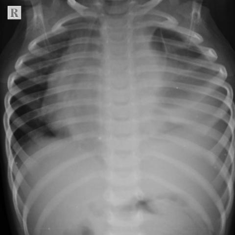

# Benchmark case 17132_8143559675802

[Case index](README.md) · [Machine-readable case](17132_8143559675802.json) · [Scored outcomes](../per-question-outcomes.json)

Source: [Eurorad case 17132](https://www.eurorad.org/case/17132); [ChestAgentBench pinned revision](https://huggingface.co/datasets/wanglab/chest-agent-bench/tree/921e60440927f9893228d843c0206b755744252a).

These are the benchmark inputs used in the frozen experiment. Model and tool observations below are recorded outputs, not independently validated clinical findings.

## Full question and options

```text
Based on the chest radiograph findings and the clinical presentation, which of the following is the most likely diagnosis, considering the obscuration of the left heart border, significant cardio-mediastinal shift to the right, and mediastinal widening observed in the chest X-ray (Figures 1 and 2)?

A) Left lower lobe pneumonia
B) T-cell acute lymphoblastic leukemia/lymphoma
C) Pulmonary tuberculosis
D) Primary lung carcinoma
E) Left-sided pleural effusion
F) Hodgkin’s lymphoma
```

## Original benchmark images

### image:1 — figures/17132/figure_1.jpg



### image:2 — figures/17132/figure_2.jpg


## Recorded answers

| Stage | Answer | Execution route/status |
|---|---|---|
| P0 | B | completed |
| V10 VKE candidate | B | candidate before gate |
| V10 VKE final | B | no_change |
| S1 | B | inherited_agreement |
| S2 | B | inherited_s1 |
| S3 | B | inherited_agreement |

Reference answer (post-generation scoring only): **B**.

## V10 VKE candidate and gate record

```json
{
  "candidate": "B",
  "final": "B",
  "changed_attributes": [
    "mediastinal mass morphology",
    "left heart border obscuration",
    "cardio-mediastinal shift direction"
  ],
  "candidate_payload": {
    "answer": "B",
    "uncertain": true,
    "changed_attributes": [
      "mediastinal mass morphology",
      "left heart border obscuration",
      "cardio-mediastinal shift direction"
    ],
    "evidence_refs": [
      "image:1",
      "image:2",
      "p0:tool:1"
    ],
    "observations": [
      {
        "attribute": "opacity lateral border shape",
        "image_ids": [
          "image:1"
        ],
        "value": "convex toward lung field, not concave/meniscus",
        "status": "observed_present",
        "evidence_refs": [
          "image:1"
        ]
      },
      {
        "attribute": "air bronchograms",
        "image_ids": [
          "image:1"
        ],
        "value": "absent within left opacity",
        "status": "observed_absent",
        "evidence_refs": [
          "image:1"
        ]
      },
      {
        "attribute": "mediastinal widening + right shift",
        "image_ids": [
          "image:1",
          "image:2"
        ],
        "value": "marked; loss of retrosternal clear space on lateral view",
        "status": "observed_present",
        "evidence_refs": [
          "image:1",
          "image:2"
        ]
      }
    ],
    "missing_evidence": [
      "hilar lymphadenopathy",
      "pleural fluid analysis",
      "clinical age/symptoms",
      "calcifications"
    ],
    "parse_warnings": [],
    "discarded_evidence_refs": []
  },
  "gate": {
    "decision": "no_change"
  },
  "fallback": null,
  "k_ids": [
    "BTS_PLEURAL_2023_K01",
    "ACR_ARI_2024_K03"
  ],
  "e_ids": [
    "B10_7529153b8934dc1ab21fce97e76fd0f8377387dc4240e21f5a05ad12cf6cfbdc",
    "B10_039bf4ec8536eef67cd5d58153db3a62501b8917816066e57e7b2d66d4b05d43"
  ],
  "candidate_error_type": null,
  "gate_error_type": null
}
```

## Detailed comparison evidence

This case did not route to the 21-case anonymous disagreement selector. Its original input and recorded answers are included; no selector packet was generated.

## V11 selector and reader records

A recorded choice can coexist with an empty observation list. That record alone does not establish a supported visual comparison. See the [decision audit](../decision-audit.json) and [decision-pattern analysis](../decision-pattern-analysis.md) for this limitation.

```json
{
  "S1": {
    "stage": "S1",
    "initial": "B",
    "candidate": "B",
    "final": "B",
    "route": "inherited_agreement",
    "selector": null,
    "fallback": null,
    "timing": {
      "started_utc": "2026-10-30T15:38:38.793480+00:00",
      "ended_utc": "2026-10-30T15:38:38.793726+00:00",
      "elapsed_s": 0.0
    },
    "selector_error_type": null
  },
  "S2": {
    "stage": "S2",
    "initial": "B",
    "candidate": "B",
    "final": "B",
    "s1_final": "B",
    "route": "inherited_s1",
    "selector": null,
    "fallback": null,
    "timing": {
      "started_utc": "2026-10-30T15:45:01.893163+00:00",
      "ended_utc": "2026-10-30T15:45:01.893346+00:00",
      "elapsed_s": 0.0
    },
    "selector_error_type": null
  },
  "S3": {
    "stage": "S3",
    "initial": "B",
    "candidate": "B",
    "final": "B",
    "route": "inherited_agreement",
    "selector": null,
    "fallback": null,
    "timing": {
      "started_utc": "2026-10-30T16:10:39.720559+00:00",
      "ended_utc": "2026-10-30T16:10:39.720757+00:00",
      "elapsed_s": 0.0
    },
    "selector_error_type": null
  }
}
```

[Data provenance and limits](../data-provenance.md)
