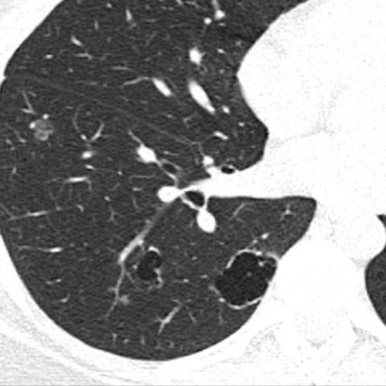
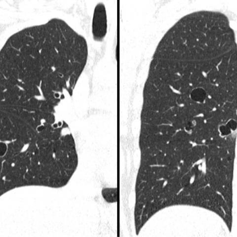

# Benchmark case 17182_8143559676067

[Case index](README.md) · [Machine-readable case](17182_8143559676067.json) · [Scored outcomes](../per-question-outcomes.json)

Source: [Eurorad case 17182](https://www.eurorad.org/case/17182); [ChestAgentBench pinned revision](https://huggingface.co/datasets/wanglab/chest-agent-bench/tree/921e60440927f9893228d843c0206b755744252a).

These are the benchmark inputs used in the frozen experiment. Model and tool observations below are recorded outputs, not independently validated clinical findings.

## Full question and options

```text
Based on the chest X-ray observations from Figures 1a-c, which of the following best describes the likely diagnosis and the reasoning behind it, considering the clinical history of recurrent pneumonia and a supraglottic polypoid lesion?

A) Granulomatosis with polyangiitis, due to bilateral lung nodules with cavitation.
B) Lymphangioleiomyomatosis, indicated by the presence of cystic lesions in the lung parenchyma.
C) Recurrent respiratory papillomatosis, supported by cavitated nodules and the presence of a supraglottic lesion.
D) Pulmonary Langerhans cell histiocytosis, characterized by cystic and nodular lung lesions.
E) Cystic pulmonary metastases, due to the presence of multiple nodular lesions with variable sizes.
```

## Original benchmark images

### image:1 — figures/17182/figure_1a.jpg


### image:2 — figures/17182/figure_1b.jpg



### image:3 — figures/17182/figure_1c.jpg



## Recorded answers

| Stage | Answer | Execution route/status |
|---|---|---|
| P0 | C | completed |
| V10 VKE candidate | C | candidate before gate |
| V10 VKE final | C | no_change |
| S1 | C | inherited_agreement |
| S2 | C | inherited_s1 |
| S3 | C | inherited_agreement |

Reference answer (post-generation scoring only): **C**.

## V10 VKE candidate and gate record

```json
{
  "candidate": "C",
  "final": "C",
  "changed_attributes": [
    "supraglottic polypoid lesion + cavitated pulmonary nodules"
  ],
  "candidate_payload": {
    "answer": "C",
    "uncertain": true,
    "changed_attributes": [
      "supraglottic polypoid lesion + cavitated pulmonary nodules"
    ],
    "evidence_refs": [
      "image:1",
      "image:2",
      "image:3",
      "p0:tool:2"
    ],
    "observations": [
      {
        "attribute": "lung lesions morphology",
        "image_ids": [
          "image:1",
          "image:2",
          "image:3"
        ],
        "value": "multiple round/oval lucent lesions, some with thin walls, no thick-walled cavitation evident",
        "status": "observed_present",
        "evidence_refs": [
          "image:1",
          "image:2",
          "image:3"
        ]
      },
      {
        "attribute": "supraglottic lesion",
        "image_ids": [],
        "value": "not visible on CT slices; clinical history only",
        "status": "unresolved",
        "evidence_refs": []
      }
    ],
    "missing_evidence": [
      "wall thickness measurement of lesions",
      "histopathology",
      "laryngoscopy image",
      "temporal evolution of lesions"
    ],
    "parse_warnings": [],
    "discarded_evidence_refs": []
  },
  "gate": {
    "decision": "no_change"
  },
  "fallback": null,
  "k_ids": [
    "ACR_ARI_2024_K03",
    "ACR_NODULE_2023_K05"
  ],
  "e_ids": [
    "B10_9626056ed88c9deaabfc05456a0ad2ecadcb4f685e732c860df4456b5ba8e2ef",
    "B10_dc1447d417eabe202938e6f119699ad045568b09a8702a4ee25ffb7cd753d7e1"
  ],
  "candidate_error_type": null,
  "gate_error_type": null
}
```

## Detailed comparison evidence

This case did not route to the 21-case anonymous disagreement selector. Its original input and recorded answers are included; no selector packet was generated.

## V11 selector and reader records

A recorded choice can coexist with an empty observation list. That record alone does not establish a supported visual comparison. See the [decision audit](../decision-audit.json) and [decision-pattern analysis](../decision-pattern-analysis.md) for this limitation.

```json
{
  "S1": {
    "stage": "S1",
    "initial": "C",
    "candidate": "C",
    "final": "C",
    "route": "inherited_agreement",
    "selector": null,
    "fallback": null,
    "timing": {
      "started_utc": "2026-10-30T15:38:38.797422+00:00",
      "ended_utc": "2026-10-30T15:38:38.797652+00:00",
      "elapsed_s": 0.0
    },
    "selector_error_type": null
  },
  "S2": {
    "stage": "S2",
    "initial": "C",
    "candidate": "C",
    "final": "C",
    "s1_final": "C",
    "route": "inherited_s1",
    "selector": null,
    "fallback": null,
    "timing": {
      "started_utc": "2026-10-30T15:45:01.896743+00:00",
      "ended_utc": "2026-10-30T15:45:01.896916+00:00",
      "elapsed_s": 0.0
    },
    "selector_error_type": null
  },
  "S3": {
    "stage": "S3",
    "initial": "C",
    "candidate": "C",
    "final": "C",
    "route": "inherited_agreement",
    "selector": null,
    "fallback": null,
    "timing": {
      "started_utc": "2026-10-30T16:10:39.724251+00:00",
      "ended_utc": "2026-10-30T16:10:39.724440+00:00",
      "elapsed_s": 0.0
    },
    "selector_error_type": null
  }
}
```

[Data provenance and limits](../data-provenance.md)
