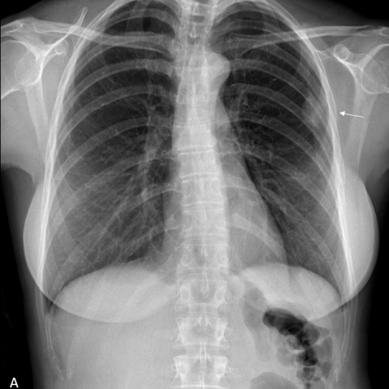

# Benchmark case 17362_8143559680136

[Case index](README.md) · [Machine-readable case](17362_8143559680136.json) · [Scored outcomes](../per-question-outcomes.json)

Source: [Eurorad case 17362](https://www.eurorad.org/case/17362); [ChestAgentBench pinned revision](https://huggingface.co/datasets/wanglab/chest-agent-bench/tree/921e60440927f9893228d843c0206b755744252a).

These are the benchmark inputs used in the frozen experiment. Model and tool observations below are recorded outputs, not independently validated clinical findings.

## Full question and options

```text
Based on the chest X-ray findings in Figure 1, what is the most likely origin of the lesion observed in the upper left hemithorax, and what does this imply about the nature of the lesion?

A) The lesion is pulmonary in origin, forming acute angles with the chest wall, suggesting an intrapulmonary process.
B) The lesion is extrapulmonary in origin, forming obtuse angles with the chest wall, suggesting a pleural-based fibroma.
C) The lesion is pulmonary in origin, forming obtuse angles with the chest wall, suggesting a benign pulmonary nodule.
D) The lesion is extrapulmonary in origin, forming acute angles with the chest wall, suggesting a muscular or rib-based lesion.
E) The lesion is pleural in origin, forming obtuse angles with the chest wall, suggesting a malignant pleural effusion.
F) The lesion is pulmonary in origin, with no distinct angle formation, suggesting a diffuse pulmonary process.
```

## Original benchmark images

### image:1 — figures/17362/figure_1a.jpg



### image:2 — figures/17362/figure_1b.jpg


## Recorded answers

| Stage | Answer | Execution route/status |
|---|---|---|
| P0 | B | completed |
| V10 VKE candidate | B | candidate before gate |
| V10 VKE final | B | no_change |
| S1 | B | inherited_agreement |
| S2 | B | inherited_s1 |
| S3 | B | inherited_agreement |

Reference answer (post-generation scoring only): **B**.

## V10 VKE candidate and gate record

```json
{
  "candidate": "B",
  "final": "B",
  "changed_attributes": [
    "angle with chest wall",
    "origin (extrapulmonary vs pulmonary)"
  ],
  "candidate_payload": {
    "answer": "B",
    "uncertain": false,
    "changed_attributes": [
      "angle with chest wall",
      "origin (extrapulmonary vs pulmonary)"
    ],
    "evidence_refs": [
      "VKE:tool:1",
      "p0:tool:3",
      "p0:tool:4"
    ],
    "observations": [
      {
        "attribute": "angle formed with chest wall",
        "image_ids": [
          "image:1"
        ],
        "value": "obtuse angles visible at lesion-chest wall interface in cropped region",
        "status": "observed_present",
        "evidence_refs": [
          "VKE:tool:1"
        ]
      },
      {
        "attribute": "spatial relationship to lung parenchyma",
        "image_ids": [
          "image:1"
        ],
        "value": "lesion appears separated from lung by subtle lucent rim (extrapleural fat sign)",
        "status": "observed_present",
        "evidence_refs": [
          "VKE:tool:1"
        ]
      },
      {
        "attribute": "origin classification",
        "image_ids": [
          "image:1"
        ],
        "value": "expert tool labeled 'Extrapulmonary'; phrase grounding localized 'pleural mass'",
        "status": "hypothesis",
        "evidence_refs": [
          "p0:tool:3",
          "p0:tool:4"
        ]
      }
    ],
    "missing_evidence": [
      "calcification pattern",
      "exact size",
      "mediastinal shift",
      "follow-up imaging"
    ],
    "parse_warnings": [],
    "discarded_evidence_refs": []
  },
  "gate": {
    "decision": "no_change"
  },
  "fallback": null,
  "k_ids": [
    "ACR_NODULE_2023_K05",
    "RAD_FLEISCHNER_2024_06"
  ],
  "e_ids": [
    "B10_1f9e17488f1b4941c04c59ea34cea30df40d8b41cb3705e9d92213aa1f58d869",
    "B10_457c771e2403d6712b6257571b315c318c99cfaea76819b04e6ecda4de743db2"
  ],
  "candidate_error_type": null,
  "gate_error_type": null
}
```

## Detailed comparison evidence

This case did not route to the 21-case anonymous disagreement selector. Its original input and recorded answers are included; no selector packet was generated.

## V11 selector and reader records

A recorded choice can coexist with an empty observation list. That record alone does not establish a supported visual comparison. See the [decision audit](../decision-audit.json) and [decision-pattern analysis](../decision-pattern-analysis.md) for this limitation.

```json
{
  "S1": {
    "stage": "S1",
    "initial": "B",
    "candidate": "B",
    "final": "B",
    "route": "inherited_agreement",
    "selector": null,
    "fallback": null,
    "timing": {
      "started_utc": "2026-10-30T15:38:38.801096+00:00",
      "ended_utc": "2026-10-30T15:38:38.801339+00:00",
      "elapsed_s": 0.0
    },
    "selector_error_type": null
  },
  "S2": {
    "stage": "S2",
    "initial": "B",
    "candidate": "B",
    "final": "B",
    "s1_final": "B",
    "route": "inherited_s1",
    "selector": null,
    "fallback": null,
    "timing": {
      "started_utc": "2026-10-30T15:45:01.903552+00:00",
      "ended_utc": "2026-10-30T15:45:01.903775+00:00",
      "elapsed_s": 0.0
    },
    "selector_error_type": null
  },
  "S3": {
    "stage": "S3",
    "initial": "B",
    "candidate": "B",
    "final": "B",
    "route": "inherited_agreement",
    "selector": null,
    "fallback": null,
    "timing": {
      "started_utc": "2026-10-30T16:10:39.727772+00:00",
      "ended_utc": "2026-10-30T16:10:39.727963+00:00",
      "elapsed_s": 0.0
    },
    "selector_error_type": null
  }
}
```

[Data provenance and limits](../data-provenance.md)
