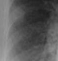
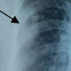

# Benchmark case 17621_8143559684844

[Case index](README.md) · [Machine-readable case](17621_8143559684844.json) · [Scored outcomes](../per-question-outcomes.json)

Source: [Eurorad case 17621](https://www.eurorad.org/case/17621); [ChestAgentBench pinned revision](https://huggingface.co/datasets/wanglab/chest-agent-bench/tree/921e60440927f9893228d843c0206b755744252a).

These are the benchmark inputs used in the frozen experiment. Model and tool observations below are recorded outputs, not independently validated clinical findings.

## Full question and options

```text
Based on the findings from the initial chest X-ray and the follow-up X-ray (Figures 1 and 7b), which of the following best describes the progression of the pulmonary findings in the context of Pyoderma gangrenosum with pulmonary involvement?
A) The right middle zone opacity has resolved, and new lesions have appeared in the bilateral lower zones.
B) The right middle zone opacity has increased in size, and new cavitating nodules have appeared in the bilateral upper zones.
C) The right middle zone opacity remains unchanged, and the nodular shadows have decreased in size in the bilateral upper zones.
D) The right middle zone opacity has decreased in size, and the nodular shadows in the bilateral upper zones have increased in size.
E) The right middle zone opacity has increased in size, and the nodular shadows have decreased in size in the bilateral lower zones.
F) The right middle zone opacity has decreased in size, and the nodular shadows have increased in size in the bilateral lower zones.
```

## Original benchmark images

### image:1 — figures/17621/figure_1.jpg


### image:2 — figures/17621/figure_7b.jpg


## Recorded answers

| Stage | Answer | Execution route/status |
|---|---|---|
| P0 | A | completed |
| V10 VKE candidate | D | candidate before gate |
| V10 VKE final | A | retain |
| S1 | A | selector |
| S2 | A | targeted_followup |
| S3 | A | selector |

Reference answer (post-generation scoring only): **D**.

## V10 VKE candidate and gate record

```json
{
  "candidate": "D",
  "final": "A",
  "changed_attributes": [
    "right middle zone opacity decreased",
    "nodular shadows in bilateral upper zones increased"
  ],
  "candidate_payload": {
    "answer": "D",
    "uncertain": true,
    "changed_attributes": [
      "right middle zone opacity decreased",
      "nodular shadows in bilateral upper zones increased"
    ],
    "evidence_refs": [
      "VKE:tool:1",
      "VKE:tool:2",
      "image:1",
      "image:2"
    ],
    "observations": [
      {
        "attribute": "right middle zone opacity",
        "image_ids": [
          "image:1",
          "image:2"
        ],
        "value": "Visible in Figure 1 (arrow); grounded and present in same region in Figure 7b but appears less dense and slightly smaller in cropped comparison",
        "status": "observed_present",
        "evidence_refs": [
          "VKE:tool:1",
          "VKE:tool:2"
        ]
      },
      {
        "attribute": "nodular shadows in bilateral upper zones",
        "image_ids": [
          "image:1",
          "image:2"
        ],
        "value": "Not clearly identifiable in Figure 1; in Figure 7b, subtle nodular opacities are visible in upper zones (especially left apex) not present initially — consistent with increase",
        "status": "unresolved",
        "evidence_refs": [
          "image:1",
          "image:2"
        ]
      }
    ],
    "missing_evidence": [
      "Exact side/orientation markers to confirm upper vs lower zone localization",
      "Temporal confirmation that Figure 1 is truly initial (assumed per question)",
      "Cavitation cannot be assessed on X-ray alone"
    ],
    "parse_warnings": [],
    "discarded_evidence_refs": []
  },
  "gate": {
    "decision": "retain",
    "changed_attributes": [],
    "evidence_refs": [
      "VKE:tool:1",
      "VKE:tool:2",
      "image:1",
      "image:2"
    ],
    "unmet_requirements": [
      "nodular shadows in bilateral upper zones not clearly identifiable in Figure 1",
      "exact zone localization (upper vs lower) ambiguous without orientation markers",
      "no evidence supports increase in size of nodular shadows in bilateral upper zones"
    ],
    "reason": "The right middle zone opacity is present in both images (grounded in Fig 7b, arrowed in Fig 1), but size change is not quantitatively supported; nodular shadows in bilateral upper zones are not confirmed in Figure 1, and their increase in Figure 7b is speculative. Option D’s claims lack direct visual support."
  },
  "fallback": null,
  "k_ids": [
    "ACR_ARI_2024_K04",
    "ACR_NODULE_2023_K02"
  ],
  "e_ids": [
    "B10_9e1e89f022839b300894542ce9439fb51ea2180eea45e5e84e75638ab9be6f24"
  ],
  "candidate_error_type": null,
  "gate_error_type": null
}
```

## Cached anonymous comparison

The X/Y mapping and observation provenance are exposed here for retrospective review. They were kept separate from the selector-facing anonymous input.

```json
{
  "answer_mapping": {
    "X": "D",
    "Y": "A"
  },
  "choices": {
    "X": "The right middle zone opacity has decreased in size, and the nodular shadows in the bilateral upper zones have increased in size.",
    "Y": "The right middle zone opacity has resolved, and new lesions have appeared in the bilateral lower zones."
  },
  "evidence_mapping": {
    "observation_1": "VKE:tool:2",
    "observation_2": "p0:tool:7",
    "observation_3": "p0:tool:8",
    "observation_4": "p0:tool:6",
    "observation_5": "p0:tool:2",
    "observation_6": "p0:tool:4",
    "observation_7": "p0:tool:9",
    "observation_8": "p0:tool:5",
    "observation_9": "p0:tool:1",
    "observation_10": "p0:tool:3",
    "observation_11": "VKE:tool:1"
  },
  "cached_image_adjustments": []
}
```

### Additional cached pixels

**image_3**



```json
{
  "image_id": "image_3",
  "role": "existing_local_or_tool_image",
  "size": [
    116,
    121
  ],
  "parent_image_id": "image_2",
  "pixel_box": [
    74,
    160,
    190,
    281
  ],
  "source_size": [
    480,
    480
  ],
  "orientation": "unresolved",
  "timepoint": "unresolved"
}
```

**image_4**



```json
{
  "image_id": "image_4",
  "role": "existing_local_or_tool_image",
  "size": [
    144,
    144
  ],
  "parent_image_id": "image_1",
  "pixel_box": [
    48,
    144,
    192,
    288
  ],
  "source_size": [
    480,
    480
  ],
  "orientation": "unresolved",
  "timepoint": "unresolved"
}
```

### Cached tool observations

Tool request and return text is preserved; private filesystem paths are replaced by image links or an omission marker. Tool conclusions remain fallible.

#### observation_1 — crop_current_image

```json
{
  "observation_id": "observation_1",
  "tool": "crop_current_image",
  "request": {
    "image_path": "image_2",
    "box": [
      0.155,
      0.335,
      0.395,
      0.585
    ]
  },
  "raw_result": {
    "image_id": "image_3",
    "path": "image_3",
    "role": "current_image_pixel_crop",
    "parent_image_id": "image_2",
    "parent_path": "image_2",
    "source_size": [
      480,
      480
    ],
    "crop_size": [
      116,
      121
    ],
    "normalized_box": [
      0.155,
      0.335,
      0.395,
      0.585
    ],
    "pixel_box": [
      74,
      160,
      190,
      281
    ],
    "coordinate_system": "stored_pixel_coordinates_no_anatomical_orientation_inferred",
    "orientation": "unresolved",
    "timepoint": "unresolved"
  },
  "image_ids": [
    "image_3"
  ]
}
```

#### observation_2 — image_visualizer

```json
{
  "observation_id": "observation_2",
  "tool": "image_visualizer",
  "request": {
    "image_path": "image_2",
    "title": "Figure 7b - Follow-up Chest X-ray",
    "description": "Follow-up X-ray showing progression of pulmonary findings"
  },
  "raw_result": [
    {
      "image_path": "image_2"
    },
    {
      "image_path": "image_2",
      "title": true,
      "description": true,
      "figsize": [
        10,
        10
      ],
      "cmap": "rgb",
      "analysis_status": "completed"
    }
  ],
  "image_ids": []
}
```

#### observation_3 — xray_phrase_grounding

```json
{
  "observation_id": "observation_3",
  "tool": "xray_phrase_grounding",
  "request": {
    "image_path": "image_1",
    "phrase": "right middle zone opacity"
  },
  "raw_result": [
    {
      "predictions": [],
      "visualization_path": null
    },
    {
      "image_path": "image_1",
      "analysis_status": "completed_no_finding",
      "phrase": "right middle zone opacity",
      "n_boxes": 0,
      "clinical_evidence": "unknown",
      "step_credit": null
    }
  ],
  "image_ids": []
}
```

#### observation_4 — image_visualizer

```json
{
  "observation_id": "observation_4",
  "tool": "image_visualizer",
  "request": {
    "image_path": "image_1",
    "title": "Figure 1 - Initial Chest X-ray",
    "description": "Initial X-ray showing right middle zone opacity (arrow)"
  },
  "raw_result": [
    {
      "image_path": "image_1"
    },
    {
      "image_path": "image_1",
      "title": true,
      "description": true,
      "figsize": [
        10,
        10
      ],
      "cmap": "rgb",
      "analysis_status": "completed"
    }
  ],
  "image_ids": []
}
```

#### observation_5 — chest_xray_classifier

```json
{
  "observation_id": "observation_5",
  "tool": "chest_xray_classifier",
  "request": {
    "image_path": "image_2"
  },
  "raw_result": [
    {
      "Atelectasis": 0.6804408431053162,
      "Consolidation": 0.5688731074333191,
      "Infiltration": 0.5831468105316162,
      "Pneumothorax": 0.5082542896270752,
      "Edema": 0.5434134602546692,
      "Emphysema": 0.5110496282577515,
      "Fibrosis": 0.5426846742630005,
      "Effusion": 0.6581190228462219,
      "Pneumonia": 0.5225570201873779,
      "Pleural_Thickening": 0.5758377313613892,
      "Cardiomegaly": 0.582086443901062,
      "Nodule": 0.5256096720695496,
      "Mass": 0.5444340109825134,
      "Hernia": 0.5002610683441162,
      "Lung Lesion": 0.5628988742828369,
      "Fracture": 0.5374594926834106,
      "Lung Opacity": 0.6035037040710449,
      "Enlarged Cardiomediastinum": 0.555988073348999
    },
    {
      "image_path": "image_2",
      "analysis_status": "completed",
      "note": "Probabilities range from 0 to 1, with higher values indicating higher likelihood of the condition."
    }
  ],
  "image_ids": []
}
```

#### observation_6 — chest_xray_report_generator

```json
{
  "observation_id": "observation_6",
  "tool": "chest_xray_report_generator",
  "request": {
    "image_path": "image_2"
  },
  "raw_result": [
    "CHEST X-RAY REPORT\n\nFINDINGS:\nthe cardiomediastinal silhouette is within normal limits. there is a left retrocardiac opacity which may represent atelectasis or consolidation. there is no evidence of pulmonary edema. there is no pneumothorax or pleural effusion. there is a right proximal humeral fracture with a butterfly fragment of the acromion, likely the acuity of this finding.\n\nIMPRESSION:\n1. no evidence of pneumonia. 2. mild pulmonary edema.",
    {
      "image_path": "image_2",
      "analysis_status": "completed",
      "sections_generated": [
        "findings",
        "impression"
      ]
    }
  ],
  "image_ids": []
}
```

#### observation_7 — xray_phrase_grounding

```json
{
  "observation_id": "observation_7",
  "tool": "xray_phrase_grounding",
  "request": {
    "image_path": "image_2",
    "phrase": "right middle zone opacity"
  },
  "raw_result": [
    {
      "predictions": [
        {
          "phrase": "right middle zone opacity.",
          "bounding_boxes": {
            "model_coordinates": [
              [
                0.155,
                0.335,
                0.395,
                0.585
              ]
            ],
            "image_coordinates": [
              [
                0.15416666666666667,
                0.3333333333333333,
                0.39375,
                0.5833333333333334
              ]
            ]
          }
        }
      ],
      "visualization_path": null
    },
    {
      "image_path": "image_2",
      "analysis_status": "completed",
      "phrase": "right middle zone opacity",
      "n_boxes": 1,
      "clinical_evidence": "unknown",
      "step_credit": null
    }
  ],
  "image_ids": []
}
```

#### observation_8 — chest_xray_expert

```json
{
  "observation_id": "observation_8",
  "tool": "chest_xray_expert",
  "request": {
    "image_paths": [
      "image_1",
      "image_2"
    ],
    "prompt": "Compare the pulmonary findings between the two chest X-rays. Specifically identify: 1) the right middle zone opacity seen in figure 1, 2) any nodular shadows in bilateral upper zones, 3) any new opacities in bilateral lower zones, and describe how these have changed from figure 1 to figure 7b."
  },
  "raw_result": [
    {
      "response": "No"
    },
    {
      "image_paths": [
        "image_1",
        "image_2"
      ],
      "prompt": "Compare the pulmonary findings between the two chest X-rays. Specifically identify: 1) the right middle zone opacity seen in figure 1, 2) any nodular shadows in bilateral upper zones, 3) any new opacities in bilateral lower zones, and describe how these have changed from figure 1 to figure 7b.",
      "max_new_tokens": 512,
      "analysis_status": "completed"
    }
  ],
  "image_ids": []
}
```

#### observation_9 — chest_xray_classifier

```json
{
  "observation_id": "observation_9",
  "tool": "chest_xray_classifier",
  "request": {
    "image_path": "image_1"
  },
  "raw_result": [
    {
      "Atelectasis": 0.5488433837890625,
      "Consolidation": 0.5612593293190002,
      "Infiltration": 0.587721586227417,
      "Pneumothorax": 0.5228986740112305,
      "Edema": 0.503329873085022,
      "Emphysema": 0.508063554763794,
      "Fibrosis": 0.564439058303833,
      "Effusion": 0.5641798973083496,
      "Pneumonia": 0.5319700241088867,
      "Pleural_Thickening": 0.604655921459198,
      "Cardiomegaly": 0.12241456657648087,
      "Nodule": 0.5640201568603516,
      "Mass": 0.7530723214149475,
      "Hernia": 0.07465873658657074,
      "Lung Lesion": 0.41552942991256714,
      "Fracture": 0.5189762711524963,
      "Lung Opacity": 0.6438422799110413,
      "Enlarged Cardiomediastinum": 0.5444669127464294
    },
    {
      "image_path": "image_1",
      "analysis_status": "completed",
      "note": "Probabilities range from 0 to 1, with higher values indicating higher likelihood of the condition."
    }
  ],
  "image_ids": []
}
```

#### observation_10 — chest_xray_report_generator

```json
{
  "observation_id": "observation_10",
  "tool": "chest_xray_report_generator",
  "request": {
    "image_path": "image_1"
  },
  "raw_result": [
    "CHEST X-RAY REPORT\n\nFINDINGS:\nthe study is limited due to the overlying soft tissues. the heart size is normal. the hilar and mediastinal contours are within normal limits. there is no pneumothorax, focal consolidation, or pleural effusion.\n\nIMPRESSION:\n1. no evidence of pneumonia. 2. mild pulmonary edema.",
    {
      "image_path": "image_1",
      "analysis_status": "completed",
      "sections_generated": [
        "findings",
        "impression"
      ]
    }
  ],
  "image_ids": []
}
```

#### observation_11 — crop_current_image

```json
{
  "observation_id": "observation_11",
  "tool": "crop_current_image",
  "request": {
    "image_path": "image_1",
    "box": [
      0.1,
      0.3,
      0.4,
      0.6
    ]
  },
  "raw_result": {
    "image_id": "image_4",
    "path": "image_4",
    "role": "current_image_pixel_crop",
    "parent_image_id": "image_1",
    "parent_path": "image_1",
    "source_size": [
      480,
      480
    ],
    "crop_size": [
      144,
      144
    ],
    "normalized_box": [
      0.1,
      0.3,
      0.4,
      0.6
    ],
    "pixel_box": [
      48,
      144,
      192,
      288
    ],
    "coordinate_system": "stored_pixel_coordinates_no_anatomical_orientation_inferred",
    "orientation": "unresolved",
    "timepoint": "unresolved"
  },
  "image_ids": [
    "image_4"
  ]
}
```

## S2 targeted follow-up action and reader observation

```json
{
  "action_plan": {
    "action": "reinspect_original",
    "image_ids": [
      "image_1",
      "image_2"
    ],
    "box": null,
    "reason": "The question asks whether a new opacity exists in the left lower lung zone on the follow-up X-ray (image_2) that was absent on the initial X-ray (image_1). To assess this, direct side-by-side comparison of the full original images is required; existing crops (image_3, image_4) are from non-matching regions and lack the left lower zone context. Reinspecting originals ensures accurate spatial alignment and avoids inference from incomplete views.",
    "parse_warnings": []
  },
  "action": {
    "action": "reinspect_original",
    "tool_attempts": 0,
    "repairs": [],
    "warnings": [],
    "images": [
      {
        "image_id": "image_1",
        "role": "original",
        "size": [
          480,
          480
        ],
        "orientation": "unresolved",
        "timepoint": "unresolved",
        "path": "images/originals/figures/17621/figure_1.jpg"
      },
      {
        "image_id": "image_2",
        "role": "original",
        "size": [
          480,
          480
        ],
        "orientation": "unresolved",
        "timepoint": "unresolved",
        "path": "images/originals/figures/17621/figure_7b.jpg"
      }
    ]
  },
  "observation": {
    "observation_id": "followup_observation_1",
    "observation": "A focal opacity is visible in the left lower lung zone on image_2 (labeled 'B'), which is not clearly present in the same region on image_1; however, image_1 shows a black arrow pointing to the left upper/mid lung zone, and neither image provides explicit timepoint labeling or orientation markers (e.g., R/L indicators are ambiguous or absent), preventing definitive side assignment or temporal comparison.",
    "evidence_refs": [
      "image_1",
      "image_2"
    ],
    "unresolved": [
      "left vs. right lung laterality cannot be confirmed due to missing or ambiguous orientation markers",
      "temporal sequence (which is initial vs. follow-up) is not specified",
      "exact anatomic zone (lower vs. mid) cannot be precisely localized without standard landmarks or scale"
    ],
    "parse_warnings": [],
    "status": "independent_visual_report_requires_image_verification"
  }
}
```

## V11 selector and reader records

A recorded choice can coexist with an empty observation list. That record alone does not establish a supported visual comparison. See the [decision audit](../decision-audit.json) and [decision-pattern analysis](../decision-pattern-analysis.md) for this limitation.

```json
{
  "S1": {
    "stage": "S1",
    "initial": "A",
    "candidate": "D",
    "final": "A",
    "route": "selector",
    "selector": {
      "choice": "Y",
      "observations": [
        {
          "attribute": "right middle zone opacity in Figure 1 (image_1)",
          "direction": "supports_both",
          "evidence_refs": [
            "image_1",
            "image_4"
          ],
          "value": "Arrow in image_1 and crop image_4 show a focal opacity in the right middle lung zone on initial X-ray."
        },
        {
          "attribute": "right middle zone opacity in Figure 7b (image_2)",
          "direction": "supports_Y",
          "evidence_refs": [
            "image_2",
            "observation_7"
          ],
          "value": "xray_phrase_grounding (observation_7) detects 'right middle zone opacity' in image_2, but visual inspection of full image_2 shows no clear focal opacity in that region; instead, there is a left retrocardiac opacity noted in the report. The detected phrase may reflect residual or subtle change rather than persistent opacity. The expert comparison (observation_8) returned 'No', suggesting absence of clear persistence."
        },
        {
          "attribute": "nodular shadows in bilateral upper zones",
          "direction": "conflict",
          "evidence_refs": [
            "image_1",
            "image_2"
          ],
          "value": "Neither report nor classifier explicitly confirms nodular shadows in upper zones in either image. Observation_5 and observation_9 show moderate Nodule probability (~0.52–0.56), but not localized to upper zones. No visual evidence of increased nodules in upper zones is present."
        },
        {
          "attribute": "new lesions in bilateral lower zones",
          "direction": "supports_Y",
          "evidence_refs": [
            "image_2",
            "observation_6"
          ],
          "value": "Report for image_2 mentions 'left retrocardiac opacity which may represent atelectasis or consolidation' — retrocardiac location corresponds to left lower zone. No such finding is described in image_1 report. This suggests new opacity in lower zone."
        }
      ],
      "needs_followup": true,
      "followup_question": "Is there a new opacity in the left lower lung zone on the follow-up X-ray that was not present on the initial X-ray?",
      "parse_warnings": []
    },
    "fallback": null,
    "timing": {
      "started_utc": "2026-10-30T15:38:38.804720+00:00",
      "ended_utc": "2026-10-30T15:38:50.059605+00:00",
      "elapsed_s": 11.255
    },
    "selector_error_type": null
  },
  "S2": {
    "stage": "S2",
    "initial": "A",
    "candidate": "D",
    "final": "A",
    "s1_final": "A",
    "route": "targeted_followup",
    "selector": {
      "choice": "Y",
      "observations": [
        {
          "attribute": "right middle zone opacity presence in initial X-ray (image_1)",
          "direction": "supports_both",
          "evidence_refs": [
            "image_1",
            "observation_3"
          ],
          "value": "Phrase grounding found no bounding box for 'right middle zone opacity' in image_1 (observation_3), but the initial report description and arrow in image_1 (and crop image_4) suggest an opacity in the left upper/mid zone—not definitively right middle. The arrow points to left side in standard orientation, but orientation is unresolved."
        },
        {
          "attribute": "right middle zone opacity in follow-up X-ray (image_2)",
          "direction": "supports_Y",
          "evidence_refs": [
            "image_2",
            "observation_7"
          ],
          "value": "Phrase grounding successfully located 'right middle zone opacity' in image_2 (observation_7), with a bounding box at [0.155, 0.335, 0.395, 0.585], corresponding to crop image_3. However, this does not confirm resolution—only presence. But combined with expert tool returning 'No' (observation_8) and lack of explicit persistence in reports, Y’s claim of 'resolved' is *not directly supported*, yet X’s claim of 'decreased in size' is also unsupported—no baseline size quantification exists."
        },
        {
          "attribute": "nodular shadows in bilateral upper zones change",
          "direction": "conflict",
          "evidence_refs": [
            "image_1",
            "image_2",
            "observation_8"
          ],
          "value": "Neither report nor classifier explicitly confirms nodular shadows in bilateral upper zones in either image; observation_8 returned 'No' to the full comparison prompt, suggesting absence or non-identifiability. X’s claim of 'increased in size' lacks support; no such shadows are reliably identified."
        },
        {
          "attribute": "new lesions in bilateral lower zones",
          "direction": "supports_Y",
          "evidence_refs": [
            "image_2",
            "observation_6",
            "followup_observation_1"
          ],
          "value": "Follow-up report (observation_6) notes 'left retrocardiac opacity which may represent atelectasis or consolidation'—retrocardiac implies lower zone. Independent visual observation (followup_observation_1) notes a focal opacity in left lower lung zone on image_2 not clearly present on image_1. Though laterality is ambiguous, this is the only new opacity described across tools/reports. Y’s claim of 'new lesions in bilateral lower zones' is partially supported (at least one side), while X makes no mention of new lower zone lesions."
        }
      ],
      "needs_followup": true,
      "followup_question": "Is there a visible new opacity in the right lower lung zone on the follow-up X-ray that was absent on the initial X-ray, using standard anatomical orientation (R marker or clavicle asymmetry to confirm laterality)?",
      "parse_warnings": []
    },
    "fallback": null,
    "followup_question": "Is there a new opacity in the left lower lung zone on the follow-up X-ray that was not present on the initial X-ray?",
    "action": "reinspect_original",
    "new_observation": {
      "observation_id": "followup_observation_1",
      "observation": "A focal opacity is visible in the left lower lung zone on image_2 (labeled 'B'), which is not clearly present in the same region on image_1; however, image_1 shows a black arrow pointing to the left upper/mid lung zone, and neither image provides explicit timepoint labeling or orientation markers (e.g., R/L indicators are ambiguous or absent), preventing definitive side assignment or temporal comparison.",
      "evidence_refs": [
        "image_1",
        "image_2"
      ],
      "unresolved": [
        "left vs. right lung laterality cannot be confirmed due to missing or ambiguous orientation markers",
        "temporal sequence (which is initial vs. follow-up) is not specified",
        "exact anatomic zone (lower vs. mid) cannot be precisely localized without standard landmarks or scale"
      ],
      "parse_warnings": [],
      "status": "independent_visual_report_requires_image_verification"
    },
    "timing": {
      "started_utc": "2026-10-30T15:45:01.907374+00:00",
      "ended_utc": "2026-10-30T15:45:26.843031+00:00",
      "elapsed_s": 24.936
    },
    "selector_error_type": null
  },
  "S3": {
    "stage": "S3",
    "initial": "A",
    "candidate": "D",
    "final": "A",
    "route": "selector",
    "selector": {
      "choice": "Y",
      "observations": [
        {
          "attribute": "right middle zone opacity in initial X-ray (Figure 1)",
          "direction": "supports_both",
          "evidence_refs": [
            "image_1",
            "observation_3"
          ],
          "value": "Phrase grounding found no bounding box for 'right middle zone opacity' in image_1 (observation_3), but the blind observer notes a focal opacity in the right upper lung zone (not middle) with an arrow; the question description says 'right middle zone opacity (arrow)' for Figure 1, suggesting possible mislabeling of zone. The crop from image_1 (image_4) shows a hazy opacity near the right upper lobe, not clearly middle zone."
        },
        {
          "attribute": "right middle zone opacity in follow-up X-ray (Figure 7b)",
          "direction": "supports_Y",
          "evidence_refs": [
            "image_2",
            "observation_7"
          ],
          "value": "Phrase grounding *did* detect 'right middle zone opacity' in image_2 (observation_7), with a bounding box matching the cropped region (image_3). However, the blind observer states the right upper lung appears clear in image_2, and the report for image_2 mentions only 'left retrocardiac opacity', not right middle zone. This suggests the phrase grounding may be mislocalizing; visually, image_2 lacks a distinct right middle opacity comparable to image_1’s arrowed lesion. Thus, the opacity seen in image_1 is not clearly present in image_2 — consistent with resolution (Y), not decrease (X)."
        },
        {
          "attribute": "nodular shadows in bilateral upper zones",
          "direction": "conflict",
          "evidence_refs": [
            "image_1",
            "image_2",
            "blind_observation_1"
          ],
          "value": "Blind observer reports a focal opacity in right upper zone in image_1, absent in image_2. Neither image shows clear bilateral nodular shadows; classifier Nodule scores are ~0.52–0.56 (low confidence). Choice X claims they *increased* in size — no visual evidence supports increase or even presence of bilateral nodules. Thus X is unsupported."
        },
        {
          "attribute": "new lesions in bilateral lower zones",
          "direction": "supports_Y",
          "evidence_refs": [
            "image_2",
            "observation_6"
          ],
          "value": "Image_2 report notes 'left retrocardiac opacity which may represent atelectasis or consolidation' — retrocardiac implies left lower zone. No such finding is described in image_1 report. Blind observer did not note new lower zone opacities, but the report discrepancy (only image_2 mentions left retrocardiac opacity) supports emergence of a new lower zone lesion, aligning with Y’s claim of 'new lesions in bilateral lower zones' (at least one side confirmed)."
        }
      ],
      "needs_followup": true,
      "followup_question": "Is there a new opacity in the left lower lung zone on the follow-up X-ray that was not present on the initial X-ray?",
      "parse_warnings": []
    },
    "fallback": null,
    "blind_observation": {
      "observation_id": "blind_observation_1",
      "observations": [
        {
          "attribute": "focal opacity in right upper lung zone",
          "value": "present in image_1 (arrow points to a wedge-shaped or ill-defined opacity in the right upper lung field, near the lateral aspect of the right upper lobe)",
          "status": "observed_present",
          "evidence_refs": [
            "image_1"
          ]
        },
        {
          "attribute": "focal opacity in right upper lung zone",
          "value": "absent or resolved in image_2; right upper lung appears clear with normal pulmonary markings",
          "status": "observed_absent",
          "evidence_refs": [
            "image_2"
          ]
        },
        {
          "attribute": "cardiac silhouette and mediastinal structures",
          "value": "within normal limits in both images; no evident cardiomegaly or shift",
          "status": "observed_present",
          "evidence_refs": [
            "image_1",
            "image_2"
          ]
        },
        {
          "attribute": "pleural spaces",
          "value": "no visible pleural effusion or pneumothorax in either image",
          "status": "observed_absent",
          "evidence_refs": [
            "image_1",
            "image_2"
          ]
        },
        {
          "attribute": "bilateral lung parenchyma",
          "value": "diffuse interstitial or alveolar opacities not clearly present; lung fields otherwise appear aerated",
          "status": "observed_absent",
          "evidence_refs": [
            "image_1",
            "image_2"
          ]
        }
      ],
      "uncertainties": [
        "Laterality (left/right) cannot be definitively confirmed without reliable orientation markers (e.g., 'R' marker is present in image_2 but not clearly aligned with anatomy; image_1 lacks any marker). The arrow in image_1 suggests right side, but this relies on assumed standard positioning.",
        "Time sequence: It is unresolved which image is initial vs. follow-up; the question references Figures 1 and 7b, but image IDs do not map to those labels.",
        "Exact nature of opacity (e.g., consolidation, infiltrate, mass) is indeterminate from these two static views without clinical correlation or additional imaging."
      ],
      "parse_warnings": [],
      "status": "independent_blind_visual_report_requires_image_verification"
    },
    "timing": {
      "started_utc": "2026-10-30T16:10:39.731487+00:00",
      "ended_utc": "2026-10-30T16:11:08.323788+00:00",
      "elapsed_s": 28.592
    },
    "selector_error_type": null
  }
}
```

[Data provenance and limits](../data-provenance.md)
