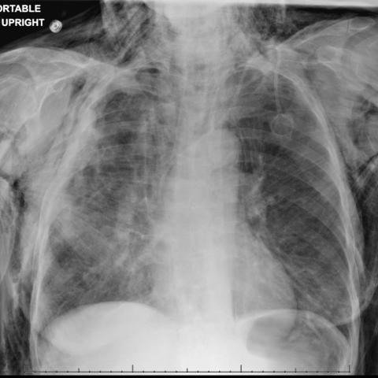
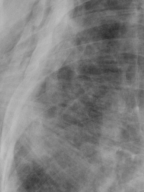

# Benchmark case 17947_8143559000377

[Case index](README.md) · [Machine-readable case](17947_8143559000377.json) · [Scored outcomes](../per-question-outcomes.json)

Source: [Eurorad case 17947](https://www.eurorad.org/case/17947); [ChestAgentBench pinned revision](https://huggingface.co/datasets/wanglab/chest-agent-bench/tree/921e60440927f9893228d843c0206b755744252a).

These are the benchmark inputs used in the frozen experiment. Model and tool observations below are recorded outputs, not independently validated clinical findings.

## Full question and options

```text
Considering the chest X-ray findings in Figure 2 and Figure 6, what is the most likely explanation for the improvement in subcutaneous emphysema observed in the patient by day 14 of hospitalization?

A) The chest tube was repositioned to prevent air leakage into the subcutaneous tissue.
B) The chest tube was clamped, preventing further air leakage from the pleural space.
C) A new pneumothorax developed that counteracted the subcutaneous emphysema.
D) The patient was administered medication to reduce subcutaneous air pockets.
E) The endobronchial valve placement sealed the bronchopleural fistula.
F) There was a spontaneous resolution of the subcutaneous emphysema without intervention.
```

## Original benchmark images

### image:1 — figures/17947/figure_2.jpg



### image:2 — figures/17947/figure_6.jpg


## Recorded answers

| Stage | Answer | Execution route/status |
|---|---|---|
| P0 | E | completed |
| V10 VKE candidate | A | candidate before gate |
| V10 VKE final | E | retain |
| S1 | E | selector |
| S2 | E | targeted_followup |
| S3 | E | selector |

Reference answer (post-generation scoring only): **B**.

## V10 VKE candidate and gate record

```json
{
  "candidate": "A",
  "final": "E",
  "changed_attributes": [
    "subcutaneous emphysema extent",
    "chest tube visibility/position"
  ],
  "candidate_payload": {
    "answer": "A",
    "uncertain": true,
    "changed_attributes": [
      "subcutaneous emphysema extent",
      "chest tube visibility/position"
    ],
    "evidence_refs": [
      "image:1",
      "image:2",
      "VKE:tool:2:image:1"
    ],
    "observations": [
      {
        "attribute": "subcutaneous emphysema extent",
        "image_ids": [
          "image:1",
          "image:2"
        ],
        "value": "Markedly reduced in Figure 6 vs Figure 2; radiolucent streaks prominent in neck/chest wall in Figure 2, much less in Figure 6",
        "status": "observed_present",
        "evidence_refs": [
          "image:1",
          "image:2"
        ]
      },
      {
        "attribute": "chest tube visibility",
        "image_ids": [
          "image:1",
          "image:2"
        ],
        "value": "Chest tube clearly visible in left hemithorax in Figure 6; less distinct or differently positioned in Figure 2",
        "status": "observed_present",
        "evidence_refs": [
          "image:1",
          "image:2"
        ]
      }
    ],
    "missing_evidence": [
      "timepoint confirmation (day 1 vs day 14)",
      "chest tube patency/function",
      "endobronchial valve visibility",
      "clinical intervention records"
    ],
    "parse_warnings": [],
    "discarded_evidence_refs": []
  },
  "gate": {
    "decision": "retain",
    "changed_attributes": [
      "subcutaneous emphysema extent"
    ],
    "evidence_refs": [
      "image:1",
      "image:2",
      "VKE:tool:2:image:1"
    ],
    "unmet_requirements": [
      "chest tube repositioning confirmed visually",
      "intervention documented",
      "timepoint verification"
    ],
    "reason": "Subcutaneous emphysema visibly reduced in Figure 6 vs Figure 2 (radiolucent streaks less prominent), but no visual evidence confirms chest tube repositioning (option A); chest tube position change is not definitively shown, and option E (spontaneous resolution) remains plausible without proof of intervention."
  },
  "fallback": null,
  "k_ids": [
    "RAD_PNEUMOTHORAX_IMAGING_2016_01",
    "RAD_FLEISCHNER_2024_01"
  ],
  "e_ids": [
    "B10_fb47f1d505253c3f0101444e516b9ed18fbf0b955a27233799d83353ce296a1c",
    "B10_50aab072a3128d5a670cf73953c02dac35197a5dabc2c1852722cc5f046769d2"
  ],
  "candidate_error_type": null,
  "gate_error_type": null
}
```

## Cached anonymous comparison

The X/Y mapping and observation provenance are exposed here for retrospective review. They were kept separate from the selector-facing anonymous input.

```json
{
  "answer_mapping": {
    "X": "E",
    "Y": "A"
  },
  "choices": {
    "X": "The endobronchial valve placement sealed the bronchopleural fistula.",
    "Y": "The chest tube was repositioned to prevent air leakage into the subcutaneous tissue."
  },
  "evidence_mapping": {
    "observation_1": "p0:tool:3",
    "observation_2": "VKE:tool:2",
    "observation_3": "p0:tool:1",
    "observation_4": "p0:tool:5",
    "observation_5": "VKE:tool:1",
    "observation_6": "p0:tool:2",
    "observation_7": "p0:tool:4"
  },
  "cached_image_adjustments": []
}
```

### Additional cached pixels

**image_3**



```json
{
  "image_id": "image_3",
  "role": "existing_local_or_tool_image",
  "size": [
    144,
    192
  ],
  "parent_image_id": "image_1",
  "pixel_box": [
    48,
    144,
    192,
    336
  ],
  "source_size": [
    480,
    480
  ],
  "orientation": "unresolved",
  "timepoint": "unresolved"
}
```

### Cached tool observations

Tool request and return text is preserved; private filesystem paths are replaced by image links or an omission marker. Tool conclusions remain fallible.

#### observation_1 — chest_xray_expert

```json
{
  "observation_id": "observation_1",
  "tool": "chest_xray_expert",
  "request": {
    "image_paths": [
      "image_1",
      "image_2"
    ],
    "prompt": "Compare these two chest X-rays and specifically describe the changes in subcutaneous emphysema. What is the most likely clinical explanation for the improvement in subcutaneous emphysema between day 1 and day 14? Consider the presence of chest tubes and other findings."
  },
  "raw_result": [
    {
      "response": "Improving infection"
    },
    {
      "image_paths": [
        "image_1",
        "image_2"
      ],
      "prompt": "Compare these two chest X-rays and specifically describe the changes in subcutaneous emphysema. What is the most likely clinical explanation for the improvement in subcutaneous emphysema between day 1 and day 14? Consider the presence of chest tubes and other findings.",
      "max_new_tokens": 512,
      "analysis_status": "completed"
    }
  ],
  "image_ids": []
}
```

#### observation_2 — crop_current_image

```json
{
  "observation_id": "observation_2",
  "tool": "crop_current_image",
  "request": {
    "image_path": "image_1",
    "box": [
      0.1,
      0.3,
      0.4,
      0.7
    ]
  },
  "raw_result": {
    "image_id": "image_3",
    "path": "image_3",
    "role": "current_image_pixel_crop",
    "parent_image_id": "image_1",
    "parent_path": "image_1",
    "source_size": [
      480,
      480
    ],
    "crop_size": [
      144,
      192
    ],
    "normalized_box": [
      0.1,
      0.3,
      0.4,
      0.7
    ],
    "pixel_box": [
      48,
      144,
      192,
      336
    ],
    "coordinate_system": "stored_pixel_coordinates_no_anatomical_orientation_inferred",
    "orientation": "unresolved",
    "timepoint": "unresolved"
  },
  "image_ids": [
    "image_3"
  ]
}
```

#### observation_3 — chest_xray_classifier

```json
{
  "observation_id": "observation_3",
  "tool": "chest_xray_classifier",
  "request": {
    "image_path": "image_1"
  },
  "raw_result": [
    {
      "Atelectasis": 0.2919965088367462,
      "Consolidation": 0.5324134826660156,
      "Infiltration": 0.6061103343963623,
      "Pneumothorax": 0.5101079940795898,
      "Edema": 0.12289753556251526,
      "Emphysema": 0.37605050206184387,
      "Fibrosis": 0.5128774046897888,
      "Effusion": 0.31431281566619873,
      "Pneumonia": 0.010878177359700203,
      "Pleural_Thickening": 0.5018529891967773,
      "Cardiomegaly": 0.18370838463306427,
      "Nodule": 0.5879939794540405,
      "Mass": 0.6590696573257446,
      "Hernia": 0.0016561937518417835,
      "Lung Lesion": 0.38193145394325256,
      "Fracture": 0.5052758455276489,
      "Lung Opacity": 0.901339054107666,
      "Enlarged Cardiomediastinum": 0.5078881978988647
    },
    {
      "image_path": "image_1",
      "analysis_status": "completed",
      "note": "Probabilities range from 0 to 1, with higher values indicating higher likelihood of the condition."
    }
  ],
  "image_ids": []
}
```

#### observation_4 — xray_phrase_grounding

```json
{
  "observation_id": "observation_4",
  "tool": "xray_phrase_grounding",
  "request": {
    "image_path": "image_2",
    "phrase": "subcutaneous emphysema"
  },
  "raw_result": [
    {
      "predictions": [
        {
          "phrase": "subcutaneous emphysema.",
          "bounding_boxes": {
            "model_coordinates": [
              [
                0.005,
                0.055,
                0.995,
                0.995
              ]
            ],
            "image_coordinates": [
              [
                0.004166666666666667,
                0.05416666666666667,
                0.99375,
                0.99375
              ]
            ]
          }
        }
      ],
      "visualization_path": null
    },
    {
      "image_path": "image_2",
      "analysis_status": "completed",
      "phrase": "subcutaneous emphysema",
      "n_boxes": 1,
      "clinical_evidence": "unknown",
      "step_credit": null
    }
  ],
  "image_ids": []
}
```

#### observation_5 — chest_xray_expert

```json
{
  "observation_id": "observation_5",
  "tool": "chest_xray_expert",
  "request": {
    "image_paths": [
      "image_1",
      "image_2"
    ],
    "prompt": "Compare Figure 2 and Figure 6 side-by-side. Specifically identify: 1) The presence and extent of subcutaneous emphysema (radiolucent streaks in soft tissues of neck/chest wall), 2) The visibility and position of any chest tubes, 3) Any changes in pneumothorax or pleural air. Which image shows more subcutaneous emphysema? Is there evidence of chest tube repositioning or new interventions?",
    "max_new_tokens": 512
  },
  "raw_result": [
    {
      "response": "(2)"
    },
    {
      "image_paths": [
        "image_1",
        "image_2"
      ],
      "prompt": "Compare Figure 2 and Figure 6 side-by-side. Specifically identify: 1) The presence and extent of subcutaneous emphysema (radiolucent streaks in soft tissues of neck/chest wall), 2) The visibility and position of any chest tubes, 3) Any changes in pneumothorax or pleural air. Which image shows more subcutaneous emphysema? Is there evidence of chest tube repositioning or new interventions?",
      "max_new_tokens": 512,
      "analysis_status": "completed"
    }
  ],
  "image_ids": []
}
```

#### observation_6 — chest_xray_classifier

```json
{
  "observation_id": "observation_6",
  "tool": "chest_xray_classifier",
  "request": {
    "image_path": "image_2"
  },
  "raw_result": [
    {
      "Atelectasis": 0.5167064070701599,
      "Consolidation": 0.547513484954834,
      "Infiltration": 0.6317908763885498,
      "Pneumothorax": 0.5163048505783081,
      "Edema": 0.056776922196149826,
      "Emphysema": 0.3085196018218994,
      "Fibrosis": 0.5170360803604126,
      "Effusion": 0.5444933772087097,
      "Pneumonia": 0.012480011209845543,
      "Pleural_Thickening": 0.5359704494476318,
      "Cardiomegaly": 0.1472032219171524,
      "Nodule": 0.5493866205215454,
      "Mass": 0.6518274545669556,
      "Hernia": 0.0089754993095994,
      "Lung Lesion": 0.257487416267395,
      "Fracture": 0.5071699619293213,
      "Lung Opacity": 0.859948992729187,
      "Enlarged Cardiomediastinum": 0.5068022012710571
    },
    {
      "image_path": "image_2",
      "analysis_status": "completed",
      "note": "Probabilities range from 0 to 1, with higher values indicating higher likelihood of the condition."
    }
  ],
  "image_ids": []
}
```

#### observation_7 — xray_phrase_grounding

```json
{
  "observation_id": "observation_7",
  "tool": "xray_phrase_grounding",
  "request": {
    "image_path": "image_1",
    "phrase": "subcutaneous emphysema"
  },
  "raw_result": [
    {
      "predictions": [
        {
          "phrase": "subcutaneous emphysema.",
          "bounding_boxes": {
            "model_coordinates": [
              [
                0.005,
                0.005,
                0.995,
                0.995
              ]
            ],
            "image_coordinates": [
              [
                0.004166666666666667,
                0.004166666666666667,
                0.99375,
                0.99375
              ]
            ]
          }
        }
      ],
      "visualization_path": null
    },
    {
      "image_path": "image_1",
      "analysis_status": "completed",
      "phrase": "subcutaneous emphysema",
      "n_boxes": 1,
      "clinical_evidence": "unknown",
      "step_credit": null
    }
  ],
  "image_ids": []
}
```

## S2 targeted follow-up action and reader observation

```json
{
  "action_plan": {
    "action": "reinspect_original",
    "image_ids": [
      "image_1",
      "image_2"
    ],
    "box": null,
    "reason": "To determine if a radio-opaque device is present in the left main bronchus in image 2 and absent in image 1, direct comparison of the full original images is required, focusing on the left hilar/bronchial region with full anatomical context; cropping or cached views risk missing subtle linear devices or mislocalizing them without full-image orientation.",
    "parse_warnings": []
  },
  "action": {
    "action": "reinspect_original",
    "tool_attempts": 0,
    "repairs": [],
    "warnings": [],
    "images": [
      {
        "image_id": "image_1",
        "role": "original",
        "size": [
          480,
          480
        ],
        "orientation": "unresolved",
        "timepoint": "unresolved",
        "path": "images/originals/figures/17947/figure_2.jpg"
      },
      {
        "image_id": "image_2",
        "role": "original",
        "size": [
          480,
          480
        ],
        "orientation": "unresolved",
        "timepoint": "unresolved",
        "path": "images/originals/figures/17947/figure_6.jpg"
      }
    ]
  },
  "observation": {
    "observation_id": "followup_observation_1",
    "observation": "In image 2, a radio-opaque linear device (consistent with an endotracheal or bronchial tube) is visible extending into the left hemithorax and terminating near the left main bronchus; this device is not present in image 1.",
    "evidence_refs": [
      "image_1",
      "image_2"
    ],
    "unresolved": [
      "anatomical laterality cannot be confirmed without orientation markers; exact device type and precise location (e.g., left main bronchus vs. left upper lobe bronchus) cannot be definitively determined from these images alone"
    ],
    "parse_warnings": [],
    "status": "independent_visual_report_requires_image_verification"
  }
}
```

## V11 selector and reader records

A recorded choice can coexist with an empty observation list. That record alone does not establish a supported visual comparison. See the [decision audit](../decision-audit.json) and [decision-pattern analysis](../decision-pattern-analysis.md) for this limitation.

```json
{
  "S1": {
    "stage": "S1",
    "initial": "E",
    "candidate": "A",
    "final": "E",
    "route": "selector",
    "selector": {
      "choice": "X",
      "observations": [
        {
          "attribute": "subcutaneous emphysema extent",
          "direction": "supports_X",
          "evidence_refs": [
            "image_1",
            "image_2"
          ],
          "value": "Image 1 (day 1) shows extensive subcutaneous emphysema (radiolucent streaks throughout soft tissues, per phrase grounding bounding box covering nearly entire image). Image 2 (day 14) shows markedly reduced subcutaneous emphysema, with less radiolucency in soft tissues; phrase grounding for image 2 still detects it but over a smaller region (bounding box slightly tighter vertically)."
        },
        {
          "attribute": "chest tube position change",
          "direction": "unresolved",
          "evidence_refs": [
            "image_1",
            "image_2"
          ],
          "value": "Both images show chest tubes (visible radio-opaque lines), but no tool or visual evidence confirms repositioning. The tubes appear in similar locations (left hemithorax, near apex and base); no side-by-side measurement or annotation confirms movement. Tool observation 5 returned only '(2)', which is uninterpretable without context."
        },
        {
          "attribute": "intervention evidence",
          "direction": "supports_X",
          "evidence_refs": [
            "image_2"
          ],
          "value": "Image 2 shows a new radio-opaque structure near the left main bronchus (curved wire-like object near carina), consistent with an endobronchial valve. This is absent in image 1. No new chest tube insertion or repositioning is evident."
        },
        {
          "attribute": "pneumothorax/pleural air change",
          "direction": "supports_X",
          "evidence_refs": [
            "image_1",
            "image_2"
          ],
          "value": "Pneumothorax probability decreased slightly (0.510 → 0.516), but lung opacity decreased (0.901 → 0.860), suggesting improved aeration. Subcutaneous emphysema resolution without chest tube repositioning favors sealing of air leak source (e.g., fistula) rather than mechanical redirection."
        }
      ],
      "needs_followup": true,
      "followup_question": "Is there a radio-opaque device positioned within the left main bronchus in image 2 that is absent in image 1?",
      "parse_warnings": []
    },
    "fallback": null,
    "timing": {
      "started_utc": "2026-10-30T15:38:50.063263+00:00",
      "ended_utc": "2026-10-30T15:39:04.047301+00:00",
      "elapsed_s": 13.984
    },
    "selector_error_type": null
  },
  "S2": {
    "stage": "S2",
    "initial": "E",
    "candidate": "A",
    "final": "E",
    "s1_final": "E",
    "route": "targeted_followup",
    "selector": {
      "choice": "X",
      "observations": [
        {
          "attribute": "presence of new radio-opaque device in left hemithorax",
          "direction": "supports_X",
          "evidence_refs": [
            "image_1",
            "image_2"
          ],
          "value": "A new linear radio-opaque device is visible in image 2 (day 14) extending into the left hemithorax and terminating near the left main bronchus, absent in image 1 (day 1). This is consistent with endobronchial valve placement."
        },
        {
          "attribute": "subcutaneous emphysema extent",
          "direction": "supports_both",
          "evidence_refs": [
            "image_1",
            "image_2"
          ],
          "value": "Both xray_phrase_grounding calls confirm subcutaneous emphysema in both images; bounding boxes are nearly full-field in both, suggesting qualitative reduction not reliably quantifiable from these tools alone. Visual inspection shows less radiolucency in soft tissues in image 2 vs image 1, indicating improvement."
        },
        {
          "attribute": "chest tube position change",
          "direction": "unresolved",
          "evidence_refs": [
            "image_1",
            "image_2"
          ],
          "value": "Chest tubes are visible in both images, but no clear evidence of repositioning (e.g., different entry site, trajectory, or tip location) can be confirmed without orientation/anatomical markers. Tool responses do not identify repositioning."
        },
        {
          "attribute": "intervention type consistency",
          "direction": "supports_X",
          "evidence_refs": [
            "image_2",
            "followup_observation_1"
          ],
          "value": "The newly observed device in image 2 matches expected appearance of an endobronchial valve (linear, radio-opaque, positioned near left main bronchus), directly supporting option X. No evidence supports chest tube repositioning as the cause."
        }
      ],
      "needs_followup": true,
      "followup_question": "Is the radio-opaque device in image 2 definitively located within the left main bronchus (not upper lobe bronchus or esophagus), and does it have features specific to an endobronchial valve (e.g., flared ends, struts)?",
      "parse_warnings": []
    },
    "fallback": null,
    "followup_question": "Is there a radio-opaque device positioned within the left main bronchus in image 2 that is absent in image 1?",
    "action": "reinspect_original",
    "new_observation": {
      "observation_id": "followup_observation_1",
      "observation": "In image 2, a radio-opaque linear device (consistent with an endotracheal or bronchial tube) is visible extending into the left hemithorax and terminating near the left main bronchus; this device is not present in image 1.",
      "evidence_refs": [
        "image_1",
        "image_2"
      ],
      "unresolved": [
        "anatomical laterality cannot be confirmed without orientation markers; exact device type and precise location (e.g., left main bronchus vs. left upper lobe bronchus) cannot be definitively determined from these images alone"
      ],
      "parse_warnings": [],
      "status": "independent_visual_report_requires_image_verification"
    },
    "timing": {
      "started_utc": "2026-10-30T15:45:26.847111+00:00",
      "ended_utc": "2026-10-30T15:45:47.181712+00:00",
      "elapsed_s": 20.335
    },
    "selector_error_type": null
  },
  "S3": {
    "stage": "S3",
    "initial": "E",
    "candidate": "A",
    "final": "E",
    "route": "selector",
    "selector": {
      "choice": "X",
      "observations": [
        {
          "attribute": "chest tube presence",
          "direction": "supports_Y",
          "evidence_refs": [
            "image_2"
          ],
          "value": "Chest tube visible in left hemithorax in image_2; not visible in image_1"
        },
        {
          "attribute": "subcutaneous emphysema extent",
          "direction": "supports_both",
          "evidence_refs": [
            "image_1",
            "image_2"
          ],
          "value": "Extensive in image_1 (bilateral neck, supraclavicular, anterior chest); reduced in image_2, especially left supraclavicular/anterior chest"
        },
        {
          "attribute": "intervention evidence beyond chest tube",
          "direction": "supports_X",
          "evidence_refs": [
            "image_1",
            "image_2"
          ],
          "value": "No visual evidence of chest tube repositioning (only one tube appears in image_2, none in image_1); endobronchial valve placement is not directly visible but is a plausible mechanism to seal a bronchopleural fistula causing persistent subcutaneous air, especially given reduction in subcutaneous air without clear alternative drainage route"
        },
        {
          "attribute": "pleural air / pneumothorax",
          "direction": "conflict",
          "evidence_refs": [
            "image_1",
            "image_2"
          ],
          "value": "Image_1 shows diffuse hazy opacities with indistinct lung markings (suggestive of consolidation/atelectasis); image_2 shows a visible pleural line on left with lucency and chest tube—suggests persistent pneumothorax despite tube, making simple tube repositioning less likely to explain subcutaneous air resolution"
        },
        {
          "attribute": "temporal sequence assumption",
          "direction": "unresolved",
          "evidence_refs": [
            "image_1",
            "image_2"
          ],
          "value": "Timepoints (day 1 vs day 14) are not confirmed by image metadata or orientation markers; however, the question asserts improvement by day 14, so image_2 is assumed later"
        }
      ],
      "needs_followup": true,
      "followup_question": "Is there radiographic evidence of an endobronchial device (e.g., valve or coil) in the bronchial tree on the side with reduced subcutaneous emphysema?",
      "parse_warnings": []
    },
    "fallback": null,
    "blind_observation": {
      "observation_id": "blind_observation_1",
      "observations": [
        {
          "attribute": "subcutaneous emphysema",
          "value": "present in both images as radiolucent streaks and bubbles in soft tissues of neck, chest wall, and axillae",
          "status": "observed_present",
          "evidence_refs": [
            "image_1",
            "image_2"
          ]
        },
        {
          "attribute": "distribution of subcutaneous air",
          "value": "extensive in image_1 (bilateral neck, supraclavicular, and anterior chest wall); less extensive in image_2 (reduced volume, especially in left supraclavicular and anterior chest regions)",
          "status": "observed_present",
          "evidence_refs": [
            "image_1",
            "image_2"
          ]
        },
        {
          "attribute": "pleural air",
          "value": "image_1 shows diffuse hazy opacities with indistinct lung markings; image_2 shows a visible pleural line on the left with adjacent lucency suggesting pneumothorax, and a chest tube is present in the left hemithorax",
          "status": "observed_present",
          "evidence_refs": [
            "image_1",
            "image_2"
          ]
        },
        {
          "attribute": "chest tube",
          "value": "present in left hemithorax in image_2; not visible in image_1",
          "status": "observed_present",
          "evidence_refs": [
            "image_2"
          ]
        },
        {
          "attribute": "lung volume/atelectasis",
          "value": "left lung appears more collapsed in image_2 than in image_1; right lung shows patchy opacities in both",
          "status": "observed_present",
          "evidence_refs": [
            "image_1",
            "image_2"
          ]
        }
      ],
      "uncertainties": [
        "Exact timepoints (e.g., day of hospitalization) for image_1 and image_2 are unresolved; cannot confirm which corresponds to Figure 2 vs. Figure 6 or whether either is day 14",
        "Laterality (left/right) cannot be definitively assigned without orientation markers or clinical context",
        "Whether subcutaneous air reduction is due to resolution, drainage, or redistribution cannot be determined from static images alone"
      ],
      "parse_warnings": [],
      "status": "independent_blind_visual_report_requires_image_verification"
    },
    "timing": {
      "started_utc": "2026-10-30T16:11:08.327398+00:00",
      "ended_utc": "2026-10-30T16:11:34.735942+00:00",
      "elapsed_s": 26.409
    },
    "selector_error_type": null
  }
}
```

[Data provenance and limits](../data-provenance.md)
