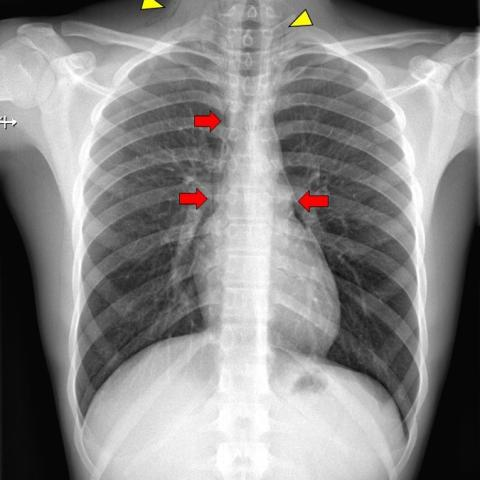
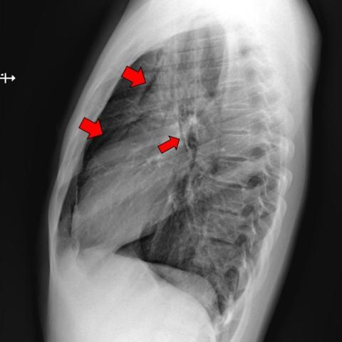

# Benchmark case 18001_8143559000935

[Case index](README.md) · [Machine-readable case](18001_8143559000935.json) · [Scored outcomes](../per-question-outcomes.json)

Source: [Eurorad case 18001](https://www.eurorad.org/case/18001); [ChestAgentBench pinned revision](https://huggingface.co/datasets/wanglab/chest-agent-bench/tree/921e60440927f9893228d843c0206b755744252a).

These are the benchmark inputs used in the frozen experiment. Model and tool observations below are recorded outputs, not independently validated clinical findings.

## Full question and options

```text
Based on the chest X-ray findings in Figure 1a and Figure 1b, which of the following is the most likely diagnosis for the patient's condition, given the clinical history of strong coughing attacks and the physical exam findings?
A) Pneumonia with subcutaneous emphysema
B) Pneumothorax with subcutaneous emphysema
C) Spontaneous pneumomediastinum with subcutaneous emphysema
D) Pneumopericardium with subcutaneous emphysema
E) Mediastinitis with subcutaneous emphysema
F) Oesophageal rupture with subcutaneous emphysema
```

## Original benchmark images

### image:1 — figures/18001/figure_1a.jpg



### image:2 — figures/18001/figure_1b.jpg



## Recorded answers

| Stage | Answer | Execution route/status |
|---|---|---|
| P0 | C | completed |
| V10 VKE candidate | C | candidate before gate |
| V10 VKE final | C | no_change |
| S1 | C | inherited_agreement |
| S2 | C | inherited_s1 |
| S3 | C | inherited_agreement |

Reference answer (post-generation scoring only): **C**.

## V10 VKE candidate and gate record

```json
{
  "candidate": "C",
  "final": "C",
  "changed_attributes": [
    "air confined to mediastinum without visceral pleural line",
    "lung volume preserved",
    "subcutaneous emphysema present"
  ],
  "candidate_payload": {
    "answer": "C",
    "uncertain": true,
    "changed_attributes": [
      "air confined to mediastinum without visceral pleural line",
      "lung volume preserved",
      "subcutaneous emphysema present"
    ],
    "evidence_refs": [
      "image:1",
      "image:2",
      "p0:tool:4",
      "p0:tool:5",
      "VKE:tool:2:image:1"
    ],
    "observations": [
      {
        "attribute": "Air in mediastinum tracking along vascular structures (aorta/pulmonary artery)",
        "image_ids": [
          "image:1"
        ],
        "value": "Linear lucencies in mediastinum marked by red arrows; no displacement of lung edge",
        "status": "observed_present",
        "evidence_refs": [
          "image:1",
          "VKE:tool:2:image:1"
        ]
      },
      {
        "attribute": "Visceral pleural line with adjacent lung collapse",
        "image_ids": [
          "image:1",
          "image:2"
        ],
        "value": "Not visible; lung markings extend to chest wall peripherally",
        "status": "observed_absent",
        "evidence_refs": [
          "image:1",
          "image:2"
        ]
      },
      {
        "attribute": "Subcutaneous emphysema",
        "image_ids": [
          "image:1"
        ],
        "value": "Lucency in soft tissues of neck (yellow arrowheads), confirmed by phrase grounding",
        "status": "observed_present",
        "evidence_refs": [
          "image:1",
          "p0:tool:5"
        ]
      },
      {
        "attribute": "Lung volume loss",
        "image_ids": [
          "image:1",
          "image:2"
        ],
        "value": "Lungs fully expanded, no volume loss",
        "status": "observed_absent",
        "evidence_refs": [
          "image:1",
          "image:2"
        ]
      }
    ],
    "missing_evidence": [
      "Tracheal deviation",
      "Diaphragmatic contour integrity",
      "Temporal progression"
    ],
    "parse_warnings": [],
    "discarded_evidence_refs": []
  },
  "gate": {
    "decision": "no_change"
  },
  "fallback": null,
  "k_ids": [
    "RAD_PNEUMOTHORAX_IMAGING_2016_01",
    "RAD_FLEISCHNER_2024_01"
  ],
  "e_ids": [
    "B10_27bb0b3b99d646dda3aeec7528cbbef4e7f5183f9cb9f32709211200c2319d66",
    "B10_fb47f1d505253c3f0101444e516b9ed18fbf0b955a27233799d83353ce296a1c"
  ],
  "candidate_error_type": null,
  "gate_error_type": null
}
```

## Detailed comparison evidence

This case did not route to the 21-case anonymous disagreement selector. Its original input and recorded answers are included; no selector packet was generated.

## V11 selector and reader records

A recorded choice can coexist with an empty observation list. That record alone does not establish a supported visual comparison. See the [decision audit](../decision-audit.json) and [decision-pattern analysis](../decision-pattern-analysis.md) for this limitation.

```json
{
  "S1": {
    "stage": "S1",
    "initial": "C",
    "candidate": "C",
    "final": "C",
    "route": "inherited_agreement",
    "selector": null,
    "fallback": null,
    "timing": {
      "started_utc": "2026-10-30T15:39:04.051011+00:00",
      "ended_utc": "2026-10-30T15:39:04.051653+00:00",
      "elapsed_s": 0.001
    },
    "selector_error_type": null
  },
  "S2": {
    "stage": "S2",
    "initial": "C",
    "candidate": "C",
    "final": "C",
    "s1_final": "C",
    "route": "inherited_s1",
    "selector": null,
    "fallback": null,
    "timing": {
      "started_utc": "2026-10-30T15:45:47.185489+00:00",
      "ended_utc": "2026-10-30T15:45:47.185701+00:00",
      "elapsed_s": 0.0
    },
    "selector_error_type": null
  },
  "S3": {
    "stage": "S3",
    "initial": "C",
    "candidate": "C",
    "final": "C",
    "route": "inherited_agreement",
    "selector": null,
    "fallback": null,
    "timing": {
      "started_utc": "2026-10-30T16:11:34.740079+00:00",
      "ended_utc": "2026-10-30T16:11:34.740304+00:00",
      "elapsed_s": 0.0
    },
    "selector_error_type": null
  }
}
```

[Data provenance and limits](../data-provenance.md)
