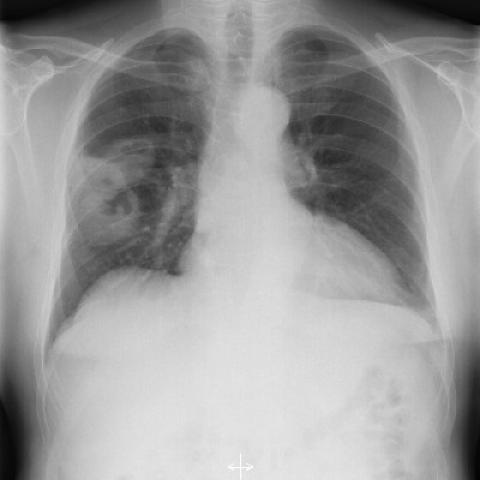

# Benchmark case 2243_8353801511231

[Case index](README.md) · [Machine-readable case](2243_8353801511231.json) · [Scored outcomes](../per-question-outcomes.json)

Source: [Eurorad case 2243](https://www.eurorad.org/case/2243); [ChestAgentBench pinned revision](https://huggingface.co/datasets/wanglab/chest-agent-bench/tree/921e60440927f9893228d843c0206b755744252a).

These are the benchmark inputs used in the frozen experiment. Model and tool observations below are recorded outputs, not independently validated clinical findings.

## Full question and options

```text
Based on the chest X-ray findings in Figure 1a and Figure 1b, which of the following best explains the radiographic features that support the diagnosis of Wegener's granulomatosis in this patient?
A) The presence of bilateral pleural effusions, which are common in Wegener's granulomatosis.
B) Solitary nodular mass with smooth margins, typical of Wegener's granulomatosis.
C) Multiple nodular masses with irregular margins and cavitation in the right lung, consistent with necrotising granulomatous vasculitis.
D) Diffuse bilateral interstitial infiltrates, which are a hallmark of Wegener's granulomatosis.
E) Left lung involvement with dense consolidation and air bronchograms, indicating Wegener's granulomatosis.
F) Mediastinal lymphadenopathy, which is a common finding in Wegener's granulomatosis.
```

## Original benchmark images

### image:1 — figures/2243/figure_1a.jpg



### image:2 — figures/2243/figure_1b.jpg


## Recorded answers

| Stage | Answer | Execution route/status |
|---|---|---|
| P0 | C | completed |
| V10 VKE candidate | C | candidate before gate |
| V10 VKE final | C | no_change |
| S1 | C | inherited_agreement |
| S2 | C | inherited_s1 |
| S3 | C | inherited_agreement |

Reference answer (post-generation scoring only): **C**.

## V10 VKE candidate and gate record

```json
{
  "candidate": "C",
  "final": "C",
  "changed_attributes": [
    "number of lesions",
    "margins",
    "cavitation"
  ],
  "candidate_payload": {
    "answer": "C",
    "uncertain": true,
    "changed_attributes": [
      "number of lesions",
      "margins",
      "cavitation"
    ],
    "evidence_refs": [
      "p0:tool:5",
      "p0:tool:6",
      "VKE:tool:1"
    ],
    "observations": [
      {
        "attribute": "nodular masses (plural)",
        "image_ids": [
          "image:1"
        ],
        "value": "phrase grounding detected two bounding boxes for 'nodular masses'",
        "status": "observed_present",
        "evidence_refs": [
          "p0:tool:6"
        ]
      },
      {
        "attribute": "cavitation",
        "image_ids": [
          "image:1"
        ],
        "value": "phrase grounding detected 'cavitation' with bounding box in right upper lobe",
        "status": "observed_present",
        "evidence_refs": [
          "p0:tool:5"
        ]
      },
      {
        "attribute": "location",
        "image_ids": [
          "image:1"
        ],
        "value": "mass in right upper lobe per report; cropped image confirms right lung lesion",
        "status": "observed_present",
        "evidence_refs": [
          "p0:tool:3",
          "VKE:tool:1"
        ]
      },
      {
        "attribute": "margins",
        "image_ids": [
          "image:1"
        ],
        "value": "irregular margins visible in cropped image, not smooth",
        "status": "observed_present",
        "evidence_refs": [
          "VKE:tool:1"
        ]
      }
    ],
    "missing_evidence": [
      "left lung assessment for bilateral disease",
      "confirmation of multiple vs. single lesion on full view",
      "CT correlation for cavitation certainty"
    ],
    "parse_warnings": [],
    "discarded_evidence_refs": []
  },
  "gate": {
    "decision": "no_change"
  },
  "fallback": null,
  "k_ids": [
    "ACR_DLD_2026_K01",
    "RAD_FLEISCHNER_2024_01"
  ],
  "e_ids": [
    "B10_9626056ed88c9deaabfc05456a0ad2ecadcb4f685e732c860df4456b5ba8e2ef",
    "B10_457c771e2403d6712b6257571b315c318c99cfaea76819b04e6ecda4de743db2"
  ],
  "candidate_error_type": null,
  "gate_error_type": null
}
```

## Detailed comparison evidence

This case did not route to the 21-case anonymous disagreement selector. Its original input and recorded answers are included; no selector packet was generated.

## V11 selector and reader records

A recorded choice can coexist with an empty observation list. That record alone does not establish a supported visual comparison. See the [decision audit](../decision-audit.json) and [decision-pattern analysis](../decision-pattern-analysis.md) for this limitation.

```json
{
  "S1": {
    "stage": "S1",
    "initial": "C",
    "candidate": "C",
    "final": "C",
    "route": "inherited_agreement",
    "selector": null,
    "fallback": null,
    "timing": {
      "started_utc": "2026-10-30T15:39:29.620367+00:00",
      "ended_utc": "2026-10-30T15:39:29.620628+00:00",
      "elapsed_s": 0.0
    },
    "selector_error_type": null
  },
  "S2": {
    "stage": "S2",
    "initial": "C",
    "candidate": "C",
    "final": "C",
    "s1_final": "C",
    "route": "inherited_s1",
    "selector": null,
    "fallback": null,
    "timing": {
      "started_utc": "2026-10-30T15:46:26.476058+00:00",
      "ended_utc": "2026-10-30T15:46:26.476594+00:00",
      "elapsed_s": 0.001
    },
    "selector_error_type": null
  },
  "S3": {
    "stage": "S3",
    "initial": "C",
    "candidate": "C",
    "final": "C",
    "route": "inherited_agreement",
    "selector": null,
    "fallback": null,
    "timing": {
      "started_utc": "2026-10-30T16:12:28.200744+00:00",
      "ended_utc": "2026-10-30T16:12:28.200944+00:00",
      "elapsed_s": 0.0
    },
    "selector_error_type": null
  }
}
```

[Data provenance and limits](../data-provenance.md)
