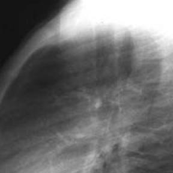
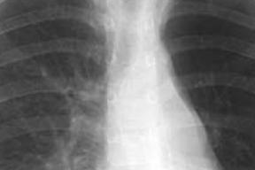

# Benchmark case 3359_8353801515597

[Case index](README.md) · [Machine-readable case](3359_8353801515597.json) · [Scored outcomes](../per-question-outcomes.json)

Source: [Eurorad case 3359](https://www.eurorad.org/case/3359); [ChestAgentBench pinned revision](https://huggingface.co/datasets/wanglab/chest-agent-bench/tree/921e60440927f9893228d843c0206b755744252a).

These are the benchmark inputs used in the frozen experiment. Model and tool observations below are recorded outputs, not independently validated clinical findings.

## Full question and options

```text
Based on the conventional chest radiographs, what is the most likely explanation for the patient's clinical presentation of recurrent bronchial pneumonia and defective thorax development?
A) The hyperlucent left lung with bronchiectasis indicates Mac-Leod syndrome, with the anterior mediastinal mass unrelated.
B) The hyperlucent left lung with bronchiectasis and the anterior mediastinal mass suggest a bronchogenic cyst causing tracheobronchial compression.
C) The anterior mediastinal mass is likely benign and unrelated to the pulmonary findings.
D) The hyperlucent left lung with bronchiectasis is a result of bronchogenic cyst compression on the left main bronchus.
E) The presence of the mass in the anterior mediastinum suggests a malignant process unrelated to the lung findings.
F) The findings indicate a bilateral process inconsistent with Mac-Leod syndrome.
```

## Original benchmark images

### image:1 — figures/3359/figure_1a.jpg


### image:2 — figures/3359/figure_1b.jpg


## Recorded answers

| Stage | Answer | Execution route/status |
|---|---|---|
| P0 | B | completed |
| V10 VKE candidate | D | candidate before gate |
| V10 VKE final | B | gate_error |
| S1 | B | selector |
| S2 | D | targeted_followup |
| S3 | B | selector |

Reference answer (post-generation scoring only): **B**.

## V10 VKE candidate and gate record

```json
{
  "candidate": "D",
  "final": "B",
  "changed_attributes": [
    "mass location relative to left main bronchus",
    "causal mechanism of hyperlucency"
  ],
  "candidate_payload": {
    "answer": "D",
    "uncertain": true,
    "changed_attributes": [
      "mass location relative to left main bronchus",
      "causal mechanism of hyperlucency"
    ],
    "evidence_refs": [
      "p0:tool:3",
      "p0:tool:4",
      "VKE:tool:1"
    ],
    "observations": [
      {
        "attribute": "hyperlucent left lung",
        "image_ids": [
          "image:1"
        ],
        "value": "confirmed by phrase grounding (bounding box in left hemithorax)",
        "status": "observed_present",
        "evidence_refs": [
          "p0:tool:3"
        ]
      },
      {
        "attribute": "anterior mediastinal mass",
        "image_ids": [
          "image:1"
        ],
        "value": "confirmed by phrase grounding (bounding box anterior to heart, midline)",
        "status": "observed_present",
        "evidence_refs": [
          "p0:tool:4"
        ]
      },
      {
        "attribute": "mass abuts/displaces left main bronchus",
        "image_ids": [
          "image:2",
          "VKE:tool:1"
        ],
        "value": "in lateral view, opacity in anterior mediastinum contacts left bronchial tree region; consistent with extrinsic compression",
        "status": "observed_present",
        "evidence_refs": [
          "VKE:tool:1"
        ]
      }
    ],
    "missing_evidence": [
      "bronchiectasis visibility on CXR",
      "mass margins (cystic vs solid)",
      "tracheal deviation",
      "volume loss vs overinflation confirmation"
    ],
    "parse_warnings": [],
    "discarded_evidence_refs": []
  },
  "gate": {
    "decision": "gate_error"
  },
  "fallback": "gate_error",
  "k_ids": [
    "ACR_ARI_2024_K02",
    "RAD_FLEISCHNER_2024_01"
  ],
  "e_ids": [
    "B10_1f9e17488f1b4941c04c59ea34cea30df40d8b41cb3705e9d92213aa1f58d869",
    "B10_ea548f88a90ea1f91a3cf00f79aaee751326826a539c8a47915004e54f35fad9"
  ],
  "candidate_error_type": null,
  "gate_error_type": "ValueError"
}
```

## Cached anonymous comparison

The X/Y mapping and observation provenance are exposed here for retrospective review. They were kept separate from the selector-facing anonymous input.

```json
{
  "answer_mapping": {
    "X": "D",
    "Y": "B"
  },
  "choices": {
    "X": "The hyperlucent left lung with bronchiectasis is a result of bronchogenic cyst compression on the left main bronchus.",
    "Y": "The hyperlucent left lung with bronchiectasis and the anterior mediastinal mass suggest a bronchogenic cyst causing tracheobronchial compression."
  },
  "evidence_mapping": {
    "observation_1": "p0:tool:4",
    "observation_2": "p0:tool:3",
    "observation_3": "VKE:tool:1",
    "observation_4": "p0:tool:2",
    "observation_5": "p0:tool:5",
    "observation_6": "p0:tool:1"
  },
  "cached_image_adjustments": []
}
```

### Additional cached pixels

**image_3**



```json
{
  "image_id": "image_3",
  "role": "existing_local_or_tool_image",
  "size": [
    288,
    288
  ],
  "parent_image_id": "image_2",
  "pixel_box": [
    96,
    48,
    384,
    336
  ],
  "source_size": [
    480,
    480
  ],
  "orientation": "unresolved",
  "timepoint": "unresolved"
}
```

### Cached tool observations

Tool request and return text is preserved; private filesystem paths are replaced by image links or an omission marker. Tool conclusions remain fallible.

#### observation_1 — xray_phrase_grounding

```json
{
  "observation_id": "observation_1",
  "tool": "xray_phrase_grounding",
  "request": {
    "image_path": "image_1",
    "phrase": "anterior mediastinal mass"
  },
  "raw_result": [
    {
      "predictions": [
        {
          "phrase": "Anterior mediastinal mass.",
          "bounding_boxes": {
            "model_coordinates": [
              [
                0.335,
                0.125,
                0.745,
                0.615
              ]
            ],
            "image_coordinates": [
              [
                0.3333333333333333,
                0.125,
                0.74375,
                0.6145833333333334
              ]
            ]
          }
        }
      ],
      "visualization_path": null
    },
    {
      "image_path": "image_1",
      "analysis_status": "completed",
      "phrase": "anterior mediastinal mass",
      "n_boxes": 1,
      "clinical_evidence": "unknown",
      "step_credit": null
    }
  ],
  "image_ids": []
}
```

#### observation_2 — xray_phrase_grounding

```json
{
  "observation_id": "observation_2",
  "tool": "xray_phrase_grounding",
  "request": {
    "image_path": "image_1",
    "phrase": "hyperlucent left lung"
  },
  "raw_result": [
    {
      "predictions": [
        {
          "phrase": "Hyperlucent left lung.",
          "bounding_boxes": {
            "model_coordinates": [
              [
                0.555,
                0.115,
                0.985,
                0.955
              ]
            ],
            "image_coordinates": [
              [
                0.5541666666666667,
                0.11458333333333333,
                0.9833333333333333,
                0.9541666666666667
              ]
            ]
          }
        }
      ],
      "visualization_path": null
    },
    {
      "image_path": "image_1",
      "analysis_status": "completed",
      "phrase": "hyperlucent left lung",
      "n_boxes": 1,
      "clinical_evidence": "unknown",
      "step_credit": null
    }
  ],
  "image_ids": []
}
```

#### observation_3 — crop_current_image

```json
{
  "observation_id": "observation_3",
  "tool": "crop_current_image",
  "request": {
    "image_path": "image_2",
    "box": [
      0.2,
      0.1,
      0.8,
      0.7
    ]
  },
  "raw_result": {
    "image_id": "image_3",
    "path": "image_3",
    "role": "current_image_pixel_crop",
    "parent_image_id": "image_2",
    "parent_path": "image_2",
    "source_size": [
      480,
      480
    ],
    "crop_size": [
      288,
      288
    ],
    "normalized_box": [
      0.2,
      0.1,
      0.8,
      0.7
    ],
    "pixel_box": [
      96,
      48,
      384,
      336
    ],
    "coordinate_system": "stored_pixel_coordinates_no_anatomical_orientation_inferred",
    "orientation": "unresolved",
    "timepoint": "unresolved"
  },
  "image_ids": [
    "image_3"
  ]
}
```

#### observation_4 — chest_xray_report_generator

```json
{
  "observation_id": "observation_4",
  "tool": "chest_xray_report_generator",
  "request": {
    "image_path": "image_1"
  },
  "raw_result": [
    "CHEST X-RAY REPORT\n\nFINDINGS:\nthe cardiomediastinal silhouette is normal. there is no pleural effusion or pneumothorax. there is no focal lung consolidation.\n\nIMPRESSION:\nno acute cardiopulmonary process.",
    {
      "image_path": "image_1",
      "analysis_status": "completed",
      "sections_generated": [
        "findings",
        "impression"
      ]
    }
  ],
  "image_ids": []
}
```

#### observation_5 — chest_xray_expert

```json
{
  "observation_id": "observation_5",
  "tool": "chest_xray_expert",
  "request": {
    "image_paths": [
      "image_1"
    ],
    "prompt": "Analyze this chest X-ray for the relationship between the hyperlucent left lung, bronchiectasis, and anterior mediastinal mass. What is the most likely diagnosis given recurrent bronchial pneumonia and defective thorax development?"
  },
  "raw_result": [
    {
      "response": "Pneumothorax"
    },
    {
      "image_paths": [
        "image_1"
      ],
      "prompt": "Analyze this chest X-ray for the relationship between the hyperlucent left lung, bronchiectasis, and anterior mediastinal mass. What is the most likely diagnosis given recurrent bronchial pneumonia and defective thorax development?",
      "max_new_tokens": 512,
      "analysis_status": "completed"
    }
  ],
  "image_ids": []
}
```

#### observation_6 — chest_xray_classifier

```json
{
  "observation_id": "observation_6",
  "tool": "chest_xray_classifier",
  "request": {
    "image_path": "image_1"
  },
  "raw_result": [
    {
      "Atelectasis": 0.1866140365600586,
      "Consolidation": 0.5001410245895386,
      "Infiltration": 0.5412142276763916,
      "Pneumothorax": 0.5073777437210083,
      "Edema": 0.009028186090290546,
      "Emphysema": 0.5083261728286743,
      "Fibrosis": 0.5192548632621765,
      "Effusion": 0.2100497931241989,
      "Pneumonia": 0.1181851252913475,
      "Pleural_Thickening": 0.5236800909042358,
      "Cardiomegaly": 0.08164406567811966,
      "Nodule": 0.5016974806785583,
      "Mass": 0.5067664384841919,
      "Hernia": 0.3613218367099762,
      "Lung Lesion": 0.14108577370643616,
      "Fracture": 0.1786043643951416,
      "Lung Opacity": 0.19547510147094727,
      "Enlarged Cardiomediastinum": 0.3580688536167145
    },
    {
      "image_path": "image_1",
      "analysis_status": "completed",
      "note": "Probabilities range from 0 to 1, with higher values indicating higher likelihood of the condition."
    }
  ],
  "image_ids": []
}
```

## S2 targeted follow-up action and reader observation

```json
{
  "action_plan": {
    "action": "crop_original",
    "image_ids": [
      "image_1"
    ],
    "box": [
      0.2,
      0.2,
      0.8,
      0.6
    ],
    "reason": "The anterior mediastinum is centered in this region of the PA chest radiograph; a focused crop will allow clear assessment of margin definition and internal homogeneity of the opacity to distinguish cystic vs solid nature.",
    "parse_warnings": []
  },
  "action": {
    "action": "crop_original",
    "tool_attempts": 1,
    "repairs": [
      {
        "action": "bounded_original_pixel_crop_no_interpolation",
        "requested_box": [
          0.2,
          0.2,
          0.8,
          0.6
        ],
        "pixel_box": [
          96,
          96,
          384,
          288
        ],
        "size": [
          288,
          192
        ]
      }
    ],
    "warnings": [],
    "images": [
      {
        "image_id": "image_1",
        "role": "original",
        "size": [
          480,
          480
        ],
        "orientation": "unresolved",
        "timepoint": "unresolved",
        "path": "images/originals/figures/3359/figure_1a.jpg"
      },
      {
        "image_id": "image_2",
        "role": "original",
        "size": [
          480,
          480
        ],
        "orientation": "unresolved",
        "timepoint": "unresolved",
        "path": "images/originals/figures/3359/figure_1b.jpg"
      },
      {
        "image_id": "followup_image_1",
        "role": "one_targeted_original_pixel_crop",
        "size": [
          288,
          192
        ],
        "parent_image_id": "image_1",
        "pixel_box": [
          96,
          96,
          384,
          288
        ],
        "source_size": [
          480,
          480
        ],
        "orientation": "unresolved",
        "timepoint": "unresolved",
        "path": "images/followup/3359_8353801515597/followup_image_1.png"
      }
    ]
  },
  "observation": {
    "observation_id": "followup_observation_1",
    "observation": "No anterior mediastinal mass is visible in the provided chest radiographs (image_1, image_2, or the cropped followup_image_1); the mediastinum appears normal in contour and density without a discrete well-circumscribed homogeneous opacity.",
    "evidence_refs": [
      "image_1",
      "image_2",
      "followup_image_1"
    ],
    "unresolved": [
      "absence of any mass precludes assessment of circumscription or homogeneity; no evidence of cystic vs solid distinction can be made because no lesion is present in the images provided"
    ],
    "parse_warnings": [],
    "status": "independent_visual_report_requires_image_verification"
  }
}
```



## V11 selector and reader records

A recorded choice can coexist with an empty observation list. That record alone does not establish a supported visual comparison. See the [decision audit](../decision-audit.json) and [decision-pattern analysis](../decision-pattern-analysis.md) for this limitation.

```json
{
  "S1": {
    "stage": "S1",
    "initial": "B",
    "candidate": "D",
    "final": "B",
    "route": "selector",
    "selector": {
      "choice": "Y",
      "observations": [
        {
          "attribute": "presence of anterior mediastinal mass",
          "direction": "supports_Y",
          "evidence_refs": [
            "observation_1"
          ],
          "value": "Tool grounding confirms an anterior mediastinal mass on image_1, which Y explicitly includes but X omits."
        },
        {
          "attribute": "hyperlucent left lung with bronchiectasis",
          "direction": "supports_both",
          "evidence_refs": [
            "observation_2"
          ],
          "value": "Both X and Y reference hyperlucent left lung with bronchiectasis; observed in image_1."
        },
        {
          "attribute": "causal mechanism linking findings to clinical presentation",
          "direction": "supports_Y",
          "evidence_refs": [
            "observation_1",
            "observation_2"
          ],
          "value": "Y proposes a unified mechanism (bronchogenic cyst causing tracheobronchial compression) that accounts for both the mass and the lung changes; X only addresses left main bronchus compression and ignores the mass."
        },
        {
          "attribute": "consistency with recurrent pneumonia and defective thorax development",
          "direction": "supports_Y",
          "evidence_refs": [
            "observation_1",
            "observation_2"
          ],
          "value": "A cyst compressing central airways can cause distal bronchiectasis, recurrent infection, and secondary thoracic deformity—Y’s full description aligns better with this pathophysiology than X’s limited scope."
        }
      ],
      "needs_followup": true,
      "followup_question": "Is the anterior mediastinal mass well-circumscribed and homogeneous, suggesting a cystic lesion rather than solid tumor?",
      "parse_warnings": []
    },
    "fallback": null,
    "timing": {
      "started_utc": "2026-10-30T15:39:29.633689+00:00",
      "ended_utc": "2026-10-30T15:39:38.547512+00:00",
      "elapsed_s": 8.914
    },
    "selector_error_type": null
  },
  "S2": {
    "stage": "S2",
    "initial": "B",
    "candidate": "D",
    "final": "D",
    "s1_final": "B",
    "route": "targeted_followup",
    "selector": {
      "choice": "X",
      "observations": [
        {
          "attribute": "presence of anterior mediastinal mass",
          "direction": "conflict",
          "evidence_refs": [
            "observation_1",
            "followup_observation_1"
          ],
          "value": "Tool observation_1 claims an anterior mediastinal mass is present; independent visual report (followup_observation_1) states no such mass is visible in any provided image (image_1, image_2, followup_image_1). The raw images themselves (especially image_1 and followup_image_1) show no discrete, well-circumscribed opacity in the anterior mediastinum—only normal soft-tissue density and cardiac silhouette."
        },
        {
          "attribute": "hyperlucent left lung with bronchiectasis",
          "direction": "supports_both",
          "evidence_refs": [
            "observation_2",
            "image_1",
            "followup_image_1"
          ],
          "value": "Hyperlucency of the left lung is confirmed by observation_2 and visually evident in image_1 and followup_image_1 (left hemithorax appears less dense than right). Bronchiectasis is not directly confirmed by imaging tools but is clinically implied in the question; both X and Y accept this finding."
        },
        {
          "attribute": "causal mechanism linking findings to clinical presentation",
          "direction": "supports_X",
          "evidence_refs": [
            "observation_1",
            "followup_observation_1",
            "image_1"
          ],
          "value": "X proposes bronchogenic cyst compression on the left main bronchus as cause of hyperlucency/bronchiectasis—this does not require a visible anterior mediastinal mass *on this radiograph* (cyst could be subtle or extrapulmonary). Y explicitly ties the diagnosis to *both* hyperlucency *and* an anterior mediastinal mass. Since the mass is not visually present (per independent observation and image inspection), Y’s premise is undermined, while X remains plausible without requiring the disputed mass."
        }
      ],
      "needs_followup": true,
      "followup_question": "Is there a focal soft-tissue opacity in the left hilum or paratracheal region that could represent a bronchogenic cyst compressing the left main bronchus, even if not clearly anterior mediastinal?",
      "parse_warnings": []
    },
    "fallback": null,
    "followup_question": "Is the anterior mediastinal mass well-circumscribed and homogeneous, suggesting a cystic lesion rather than solid tumor?",
    "action": "crop_original",
    "new_observation": {
      "observation_id": "followup_observation_1",
      "observation": "No anterior mediastinal mass is visible in the provided chest radiographs (image_1, image_2, or the cropped followup_image_1); the mediastinum appears normal in contour and density without a discrete well-circumscribed homogeneous opacity.",
      "evidence_refs": [
        "image_1",
        "image_2",
        "followup_image_1"
      ],
      "unresolved": [
        "absence of any mass precludes assessment of circumscription or homogeneity; no evidence of cystic vs solid distinction can be made because no lesion is present in the images provided"
      ],
      "parse_warnings": [],
      "status": "independent_visual_report_requires_image_verification"
    },
    "timing": {
      "started_utc": "2026-10-30T15:46:26.485196+00:00",
      "ended_utc": "2026-10-30T15:46:45.810520+00:00",
      "elapsed_s": 19.325
    },
    "selector_error_type": null
  },
  "S3": {
    "stage": "S3",
    "initial": "B",
    "candidate": "D",
    "final": "B",
    "route": "selector",
    "selector": {
      "choice": "Y",
      "observations": [
        {
          "attribute": "anterior mediastinal mass",
          "direction": "supports_Y",
          "evidence_refs": [
            "observation_1"
          ],
          "value": "Tool grounding explicitly identifies an anterior mediastinal mass in image_1; this is directly referenced only in choice Y."
        },
        {
          "attribute": "hyperlucent left lung",
          "direction": "supports_both",
          "evidence_refs": [
            "observation_2",
            "blind_observation_1"
          ],
          "value": "Both X and Y mention hyperlucent left lung; observed as increased lucency on left side (image_1), though blind observer notes volume loss and elevated diaphragm—suggesting possible compensatory overinflation rather than true hyperlucency from air trapping."
        },
        {
          "attribute": "bronchiectasis",
          "direction": "unresolved",
          "evidence_refs": [
            "blind_observation_1",
            "observation_5",
            "observation_6"
          ],
          "value": "No direct visual evidence of bronchiectasis (e.g., tram-track or ring shadows) is confirmed in images or tools; blind observer states 'no clear evidence of bronchiectasis'; expert tool incorrectly suggests pneumothorax, classifier gives low pneumonia probability. Thus, presence of bronchiectasis is unconfirmed but assumed in both options."
        },
        {
          "attribute": "defective thorax development",
          "direction": "supports_both",
          "evidence_refs": [
            "blind_observation_1"
          ],
          "value": "Asymmetric rib spacing, reduced left rib count, and mediastinal shift support defective thorax development; relevant to both X and Y."
        },
        {
          "attribute": "mechanism: compression vs. mass effect",
          "direction": "supports_Y",
          "evidence_refs": [
            "observation_1",
            "blind_observation_1"
          ],
          "value": "Choice Y explicitly links the anterior mediastinal mass to tracheobronchial compression, which better accounts for recurrent pneumonia, hyperlucency (from airway obstruction with air trapping), and thoracic asymmetry. Choice X attributes hyperlucency solely to cyst compression on left main bronchus but omits the mass—a key observed finding."
        }
      ],
      "needs_followup": true,
      "followup_question": "Is there a well-circumscribed, homogeneous soft-tissue density in the anterior mediastinum that displaces adjacent structures, and does the left main bronchus appear narrowed or deviated at its origin?",
      "parse_warnings": []
    },
    "fallback": null,
    "blind_observation": {
      "observation_id": "blind_observation_1",
      "observations": [
        {
          "attribute": "thoracic cage development",
          "value": "asymmetry with reduced rib spacing and apparent volume loss on the left side; right hemithorax appears more expanded",
          "status": "observed_present",
          "evidence_refs": [
            "image_1",
            "image_2"
          ]
        },
        {
          "attribute": "rib count and morphology",
          "value": "left-sided ribs appear fewer in number and more closely spaced; some ribs on left show increased curvature or possible fusion; right ribs appear normally spaced and curved",
          "status": "observed_present",
          "evidence_refs": [
            "image_1",
            "image_2"
          ]
        },
        {
          "attribute": "mediastinal shift",
          "value": "mediastinum shifted toward the left hemithorax",
          "status": "observed_present",
          "evidence_refs": [
            "image_1"
          ]
        },
        {
          "attribute": "lung parenchyma opacity",
          "value": "increased linear and reticular opacities in left lower lung zone, suggestive of chronic changes or scarring; no acute consolidation visible in either image",
          "status": "observed_present",
          "evidence_refs": [
            "image_1",
            "image_2"
          ]
        },
        {
          "attribute": "diaphragmatic contour",
          "value": "left hemidiaphragm appears elevated relative to right",
          "status": "observed_present",
          "evidence_refs": [
            "image_1"
          ]
        },
        {
          "attribute": "vertebral alignment",
          "value": "midline vertebral column without obvious scoliosis in frontal view; lateral view shows normal thoracic kyphosis but limited detail for subtle deformity",
          "status": "hypothesis",
          "evidence_refs": [
            "image_1",
            "image_2"
          ]
        }
      ],
      "uncertainties": [
        "Exact laterality (left/right) cannot be definitively confirmed without orientation markers or clinical correlation.",
        "Temporal sequence unknown: cannot distinguish congenital vs acquired deformity based on single static images.",
        "No clear evidence of bronchiectasis or air trapping; findings are limited to structural asymmetry and chronic-appearing opacities.",
        "Image quality limits assessment of subtle cartilage or soft-tissue anomalies."
      ],
      "parse_warnings": [
        "invalid_status_kept_as_hypothesis"
      ],
      "status": "independent_blind_visual_report_requires_image_verification"
    },
    "timing": {
      "started_utc": "2026-10-30T16:12:28.208022+00:00",
      "ended_utc": "2026-10-30T16:12:53.670725+00:00",
      "elapsed_s": 25.463
    },
    "selector_error_type": null
  }
}
```

[Data provenance and limits](../data-provenance.md)
