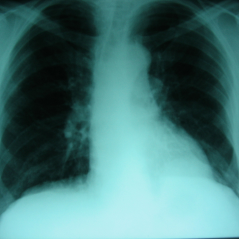
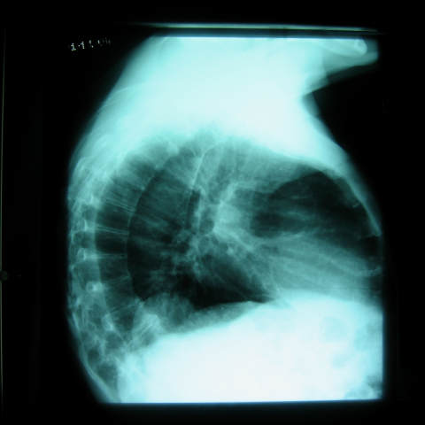
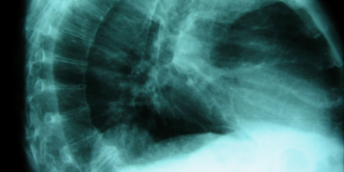

# Benchmark case 3561_8353801511489

[Case index](README.md) · [Machine-readable case](3561_8353801511489.json) · [Scored outcomes](../per-question-outcomes.json)

Source: [Eurorad case 3561](https://www.eurorad.org/case/3561); [ChestAgentBench pinned revision](https://huggingface.co/datasets/wanglab/chest-agent-bench/tree/921e60440927f9893228d843c0206b755744252a).

These are the benchmark inputs used in the frozen experiment. Model and tool observations below are recorded outputs, not independently validated clinical findings.

## Full question and options

```text
Based on the chest X-rays provided, what is the most likely cause for the rounded opacity near the left costophrenic angle observed in Figure 1 and confirmed on the lateral view in Figure 5?
A) Pleural effusion
B) Bochdalek hernia with herniated abdominal contents
C) Diaphragmatic lipoma
D) Pulmonary nodule
E) Hiatal hernia
F) Pseudotumor due to atelectasis
```

## Original benchmark images

### image:1 — figures/3561/figure_1.jpg



### image:2 — figures/3561/figure_5.jpg



## Recorded answers

| Stage | Answer | Execution route/status |
|---|---|---|
| P0 | B | completed |
| V10 VKE candidate | F | candidate before gate |
| V10 VKE final | B | retain |
| S1 | F | selector |
| S2 | F | targeted_followup |
| S3 | F | selector |

Reference answer (post-generation scoring only): **B**.

## V10 VKE candidate and gate record

```json
{
  "candidate": "F",
  "final": "B",
  "changed_attributes": [
    "morphology and interface with lung",
    "spatial relationship to diaphragm"
  ],
  "candidate_payload": {
    "answer": "F",
    "uncertain": true,
    "changed_attributes": [
      "morphology and interface with lung",
      "spatial relationship to diaphragm"
    ],
    "evidence_refs": [
      "image:1",
      "image:2",
      "VKE:tool:1"
    ],
    "observations": [
      {
        "attribute": "spatial relationship to diaphragm",
        "image_ids": [
          "image:2"
        ],
        "value": "opacity appears adjacent to but not clearly below diaphragm; chest_xray_expert explicitly answered 'No' to being below diaphragm and contiguous with abdominal contents",
        "status": "observed_absent",
        "evidence_refs": [
          "VKE:tool:2"
        ]
      },
      {
        "attribute": "morphology and interface with lung",
        "image_ids": [
          "image:1",
          "image:2"
        ],
        "value": "rounded, well-circumscribed opacity at left costophrenic angle without meniscus (ruling out pleural effusion), no air bronchograms visible, but location suggests extrapulmonary mass or pseudotumor",
        "status": "unresolved",
        "evidence_refs": [
          "image:1",
          "image:2"
        ]
      }
    ],
    "missing_evidence": [
      "presence of air-fluid level",
      "fat density",
      "contrast enhancement",
      "diaphragmatic contour continuity"
    ],
    "parse_warnings": [],
    "discarded_evidence_refs": []
  },
  "gate": {
    "decision": "retain",
    "changed_attributes": [
      "spatial relationship to diaphragm"
    ],
    "evidence_refs": [
      "VKE:tool:2"
    ],
    "unmet_requirements": [
      "morphology and interface with lung",
      "presence of air-fluid level",
      "fat density",
      "contrast enhancement"
    ],
    "reason": "Expert tool explicitly states 'No' to opacity being below diaphragm and contiguous with abdominal contents, refuting Bochdalek hernia (B); however, no evidence confirms pseudotumor due to atelectasis (F) — e.g., no volume loss, air bronchograms, or diaphragmatic elevation visible. Rounded opacity lacks meniscus (against effusion A), but F remains unsupported."
  },
  "fallback": null,
  "k_ids": [
    "RAD_FLEISCHNER_2024_01",
    "RAD_CXR_CHALLENGES_2025_05"
  ],
  "e_ids": [
    "B10_dc1447d417eabe202938e6f119699ad045568b09a8702a4ee25ffb7cd753d7e1",
    "B10_b12875b07ff6d1b1efccfca9aec66b2afbf054207dc2bdfaa2e26382d25e6dd3"
  ],
  "candidate_error_type": null,
  "gate_error_type": null
}
```

## Cached anonymous comparison

The X/Y mapping and observation provenance are exposed here for retrospective review. They were kept separate from the selector-facing anonymous input.

```json
{
  "answer_mapping": {
    "X": "B",
    "Y": "F"
  },
  "choices": {
    "X": "Bochdalek hernia with herniated abdominal contents",
    "Y": "Pseudotumor due to atelectasis"
  },
  "evidence_mapping": {
    "observation_1": "p0:tool:2",
    "observation_2": "p0:tool:4",
    "observation_3": "p0:tool:1",
    "observation_4": "VKE:tool:2",
    "observation_5": "p0:tool:5",
    "observation_6": "p0:tool:3",
    "observation_7": "VKE:tool:1"
  },
  "cached_image_adjustments": []
}
```

### Additional cached pixels

**image_3**



```json
{
  "image_id": "image_3",
  "role": "existing_local_or_tool_image",
  "size": [
    384,
    192
  ],
  "parent_image_id": "image_2",
  "pixel_box": [
    48,
    192,
    432,
    384
  ],
  "source_size": [
    480,
    480
  ],
  "orientation": "unresolved",
  "timepoint": "unresolved"
}
```

### Cached tool observations

Tool request and return text is preserved; private filesystem paths are replaced by image links or an omission marker. Tool conclusions remain fallible.

#### observation_1 — chest_xray_report_generator

```json
{
  "observation_id": "observation_1",
  "tool": "chest_xray_report_generator",
  "request": {
    "image_path": "image_1"
  },
  "raw_result": [
    "CHEST X-RAY REPORT\n\nFINDINGS:\nthe lungs are clear. there is no pneumothorax. the heart and mediastinum are magnified by the projection. regional bones and soft tissues are unremarkable.\n\nIMPRESSION:\nno acute cardiopulmonary process.",
    {
      "image_path": "image_1",
      "analysis_status": "completed",
      "sections_generated": [
        "findings",
        "impression"
      ]
    }
  ],
  "image_ids": []
}
```

#### observation_2 — xray_phrase_grounding

```json
{
  "observation_id": "observation_2",
  "tool": "xray_phrase_grounding",
  "request": {
    "image_path": "image_1",
    "phrase": "diaphragmatic hernia"
  },
  "raw_result": [
    {
      "predictions": [
        {
          "phrase": "diaphragmatic hernia.",
          "bounding_boxes": {
            "model_coordinates": [
              [
                0.005,
                0.595,
                0.435,
                0.915
              ]
            ],
            "image_coordinates": [
              [
                0.004166666666666667,
                0.59375,
                0.43333333333333335,
                0.9145833333333333
              ]
            ]
          }
        }
      ],
      "visualization_path": null
    },
    {
      "image_path": "image_1",
      "analysis_status": "completed",
      "phrase": "diaphragmatic hernia",
      "n_boxes": 1,
      "clinical_evidence": "unknown",
      "step_credit": null
    }
  ],
  "image_ids": []
}
```

#### observation_3 — chest_xray_classifier

```json
{
  "observation_id": "observation_3",
  "tool": "chest_xray_classifier",
  "request": {
    "image_path": "image_1"
  },
  "raw_result": [
    {
      "Atelectasis": 0.5348766446113586,
      "Consolidation": 0.5017282962799072,
      "Infiltration": 0.5255641937255859,
      "Pneumothorax": 0.22143065929412842,
      "Edema": 0.14400668442249298,
      "Emphysema": 0.5020429491996765,
      "Fibrosis": 0.5100738406181335,
      "Effusion": 0.31489297747612,
      "Pneumonia": 0.5192936658859253,
      "Pleural_Thickening": 0.3672102689743042,
      "Cardiomegaly": 0.48933500051498413,
      "Nodule": 0.5012965798377991,
      "Mass": 0.5194730758666992,
      "Hernia": 0.04204987362027168,
      "Lung Lesion": 0.500138521194458,
      "Fracture": 0.5061104893684387,
      "Lung Opacity": 0.3605874478816986,
      "Enlarged Cardiomediastinum": 0.5327421426773071
    },
    {
      "image_path": "image_1",
      "analysis_status": "completed",
      "note": "Probabilities range from 0 to 1, with higher values indicating higher likelihood of the condition."
    }
  ],
  "image_ids": []
}
```

#### observation_4 — chest_xray_expert

```json
{
  "observation_id": "observation_4",
  "tool": "chest_xray_expert",
  "request": {
    "image_paths": [
      "image_1",
      "image_2"
    ],
    "prompt": "In the lateral view (Figure 5), is the rounded opacity at the left costophrenic angle located below the diaphragmatic contour and contiguous with intra-abdominal structures, indicating a Bochdalek hernia?",
    "max_new_tokens": 512
  },
  "raw_result": [
    {
      "response": "No"
    },
    {
      "image_paths": [
        "image_1",
        "image_2"
      ],
      "prompt": "In the lateral view (Figure 5), is the rounded opacity at the left costophrenic angle located below the diaphragmatic contour and contiguous with intra-abdominal structures, indicating a Bochdalek hernia?",
      "max_new_tokens": 512,
      "analysis_status": "completed"
    }
  ],
  "image_ids": []
}
```

#### observation_5 — xray_phrase_grounding

```json
{
  "observation_id": "observation_5",
  "tool": "xray_phrase_grounding",
  "request": {
    "image_path": "image_1",
    "phrase": "pleural effusion"
  },
  "raw_result": [
    {
      "predictions": [
        {
          "phrase": "pleural effusion.",
          "bounding_boxes": {
            "model_coordinates": [
              [
                0.005,
                0.665,
                0.425,
                0.875
              ]
            ],
            "image_coordinates": [
              [
                0.004166666666666667,
                0.6645833333333333,
                0.425,
                0.875
              ]
            ]
          }
        }
      ],
      "visualization_path": null
    },
    {
      "image_path": "image_1",
      "analysis_status": "completed",
      "phrase": "pleural effusion",
      "n_boxes": 1,
      "clinical_evidence": "unknown",
      "step_credit": null
    }
  ],
  "image_ids": []
}
```

#### observation_6 — chest_xray_expert

```json
{
  "observation_id": "observation_6",
  "tool": "chest_xray_expert",
  "request": {
    "image_paths": [
      "image_1",
      "image_2"
    ],
    "prompt": "Analyze the rounded opacity near the left costophrenic angle in Figure 1 and confirm its characteristics on the lateral view in Figure 5. What is the most likely diagnosis?"
  },
  "raw_result": [
    {
      "response": "Lung Opacity"
    },
    {
      "image_paths": [
        "image_1",
        "image_2"
      ],
      "prompt": "Analyze the rounded opacity near the left costophrenic angle in Figure 1 and confirm its characteristics on the lateral view in Figure 5. What is the most likely diagnosis?",
      "max_new_tokens": 512,
      "analysis_status": "completed"
    }
  ],
  "image_ids": []
}
```

#### observation_7 — crop_current_image

```json
{
  "observation_id": "observation_7",
  "tool": "crop_current_image",
  "request": {
    "image_path": "image_2",
    "box": [
      0.1,
      0.4,
      0.9,
      0.8
    ]
  },
  "raw_result": {
    "image_id": "image_3",
    "path": "image_3",
    "role": "current_image_pixel_crop",
    "parent_image_id": "image_2",
    "parent_path": "image_2",
    "source_size": [
      480,
      480
    ],
    "crop_size": [
      384,
      192
    ],
    "normalized_box": [
      0.1,
      0.4,
      0.9,
      0.8
    ],
    "pixel_box": [
      48,
      192,
      432,
      384
    ],
    "coordinate_system": "stored_pixel_coordinates_no_anatomical_orientation_inferred",
    "orientation": "unresolved",
    "timepoint": "unresolved"
  },
  "image_ids": [
    "image_3"
  ]
}
```

## S2 targeted follow-up action and reader observation

```json
{
  "action_plan": {
    "action": "crop_original",
    "image_ids": [
      "image_1"
    ],
    "box": [
      0.6,
      0.7,
      1.0,
      1.0
    ],
    "reason": "The rounded opacity near the left costophrenic angle is best assessed in the PA view (image_1); a crop of that region will allow direct visual evaluation of margin sharpness, homogeneity, and presence of air bronchograms or volume loss—key discriminators between benign mass/effusion and atelectasis.",
    "parse_warnings": []
  },
  "action": {
    "action": "crop_original",
    "tool_attempts": 1,
    "repairs": [
      {
        "action": "bounded_original_pixel_crop_no_interpolation",
        "requested_box": [
          0.6,
          0.7,
          1.0,
          1.0
        ],
        "pixel_box": [
          288,
          336,
          480,
          480
        ],
        "size": [
          192,
          144
        ]
      }
    ],
    "warnings": [],
    "images": [
      {
        "image_id": "image_1",
        "role": "original",
        "size": [
          480,
          480
        ],
        "orientation": "unresolved",
        "timepoint": "unresolved",
        "path": "images/originals/figures/3561/figure_1.jpg"
      },
      {
        "image_id": "image_2",
        "role": "original",
        "size": [
          480,
          480
        ],
        "orientation": "unresolved",
        "timepoint": "unresolved",
        "path": "images/originals/figures/3561/figure_5.jpg"
      },
      {
        "image_id": "followup_image_1",
        "role": "one_targeted_original_pixel_crop",
        "size": [
          192,
          144
        ],
        "parent_image_id": "image_1",
        "pixel_box": [
          288,
          336,
          480,
          480
        ],
        "source_size": [
          480,
          480
        ],
        "orientation": "unresolved",
        "timepoint": "unresolved",
        "path": "images/followup/3561_8353801511489/followup_image_1.png"
      }
    ]
  },
  "observation": {
    "observation_id": "followup_observation_1",
    "observation": "The cropped region (followup_image_1) is severely underexposed and blurred, showing only a uniform pale cyan field with no discernible internal structure, margins, or air bronchograms; the original images (image_1 and image_2) lack sufficient resolution and contrast to assess demarcation, homogeneity, or volume loss at the left costophrenic angle.",
    "evidence_refs": [
      "image_1",
      "image_2",
      "followup_image_1"
    ],
    "unresolved": [
      "exact margin sharpness of the opacity",
      "presence or absence of air bronchograms",
      "evidence of volume loss (e.g., mediastinal shift, diaphragmatic elevation, rib crowding) due to poor image quality and lack of clear anatomical landmarks in the region of interest"
    ],
    "parse_warnings": [],
    "status": "independent_visual_report_requires_image_verification"
  }
}
```


## V11 selector and reader records

A recorded choice can coexist with an empty observation list. That record alone does not establish a supported visual comparison. See the [decision audit](../decision-audit.json) and [decision-pattern analysis](../decision-pattern-analysis.md) for this limitation.

```json
{
  "S1": {
    "stage": "S1",
    "initial": "B",
    "candidate": "F",
    "final": "F",
    "route": "selector",
    "selector": {
      "choice": "Y",
      "observations": [
        {
          "attribute": "location relative to diaphragm on lateral view",
          "direction": "supports_Y",
          "evidence_refs": [
            "observation_4"
          ],
          "value": "Expert explicitly states the opacity is NOT below the diaphragmatic contour nor contiguous with intra-abdominal structures, contradicting Bochdalek hernia (X) and supporting pseudotumor from atelectasis (Y)"
        },
        {
          "attribute": "presence of diaphragmatic hernia",
          "direction": "conflict",
          "evidence_refs": [
            "observation_2",
            "observation_4"
          ],
          "value": "Phrase grounding suggests 'diaphragmatic hernia' but expert analysis directly refutes it; expert assessment carries higher diagnostic weight for spatial relationships"
        },
        {
          "attribute": "likelihood of atelectasis",
          "direction": "supports_Y",
          "evidence_refs": [
            "observation_3"
          ],
          "value": "Atelectasis probability = 0.535 (highest among listed conditions), consistent with pseudotumor due to atelectasis"
        },
        {
          "attribute": "pleural effusion detection",
          "direction": "supports_both",
          "evidence_refs": [
            "observation_5"
          ],
          "value": "Phrase grounding identifies pleural effusion in same region, which can accompany or mimic atelectatic pseudotumor; does not distinguish X vs Y"
        }
      ],
      "needs_followup": true,
      "followup_question": "Is the rounded opacity sharply demarcated and homogeneous, or does it show air bronchograms and volume loss consistent with atelectasis?",
      "parse_warnings": []
    },
    "fallback": null,
    "timing": {
      "started_utc": "2026-10-30T15:39:49.485516+00:00",
      "ended_utc": "2026-10-30T15:39:57.286448+00:00",
      "elapsed_s": 7.801
    },
    "selector_error_type": null
  },
  "S2": {
    "stage": "S2",
    "initial": "B",
    "candidate": "F",
    "final": "F",
    "s1_final": "F",
    "route": "targeted_followup",
    "selector": {
      "choice": "Y",
      "observations": [
        {
          "attribute": "location relative to diaphragm on lateral view",
          "direction": "supports_Y",
          "evidence_refs": [
            "observation_4"
          ],
          "value": "Expert analysis explicitly states the opacity is NOT below the diaphragmatic contour nor contiguous with intra-abdominal structures, contradicting Bochdalek hernia (X) and supporting an intrapleural/intrapulmonary process like pseudotumor from atelectasis (Y)."
        },
        {
          "attribute": "hernia probability",
          "direction": "supports_Y",
          "evidence_refs": [
            "observation_3"
          ],
          "value": "Classifier gives very low probability for 'Hernia' (0.042), while 'Atelectasis' has highest probability (0.535), favoring Y over X."
        },
        {
          "attribute": "pleural effusion detection",
          "direction": "conflict",
          "evidence_refs": [
            "observation_5"
          ],
          "value": "Phrase grounding flags 'pleural effusion', but this is inconsistent with the expert's 'Lung Opacity' diagnosis (observation_6) and the absence of classic effusion signs (e.g., meniscus, blunting) in visible images; likely a false positive due to low contrast/opacity location—does not strongly support X or Y."
        },
        {
          "attribute": "internal structure/margin assessment",
          "direction": "unresolved",
          "evidence_refs": [
            "followup_observation_1",
            "image_1",
            "image_2"
          ],
          "value": "Cropped and original images are too underexposed/blurred to assess sharp demarcation, homogeneity, air bronchograms, or volume loss—critical features to distinguish pseudotumor vs. hernia, but current evidence insufficient."
        }
      ],
      "needs_followup": true,
      "followup_question": "On the lateral view, does the rounded opacity abut the posterior chest wall and show a convex medial margin with no continuity to abdominal contents?",
      "parse_warnings": []
    },
    "fallback": null,
    "followup_question": "Is the rounded opacity sharply demarcated and homogeneous, or does it show air bronchograms and volume loss consistent with atelectasis?",
    "action": "crop_original",
    "new_observation": {
      "observation_id": "followup_observation_1",
      "observation": "The cropped region (followup_image_1) is severely underexposed and blurred, showing only a uniform pale cyan field with no discernible internal structure, margins, or air bronchograms; the original images (image_1 and image_2) lack sufficient resolution and contrast to assess demarcation, homogeneity, or volume loss at the left costophrenic angle.",
      "evidence_refs": [
        "image_1",
        "image_2",
        "followup_image_1"
      ],
      "unresolved": [
        "exact margin sharpness of the opacity",
        "presence or absence of air bronchograms",
        "evidence of volume loss (e.g., mediastinal shift, diaphragmatic elevation, rib crowding) due to poor image quality and lack of clear anatomical landmarks in the region of interest"
      ],
      "parse_warnings": [],
      "status": "independent_visual_report_requires_image_verification"
    },
    "timing": {
      "started_utc": "2026-10-30T15:47:02.314736+00:00",
      "ended_utc": "2026-10-30T15:47:22.745864+00:00",
      "elapsed_s": 20.431
    },
    "selector_error_type": null
  },
  "S3": {
    "stage": "S3",
    "initial": "B",
    "candidate": "F",
    "final": "F",
    "route": "selector",
    "selector": {
      "choice": "Y",
      "observations": [
        {
          "attribute": "location relative to diaphragm and intra-abdominal structures",
          "direction": "supports_Y",
          "evidence_refs": [
            "observation_4"
          ],
          "value": "Expert analysis explicitly states the opacity is NOT below the diaphragmatic contour nor contiguous with intra-abdominal structures, contradicting Bochdalek hernia (X) and supporting pseudotumor from atelectasis (Y), which typically lies within lung parenchyma."
        },
        {
          "attribute": "hernia probability score",
          "direction": "supports_Y",
          "evidence_refs": [
            "observation_3"
          ],
          "value": "Classifier gives 'Hernia' very low probability (0.042), while 'Atelectasis' is highest among relevant options (0.535), favoring Y over X."
        },
        {
          "attribute": "opacity characteristics on lateral view",
          "direction": "unresolved",
          "evidence_refs": [
            "image_2",
            "observation_6"
          ],
          "value": "Lateral view shows a dense rounded opacity in lower thorax, but orientation is unresolved; expert calls it 'Lung Opacity', consistent with atelectatic pseudotumor, not herniated bowel gas or organs."
        },
        {
          "attribute": "pleural effusion vs. atelectasis sign",
          "direction": "conflict",
          "evidence_refs": [
            "observation_5",
            "observation_1"
          ],
          "value": "Phrase grounding detects 'pleural effusion', but radiologist report says 'lungs are clear' and no effusion is mentioned; this discrepancy suggests grounding is unreliable here. Atelectasis can mimic effusion as a pseudotumor, especially when blunting costophrenic angle without fluid layering."
        }
      ],
      "needs_followup": true,
      "followup_question": "Is there evidence of volume loss (e.g., mediastinal shift, crowding of vessels/bronchi, elevated hemidiaphragm) adjacent to the rounded opacity that would support atelectasis?",
      "parse_warnings": [
        "observation_direction_normalized"
      ]
    },
    "fallback": null,
    "blind_observation": {
      "observation_id": "blind_observation_1",
      "observations": [
        {
          "attribute": "rounded opacity near left costophrenic angle",
          "value": "not clearly visible in image_1; the left costophrenic angle appears blunted but no discrete rounded opacity is discernible",
          "status": "unresolved",
          "evidence_refs": [
            "image_1"
          ]
        },
        {
          "attribute": "lateral view (image_2) confirmation of rounded opacity",
          "value": "image_2 shows a lateral chest projection with a dense, rounded opacity located anteriorly and inferiorly, consistent with the left lower thoracic region; however, exact relationship to costophrenic angle cannot be definitively confirmed due to lack of orientation markers and superimposition",
          "status": "unresolved",
          "evidence_refs": [
            "image_2"
          ]
        },
        {
          "attribute": "image orientation",
          "value": "no anatomical markers (e.g., 'L', 'R', 'AP', 'PA', 'LAT') are present; laterality (left vs. right) and projection type (AP/PA vs. lateral) cannot be confirmed from image content alone",
          "status": "unresolved",
          "evidence_refs": [
            "image_1",
            "image_2"
          ]
        },
        {
          "attribute": "costophrenic angle definition",
          "value": "in image_1, both costophrenic angles appear somewhat obscured or blunted; no clear sharp angle is visualized, possibly due to technical factors or pathology",
          "status": "observed_present",
          "evidence_refs": [
            "image_1"
          ]
        }
      ],
      "uncertainties": [
        "Absence of orientation labels prevents confirmation of which side is left and whether image_2 is truly a lateral view of the same patient/session.",
        "Image quality and exposure limit visualization of subtle opacities; the described 'rounded opacity' is not definitively identified in either image without assumed context.",
        "No temporal sequence or clinical correlation provided; single static images do not allow assessment of change over time."
      ],
      "parse_warnings": [],
      "status": "independent_blind_visual_report_requires_image_verification"
    },
    "timing": {
      "started_utc": "2026-10-30T16:13:14.979894+00:00",
      "ended_utc": "2026-10-30T16:13:38.422960+00:00",
      "elapsed_s": 23.443
    },
    "selector_error_type": null
  }
}
```

[Data provenance and limits](../data-provenance.md)
