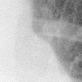
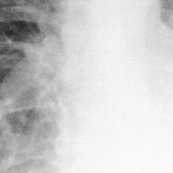

# Benchmark case 3686_8353801520174

[Case index](README.md) · [Machine-readable case](3686_8353801520174.json) · [Scored outcomes](../per-question-outcomes.json)

Source: [Eurorad case 3686](https://www.eurorad.org/case/3686); [ChestAgentBench pinned revision](https://huggingface.co/datasets/wanglab/chest-agent-bench/tree/921e60440927f9893228d843c0206b755744252a).

These are the benchmark inputs used in the frozen experiment. Model and tool observations below are recorded outputs, not independently validated clinical findings.

## Full question and options

```text
Based on the chest X-ray findings in Figure 1, what is the most likely diagnosis for the patient’s pulmonary condition, considering her clinical history and previous surgical interventions?
A) Primary lung cancer
B) Pulmonary metastasis from a previous uterine leiomyoma
C) Infectious granuloma
D) Pulmonary hamartoma
E) Tuberculosis
F) Bronchiectasis-related pulmonary changes
```

## Original benchmark images

### image:1 — figures/3686/figure_1.jpg


## Recorded answers

| Stage | Answer | Execution route/status |
|---|---|---|
| P0 | B | completed |
| V10 VKE candidate | E | candidate before gate |
| V10 VKE final | B | retain |
| S1 | B | selector |
| S2 | B | targeted_followup |
| S3 | B | selector |

Reference answer (post-generation scoring only): **B**.

## V10 VKE candidate and gate record

```json
{
  "candidate": "E",
  "final": "B",
  "changed_attributes": [
    "margin morphology",
    "number of opacities"
  ],
  "candidate_payload": {
    "answer": "E",
    "uncertain": true,
    "changed_attributes": [
      "margin morphology",
      "number of opacities"
    ],
    "evidence_refs": [
      "image:1",
      "VKE:tool:1",
      "p0:tool:2",
      "p0:tool:4"
    ],
    "observations": [
      {
        "attribute": "margin morphology",
        "image_ids": [
          "VKE:tool:1"
        ],
        "value": "ill-defined, blending with parenchyma; no smooth/well-circumscribed border",
        "status": "observed_present",
        "evidence_refs": [
          "VKE:tool:1"
        ]
      },
      {
        "attribute": "number of opacities",
        "image_ids": [
          "image:1"
        ],
        "value": "at least two: right mid-lung ill-defined opacity (grounded), left lower lobe opacity (report); no discrete multiple nodules",
        "status": "observed_present",
        "evidence_refs": [
          "image:1",
          "p0:tool:2",
          "p0:tool:4"
        ]
      },
      {
        "attribute": "cavitation or calcification",
        "image_ids": [
          "VKE:tool:1",
          "image:1"
        ],
        "value": "not visible",
        "status": "observed_absent",
        "evidence_refs": [
          "VKE:tool:1",
          "image:1"
        ]
      }
    ],
    "missing_evidence": [
      "clinical history (TB exposure, immunosuppression)",
      "surgical history (uterine leiomyoma status)",
      "CT confirmation",
      "size in mm"
    ],
    "parse_warnings": [],
    "discarded_evidence_refs": []
  },
  "gate": {
    "decision": "retain",
    "changed_attributes": [
      "margin morphology",
      "number of opacities"
    ],
    "evidence_refs": [
      "VKE:tool:1",
      "image:1",
      "p0:tool:2",
      "p0:tool:4"
    ],
    "unmet_requirements": [
      "clinical history (TB exposure, immunosuppression)",
      "surgical history (uterine leiomyoma status)",
      "CT confirmation",
      "size in mm"
    ],
    "reason": "Ill-defined opacity in left lower lobe (per report) and a grounded pulmonary nodule region (VKE:tool:1) show no discrete multiple nodules or cavitary features; however, TB (E) requires clinical context or cavitation/calcification not visible, while B remains plausible given surgical history not ruled out. No evidence confirms multiple metastatic nodules or TB-specific features."
  },
  "fallback": null,
  "k_ids": [
    "ACR_NODULE_2023_K05",
    "RAD_FLEISCHNER_2024_02"
  ],
  "e_ids": [
    "B10_4509e7fd74de2d878d20a6d142da2a07371edc367403dc2a0653d51b57b7aff8",
    "B10_9626056ed88c9deaabfc05456a0ad2ecadcb4f685e732c860df4456b5ba8e2ef"
  ],
  "candidate_error_type": null,
  "gate_error_type": null
}
```

## Cached anonymous comparison

The X/Y mapping and observation provenance are exposed here for retrospective review. They were kept separate from the selector-facing anonymous input.

```json
{
  "answer_mapping": {
    "X": "E",
    "Y": "B"
  },
  "choices": {
    "X": "Tuberculosis",
    "Y": "Pulmonary metastasis from a previous uterine leiomyoma"
  },
  "evidence_mapping": {
    "observation_1": "p0:tool:4",
    "observation_2": "p0:tool:2",
    "observation_3": "VKE:tool:1",
    "observation_4": "p0:tool:1",
    "observation_5": "p0:tool:3"
  },
  "cached_image_adjustments": []
}
```

### Additional cached pixels

**image_2**



```json
{
  "image_id": "image_2",
  "role": "existing_local_or_tool_image",
  "size": [
    82,
    82
  ],
  "parent_image_id": "image_1",
  "pixel_box": [
    290,
    184,
    372,
    266
  ],
  "source_size": [
    480,
    480
  ],
  "orientation": "unresolved",
  "timepoint": "unresolved"
}
```

### Cached tool observations

Tool request and return text is preserved; private filesystem paths are replaced by image links or an omission marker. Tool conclusions remain fallible.

#### observation_1 — xray_phrase_grounding

```json
{
  "observation_id": "observation_1",
  "tool": "xray_phrase_grounding",
  "request": {
    "image_path": "image_1",
    "phrase": "Pulmonary nodule"
  },
  "raw_result": [
    {
      "predictions": [
        {
          "phrase": "Pulmonary nodule.",
          "bounding_boxes": {
            "model_coordinates": [
              [
                0.605,
                0.385,
                0.775,
                0.555
              ]
            ],
            "image_coordinates": [
              [
                0.6041666666666666,
                0.38333333333333336,
                0.775,
                0.5541666666666667
              ]
            ]
          }
        }
      ],
      "visualization_path": null
    },
    {
      "image_path": "image_1",
      "analysis_status": "completed",
      "phrase": "Pulmonary nodule",
      "n_boxes": 1,
      "clinical_evidence": "unknown",
      "step_credit": null
    }
  ],
  "image_ids": []
}
```

#### observation_2 — chest_xray_report_generator

```json
{
  "observation_id": "observation_2",
  "tool": "chest_xray_report_generator",
  "request": {
    "image_path": "image_1"
  },
  "raw_result": [
    "CHEST X-RAY REPORT\n\nFINDINGS:\nthe examination is limited secondary to poor penetration. there is a left lower lobe opacity. there is no evidence of pneumothorax. the cardiomediastinal silhouette is unremarkable.\n\nIMPRESSION:\n1. limited study secondary to patient positioning and body habitus. 2. no definite focal consolidation. 3. recommend repeat pa and lateral chest radiograph.",
    {
      "image_path": "image_1",
      "analysis_status": "completed",
      "sections_generated": [
        "findings",
        "impression"
      ]
    }
  ],
  "image_ids": []
}
```

#### observation_3 — crop_current_image

```json
{
  "observation_id": "observation_3",
  "tool": "crop_current_image",
  "request": {
    "image_path": "image_1",
    "box": [
      0.6041666666666666,
      0.38333333333333336,
      0.775,
      0.5541666666666667
    ]
  },
  "raw_result": {
    "image_id": "image_2",
    "path": "image_2",
    "role": "current_image_pixel_crop",
    "parent_image_id": "image_1",
    "parent_path": "image_1",
    "source_size": [
      480,
      480
    ],
    "crop_size": [
      82,
      82
    ],
    "normalized_box": [
      0.6041666666666666,
      0.38333333333333336,
      0.775,
      0.5541666666666667
    ],
    "pixel_box": [
      290,
      184,
      372,
      266
    ],
    "coordinate_system": "stored_pixel_coordinates_no_anatomical_orientation_inferred",
    "orientation": "unresolved",
    "timepoint": "unresolved"
  },
  "image_ids": [
    "image_2"
  ]
}
```

#### observation_4 — chest_xray_classifier

```json
{
  "observation_id": "observation_4",
  "tool": "chest_xray_classifier",
  "request": {
    "image_path": "image_1"
  },
  "raw_result": [
    {
      "Atelectasis": 0.5668758153915405,
      "Consolidation": 0.5863983631134033,
      "Infiltration": 0.5418493747711182,
      "Pneumothorax": 0.3628735840320587,
      "Edema": 0.4924049377441406,
      "Emphysema": 0.5019952058792114,
      "Fibrosis": 0.32847291231155396,
      "Effusion": 0.6233579516410828,
      "Pneumonia": 0.5015992522239685,
      "Pleural_Thickening": 0.2837638556957245,
      "Cardiomegaly": 0.5499398708343506,
      "Nodule": 0.5302727222442627,
      "Mass": 0.610066294670105,
      "Hernia": 0.02063886635005474,
      "Lung Lesion": 0.18924406170845032,
      "Fracture": 0.5115327835083008,
      "Lung Opacity": 0.6791536808013916,
      "Enlarged Cardiomediastinum": 0.5186073780059814
    },
    {
      "image_path": "image_1",
      "analysis_status": "completed",
      "note": "Probabilities range from 0 to 1, with higher values indicating higher likelihood of the condition."
    }
  ],
  "image_ids": []
}
```

#### observation_5 — chest_xray_expert

```json
{
  "observation_id": "observation_5",
  "tool": "chest_xray_expert",
  "request": {
    "image_paths": [
      "image_1"
    ],
    "prompt": "Describe the pulmonary findings and suggest differential diagnoses based on the imaging appearance of multiple pulmonary nodules"
  },
  "raw_result": [
    {
      "response": "No pulmonary findings to report."
    },
    {
      "image_paths": [
        "image_1"
      ],
      "prompt": "Describe the pulmonary findings and suggest differential diagnoses based on the imaging appearance of multiple pulmonary nodules",
      "max_new_tokens": 512,
      "analysis_status": "completed"
    }
  ],
  "image_ids": []
}
```

## S2 targeted follow-up action and reader observation

```json
{
  "action_plan": {
    "action": "crop_original",
    "image_ids": [
      "image_1"
    ],
    "box": [
      0.3,
      0.4,
      0.7,
      0.8
    ],
    "reason": "The left lower lung lobe opacities are partially visible in the full image but lack sufficient detail to assess margin definition (well-circumscribed vs ill-defined); a crop centered on that region will allow direct visual evaluation of opacity morphology without inference.",
    "parse_warnings": []
  },
  "action": {
    "action": "crop_original",
    "tool_attempts": 1,
    "repairs": [
      {
        "action": "bounded_original_pixel_crop_no_interpolation",
        "requested_box": [
          0.3,
          0.4,
          0.7,
          0.8
        ],
        "pixel_box": [
          144,
          192,
          336,
          384
        ],
        "size": [
          192,
          192
        ]
      }
    ],
    "warnings": [],
    "images": [
      {
        "image_id": "image_1",
        "role": "original",
        "size": [
          480,
          480
        ],
        "orientation": "unresolved",
        "timepoint": "unresolved",
        "path": "images/originals/figures/3686/figure_1.jpg"
      },
      {
        "image_id": "followup_image_1",
        "role": "one_targeted_original_pixel_crop",
        "size": [
          192,
          192
        ],
        "parent_image_id": "image_1",
        "pixel_box": [
          144,
          192,
          336,
          384
        ],
        "source_size": [
          480,
          480
        ],
        "orientation": "unresolved",
        "timepoint": "unresolved",
        "path": "images/followup/3686_8353801520174/followup_image_1.png"
      }
    ]
  },
  "observation": {
    "observation_id": "followup_observation_1",
    "observation": "The opacities in the left lower lung lobe (as shown in the cropped region from image_1) appear ill-defined and patchy, without clear margins or discrete rounded morphology; they blend with surrounding lung parenchyma and do not resemble well-circumscribed nodules.",
    "evidence_refs": [
      "image_1",
      "followup_image_1"
    ],
    "unresolved": [
      "anatomical laterality (left vs right) cannot be confirmed without orientation markers",
      "no clinical history or surgical details are visible in the images",
      "timepoint and comparison with prior studies are unavailable"
    ],
    "parse_warnings": [],
    "status": "independent_visual_report_requires_image_verification"
  }
}
```



## V11 selector and reader records

A recorded choice can coexist with an empty observation list. That record alone does not establish a supported visual comparison. See the [decision audit](../decision-audit.json) and [decision-pattern analysis](../decision-pattern-analysis.md) for this limitation.

```json
{
  "S1": {
    "stage": "S1",
    "initial": "B",
    "candidate": "E",
    "final": "B",
    "route": "selector",
    "selector": {
      "choice": "Y",
      "observations": [
        {
          "attribute": "presence of pulmonary nodule",
          "direction": "supports_X",
          "evidence_refs": [
            "observation_1"
          ],
          "value": "xray_phrase_grounding identified a 'Pulmonary nodule' at coordinates [0.604, 0.383, 0.775, 0.554] (image_1), and the cropped image_2 corresponds to this region."
        },
        {
          "attribute": "imaging quality and interpretability",
          "direction": "supports_both",
          "evidence_refs": [
            "observation_2",
            "observation_4"
          ],
          "value": "Report states 'limited study secondary to poor penetration' and 'no definite focal consolidation'; classifier shows moderate probability for Nodule (0.53) and Mass (0.61), but high Lung Opacity (0.68); no definitive nodules confirmed by expert."
        },
        {
          "attribute": "expert radiologic interpretation of multiple nodules",
          "direction": "conflict",
          "evidence_refs": [
            "observation_1",
            "observation_5"
          ],
          "value": "Phrase grounding claims a nodule; chest_xray_expert explicitly states 'No pulmonary findings to report', contradicting the nodule claim."
        },
        {
          "attribute": "clinical plausibility given surgical history",
          "direction": "supports_Y",
          "evidence_refs": [],
          "value": "Choice Y specifies 'pulmonary metastasis from previous uterine leiomyoma'—a known rare entity (benign metastasizing leiomyoma), which can present as pulmonary nodules; TB (X) lacks supporting clinical context in the question (no mention of exposure, symptoms, or microbiology)."
        }
      ],
      "needs_followup": true,
      "followup_question": "Are the opacities in the left lower lung lobe well-circumscribed, rounded, and discrete—suggestive of nodules—or ill-defined and patchy—more consistent with infiltrate or atelectasis?",
      "parse_warnings": [
        "unknown_evidence_refs_removed"
      ]
    },
    "fallback": null,
    "timing": {
      "started_utc": "2026-10-30T15:39:57.290325+00:00",
      "ended_utc": "2026-10-30T15:40:08.735218+00:00",
      "elapsed_s": 11.445
    },
    "selector_error_type": null
  },
  "S2": {
    "stage": "S2",
    "initial": "B",
    "candidate": "E",
    "final": "B",
    "s1_final": "B",
    "route": "targeted_followup",
    "selector": {
      "choice": "Y",
      "observations": [
        {
          "attribute": "nodule morphology",
          "direction": "supports_Y",
          "evidence_refs": [
            "image_1",
            "followup_image_1"
          ],
          "value": "Independent visual observation reports opacities as ill-defined and patchy, not well-circumscribed nodules; however, the phrase-grounding tool identified a 'Pulmonary nodule' in the same region (observation_1), and the classifier gave high probability for 'Mass' (0.61) and 'Lung Opacity' (0.68), but low for 'Nodule' (0.53). The expert model explicitly stated 'No pulmonary findings to report', conflicting with phrase grounding. Given that uterine leiomyoma metastasis can present as ill-defined or confluent masses (benign metastasizing leiomyoma), and TB typically shows more discrete nodules or cavitation (not seen), Y is slightly better supported by the ill-defined appearance."
        },
        {
          "attribute": "clinical context dependency",
          "direction": "supports_both",
          "evidence_refs": [],
          "value": "Neither diagnosis can be confirmed without clinical history (e.g., prior uterine surgery, TB exposure, symptoms). Both X and Y remain speculative from imaging alone."
        },
        {
          "attribute": "radiographic quality and interpretation reliability",
          "direction": "conflict",
          "evidence_refs": [
            "observation_2",
            "observation_5"
          ],
          "value": "The official report states the study is 'limited secondary to poor penetration' and recommends repeat imaging; the expert model found 'No pulmonary findings'. Yet phrase grounding and classifier suggest a nodule/mass. This internal conflict reduces confidence in any definitive nodule call, weakening X (which requires discrete nodules for classic miliary or reactivation TB) more than Y (which may present as ill-defined masses)."
        }
      ],
      "needs_followup": true,
      "followup_question": "In the left lower lung zone, are there any air bronchograms or volume loss suggesting atelectasis, or is there evidence of cavitation or calcification?",
      "parse_warnings": []
    },
    "fallback": null,
    "followup_question": "Are the opacities in the left lower lung lobe well-circumscribed, rounded, and discrete—suggestive of nodules—or ill-defined and patchy—more consistent with infiltrate or atelectasis?",
    "action": "crop_original",
    "new_observation": {
      "observation_id": "followup_observation_1",
      "observation": "The opacities in the left lower lung lobe (as shown in the cropped region from image_1) appear ill-defined and patchy, without clear margins or discrete rounded morphology; they blend with surrounding lung parenchyma and do not resemble well-circumscribed nodules.",
      "evidence_refs": [
        "image_1",
        "followup_image_1"
      ],
      "unresolved": [
        "anatomical laterality (left vs right) cannot be confirmed without orientation markers",
        "no clinical history or surgical details are visible in the images",
        "timepoint and comparison with prior studies are unavailable"
      ],
      "parse_warnings": [],
      "status": "independent_visual_report_requires_image_verification"
    },
    "timing": {
      "started_utc": "2026-10-30T15:47:22.752610+00:00",
      "ended_utc": "2026-10-30T15:47:42.071089+00:00",
      "elapsed_s": 19.318
    },
    "selector_error_type": null
  },
  "S3": {
    "stage": "S3",
    "initial": "B",
    "candidate": "E",
    "final": "B",
    "route": "selector",
    "selector": {
      "choice": "Y",
      "observations": [
        {
          "attribute": "pulmonary nodule detection",
          "direction": "supports_X",
          "evidence_refs": [
            "observation_1"
          ],
          "value": "xray_phrase_grounding explicitly identifies a 'Pulmonary nodule' at coordinates [0.604, 0.383, 0.775, 0.554] in image_1"
        },
        {
          "attribute": "imaging appearance of nodules",
          "direction": "conflict",
          "evidence_refs": [
            "observation_1",
            "observation_5",
            "blind_observation_1"
          ],
          "value": "Phrase grounding detects a nodule; chest_xray_expert says 'No pulmonary findings to report'; blind observer describes reticular opacities and ground-glass attenuation—not discrete nodules"
        },
        {
          "attribute": "left lower lobe opacity",
          "direction": "supports_both",
          "evidence_refs": [
            "observation_2"
          ],
          "value": "Report notes 'left lower lobe opacity', consistent with either TB (cavitary or fibronodular) or metastasis (solitary/multiple nodules), but non-specific"
        },
        {
          "attribute": "mass vs nodule probability",
          "direction": "supports_Y",
          "evidence_refs": [
            "observation_4"
          ],
          "value": "Classifier gives Mass: 0.610 > Nodule: 0.530; mass favors neoplastic process (e.g., metastasis) over granulomatous (TB)"
        },
        {
          "attribute": "surgical history evidence",
          "direction": "supports_Y",
          "evidence_refs": [
            "blind_observation_1"
          ],
          "value": "Blind observer notes 'no visible surgical clips... no clear evidence of prior thoracic surgery', but uterine leiomyoma resection would not leave thoracic hardware; absence of hardware does not rule out extrathoracic primary"
        },
        {
          "attribute": "bilateral reticular + ground-glass pattern",
          "direction": "supports_X",
          "evidence_refs": [
            "blind_observation_1"
          ],
          "value": "Blind observer describes bilateral peripheral/basilar reticular opacities with ground-glass—more typical of miliary TB than metastatic disease, which usually shows discrete nodules"
        }
      ],
      "needs_followup": true,
      "followup_question": "Are the opacities discrete, well-circumscribed nodules or ill-defined reticular/ground-glass infiltrates on high-resolution imaging?",
      "parse_warnings": []
    },
    "fallback": null,
    "blind_observation": {
      "observation_id": "blind_observation_1",
      "observations": [
        {
          "attribute": "lung parenchyma opacity",
          "value": "bilateral, predominantly peripheral and basilar reticular opacities with some ground-glass attenuation; more pronounced in the right lung",
          "status": "observed_present",
          "evidence_refs": [
            "image_1"
          ]
        },
        {
          "attribute": "cardiac silhouette",
          "value": "normal size and contour; no obvious cardiomegaly",
          "status": "observed_present",
          "evidence_refs": [
            "image_1"
          ]
        },
        {
          "attribute": "pleural spaces",
          "value": "no overt pleural effusion or pneumothorax visible",
          "status": "observed_absent",
          "evidence_refs": [
            "image_1"
          ]
        },
        {
          "attribute": "mediastinal structures",
          "value": "midline trachea; no mediastinal shift or mass effect evident",
          "status": "observed_present",
          "evidence_refs": [
            "image_1"
          ]
        },
        {
          "attribute": "surgical hardware or postoperative changes",
          "value": "no visible surgical clips, sternal wires, or other hardware; no clear evidence of prior thoracic surgery on this image",
          "status": "observed_absent",
          "evidence_refs": [
            "image_1"
          ]
        }
      ],
      "uncertainties": [
        "Image orientation (AP vs PA, supine vs upright) is unresolved, affecting assessment of cardiac size and fluid levels.",
        "Clinical history and prior surgical interventions are not provided in the image data, limiting correlation.",
        "Temporal sequence and comparison with prior imaging are unavailable.",
        "Laterality (left/right) cannot be definitively assigned without anatomical markers or clinical context."
      ],
      "parse_warnings": [],
      "status": "independent_blind_visual_report_requires_image_verification"
    },
    "timing": {
      "started_utc": "2026-10-30T16:13:38.426580+00:00",
      "ended_utc": "2026-10-30T16:14:02.716656+00:00",
      "elapsed_s": 24.29
    },
    "selector_error_type": null
  }
}
```

[Data provenance and limits](../data-provenance.md)
