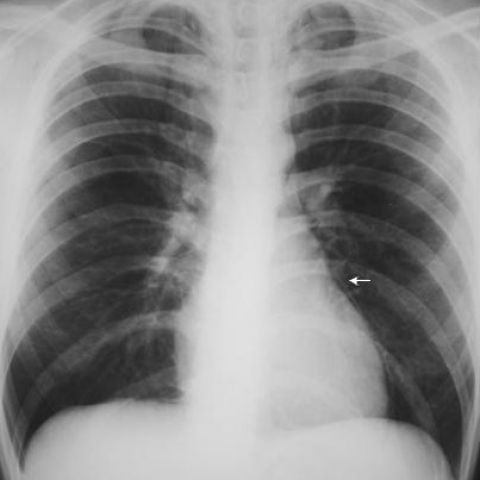
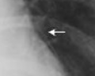
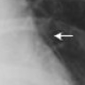

# Benchmark case 4491_8353801523228

[Case index](README.md) · [Machine-readable case](4491_8353801523228.json) · [Scored outcomes](../per-question-outcomes.json)

Source: [Eurorad case 4491](https://www.eurorad.org/case/4491); [ChestAgentBench pinned revision](https://huggingface.co/datasets/wanglab/chest-agent-bench/tree/921e60440927f9893228d843c0206b755744252a).

These are the benchmark inputs used in the frozen experiment. Model and tool observations below are recorded outputs, not independently validated clinical findings.

## Full question and options

```text
Based on the chest X-ray findings alone, what is the most likely explanation for the patient's symptoms and what should be the initial management approach?
A) The chest X-ray shows signs of pneumothorax, suggesting a pleural injury; initiate chest tube drainage.
B) The chest X-ray reveals pneumomediastinum and subcutaneous emphysema; manage conservatively with observation.
C) The chest X-ray indicates a large pleural effusion; recommend therapeutic thoracentesis.
D) The chest X-ray demonstrates consolidation in the lower lobes; initiate antibiotic therapy.
E) The chest X-ray shows no abnormal findings; discharge the patient without further intervention.
F) The chest X-ray reveals signs of cardiac tamponade; prepare for pericardiocentesis.
```

## Original benchmark images

### image:1 — figures/4491/figure_2.jpg



## Recorded answers

| Stage | Answer | Execution route/status |
|---|---|---|
| P0 | E | completed |
| V10 VKE candidate | B | candidate before gate |
| V10 VKE final | E | retain |
| S1 | E | selector |
| S2 | B | targeted_followup |
| S3 | E | selector |

Reference answer (post-generation scoring only): **B**.

## V10 VKE candidate and gate record

```json
{
  "candidate": "B",
  "final": "E",
  "changed_attributes": [
    "linear lucency along right heart border",
    "absence of pneumothorax signs"
  ],
  "candidate_payload": {
    "answer": "B",
    "uncertain": true,
    "changed_attributes": [
      "linear lucency along right heart border",
      "absence of pneumothorax signs"
    ],
    "evidence_refs": [
      "VKE:tool:1",
      "image:1",
      "p0:tool:2"
    ],
    "observations": [
      {
        "attribute": "thin radiolucent line paralleling right heart border",
        "image_ids": [
          "image:1"
        ],
        "value": "present (visible in crop VKE:tool:1)",
        "status": "observed_present",
        "evidence_refs": [
          "VKE:tool:1"
        ]
      },
      {
        "attribute": "visceral pleural line with absent peripheral lung markings",
        "image_ids": [
          "image:1"
        ],
        "value": "absent",
        "status": "observed_absent",
        "evidence_refs": [
          "VKE:tool:1",
          "p0:tool:2"
        ]
      }
    ],
    "missing_evidence": [
      "subcutaneous emphysema (not imaged)",
      "clinical correlation (symptoms, vitals)"
    ],
    "parse_warnings": [],
    "discarded_evidence_refs": []
  },
  "gate": {
    "decision": "retain",
    "changed_attributes": [
      "linear lucency along right heart border",
      "absence of pneumothorax signs"
    ],
    "evidence_refs": [
      "VKE:tool:1",
      "image:1",
      "p0:tool:2"
    ],
    "unmet_requirements": [
      "subcutaneous emphysema not visible in image",
      "no direct evidence of pneumomediastinum beyond linear lucency"
    ],
    "reason": "The thin radiolucent line paralleling the right heart border (visible in crop VKE:tool:1 and full image image:1) is consistent with mediastinal air, but the expert report (p0:tool:2) explicitly states 'no obvious pneumothorax' and 'no evidence of acute cardiopulmonary disease', and no subcutaneous emphysema is visible. Pneumomediastinum diagnosis requires more than a single linear lucency without corroborating signs; thus B is not sufficiently supported. Option E remains better supported by the official impression."
  },
  "fallback": null,
  "k_ids": [
    "RAD_PNEUMOTHORAX_IMAGING_2016_01",
    "BTS_PLEURAL_2023_K08"
  ],
  "e_ids": [
    "B10_2612ff9a3aef32d05a7a5d94258d88941127e57efa0a05735d5791c178f7b9e2",
    "B10_fb47f1d505253c3f0101444e516b9ed18fbf0b955a27233799d83353ce296a1c"
  ],
  "candidate_error_type": null,
  "gate_error_type": null
}
```

## Cached anonymous comparison

The X/Y mapping and observation provenance are exposed here for retrospective review. They were kept separate from the selector-facing anonymous input.

```json
{
  "answer_mapping": {
    "X": "B",
    "Y": "E"
  },
  "choices": {
    "X": "The chest X-ray reveals pneumomediastinum and subcutaneous emphysema; manage conservatively with observation.",
    "Y": "The chest X-ray shows no abnormal findings; discharge the patient without further intervention."
  },
  "evidence_mapping": {
    "observation_1": "p0:tool:2",
    "observation_2": "p0:tool:3",
    "observation_3": "p0:tool:5",
    "observation_4": "p0:tool:1",
    "observation_5": "p0:tool:4",
    "observation_6": "VKE:tool:1"
  },
  "cached_image_adjustments": []
}
```

### Additional cached pixels

**image_2**



```json
{
  "image_id": "image_2",
  "role": "existing_local_or_tool_image",
  "size": [
    120,
    96
  ],
  "parent_image_id": "image_1",
  "pixel_box": [
    288,
    240,
    408,
    336
  ],
  "source_size": [
    480,
    480
  ],
  "orientation": "unresolved",
  "timepoint": "unresolved"
}
```

### Cached tool observations

Tool request and return text is preserved; private filesystem paths are replaced by image links or an omission marker. Tool conclusions remain fallible.

#### observation_1 — chest_xray_report_generator

```json
{
  "observation_id": "observation_1",
  "tool": "chest_xray_report_generator",
  "request": {
    "image_path": "image_1"
  },
  "raw_result": [
    "CHEST X-RAY REPORT\n\nFINDINGS:\nthe study is limited by motion. however, the lung apices are not included on the film. within these limitations, no obvious pneumothorax is seen. the cardiomediastinal silhouette is within normal limits. no pleural effusions are seen. the visualized bony structures are unremarkable.\n\nIMPRESSION:\n1. no evidence of acute cardiopulmonary disease. 2. no evidence of rib fracture or pneumothorax.",
    {
      "image_path": "image_1",
      "analysis_status": "completed",
      "sections_generated": [
        "findings",
        "impression"
      ]
    }
  ],
  "image_ids": []
}
```

#### observation_2 — chest_xray_expert

```json
{
  "observation_id": "observation_2",
  "tool": "chest_xray_expert",
  "request": {
    "image_paths": [
      "image_1"
    ],
    "prompt": "What does the white arrow in this chest X-ray point to? Is there evidence of pneumomediastinum, subcutaneous emphysema, or other abnormal findings? Provide detailed analysis."
  },
  "raw_result": [
    {
      "response": "The white arrow in the image does not point to any specific finding; it is likely part of the image's background or related to the projection of the X-ray."
    },
    {
      "image_paths": [
        "image_1"
      ],
      "prompt": "What does the white arrow in this chest X-ray point to? Is there evidence of pneumomediastinum, subcutaneous emphysema, or other abnormal findings? Provide detailed analysis.",
      "max_new_tokens": 512,
      "analysis_status": "completed"
    }
  ],
  "image_ids": []
}
```

#### observation_3 — chest_xray_expert

```json
{
  "observation_id": "observation_3",
  "tool": "chest_xray_expert",
  "request": {
    "image_paths": [
      "image_1"
    ],
    "prompt": "Examine the area indicated by the white arrow in the right lung field near the cardiac border. What anatomical structure is this, and is there any pathological finding present?"
  },
  "raw_result": [
    {
      "response": "Lung"
    },
    {
      "image_paths": [
        "image_1"
      ],
      "prompt": "Examine the area indicated by the white arrow in the right lung field near the cardiac border. What anatomical structure is this, and is there any pathological finding present?",
      "max_new_tokens": 512,
      "analysis_status": "completed"
    }
  ],
  "image_ids": []
}
```

#### observation_4 — chest_xray_classifier

```json
{
  "observation_id": "observation_4",
  "tool": "chest_xray_classifier",
  "request": {
    "image_path": "image_1"
  },
  "raw_result": [
    {
      "Atelectasis": 0.14412684738636017,
      "Consolidation": 0.09793134778738022,
      "Infiltration": 0.45129886269569397,
      "Pneumothorax": 0.29564183950424194,
      "Edema": 0.0017868163995444775,
      "Emphysema": 0.5113133192062378,
      "Fibrosis": 0.5093380212783813,
      "Effusion": 0.18503642082214355,
      "Pneumonia": 0.00018643401563167572,
      "Pleural_Thickening": 0.2862350344657898,
      "Cardiomegaly": 0.10701142996549606,
      "Nodule": 0.5058456659317017,
      "Mass": 0.5639941692352295,
      "Hernia": 0.006414714735001326,
      "Lung Lesion": 0.05062831938266754,
      "Fracture": 0.20060105621814728,
      "Lung Opacity": 0.4621905982494354,
      "Enlarged Cardiomediastinum": 0.30096760392189026
    },
    {
      "image_path": "image_1",
      "analysis_status": "completed",
      "note": "Probabilities range from 0 to 1, with higher values indicating higher likelihood of the condition."
    }
  ],
  "image_ids": []
}
```

#### observation_5 — xray_phrase_grounding

```json
{
  "observation_id": "observation_5",
  "tool": "xray_phrase_grounding",
  "request": {
    "image_path": "image_1",
    "phrase": "Pneumomediastinum"
  },
  "raw_result": [
    {
      "predictions": [
        {
          "phrase": "Pneumomediastinum is an uncommon occurrence.",
          "bounding_boxes": {
            "model_coordinates": [
              [
                0.165,
                0.005,
                0.835,
                0.825
              ]
            ],
            "image_coordinates": [
              [
                0.16458333333333333,
                0.004166666666666667,
                0.8333333333333334,
                0.825
              ]
            ]
          }
        }
      ],
      "visualization_path": null
    },
    {
      "image_path": "image_1",
      "analysis_status": "completed",
      "phrase": "Pneumomediastinum",
      "n_boxes": 1,
      "clinical_evidence": "unknown",
      "step_credit": null
    }
  ],
  "image_ids": []
}
```

#### observation_6 — crop_current_image

```json
{
  "observation_id": "observation_6",
  "tool": "crop_current_image",
  "request": {
    "image_path": "image_1",
    "box": [
      0.6,
      0.5,
      0.85,
      0.7
    ]
  },
  "raw_result": {
    "image_id": "image_2",
    "path": "image_2",
    "role": "current_image_pixel_crop",
    "parent_image_id": "image_1",
    "parent_path": "image_1",
    "source_size": [
      480,
      480
    ],
    "crop_size": [
      120,
      96
    ],
    "normalized_box": [
      0.6,
      0.5,
      0.85,
      0.7
    ],
    "pixel_box": [
      288,
      240,
      408,
      336
    ],
    "coordinate_system": "stored_pixel_coordinates_no_anatomical_orientation_inferred",
    "orientation": "unresolved",
    "timepoint": "unresolved"
  },
  "image_ids": [
    "image_2"
  ]
}
```

## S2 targeted follow-up action and reader observation

```json
{
  "action_plan": {
    "action": "crop_original",
    "image_ids": [
      "image_1"
    ],
    "box": [
      0.6,
      0.5,
      0.8,
      0.7
    ],
    "reason": "The arrow in the existing local image points to a region near the right pulmonary artery/aortopulmonary window; a high-resolution crop of this area is needed to assess for linear lucency outlining mediastinal structures, which is the specific visual criterion for pneumomediastinum.",
    "parse_warnings": []
  },
  "action": {
    "action": "crop_original",
    "tool_attempts": 1,
    "repairs": [
      {
        "action": "bounded_original_pixel_crop_no_interpolation",
        "requested_box": [
          0.6,
          0.5,
          0.8,
          0.7
        ],
        "pixel_box": [
          288,
          240,
          384,
          336
        ],
        "size": [
          96,
          96
        ]
      }
    ],
    "warnings": [],
    "images": [
      {
        "image_id": "image_1",
        "role": "original",
        "size": [
          480,
          480
        ],
        "orientation": "unresolved",
        "timepoint": "unresolved",
        "path": "images/originals/figures/4491/figure_2.jpg"
      },
      {
        "image_id": "followup_image_1",
        "role": "one_targeted_original_pixel_crop",
        "size": [
          96,
          96
        ],
        "parent_image_id": "image_1",
        "pixel_box": [
          288,
          240,
          384,
          336
        ],
        "source_size": [
          480,
          480
        ],
        "orientation": "unresolved",
        "timepoint": "unresolved",
        "path": "images/followup/4491_8353801523228/followup_image_1.png"
      }
    ]
  },
  "observation": {
    "observation_id": "followup_observation_1",
    "observation": "A thin linear lucency is visible adjacent to the left mediastinal border, near the aortopulmonary window, indicated by the white arrow in both the original and cropped images; this is consistent with air outlining mediastinal structures and suggestive of pneumomediastinum.",
    "evidence_refs": [
      "image_1",
      "followup_image_1"
    ],
    "unresolved": [
      "orientation (e.g., PA vs AP) not confirmed",
      "timepoint not specified",
      "absence of clinical correlation or additional imaging prevents definitive diagnosis"
    ],
    "parse_warnings": [],
    "status": "independent_visual_report_requires_image_verification"
  }
}
```



## V11 selector and reader records

A recorded choice can coexist with an empty observation list. That record alone does not establish a supported visual comparison. See the [decision audit](../decision-audit.json) and [decision-pattern analysis](../decision-pattern-analysis.md) for this limitation.

```json
{
  "S1": {
    "stage": "S1",
    "initial": "E",
    "candidate": "B",
    "final": "E",
    "route": "selector",
    "selector": {
      "choice": "Y",
      "observations": [
        {
          "attribute": "pneumomediastinum",
          "direction": "conflict",
          "evidence_refs": [
            "observation_1",
            "observation_5"
          ],
          "value": "The formal chest X-ray report (observation_1) states no evidence of acute cardiopulmonary disease and specifically excludes pneumothorax; however, phrase grounding (observation_5) returns a generic statement about pneumomediastinum with a bounding box covering most of the image but no clinical evidence. No actual radiographic sign (e.g., air in mediastinum, continuous diaphragm sign, or tubular shadow) is identified in the images or expert analyses."
        },
        {
          "attribute": "subcutaneous emphysema",
          "direction": "supports_Y",
          "evidence_refs": [
            "observation_1",
            "observation_2",
            "observation_3"
          ],
          "value": "No mention of subcutaneous air (e.g., streaky lucencies in soft tissues) in the report or expert analyses; the white arrow is dismissed as non-pathological background (observation_2), and the area near cardiac border is identified only as lung (observation_3)."
        },
        {
          "attribute": "overall abnormality",
          "direction": "supports_Y",
          "evidence_refs": [
            "observation_1",
            "observation_4"
          ],
          "value": "The official report concludes 'no evidence of acute cardiopulmonary disease' and 'no pneumothorax'. While the classifier (observation_4) gives moderate probabilities for some findings (e.g., Emphysema 0.51, Mass 0.56), these are probabilistic outputs without visual confirmation and are outweighed by the explicit negative clinical impression from the structured report."
        },
        {
          "attribute": "white arrow significance",
          "direction": "supports_Y",
          "evidence_refs": [
            "observation_2",
            "observation_3"
          ],
          "value": "Both expert analyses conclude the arrow does not indicate pathology: one says it's likely background/projection artifact, the other identifies the region as normal lung."
        }
      ],
      "needs_followup": true,
      "followup_question": "Is there linear lucency outlining the mediastinal structures (e.g., aortopulmonary window or right pulmonary artery) suggesting pneumomediastinum?",
      "parse_warnings": []
    },
    "fallback": null,
    "timing": {
      "started_utc": "2026-10-30T15:40:08.750283+00:00",
      "ended_utc": "2026-10-30T15:40:21.706340+00:00",
      "elapsed_s": 12.956
    },
    "selector_error_type": null
  },
  "S2": {
    "stage": "S2",
    "initial": "E",
    "candidate": "B",
    "final": "B",
    "s1_final": "E",
    "route": "targeted_followup",
    "selector": {
      "choice": "X",
      "observations": [],
      "needs_followup": false,
      "followup_question": "",
      "parse_warnings": []
    },
    "fallback": null,
    "followup_question": "Is there linear lucency outlining the mediastinal structures (e.g., aortopulmonary window or right pulmonary artery) suggesting pneumomediastinum?",
    "action": "crop_original",
    "new_observation": {
      "observation_id": "followup_observation_1",
      "observation": "A thin linear lucency is visible adjacent to the left mediastinal border, near the aortopulmonary window, indicated by the white arrow in both the original and cropped images; this is consistent with air outlining mediastinal structures and suggestive of pneumomediastinum.",
      "evidence_refs": [
        "image_1",
        "followup_image_1"
      ],
      "unresolved": [
        "orientation (e.g., PA vs AP) not confirmed",
        "timepoint not specified",
        "absence of clinical correlation or additional imaging prevents definitive diagnosis"
      ],
      "parse_warnings": [],
      "status": "independent_visual_report_requires_image_verification"
    },
    "timing": {
      "started_utc": "2026-10-30T15:47:42.089242+00:00",
      "ended_utc": "2026-10-30T15:48:03.246156+00:00",
      "elapsed_s": 21.157
    },
    "selector_error_type": null
  },
  "S3": {
    "stage": "S3",
    "initial": "E",
    "candidate": "B",
    "final": "E",
    "route": "selector",
    "selector": {
      "choice": "Y",
      "observations": [
        {
          "attribute": "pneumomediastinum",
          "direction": "conflict",
          "evidence_refs": [
            "observation_1",
            "observation_2",
            "observation_3",
            "observation_5"
          ],
          "value": "The formal report (observation_1) states no evidence of acute cardiopulmonary disease; expert analyses (observations 2,3) find no pneumomediastinum or subcutaneous emphysema at the arrowed site; phrase grounding (observation_5) returns generic text with no clinical evidence. No visual feature in image_1 supports pneumomediastinum."
        },
        {
          "attribute": "subcutaneous emphysema",
          "direction": "conflict",
          "evidence_refs": [
            "observation_1",
            "image_1"
          ],
          "value": "No subcutaneous air lucency is visible in soft tissues on image_1; the report explicitly notes no abnormal findings."
        },
        {
          "attribute": "abnormal findings overall",
          "direction": "supports_Y",
          "evidence_refs": [
            "observation_1",
            "blind_observation_1"
          ],
          "value": "Both the structured report and independent blind observer describe normal lung fields, cardiac silhouette, mediastinum, diaphragm, and bony thorax—no acute pathology identified. The arrowed opacity is indeterminate but not diagnostic of pneumomediastinum or emphysema."
        },
        {
          "attribute": "clinical implication for management",
          "direction": "supports_Y",
          "evidence_refs": [
            "observation_1",
            "blind_observation_1"
          ],
          "value": "Given absence of radiographic pathology, discharge without intervention (Y) is better supported than conservative observation for pneumomediastinum (X), which lacks imaging support."
        }
      ],
      "needs_followup": true,
      "followup_question": "Is there linear lucency tracking along the mediastinal border or in the neck soft tissues that would indicate air in the mediastinum or subcutaneous tissues?",
      "parse_warnings": []
    },
    "fallback": null,
    "blind_observation": {
      "observation_id": "blind_observation_1",
      "observations": [
        {
          "attribute": "lung parenchyma",
          "value": "bilateral lung fields appear generally clear without overt consolidation, mass, or pleural effusion",
          "status": "observed_present",
          "evidence_refs": [
            "image_1"
          ]
        },
        {
          "attribute": "cardiac silhouette",
          "value": "cardiac size appears within normal limits; no obvious cardiomegaly",
          "status": "observed_present",
          "evidence_refs": [
            "image_1"
          ]
        },
        {
          "attribute": "mediastinum",
          "value": "midline trachea and mediastinal structures; no shift or widening evident",
          "status": "observed_present",
          "evidence_refs": [
            "image_1"
          ]
        },
        {
          "attribute": "arrowed finding",
          "value": "a small, focal opacity in the left mid-lung zone (approximately at the level of the 5th–6th rib), indicated by a white arrow",
          "status": "observed_present",
          "evidence_refs": [
            "image_1"
          ]
        },
        {
          "attribute": "diaphragm",
          "value": "diaphragmatic contours are smooth and well-defined bilaterally",
          "status": "observed_present",
          "evidence_refs": [
            "image_1"
          ]
        },
        {
          "attribute": "bony thorax",
          "value": "no obvious rib fractures or lytic lesions visible in this view",
          "status": "observed_present",
          "evidence_refs": [
            "image_1"
          ]
        }
      ],
      "uncertainties": [
        "Exact anatomical laterality (left/right) cannot be confirmed without orientation markers or clinical correlation",
        "The nature of the arrowed opacity (e.g., nodule, atelectasis, artifact, vascular marking) is indeterminate from this single 2D image",
        "No clinical history, symptoms, or additional imaging views (e.g., lateral, CT) are provided to contextualize findings",
        "Image quality and exposure settings limit assessment of subtle interstitial or perihilar abnormalities"
      ],
      "parse_warnings": [],
      "status": "independent_blind_visual_report_requires_image_verification"
    },
    "timing": {
      "started_utc": "2026-10-30T16:14:02.731812+00:00",
      "ended_utc": "2026-10-30T16:14:25.029526+00:00",
      "elapsed_s": 22.298
    },
    "selector_error_type": null
  }
}
```

[Data provenance and limits](../data-provenance.md)
