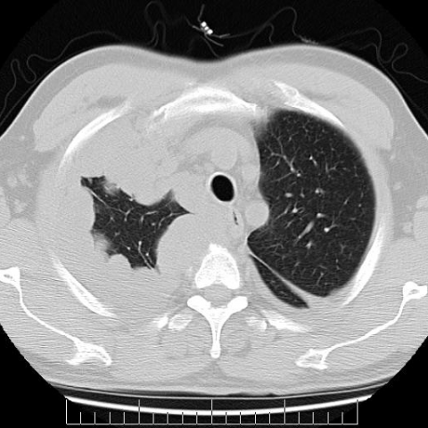
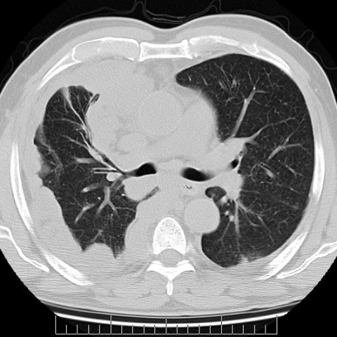
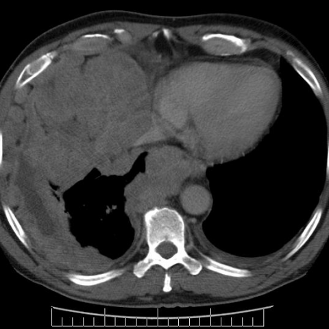

# Benchmark case 4734_8353801532720

[Case index](README.md) · [Machine-readable case](4734_8353801532720.json) · [Scored outcomes](../per-question-outcomes.json)

Source: [Eurorad case 4734](https://www.eurorad.org/case/4734); [ChestAgentBench pinned revision](https://huggingface.co/datasets/wanglab/chest-agent-bench/tree/921e60440927f9893228d843c0206b755744252a).

These are the benchmark inputs used in the frozen experiment. Model and tool observations below are recorded outputs, not independently validated clinical findings.

## Full question and options

```text
Based on the chest X-ray figures, which feature most strongly supports the diagnosis of malignant pleural mesothelioma in this patient?
A) Bilateral pleural effusion
B) Thick nodular pleural mass impinging on mediastinal structures
C) Bilateral lung volume reduction
D) Large central pulmonary mass
E) Diffuse interstitial lung disease
F) Osteolytic lesion of the sternum
```

## Original benchmark images

### image:1 — figures/4734/figure_1.jpg



### image:2 — figures/4734/figure_2.jpg



### image:3 — figures/4734/figure_3.jpg



## Recorded answers

| Stage | Answer | Execution route/status |
|---|---|---|
| P0 | B | completed |
| V10 VKE candidate | B | candidate before gate |
| V10 VKE final | B | no_change |
| S1 | B | inherited_agreement |
| S2 | B | inherited_s1 |
| S3 | B | inherited_agreement |

Reference answer (post-generation scoring only): **B**.

## V10 VKE candidate and gate record

```json
{
  "candidate": "B",
  "final": "B",
  "changed_attributes": [
    "morphology (thick nodular)",
    "spatial relationship (impinging on mediastinum)",
    "laterality (unilateral)"
  ],
  "candidate_payload": {
    "answer": "B",
    "uncertain": false,
    "changed_attributes": [
      "morphology (thick nodular)",
      "spatial relationship (impinging on mediastinum)",
      "laterality (unilateral)"
    ],
    "evidence_refs": [
      "image:1",
      "image:2",
      "image:3",
      "VKE:tool:1"
    ],
    "observations": [
      {
        "attribute": "thick nodular pleural mass",
        "image_ids": [
          "image:1"
        ],
        "value": "bulky, irregular soft-tissue encasing left lung with nodular contour",
        "status": "observed_present",
        "evidence_refs": [
          "image:1"
        ]
      },
      {
        "attribute": "impinging on mediastinal structures",
        "image_ids": [
          "image:1",
          "image:2"
        ],
        "value": "mediastinal shift rightward; heart and great vessels displaced away from left pleural mass",
        "status": "observed_present",
        "evidence_refs": [
          "image:1",
          "image:2"
        ]
      },
      {
        "attribute": "laterality",
        "image_ids": [
          "image:1",
          "image:2",
          "image:3"
        ],
        "value": "predominantly left-sided, asymmetric; right pleura unremarkable",
        "status": "observed_present",
        "evidence_refs": [
          "image:1",
          "image:2",
          "image:3"
        ]
      }
    ],
    "missing_evidence": [
      "pleural enhancement (no contrast CT)",
      "histopathology",
      "temporal progression"
    ],
    "parse_warnings": [],
    "discarded_evidence_refs": []
  },
  "gate": {
    "decision": "no_change"
  },
  "fallback": null,
  "k_ids": [
    "ACR_DLD_2026_K01",
    "RAD_PNEUMOTHORAX_IMAGING_2016_01"
  ],
  "e_ids": [
    "B10_6ba5978652d9c23d65a67d58486ec71934ad5c76f2ec74f583aba5ddf9fbb7d0",
    "B10_ea548f88a90ea1f91a3cf00f79aaee751326826a539c8a47915004e54f35fad9"
  ],
  "candidate_error_type": null,
  "gate_error_type": null
}
```

## Detailed comparison evidence

This case did not route to the 21-case anonymous disagreement selector. Its original input and recorded answers are included; no selector packet was generated.

## V11 selector and reader records

A recorded choice can coexist with an empty observation list. That record alone does not establish a supported visual comparison. See the [decision audit](../decision-audit.json) and [decision-pattern analysis](../decision-pattern-analysis.md) for this limitation.

```json
{
  "S1": {
    "stage": "S1",
    "initial": "B",
    "candidate": "B",
    "final": "B",
    "route": "inherited_agreement",
    "selector": null,
    "fallback": null,
    "timing": {
      "started_utc": "2026-10-30T15:40:21.713497+00:00",
      "ended_utc": "2026-10-30T15:40:21.713740+00:00",
      "elapsed_s": 0.0
    },
    "selector_error_type": null
  },
  "S2": {
    "stage": "S2",
    "initial": "B",
    "candidate": "B",
    "final": "B",
    "s1_final": "B",
    "route": "inherited_s1",
    "selector": null,
    "fallback": null,
    "timing": {
      "started_utc": "2026-10-30T15:48:03.253350+00:00",
      "ended_utc": "2026-10-30T15:48:03.253533+00:00",
      "elapsed_s": 0.0
    },
    "selector_error_type": null
  },
  "S3": {
    "stage": "S3",
    "initial": "B",
    "candidate": "B",
    "final": "B",
    "route": "inherited_agreement",
    "selector": null,
    "fallback": null,
    "timing": {
      "started_utc": "2026-10-30T16:14:25.037112+00:00",
      "ended_utc": "2026-10-30T16:14:25.037364+00:00",
      "elapsed_s": 0.0
    },
    "selector_error_type": null
  }
}
```

[Data provenance and limits](../data-provenance.md)
