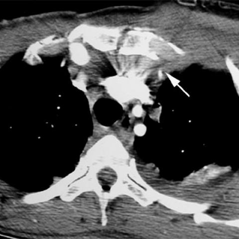
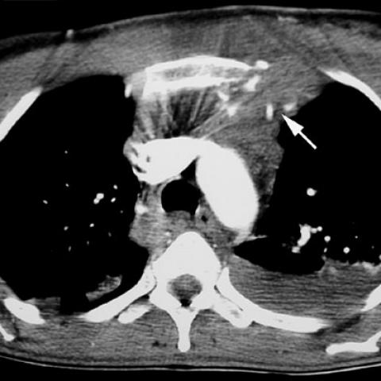

# Benchmark case 548_8353802023456

[Case index](README.md) · [Machine-readable case](548_8353802023456.json) · [Scored outcomes](../per-question-outcomes.json)

Source: [Eurorad case 548](https://www.eurorad.org/case/548); [ChestAgentBench pinned revision](https://huggingface.co/datasets/wanglab/chest-agent-bench/tree/921e60440927f9893228d843c0206b755744252a).

These are the benchmark inputs used in the frozen experiment. Model and tool observations below are recorded outputs, not independently validated clinical findings.

## Full question and options

```text
A 47-year-old female patient presented after a fall from a height of 20 meters, with a history suggestive of a suicide attempt. Based on the chest X-ray, which of the following findings would most likely necessitate further investigation to rule out major vascular injury?

A) Isolated sternal fracture without mediastinal widening
B) Sternal fracture with retrosternal hematoma but no mediastinal widening
C) Mediastinal widening with no visible sternal fracture
D) Mediastinal widening in the presence of a sternal fracture
E) Isolated left hemothorax without mediastinal changes
F) Anterior soft tissue swelling without sternal fracture or mediastinal widening
```

## Original benchmark images

### image:1 — figures/548/figure_1a.jpg



### image:2 — figures/548/figure_1b.jpg



## Recorded answers

| Stage | Answer | Execution route/status |
|---|---|---|
| P0 | D | completed |
| V10 VKE candidate | D | candidate before gate |
| V10 VKE final | D | no_change |
| S1 | D | inherited_agreement |
| S2 | D | inherited_s1 |
| S3 | D | inherited_agreement |

Reference answer (post-generation scoring only): **D**.

## V10 VKE candidate and gate record

```json
{
  "candidate": "D",
  "final": "D",
  "changed_attributes": [
    "mediastinal widening",
    "sternal fracture"
  ],
  "candidate_payload": {
    "answer": "D",
    "uncertain": true,
    "changed_attributes": [
      "mediastinal widening",
      "sternal fracture"
    ],
    "evidence_refs": [
      "VKE:tool:1",
      "image:1",
      "p0:tool:1"
    ],
    "observations": [
      {
        "attribute": "sternal fracture",
        "image_ids": [
          "image:1"
        ],
        "value": "not visible on axial CT slice; cannot assess on X-ray (no X-ray provided)",
        "status": "unresolved",
        "evidence_refs": [
          "VKE:tool:1"
        ]
      },
      {
        "attribute": "mediastinal widening",
        "image_ids": [
          "image:1"
        ],
        "value": "no clear widening on axial CT; AP width not measurable without chest X-ray",
        "status": "unresolved",
        "evidence_refs": [
          "VKE:tool:1"
        ]
      }
    ],
    "missing_evidence": [
      "frontal chest X-ray image",
      "sagittal sternal view",
      "CT angiography for vascular integrity"
    ],
    "parse_warnings": [],
    "discarded_evidence_refs": []
  },
  "gate": {
    "decision": "no_change"
  },
  "fallback": null,
  "k_ids": [
    "ACR_ARI_2024_K02"
  ],
  "e_ids": [
    "B10_27bb0b3b99d646dda3aeec7528cbbef4e7f5183f9cb9f32709211200c2319d66",
    "B10_8adad335ecf033d12c6ae181112162e2ed8214d373fd178d5515d07dd99b188d"
  ],
  "candidate_error_type": null,
  "gate_error_type": null
}
```

## Detailed comparison evidence

This case did not route to the 21-case anonymous disagreement selector. Its original input and recorded answers are included; no selector packet was generated.

## V11 selector and reader records

A recorded choice can coexist with an empty observation list. That record alone does not establish a supported visual comparison. See the [decision audit](../decision-audit.json) and [decision-pattern analysis](../decision-pattern-analysis.md) for this limitation.

```json
{
  "S1": {
    "stage": "S1",
    "initial": "D",
    "candidate": "D",
    "final": "D",
    "route": "inherited_agreement",
    "selector": null,
    "fallback": null,
    "timing": {
      "started_utc": "2026-10-30T15:40:44.872181+00:00",
      "ended_utc": "2026-10-30T15:40:44.872408+00:00",
      "elapsed_s": 0.0
    },
    "selector_error_type": null
  },
  "S2": {
    "stage": "S2",
    "initial": "D",
    "candidate": "D",
    "final": "D",
    "s1_final": "D",
    "route": "inherited_s1",
    "selector": null,
    "fallback": null,
    "timing": {
      "started_utc": "2026-10-30T15:48:25.004057+00:00",
      "ended_utc": "2026-10-30T15:48:25.004317+00:00",
      "elapsed_s": 0.0
    },
    "selector_error_type": null
  },
  "S3": {
    "stage": "S3",
    "initial": "D",
    "candidate": "D",
    "final": "D",
    "route": "inherited_agreement",
    "selector": null,
    "fallback": null,
    "timing": {
      "started_utc": "2026-10-30T16:15:24.952547+00:00",
      "ended_utc": "2026-10-30T16:15:24.952771+00:00",
      "elapsed_s": 0.0
    },
    "selector_error_type": null
  }
}
```

[Data provenance and limits](../data-provenance.md)
